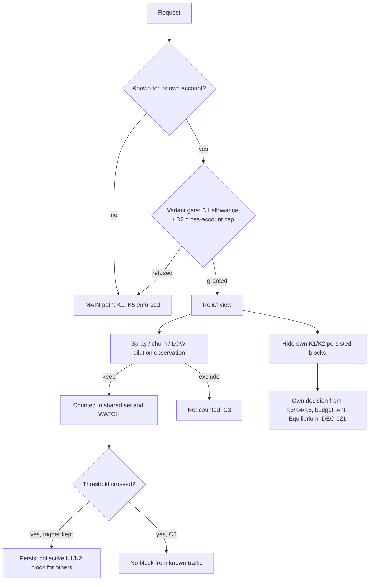

# Architecture — relief alternatives and the consumption / enforcement matrix

The question is not "make K1 or K2 advisory". It is which of three separate effects of a known request a design keeps:

1. **Consumption:** the request is counted in the shared spray / churn / dilution sets and their WATCH flags.
2. **Collective trigger:** when the count crosses the threshold, a block is persisted on K1 / K2 for **everybody** on that scope.
3. **Self-enforcement:** the request itself is denied by a persisted K1 / K2 block or by its own network candidate.

Relief means removing (3) for a known device. The alternatives differ in what they do with (1) and (2), and in extra conditions on (3).

## 1. Alternatives studied

| Variant | Relieved scopes for a known request | Consumption (1) | Collective trigger (2) | Extra relief condition | Brief § |
|---|---|---|---|---|---|
| `MAIN` | none (trusted session: K1 only, already shipped) | kept | kept | — | baseline |
| `A` | K2 (churn, LOW dilution) | kept | kept | — | §5 A |
| `B` | K1 (spray). This is the shipped trusted advisory, extended to previously-verified | kept | kept | — | §5 B |
| `C1` | K1 + K2 | kept | kept | — | §5 C (consume + trigger) |
| `C2` | K1 + K2 | kept | **not issued by known traffic** | — | §5 C (consume, no trigger) |
| `C3` | K1 + K2 | **excluded** | not issued by known traffic | — | §5 C (exclude: the pool question, HMCI B5) |
| `D1` | K1 + K2 | kept | kept | only while the account's DEC-021 known-device allowance is not spent (`count < 8` Login / `< 2` OTP, fixed 24 h epoch) | §5 D (account bound) |
| `D2` | K1 + K2 | kept | kept | D1 **and** at most R = 5 distinct relieved accounts per IP per fixed 600 s window | §5 D (+ cross-account bound) |

"Known request" = `accountId !== null` and (`isSessionTrusted` with a non-empty `sessionDeviceId`, or `isDevicePreviouslyVerifiedForAccount`).
This is the public contract's `isKnownForAccount` for the request's own account. No variant adds a public input.

Notes on the parameters:

* **D2's R = 5** reuses the existing K1 spray cap to illustrate a cross-account guard. It is **not** a proposed threshold. §3 shows why every
  value of R moves the office and the attacker together.
* **D1** uses only existing state: the `known_device_allowance` counter of DEC-021, read through the pipeline's own key derivation.
* K3 (IP + DeviceFP) and every account / device protection (K4, K5, DEC-021 allowance and thresholds, budget, Anti-Equilibrium, distributed
  account, flood, device caps) stay enforced in every variant.

## 2. Consumption / enforcement matrix (Login, IPv4)

| | K1 spray set | K1 block persisted by known traffic | K1 enforced on known | K2 churn / LOW-dilution sets | K2 block persisted by known traffic | K2 enforced on known | Unknown traffic |
|---|---|---|---|---|---|---|---|
| MAIN | yes | yes (trusted: as advisory) | untrusted: yes; trusted: no | yes | yes | yes | unchanged |
| A | yes | yes | untrusted: yes; trusted: no | yes | yes | **no** | unchanged |
| B | yes | yes | **no** | yes | yes | yes | unchanged |
| C1 | yes | yes | **no** | yes | yes | **no** | unchanged rules, same shared state as MAIN would build |
| C2 | yes | **no** | **no** | yes | **no** | **no** | sets filled by known traffic; only unknown requests trigger |
| C3 | **no** | no | **no** | **no** | no | **no** | sets hold unknown traffic only (more room) |
| D1 | as C1 while allowance unspent, else as MAIN | | | | | | |
| D2 | as D1 for the first R accounts / IP / 600 s, else as MAIN | | | | | | |

## 3. Why the matrix cannot separate the office from the attacker

The decision of every network rule is a function of the request tuple (IP prefix, UA major, DeviceFP, account / correlation subject,
trusted flag, verified flag, time) and of shared state built from earlier tuples. **Recorded outcomes never enter K1 / K2** (spray is
observed at pre-check; churn ignores the command type; `recordSuccess` lowers nothing). `CURRENT_STATE.md` §4–§5.

* `[MAIN]` M3: the trusted office `N12T` and the attacker `TMS` holding 12 valid trusted sessions send the same tuples. They receive identical
  decisions, request for request, in `pre+out`, `pre` and `out`.
* Any relief rule that is a function of those tuples and of the existing state therefore gives `TMS` exactly what it gives `N12T`. `[MODEL]` R2:
  in every variant where `N12T` is fully relieved (A, C1, C2, C3, D1), `TMS` reaches the verifier on **61/61** attempts (main 7/61).
* What differs between the two streams is the outcome history: 61 failures versus about 5 typos. The only state that sees it today is per
  account (K4, K5, the DEC-021 allowance). So once K1 / K2 are relieved, the attacker is bounded per account, not across accounts. The
  bound then scales with the number of accounts held (`[MODEL]` R6: KS1 5, KS2 10, KS5 25, 12 accounts 60, KS50 200 of 200 in one 600 s
  window).
* A cross-account guard on the relieved traffic (D2) restores some of the bound. It is a function of the same tuples, so it withdraws relief
  from the office by the same rule (`[MODEL]` R14: N12T denied 0 → 28/61; N100 LOW 100 % known: 0 → 80 locked out). The office and the
  attacker move together for every R. A model sweep over R would only redraw this line.

A design that separates them needs a signal the library does not receive. Examples: an outcome-qualified rule (studied as OQC #111 and
OAAA #116, both NO-GO for their own reasons), or a binding the library can verify between the proof and the account (not in the current
contract). Both are outside "no new public field".

## 4. How the variants are modelled (and what that does not prove)

The model is `lib/akdr.php`. It injects two decorators into the **unpatched** `EvaluationPipeline`:

* `AkdrRateStore::checkBlock()` returns `null` for the relieved request's own K1 / K2 keys. Everything else, including the Store's own cycle
  bookkeeping inside `blockWithCycleTracking()`, sees the real state.
* `AkdrCorrStore` recognizes the spray (600 s / cap 5), churn (600 s / cap 3) and LOW-dilution (600 s / cap 6, LOW request only) set classes
  as the #108 `K1Store` does:
  * **keep:** it performs the real add. It answers a below-trigger count when the real count crosses the cap. It lets the real WATCH
    increment happen at count = cap − 1, but answers `1`. In both cases it records the suppressed trigger.
  * **exclude:** it does not add, and answers `1`.
* When a variant keeps the trigger, the harness persists the block the pipeline would have persisted, after the step: K2 L2 60 s for churn /
  LOW dilution, K1 L2 `PenaltyLadder::getDuration(2)` for spray. It uses `blockWithCycleTracking()` and the pipeline's private cycle
  constants (reflection, asserted in provenance). This is the same re-persistence the shipped trusted K1 advisory does on every trusted
  request that meets the spray threshold (`EP:2221`, `EP:2232`).

Fidelity evidence (all PASS, `expected/summary.md` §1):

| Gate | What it shows |
|---|---|
| G-EQ | With relief off, the decorated lab gives the same denial / reach / attribution as the unchanged PR #108 `k1Replay` on `k1Lab('A')`, request for request: 174 stream × policy × flow cells, 0 differing requests |
| G-INERT | Streams, offices and bootstrap days with no known request give MAIN's exact decisions in every variant |
| G-SUPP | Across 85,181 relieved denials, none is attributed to a relieved scope only. The relief view is effective; relieved requests are denied only by K3 / K4 / K5 / score / budget sources |
| G-STREAM | Compliant streams bind each known device to its own account; the Host-violating controls (`TMX`, `TMXb`, `VMX`, `SPV`, `SP5`) do not |

Attribution caveat (inherited from PR #108, as #113 §3.1 noted): a denial's `src` label lists every unexpired block on the request's enforced scopes. On MAIN it can therefore name K1 for a trusted session, whose K1 is not enforced. For relieved requests the relieved scopes are excluded from that list, so G-SUPP is not affected. Decisions, reach and denial counts never depend on the labels.

What the model does **not** reproduce:

* A real candidate's code path. For example, a candidate might also skip the observation work, change attribution, or touch the IPv6
  macro scopes.
* Redis atomicity, concurrency, secret rotation (the decorators throw rather than guess), IPv6, mixed versions or DEC-015.
* The D2 counter is a harness array, not a store capability.

The model is sufficient for this study's NO-GO, because the deciding results are structural:

* R2 follows from M3 (identical tuples), independent of how relief is coded.
* R4 follows from pre-checks never scoring K4 / K5, independent of how relief is coded.
* R8 follows from the flag being unbound.

A candidate cannot change these without changing those facts.

## 5. Alternatives considered and not modelled

| Idea | Why not modelled |
|---|---|
| Relief keyed on K5 presence, a stable DeviceFP, HIGH confidence or a K5 score history | Forbidden by the brief and by `DEVICE_FINGERPRINT.md` §4.3 (K5 presence and HIGH are not proof) |
| Relief issued on a site visit or a client-sent id | Forbidden by the brief. HMCI (#118) measured the client-id mappings: NO-GO |
| Relief only for Hosts that record outcomes (`pre+out`) | The library cannot detect the Host's flow (OAAA #116 X3). It would need a new Host declaration, i.e. a public contract change |
| Relief only after a recorded success on this device today | A success is the attacker's own once he holds a valid credential (OAAA #116 E4, Y6b 2 → 36/36). On a login page the success comes after the pre-check that relief must decide |
| A sweep of D2's R | The office and the attacker move together for every R (§3). A sweep would add numbers without a decision |
