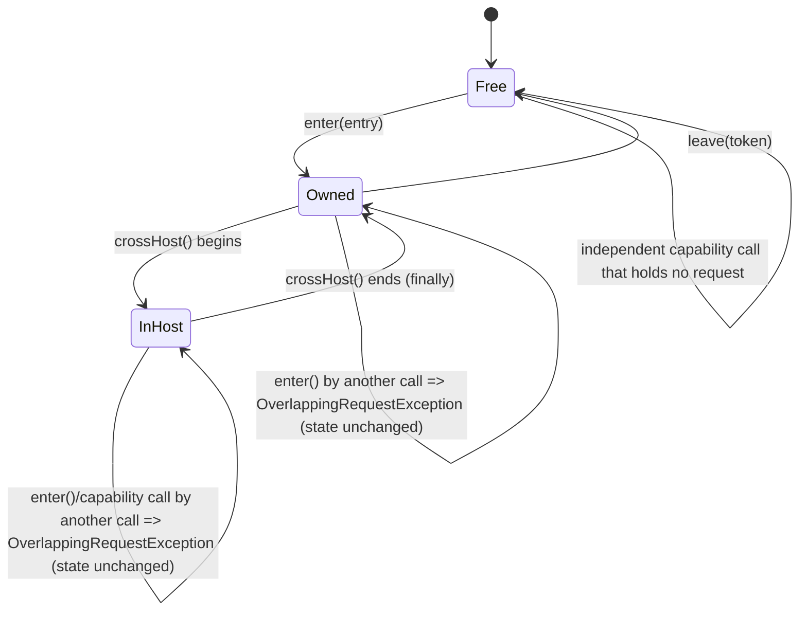
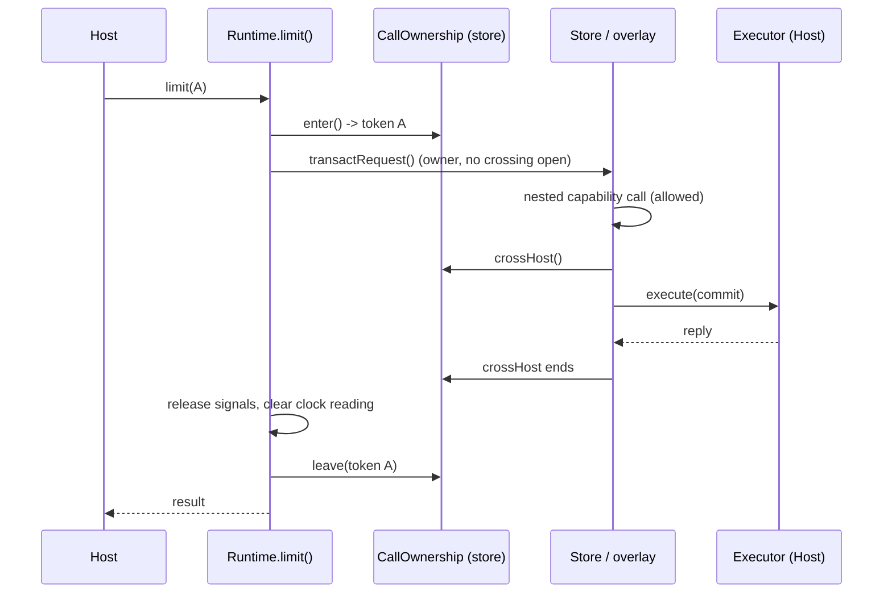
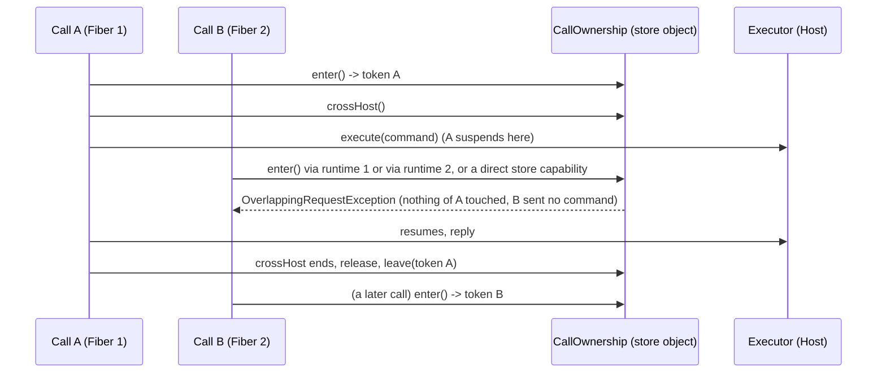
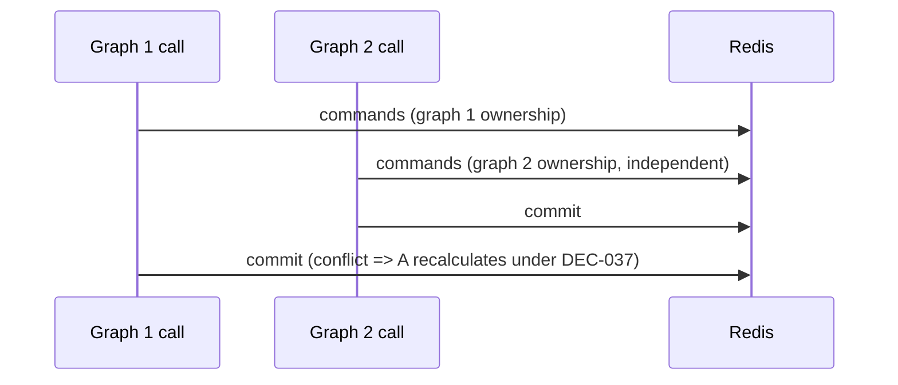

# #260 — Design proposal: exclusive request ownership and explicit refusal of an overlapping call

**Status of this document: a design proposal for review. Nothing here is implemented, and nothing here except the principle of DEC-041 is approved.**
It authorizes no change to `src/`, interfaces, DTOs, exceptions, Lua, tests, runners, Composer, workflows, the pin or defaults.

Markers used throughout:

- **[APPROVED]** the principle of [DEC-041](../../docs/decisions/DEC-041_EXCLUSIVE_REQUEST_OWNERSHIP_AND_EXPLICIT_OVERLAP_REFUSAL.md) (direction B, Owner, 2026-11-18). Nothing else is approved.
- **[PROPOSED]** a design detail recommended here, not decided.
- **[NEEDS APPROVAL]** a change of an interface, a contract text, a required or optional capability, an exception, or a Host requirement. Listed in section 11.
- **[OPEN]** a question the design does not settle.
- **[ESTIMATE]** a statement about cost or size that no design or measurement establishes.

Baseline: `main@316b1de99e784fec95b40f849d83a04dec772e2b` (tree `fe75547412fcb21b695644b21b86b387fc26bd31`). Accepted evidence: [PR #266](https://github.com/Maatify/php-rate-limiter/pull/266) at `515b09f02396ddf41a137d54eba147d5f3ed6ca5` (`RESULTS.md`, `FiberRequestOwnershipRedisTest`, 14 characterization tests on PHP_INT_SIZE 8 and 4). The merged repairs #258 (outcome claim as its own command) and #259 (fallback allowance charged once, from the chosen answer) are taken as given and are not touched.

## 1. What the design has to achieve

[APPROVED] B: a runtime graph and every store object it is built on serve one independent call at a time; an independent call that begins while another is in flight is refused explicitly, before it can alter, consume or observe any state of the call in flight, including when two runtimes share a store object; legitimate nesting inside a call stays; independent graphs stay supported; documentation alone is not enforcement.

Evidence the mechanism has to answer (all demonstrated in #266, none assumed): an independent call joins the open request of another call and is answered before it is saved (`transactRequest()` nested-call branch); the Host clock reading of the call in flight is used by a later call (`RequestScopedClock::$held`); a backend failure of one call is reported for the other (`requestBackendFailure`); a held recovery signal is released by another call before its save (`CircuitBreaker::$heldSignals`); two runtimes on one store object share the request but not the clock or signal buffer.

Not in scope: Redis conflicts between valid requests of separate graphs or processes (DEC-037, unchanged), the outcome claim (#258, DEC-036), the fallback allowance (#259), any change of values, time-outs, DTOs, defaults, the clock rules, the place where a claim or a probe is saved or where signals are sent.

## 2. Definitions [PROPOSED]

- **Public entry.** A method of the runtime graph that a Host calls: `limit()`, `consume()`, `claimPostPunishmentReentry()`, `revokeAccountBinding()`, `bindingEpoch()`, `openAdmissionFence()`, `rebindAdmissionSharedConfig()`, and the operational readers' `read*()` methods.
- **Independent call.** An invocation of a public entry, or of a store capability made directly by a Host or a low-level user, that begins while no operation of the same call chain is on the stack that started it. The library never calls its own public entries, so *every* public entry is an independent call.
- **Logical request (a call).** Everything one independent call does from the moment it begins until it has returned or thrown and has released what it held: every attempt of `transactRequest()` (conflict retries, the abandoned attempts), the recovery step and its sequential/emergency repetition, the pipeline, the admission scripts, the circuit breaker's report, the release of held signals, the final fallback charge, and the clearing of the clock reading.
- **Nested operation.** A call from the library code of a call in flight to a collaborator of the graph (pipeline, breaker, clock, store capability, a nested `transactRequest()`), made *between* crossings into Host code.
- **Host boundary crossing.** The library calling into code it does not own: the Redis executor (`RedisCommandExecutorInterface::execute()`), the failure signal emitter (`emit()`), the Host clock (`ClockInterface::now()`), the device identity resolver, and policy callbacks.
- **In flight / owner.** A call is in flight from entry to release; the single token it holds is the *owner*.

## 3. Recommended mechanism (one): single-flight call ownership, aware of Host boundary crossings [PROPOSED]

### 3.1 The invariant that removes the need for an execution-context identity

PHP runs one stack at a time. A call in flight can be displaced by another call only while it is **inside Host code**: a Fiber suspends from code running on its stack (the executor, the emitter, the clock, a Host callback), a cooperative scheduler switches at the Host's own await points, and a re-entrant call comes from a Host callback. Library-owned code never yields. Therefore:

> A call that reaches the graph or a store object **while the owner is inside a Host boundary crossing** cannot be a nested operation of the owner; it is independent. A call that reaches it **while no crossing is open** can only be the owner's own library code.

The mechanism is built on that invariant. It does **not** use `Fiber::getCurrent()`, a context key, or any information about which scheduler is running, so it does not claim to recognize every coroutine implementation (the question the brief raised) and it asks the Host for no execution-context identity. It does depend on the stated limit in 3.5.

### 3.2 Shapes (all internal unless marked) [PROPOSED]

```php
// Internal. One instance per store object (the shared object), see 3.3.
final class CallOwnership
{
    public function enter(string $entry): CallToken;          // throws OverlappingRequestException when an owner exists
    public function leave(CallToken $token): void;            // idempotent for a released token; never releases another owner
    /** @template T @param callable():T $hostCall */
    public function crossHost(callable $hostCall): mixed;     // marks "inside Host code" while $hostCall runs (only when an owner exists)
    public function assertNotIndependent(string $entry): void; // throws when an owner exists and a crossing is open
    public function hasOwner(): bool;
}
final class CallToken { /* opaque; one per call; carries `released` */ }

// [NEEDS APPROVAL] new optional capability, public, additive
interface CallOwnershipStoreInterface { public function callOwnership(): CallOwnership; }
```

`CallOwnership`/`CallToken` are internal classes (not part of the supported API). `CallOwnershipStoreInterface` is the only public addition, and it is optional.

### 3.3 Where the ownership lives, who creates it, how it reaches the runtime and the store

- **Held by the store object.** The store object is the only thing two runtimes can share, so the single owner slot lives on the store: `RedisFullCapabilityStore` creates its `CallOwnership` lazily and exposes it through `callOwnership()`. Two runtimes built on the same store object therefore contend for the same slot (this is the shared-store case, section 5.1).
- **Reached by the graph.** `RateLimiterBuilder::build()` asks the store for the capability and passes the same `CallOwnership` to the engine, the composite runtime (for `consume()` and the controls) and the operational readers. A store that lacks the capability gets a Builder-created `CallOwnership` for that graph alone (limit in 3.5 and open question O-2).
- **Created by.** The public entry creates the token (`enter()`); a store capability called directly by a Host while no owner exists creates it for the duration of that single capability call when the capability is a request (`transactRequest()`), and holds none otherwise (a single Lua command holds no in-memory request state).
- **Borrowed by.** Nothing borrows a token. Nesting is recognised by the invariant of 3.1 (no crossing open), so there is no token to pass through the 78 store methods and no scoped store view to build; this is the main reason the mechanism is small.
- **Ends.** At the outermost `finally` of the public entry (3.6), after everything the call held has been released.

### 3.4 Scope of the exclusivity

- **Enforced:** the runtime graph (engine, pipeline, circuit breaker, `RequestScopedClock`, simple runtime, readers) and every store object it is built on, across all runtimes that share that store object.
- **Not enforced, not affected:** Redis itself. Two graphs with their own store objects, clocks and signal buffers over one Redis are independent callers; their conflicts are DEC-037's. There is no cross-worker or per-namespace lock.
- **Not a Redis lease.** The owner is process memory; it cannot expire on a timer and nothing about it is stored in Redis.

### 3.5 Supported execution contexts, Host requirements and the stated limit

| Context | Supported by the mechanism | Requirement on the Host |
| --- | --- | --- |
| ordinary sequential use (PHP-FPM, CLI, one call at a time) | yes, unchanged | none |
| PHP Fibers (suspension inside the executor, emitter, clock) | yes: an overlapping call is refused | none; no Fiber identity is used |
| another cooperative scheduler (event-loop libraries, coroutine extensions) | yes **if** its switch points are inside the guarded crossings (executor, emitter, clock, resolver) | the Host must not yield from other callbacks it hands to the library (see O-5) |
| re-entrant calls from inside an executor or emitter callback on the same stack | yes: refused | none |
| a Host-supplied callback passed to a **direct** `transactRequest($evaluate)` that yields or re-enters inside the callback | **no** (stated limit, O-8): the callback is Host code, but nested capability calls made by that same callback are legitimate, so the mechanism cannot tell them from an independent call arriving while the callback is suspended | the callback must not yield; a Host that needs that pattern needs an execution-context identity (O-8) |
| preemptive threads sharing one graph | not applicable to PHP's single-threaded runtime; a Host using a threaded extension must use one graph per thread | stated, not enforced |
| independent graphs per context, or one process per worker | yes (the supported way to run concurrent contexts) | one graph and one connection per concurrent context |

**Stated limits:** (1) the guarantee holds only for suspensions and re-entries that happen inside a guarded crossing; (2) it does not cover a Host callback handed to a direct `transactRequest($evaluate)`: the runtime graph's own use of `transactRequest()` passes a library-owned closure and is covered, but `RequestAtomicStoreInterface` is a public interface and a low-level caller's `$evaluate` is Host code that may legitimately call store capabilities as nested operations, so a suspension inside it leaves no crossing open and an independent call is indistinguishable from nesting (this is exactly the shape of the store-level characterization test, which suspends inside the callback). A collaborator that yields from an unguarded callback (a custom policy method, for example) is outside it. This is declared, not left undefined: the unguarded callbacks are enumerated in O-5 and either get a crossing marker or are documented as unsupported.

### 3.6 Call lifecycle and the order of release [PROPOSED]

Acquire first, release last, so that no call can start while anything owned by the call in flight is still pending.

```text
entry(limit):
    token = ownership.enter('limit')          // refuse here, before ANY other effect
    try:
        clock.holding(                         // takes the clock reading (a crossing)
            evaluate()                         // all attempts, the recovery step, fallback charge
        )
    finally:
        // 1. release held signals (emission is a crossing; the owner is still set)
        // 2. clear the clock reading
        // 3. release ownership last
        ownership.leave(token)
```

- Release is by unwinding. `leave()` is idempotent for a released token (no double release) and refuses to release a token that is not the current owner (an internal integrity error, never releasing someone else's).
- The owner and its token are plain objects in the graph; nothing is stored in a static, so a long-lived worker does not accumulate owners (O-3 covers an owner leaked by a call that is never unwound).

## 4. Entry and resource matrix [PROPOSED]

Resources: **S** = store held request state (`requestState`, `requestBackendFailure`), **C** = `RequestScopedClock::$held`, **G** = `CircuitBreaker::$heldSignals`, **E** = engine flags (`$sequentialRecovery`, the final fallback charge), **A** = admission state, **F** = process-wide `LocalFallbackLimiter` counters.

| Entry / contract | Shared resources it touches | Owner context | Check point | The owner itself | An independent call | Cleanup |
| --- | --- | --- | --- | --- | --- | --- |
| `limit()` | S, C, G, E, A, F | token from `enter()` | first statement, before the clock | runs; nested operations are not checked | refused (`OverlappingRequestException`) before any clock reading, breaker or store touch | release order of 3.6 |
| `consume()` (simple runtime) | S (store increments route through an open request), C (shared clock object) | token | composite runtime entry | runs | refused | release order of 3.6 |
| `claimPostPunishmentReentry()` | S, C, G (reports), A | token | entry | runs | refused | 3.6 |
| `revokeAccountBinding()`, `bindingEpoch()`, `openAdmissionFence()`, `rebindAdmissionSharedConfig()` | S (admission store operations route through an open request), C | token | composite/engine entry | runs | refused | 3.6 |
| operational readers `read()`, `readScorePolicy()`, `readSimpleThrottle()` | S (peek and read paths route through an open request and add to its read set), C | token | reader entry | runs | refused in this proposal; the pass-through variant is O-1 | 3.6 |
| `RequestAtomicStoreInterface::transactRequest()` | S | token if none exists (direct caller) | method entry | nested call by the owner (no crossing open): allowed, joins the request as today | no owner: becomes the owner for the call; owner exists and a crossing is open: refused | released in `finally` when it was the one that entered; a Host callback that yields inside `$evaluate` is outside the guarantee (3.5, O-8) |
| store capabilities that send commands (`acquireProbeLease()`, `increment*`, `addDistinct*`, `block*`, `save*`, readers of state, …) | S when a request is open | none of its own | the store's two command choke points (`eval` and `command`), before the command is formed | nested use by the owner (no crossing open): allowed | owner exists and a crossing is open: refused before the command; no owner: unchanged (a single command holds no request state) | none |
| admission capabilities that join the overlay (`reserveAdmission`, `applyAdmissionOutcome`, epoch and config operations) | S, A | none of its own | the same choke point | allowed | refused while an owner is inside a crossing | none |
| `claimAdmissionPermitWithOutcome()` (and the permit claim) | A only: since #258 it is its own command and never held back | none | not guarded: it touches no in-memory request state | runs | **not refused** by design (DEC-036: an independent atomic command; its Lua is its own boundary) | none |
| `isHealthy()` (PING) | none (one stateless command) | none | not guarded | runs | not refused | none |
| `CircuitBreaker::holdSignals()/releaseSignals()`, `RequestScopedClock::holding()`, `RateLimiterEngine::evaluate()` and the other private collaborators | G, C, E | the owner | never reached by an independent call, because the public entry refused it first | run | unreachable | per 3.6 |
| `FailureSignalEmitterInterface::emit()`, `ClockInterface::now()`, `DeviceIdentityResolverInterface::resolve()`, the executor's `execute()` | Host code | the owner is inside a crossing | wrapped by `crossHost()` | n/a | a call that arrives from here (re-entrancy or another context) is refused | the crossing counter is decremented in `finally` |
| local-only getters and DTO accessors | none | none | not guarded | n/a | not refused (a lock on every getter would be a cost without a benefit) | none |

Classification of the pure-local surface: policy getters, DTOs, value objects and `FailureFallbackProfileEnum` hold no shared mutable state and stay unguarded.

## 5. The two cases the design must not leave open [PROPOSED]

### 5.1 Two runtimes on one store object

Two busy flags kept per runtime cannot protect the store, because B enters through another runtime. Here the owner slot is on the **store object**, and both runtimes enter it:

1. B calls `limit()` on runtime 2. Its first statement is `ownership.enter()`, on the same `CallOwnership` that A holds.
2. A holds the slot, so B is refused **at the entry**: B has not read its clock, has not touched its breaker, and has sent no command. Nothing of A (its clock reading, held state, failure flag, signals) is reachable by B.
3. A direct store capability call by B (not through a runtime) is refused at the store choke point as long as A is inside a crossing.
4. After A has released, B (and any later call on either runtime) runs normally; sequential use of one store by several runtimes is unchanged.

A store that does not implement the capability cannot be protected across graphs (3.5, O-2); that pattern is documented as unsupported and the limit is named rather than left undefined.

### 5.2 Nested calls inside one request

Nested operations are not refused because they are never "independent" under the invariant of 3.1: they arrive while **no crossing is open**.

- The engine's recovery step → pipeline → `transactRequest()` → capability commands: all library code between executor crossings; `assertNotIndependent()` sees no open crossing and allows them. The nested `transactRequest()` joins the owner's request exactly as today (one commit).
- A blanket "a request is open, refuse" is **not** the rule; it would reject the supported nesting. The rule is "an owner exists **and** a crossing is open".
- A call from inside the executor or emitter (a re-entrant Host callback, or another Fiber that runs while A is suspended there) arrives with a crossing open and is refused; it cannot join the request silently, whether or not it runs on the same Fiber.

## 6. Ownership over time, refusal, and failures [PROPOSED]

### 6.1 State diagram of one `CallOwnership`



### 6.2 Sequence diagrams

Successful sequential call, and a nested operation:



A suspended, B independent on the same runtime / on another runtime sharing the store / B direct on the store:



Two graphs with their own store objects over the same Redis (a valid path, DEC-037 unchanged):



### 6.3 Pseudocode of the choke points

```php
// Store: before forming any command (eval and command choke points) and at transactRequest().
private function assertNotIndependent(string $entry): void
{
    $this->ownership->assertNotIndependent($entry);   // owner exists and a crossing is open => refuse; otherwise return
}

// Store: around the Host executor.
private function command(array $command): mixed
{
    $this->assertNotIndependent('command');
    return $this->ownership->crossHost(fn() => $this->redis->execute($command));
}

// transactRequest(): an outermost direct caller becomes the owner; the owner's nested call joins; an independent call is refused.
public function transactRequest(callable $evaluate): mixed
{
    if ($this->requestState !== null) { $this->assertNotIndependent('transactRequest'); return $evaluate(); }
    $token = $this->ownership->hasOwner() ? null : $this->ownership->enter('transactRequest');
    try { /* the existing attempt loop, unchanged, rethrowing OverlappingRequestException unchanged */ }
    finally { if ($token !== null) { $this->ownership->leave($token); } }
}
```

### 6.4 Lifetime across retries, failures and cancellation

| Situation | Behaviour of the ownership |
| --- | --- |
| Redis conflict and the attempts of `transactRequest()` | one owner for the whole call; an abandoned attempt never releases ownership and never releases another call's (there is none: the other call was refused). Its in-memory request state is reset as today |
| save that fails before it is applied; the sequential/emergency recovery repeat | the repeat happens inside the same call; the token is unchanged |
| save applied and the reply lost (DEC-037: unknown outcome) | unchanged semantics; the owner is released when the call unwinds; nothing is reinterpreted as "not saved" |
| classified error, `RateLimitConcurrencyException`, `BackendFailureException` | the exception unwinds through the entry's `finally`: signals are released (dropped or emitted exactly as today), the clock reading cleared, ownership released |
| exception from an executor, emitter or clock callback | the crossing counter is decremented in `finally`; the entry's `finally` still runs; the original exception propagates |
| emitter that re-enters the library | the owner is still held and a crossing is open: the re-entrant call is refused; the signal emission itself completes |
| Fiber destroyed while the owner is suspended | PHP unwinds the Fiber's stack and runs `finally` blocks: the owner is released **when the Fiber object is destroyed**, which depends on the Host dropping the last reference. Not deterministic by itself (O-3) |
| Fiber never resumed and never destroyed | the owner is **not** released; every later call on the graph and on any graph sharing its store is refused until it is. This is the cost of an explicit refusal and is stated as a Host responsibility (O-3) |
| process exit or fatal error | the memory is gone with the process; nothing to release |
| long-lived worker | no static or global holds an owner; an owner exists only while a call is in flight |

No rollback is proposed for the outcome claim to hide a late check: the check is at the public entry, before any claim or other irreversible write, and the claim boundary of #258 / DEC-036 is untouched.

## 7. Refusal contract and what it must not be confused with [PROPOSED, NEEDS APPROVAL]

Proposed shape: a thrown exception, `Maatify\RateLimiter\Exception\OverlappingRequestException extends RateLimiterException`, with a message naming the refused entry and that another call is in flight. It carries no `RateLimitResultDTO`.

- **Why an exception, not a result.** A result would turn an integration error into a decision (an allow, a block or a fallback), which B forbids. It is raised to the Host at the entry, outside the engine's failure-mode machinery.
- **Not `BackendFailureException`.** An overlap is not a Redis outage: it is not caught by the engine's backend-failure handling, does not report to the circuit breaker, does not open a fallback and does not consume any fallback allowance (so it cannot move the circuit or the #259 counters).
- **Not `RateLimitConcurrencyException`.** That one means a Redis conflict persisted until the retry bound; it is answered by the engine's concurrency block. The new exception is a distinct class, is never retried by the library and is never converted into the concurrency block. `RedisFullCapabilityStore::transactRequest()` must rethrow it unchanged and must not treat it as a retryable error over stale state (its `catch (\Throwable)` classification must exclude it).
- **Not a policy refusal or a fallback denial.** The refused call never becomes `ALLOW`, never writes an allowance or a block, and never erases the allowance or the effects of the call in flight.
- **Host-visible.** The Host sees a `RateLimiterException` subclass it can catch; retrying is the Host's choice and is safe only after the call in flight has finished. The library offers no automatic retry and no wait.

## 8. Compatibility, before and after [PROPOSED; every change below is a proposal]

| Surface | Before (baseline) | After (proposed) | Source of compatibility / where it can break |
| --- | --- | --- | --- |
| `RateLimiterBuilder::fromFullCapabilityStore()` / `build()` | wires the graph; no ownership | same signatures; internally obtains `CallOwnership` from the store or creates one | default path needs no new wiring or Host change |
| `RedisFullCapabilityStore` | constructor, 78 public capability methods | constructor unchanged; additive `callOwnership()` implementing the new optional interface | additive; overlapping direct use now refused (was silently joined) |
| `RequestAtomicStoreInterface::transactRequest()` | signature unchanged; guarantee: runs inside an open request of the store itself | signature unchanged; **the last guarantee's wording changes** to: made by the evaluating call itself; an arrival while the owner is inside a Host crossing is refused | [NEEDS APPROVAL] contract text; Host stores implementing the interface keep working but get no refusal unless they adopt the capability |
| new `CallOwnershipStoreInterface` | none | optional capability | a Host store without it: single-graph protection only (O-2) |
| `CompositeRateLimiterRuntime`, `RateLimiterEngine`, operational readers | constructors without ownership | an additional optional constructor parameter or an internal setter [OPEN: shape] | source-compatible if optional; direct constructors keep working unprotected |
| `RequestScopedClock`, `CircuitBreaker` | public API as today | no public API change; the crossing marker is internal | none |
| new exception | none | `OverlappingRequestException extends RateLimiterException` | [NEEDS APPROVAL]; Hosts catching `RateLimiterException` already handle it |
| shared store, sequential use by several runtimes | works | works | unchanged |
| shared store, overlapping use | silent loss and cross-call effects | refused explicitly | **behaviour change only for a pattern that was already incorrect** |
| low-level direct capability use | joins any open request | refused when it arrives while the owner is inside a crossing | direct overlapping users must hold one store object per context |
| PHP32 / PHP64 | no integer-width involvement | none: the mechanism uses counters and object identity only | none |
| connection lifecycle | owned by the Host | unchanged: the mechanism neither opens, closes nor multiplexes connections; one connection per concurrent context stays the Host's obligation | none |
| tests that start a second runtime from inside an executor hook | those read for this design (`RequestAtomicityBoundaries…`, the #258 and #259 suites) build the second runtime on its **own** store object | still valid | not scanned exhaustively: the implementation unit must scan the whole suite, because a test that reused one store object from inside a hook would now be refused |

Nothing here promises a compatibility the design has not established; each [NEEDS APPROVAL] entry above shows its effect for review.

## 9. Verification plan for a later implementation unit (not executed, not authorized)

Intended behaviour for each of the 14 characterization tests of `FiberRequestOwnershipRedisTest`, and what the later unit would add. Exact `DUMP` and `PEXPIRETIME` from outside Lua are used wherever no change is claimed; every test runs on actual PHP_INT_SIZE 8 and 4 in Docker with an isolated Redis.

| # | Present test (name) | Intended behaviour under DEC-041 + this mechanism | Conversion / new control |
| --- | --- | --- | --- |
| 1 | `testAStoreCallMadeWhileAnotherRequestIsOpen…` | **As written (A suspends inside the Host callback of a direct `transactRequest()`) the mechanism does not refuse B** (stated limit, O-8): the test stays as the characterization of that unsupported pattern. The conversion adds a variant in which A is suspended inside an executor crossing (a held command of its own request): B's `acquireProbeLease()` is then refused with `OverlappingRequestException`, Redis is unchanged before and after A's rejection, and the same call succeeds after A has ended | keep the present test with its documented limit; add the executor-crossing variant |
| 2 | `testSequentialCallsAreSavedBeforeEachReturns…` | unchanged control | keep |
| 3 | `testANestedRequestInsideOneRequest…` | unchanged: one commit, one clock reading, **no** `OverlappingRequestException` | keep; add the engine recovery nesting case |
| 4 | `testACompletedIndependentCallIsNotSaved…` | B refused at the entry; no key of B; A completes and the stored set equals "A alone" (sequential control) | rewrite |
| 5 | `testTheFailureOfACompletedIndependentCall…` | B refused (the Host sees the refusal, never an `ALLOW`); A rejected; Redis unchanged; B's failure was never claimed as recorded | rewrite |
| 6 | `testTwoCallsSuspendedInsideOneRequest…` (2 resume orders) | whichever call starts second is refused, in both orders; the first stores exactly its own effects | rewrite |
| 7 | `testTheSampleOfTheHostClock…` | B refused; A's reading unchanged; a call after A ends uses the Host clock's new value | rewrite |
| 8 | `testABackendFailureOfOneCall…` | B refused before it sends any command, so no failure exists to cross; A completes with its own answer (not `FAIL_CLOSED`); assert zero commands from B and no circuit write | rewrite |
| 9 | `testTwoRuntimesSharingOneStoreObject…Loss…` | B on runtime 2 refused at its entry; A unaffected | rewrite |
| 10 | `testTheHostClockOfTheOtherRuntime…` | B refused while A is in flight; after A ends B's effects carry B's own clock reading | rewrite |
| 11 | `testRuntimesWithTheirOwnStoreAndClock…` | unchanged control: separate graphs over one Redis are independent | keep |
| 12 | `testARecoveryTransitionIsAnnounced…` (2 endings) | B refused; **no** `CB_RECOVERED` until A has saved, and none when A is rejected; the circuit is unchanged | rewrite |

Additional controls and detectors the later unit would need: a mutant without the entry guard (the 14-test matrix fails); a mutant that refuses on `requestState !== null` alone (the nesting test fails); a mutant that releases ownership before the signals are emitted (a call starting during emission is wrongly allowed); a re-entrant call from inside an executor hook and from inside an emitter callback on the same stack (refused); a direct store call from another Fiber (refused); an `OverlappingRequestException` is not a `BackendFailureException` (no circuit report) and is rethrown by `transactRequest()` without retry; a destroyed suspended Fiber releases the owner and a later call succeeds; double release and a foreign-token release; sequences of many calls leave no owner behind; traces of commands, clock readings and signals per call; regression suites of #258 (`AdmissionOutcomeDuringRecovery…`, `RequestAtomicityBoundaries…`) and #259 (`LocalFallbackRecoveryAccounting…`) and the retry/lost-reply contracts of DEC-037. The existing characterization tests, logs and preservation controls of #266 stay as the historical before-state.

## 10. Documentation to update in the implementation unit (a map, not done now)

`docs/FAILURE_SEMANTICS.md` (the refusal is not a failure mode), `docs/guides/USAGE_GUIDE.md` (one call at a time per graph and store object; one graph per concurrent context; sequential sharing allowed), `RATE_LIMITER_PACKAGE_REFERENCE.md` (new exception and optional capability), the `RequestAtomicStoreInterface` docblock and DEC-037 item 7 wording (the nested-call guarantee; needs approval first), `README.md` (hosting patterns), `CHANGELOG.md`, and `DECISIONS_INDEX.md` (status of DEC-041 when the implementation lands). None of them may say that exclusivity works before it does.

## 11. What needs a further decision, and open questions

**[NEEDS APPROVAL]** before any implementation: the mechanism of section 3; the new optional public capability `CallOwnershipStoreInterface`; the new exception class; the changed wording of the `RequestAtomicStoreInterface` nested-call guarantee (and the matching DEC-037 item 7 sentence); constructor shapes of the runtime, the engine and the readers; the supported-scheduler contract of 3.5, including its limit for a Host callback handed to a direct `transactRequest()`.

**[OPEN]**

- **O-1. Operational readers.** Refuse an overlapping reader (recommended, consistent, simplest) or give pure peeks a pass-through read path that never joins a request (keeps monitoring available under load, changes the readers' semantics). Needs a decision.
- **O-2. Stores without the capability.** The proposal: the Builder creates a per-graph `CallOwnership` (protects the one graph) and documents that sharing such a store between graphs is unsupported and unenforced. Alternative: the Builder refuses to build a second graph over a store object it cannot protect. Needs a decision.
- **O-3. A suspended call that is never unwound.** The graph stays refused until the Host destroys the Fiber. A time-based release is rejected here (it would reintroduce silent overlap); any remedy (a documented Host duty, or an explicit abandon call) is a new API and is not proposed.
- **O-4. Exception name, namespace and whether the refusal also needs a result-level metadata cause for Hosts that only handle results.**
- **O-5. The unguarded Host callbacks** (custom policy methods, `BlockPolicyInterface`, `PostPunishmentReentryPolicyInterface` and similar): wrap them in crossings or declare that they must not yield or re-enter.
- **O-6. `consume()` and the simple runtime.** Recommended to enter the same ownership because the simple runtime shares the store and the clock object; the investigation did not measure `consume()` under overlap, so this is a design choice from the code path, not a demonstrated failure.
- **O-8. A Host callback that yields inside a direct `transactRequest($evaluate)`.** Out of the guarantee as designed. Candidates, none chosen: document it as unsupported (recommended, nothing to build), or give low-level users an optional execution-context provider (`Fiber::getCurrent()` for Fibers, a Host-supplied key for other schedulers) used only on that path, or hand the callback a request handle that nested calls must present (changes the `callable` contract). Needs a decision because the first option leaves the store-level case of the characterization (test 1 as written) as an unsupported pattern rather than a refused one.
- **O-7. `LocalFallbackLimiter` counters** are process-wide statics shared by all graphs in one process. They are untouched by this design; a refused call never charges them. Whether overlapping graphs in one process should share them is outside this unit.

**[ESTIMATE]** The mechanism touches one new internal class pair, one optional public interface, the store's two command choke points and `transactRequest()`, the public entries of the runtime graph, and the crossing markers at four Host callouts; the per-call cost is a few object operations and a counter per crossing. These are estimates: no prototype exists and nothing was measured. The risk that matters more than cost is O-3.

## 12. Traceability

The evidence is `RESULTS.md` and `FiberRequestOwnershipRedisTest` (13 → 14 tests) at the accepted head; the repairs relied on are #258 (`AdmissionOutcomeDuringRecoveryRedisTest`) and #259 (`LocalFallbackRecoveryAccountingRedisTest`); the principle is DEC-041; the entry points listed in section 4 were read from `CompositeRateLimiterRuntime`, `RateLimiterEngine`, the operational reader interfaces and the 78 public methods of `RedisFullCapabilityStore`. No scenario in this design is claimed as demonstrated beyond what #266 demonstrated: `consume()`, the readers, the controls and the direct admission entries are design classifications from the code, not measured results.
