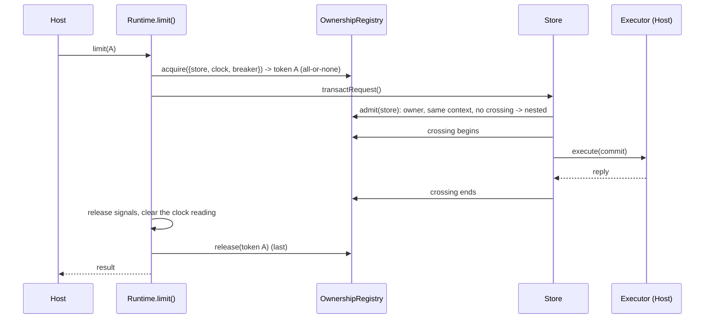
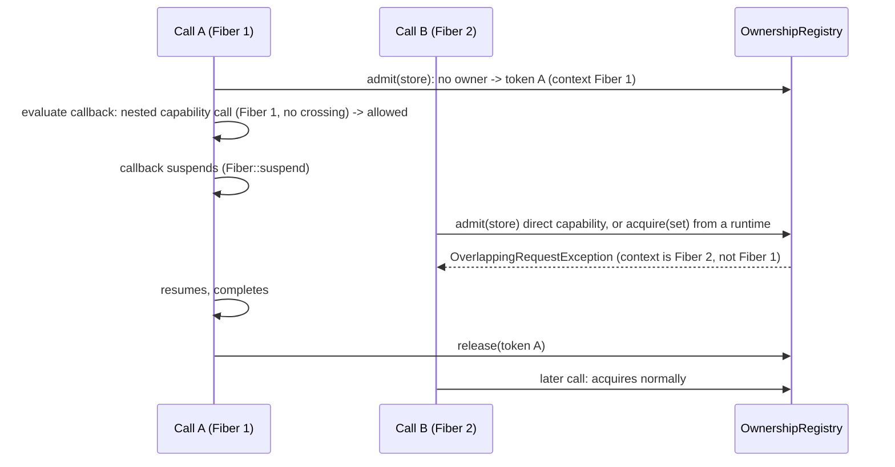
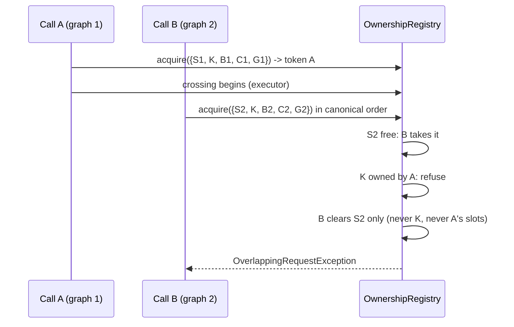
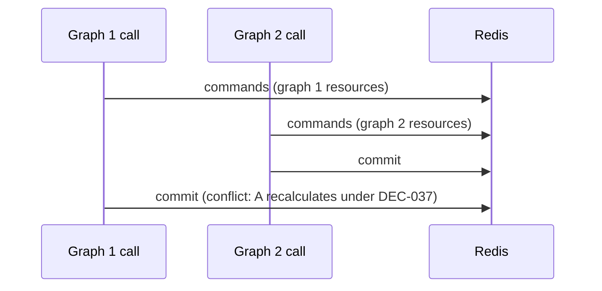
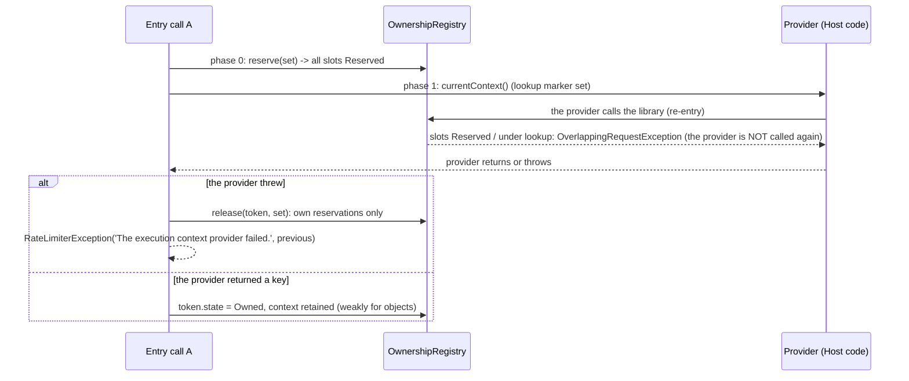

# #260 — Design proposal: exclusive request ownership and explicit refusal of an overlapping call (revision 3)

**Status of this document: a design proposal for review. Nothing here is implemented, and nothing here except the principle of DEC-041 is approved.**
It authorizes no change to `src/`, interfaces, DTOs, exceptions, Lua, tests, runners, Composer, workflows, the pin or defaults. No prototype was built, nothing was executed to produce this revision, and every statement about cost is an estimate.

Markers: **[APPROVED]** the principle of [DEC-041](../../docs/decisions/DEC-041_EXCLUSIVE_REQUEST_OWNERSHIP_AND_EXPLICIT_OVERLAP_REFUSAL.md) (direction B, Owner, 2026-11-18), and nothing else. **[PROPOSED]** a design detail recommended here. **[APPROVAL M#]** a material item that needs its own approval, listed in section 11. **[OPEN]** a question left to a decision. **[ESTIMATE]** an unmeasured size or cost statement.

Baseline: `main@316b1de99e784fec95b40f849d83a04dec772e2b` (tree `fe75547412fcb21b695644b21b86b387fc26bd31`). Accepted evidence: [PR #266](https://github.com/Maatify/php-rate-limiter/pull/266) at `515b09f02396ddf41a137d54eba147d5f3ed6ca5` (`RESULTS.md`, `FiberRequestOwnershipRedisTest`, 14 characterization tests on PHP_INT_SIZE 8 and 4). #258 (outcome claim as its own command) and #259 (fallback allowance charged once from the chosen answer) are taken as given.

## 0. What changed and which review finding each change closes (revision 1 = `e209253a`, revision 2 = `1c1329db`, revision 3 = this file)

| Review finding | Revision 1 | Revision 2 |
| --- | --- | --- |
| F266-05: crossing depth alone cannot tell a legitimate nested call from an independent call when a direct `transactRequest($evaluate)` callback suspends | O-8 left that case unrefused and replaced test 1 with an easier variant | The owner carries an **execution-context identity** (default: the current Fiber, optional Host provider). A call is nested only if it comes from **the owner's context and no Host crossing is open**; crossing markers are a supplementary guard, not the proof. Case 1 stays a required **refused** case; the callback contract is enumerated (3.7) |
| F266-06: checks keyed on `requestState`, direct capabilities and claims exempt, owner without a transaction unguarded | `requestState !== null` as the independence test; claims and PING exempt | Admission is decided from the **owner state of the resource**, never from `requestState`; **every backend operation is admitted** (a direct capability, claim or PING included) with a complete call lifetime; only pure local getters are exempt, with a reason (sections 3.5, 4) |
| F266-07: one unspecified store slot; the Builder accepts separate rate-limit, correlation and circuit stores | "the store" had the owner slot; stores without the capability were documented as unprotected | Ownership is per **resource object**; an entry acquires the deduplicated set of every store, clock and breaker object its graph uses, all-or-none and in canonical order, **before the first Host call or write**; partially shared graphs contend on the shared object. One primary behaviour for stores without cooperation: **every graph entry protects them** (3.2, 5) |
| F266-09 (revision 3): the provider is not bound to graphs, direct calls or shared resources; it runs before any reservation; its keys have no stability or retention contract; and the reader inventory named a clock the Builder does not create | revision 2 left `provider.current()` inside `acquire()` with no association rule | Each resource is bound to **one context domain** (a provider instance or the default Fiber domain) at construction time and the binding is immutable and checked, with a fail-fast on any mismatch (3.4); identity lookup runs **after a provider-free reservation** and under a lookup marker, with a restricted provider contract and a classified failure (3.3, 3.4); the identity contract fixes stability, equality, reuse and retention, and a token holds no strong reference to its resources or to an object context (3.3, 3.4); the reader inventory is corrected (4, 5.1) |
| F266-08: a public Host interface returning the concrete `CallOwnership` | `CallOwnershipStoreInterface` | **Removed.** The coordinator is package-owned and keyed by object identity, so no Host store has to implement or construct anything. The only public additions are an exception class and an **optional** context-provider interface (3.6, 8) |

## 1. What the design has to achieve

[APPROVED] B: a runtime graph and every store object it is built on serve one independent call at a time; an independent call that begins while another is in flight is refused explicitly, before it can alter, consume or observe any state of the call in flight, including when two runtimes share a store object; legitimate nesting stays; independent graphs stay supported; documentation alone is not enforcement.

Evidence the mechanism has to answer (demonstrated in #266): an independent call joins the open request of another and is answered before it is saved; the Host clock reading of the call in flight is used by a later call; a backend failure of one call is reported for the other; a held recovery signal is released by another call before its save; two runtimes on one store object share the request but not the clock or signal buffer; a Host callback suspended inside a direct `transactRequest()` lets an independent store call join silently.

Out of scope: Redis conflicts between valid requests of separate graphs or processes (DEC-037, unchanged), the outcome claim (#258/DEC-036), the fallback allowance (#259), any change of values, time-outs, DTOs, defaults, the clock rules, and the place where a claim or a probe is saved or signals are sent.

## 2. Definitions [PROPOSED]

- **Resource.** An object that holds in-process state belonging to one request, or through which such state is reached. Concretely, per graph: the rate-limit store, the correlation store, the circuit-breaker store (and the admission store, which is the rate-limit store), the `RequestScopedClock` (its `held` reading), the `CircuitBreaker` (its `heldSignals`), and the engine (its `sequentialRecovery` flag and the final fallback charge). Resources are identified by object identity.
- **Resource set of an entry.** The deduplicated set of the resources an entry's call may touch (section 5.1 inventories it per composition path).
- **Public entry.** A method a Host calls on the graph: `limit()`, `consume()`, `claimPostPunishmentReentry()`, `revokeAccountBinding()`, `bindingEpoch()`, `openAdmissionFence()`, `rebindAdmissionSharedConfig()`, and the operational readers' `read*()`. The library never calls its own public entries, so a public entry is **always** an independent call. The guard sits on the class that **owns the resources** (`RateLimiterEngine`, `FixedWindowSimpleRateLimiter`, the readers); a delegating wrapper such as `CompositeRateLimiterRuntime` forwards to that entry and does not acquire, so one call is never acquired twice and cannot refuse itself.
- **Direct capability call.** A call by a Host or low-level user to a method of a store object (`transactRequest()`, `acquireProbeLease()`, `increment*`, claims, `isHealthy()`, …) outside a public entry.
- **Logical request (a call).** Everything one independent call does from acquisition to release: every attempt of `transactRequest()`, the abandoned attempts, the recovery step and its sequential repetition, the pipeline, the admission scripts, the breaker's report, the release of held signals, the final fallback charge and the clearing of the clock reading.
- **Execution context.** The identity of the stack of control that is running: a Fiber, a coroutine, or the main stack.
- **Host crossing.** The library calling code it does not own: the Redis executor, the signal emitter, the Host clock, the device identity resolver, and policy callbacks.
- **Owner / token.** The single `CallToken` a call holds on every resource of its set while it is in flight. It records the owner's context domain, the owner's execution context (resolved after a provider-free reservation), a state (reserved, owned, released) and a counter of open Host crossings. It holds **no strong reference** to its resources or to an object context.
- **Nested operation.** An operation made on a resource owned by the caller's own token, from **the owner's execution context while no Host crossing of that token is open**.

## 3. Recommended mechanism (one): resource-set ownership with execution-context identity, supplemented by Host-crossing markers [PROPOSED]

### 3.1 The rule, and why two proofs

A call reaches a resource in one of two ways, and the outcome is decided by the owner state of that resource alone:

| Owner on the resource? | Caller is the owner's execution context? | A Host crossing of the owner is open? | Public entry (acquire) | Direct capability call or any operation on the resource (admit) |
| --- | --- | --- | --- | --- |
| no | n/a | n/a | acquire the set; the call becomes the owner | the call becomes a short-lived owner for the whole method (3.5) |
| yes | any | any | **refuse** (a public entry is never nested) | see the next rows |
| yes | **yes** | **no** | n/a | **allowed: nested** (no token, no cost beyond the check) |
| yes | yes | **yes** | n/a | **refuse**: it comes from inside Host code (a re-entrant callback) |
| yes | **no** | any | n/a | **refuse**: a different execution context is an independent call |

Why both proofs are needed:

- **Identity alone** would let a re-entrant call from an executor or emitter callback, made on the owner's own stack, pass as nested when the Host has no identity provider for its scheduler. The crossing marker refuses it.
- **Crossing alone** (revision 1) cannot separate "the owner's callback calls a capability" from "the owner's callback is suspended and another call arrives": both have an owner, an open request and no crossing open. The execution context separates them: the second arrives from another context.

The two do not replace each other: identity is the proof that a call is nested; the crossing marker refuses what identity cannot see (the same context re-entering through Host code) and covers schedulers whose context cannot be identified.

### 3.2 Resources, the coordinator, and who constructs it [PROPOSED]

- **Package-owned coordinator.** `OwnershipRegistry` is an internal class holding a process-wide `WeakMap` from a resource object to its current `CallToken` (or none). It is keyed by object identity, so two graphs that share an object contend on the same slot with no cooperation from that object. It is not a public type; no Host store implements or constructs anything. A resource object that is garbage-collected drops out of the map by itself, so a long-lived worker does not accumulate entries.
- **Resource discovery.** Each package class that is a public entry or a collaborator exposes an `@internal` method that returns the resources it owns or reaches (`ownedResources(): list<object>`), computed at construction from its collaborators and deduplicated by object identity. Entry classes combine the sets of their collaborators. Consequently an entry class constructed **directly** (without the Builder) is protected exactly like a Builder-built one; no optional constructor parameter is needed.
- **Stores that do not cooperate.** A Host-implemented store is a resource like any other: every graph entry that uses it acquires its slot, so two graphs sharing it are protected **at the graph entries** without the store doing anything. This is the one primary behaviour for stores without cooperation.
- **Context domain.** Next to its slot, every resource has a **context domain**: the provider instance (or the default Fiber domain) whose identities are valid for it. The domain is bound by a set-wide, failure-atomic `bindAll` when an entry class is built or a package-owned store is resolved, and does not change while its provider lives (3.4).
- **Package-owned stores admit their own direct calls.** `RedisFullCapabilityStore` calls the registry for `$this` at its own entries (3.5), so a direct overlapping call to it is refused too.

### 3.3 Acquisition in two phases, refusal and release (all-or-none) [PROPOSED]

The provider is Host code (3.4), so the entry must not call it before it has reserved anything. Acquisition therefore has two phases, **no Host call happens in phase 0**, and **one outer cleanup structure** clears exactly what this token reserved, whatever made the acquisition fail.

**Slot records.** Each reservation creates a fresh `SlotRecord` object `{token, lookupBy}` stored in the resource's slot. Every marker and every cleanup refers to the **record object** it created, never to the slot by position, so a marker or a clear can only ever affect the record it belongs to; a record that has been cleared and replaced by another call's record is not touched.

```text
acquire(resources, entry, domain):            // a public entry
    set   = dedupe(resources) ordered by a fixed canonical order (object id)
    token = new CallToken(domain, state = Reserved)
    taken = []                                 // the resources THIS token has reserved, with the record it created in each
    ok    = false
    providerFailure = null
    try:
        // phase 0: provider-free reservation, all-or-none
        for r in set:
            if registry.domainOf(r) !== domain:
                throw RateLimiterException(integrity: the domain binding was checked at construction)   // configuration/integrity failure, not busy, not a provider failure
            if slot(r) has a record OR a lookup is in progress on it:
                throw OverlappingRequestException(entry)       // busy refusal: r is occupied by someone else and is NOT in `taken`
            record = registry.reserve(r, token); taken.push((r, record))
        // phase 1: identity lookup, under the reservations
        token.crossings += 1
        for (r, record) in taken: record.lookupBy = token
        try:    key = domain.provider.currentContext()         // Host code
        catch Throwable e: providerFailure = e
        finally:
            for (r, record) in taken: if record.lookupBy === token: record.lookupBy = null   // 1. this lookup's markers first
            token.crossings -= 1                                                              // 2. then its crossing
        if providerFailure !== null:
            throw new RateLimiterException('The execution context provider failed.', previous: providerFailure)   // provider failure only
        token.context = retain(key); token.state = Owned; ok = true
        return token
    finally:
        if not ok:                                          // 3. only then the reservations, exactly `taken`, token-aware
            for (r, record) in reverse(taken): registry.clear(r, record)   // clears the slot only if it still holds THIS record
```

- **Three kinds of failure stay distinct.** A **busy refusal** (`OverlappingRequestException`), a **configuration/integrity failure** (a domain mismatch, which should already have been refused at construction, 3.4 A; a plain `RateLimiterException`), and a **provider failure** (a `RateLimiterException` whose `previous` is the provider's exception). Phase-0 errors are never reported as provider failures.
- **Trace for CE-7 with names.** A owns R2 (record `rA2`, token `tA`). B (`tB`) acquires `{R1, R2}`, canonical order R1 then R2. R1 is free: B reserves it (record `rB1`, `taken = [(R1, rB1)]`). R2 holds `rA2`: B throws the busy refusal; R2 is not in `taken`. The outer `finally` runs `clear(R1, rB1)`: R1's slot still holds `rB1`, so it is cleared. `rA2` and `tA` are untouched; R1 is free for a third call.
- **No partial hold.** A refused acquisition leaves every slot exactly as it found it; it clears only the records it created. A third call can acquire the resources a refused call briefly held.
- **Admission lookups** (3.4 B) use a `LookupTicket` that refers to the record object of the owned slot it read; ending the ticket decrements only that record's counter, so a lookup that outlives its owner cannot leave state on a cleared slot or on a reused one (the new owner has a different record).
- **Deduplication.** The aggregate store passed as rate-limit, correlation and circuit-breaker store is one resource; it is acquired once, so a call cannot refuse itself.
- **Canonical order** makes the sequence deterministic; with a single-threaded runtime it also removes any ordering dependence between two graphs that share part of their sets.
- **Release of an owned call.** At the outermost `finally` of the entry: (1) held signals are released (emission is a Host crossing; the owner is still set), (2) the clock reading is cleared, (3) every lookup marker of the call has already ended, and (4) the slots are cleared **last**, in reverse order of acquisition. `release(token, set)` takes the set from the **entry's own frame** (the entry holds its collaborators anyway), clears each slot only if it still holds this token's record, is idempotent for a released token, and treats a slot that holds another token's record as an internal integrity error, never releasing it.

### 3.4 Execution-context identity: domain, association, provider contract, identity contract [PROPOSED; APPROVAL M2]

**A. One context domain per resource, bound at construction, immutable.**

- A **domain** is either the **default Fiber domain** or one **provider instance** (`===`). Identities of different domains are never compared: equal strings or objects from two providers have no cross-provider meaning.
- **Binding.** A resource is bound to a domain by `bindDomain(resource, domain)`: unbound, the domain is recorded; bound to an equal domain, a no-op; bound to a different domain, the call **fails fast** with a `RateLimiterException` (a configuration error naming the resource class and that two context domains were requested).
- **Binding is set-wide and failure-atomic.** Binding a graph's resources is `bindAll(set, domain)`: **step 1 validates the whole set without changing anything** (every resource must be unbound, or bound to an equal domain); only if the whole set validates does **step 2 record the domain on the resources that were unbound**, returning a ledger of exactly those. If anything fails after step 2 began, `rollback(ledger)` unbinds exactly the resources in that ledger and nothing else. Existing bindings are never changed. Trace: R1 is unbound, R2 is bound to P; a graph in domain Q runs step 1, finds R2 bound to P and fails; **R1 was never recorded**, so a later graph in domain P over R1 binds normally. `RateLimiterBuilder::build()` binds the **union** of the resource sets of every entry class it is about to construct in **one** `bindAll`, after its existing capability assertions and **before** constructing any entry class, so a failing build leaves no partial binding; entry classes constructed directly bind their own set with the same operation.
- **How an entry class learns its domain (no constructor change).** The Builder binds the union first (above); each entry class, at construction, reads the domain of its resources: they must all be bound to the same domain (an entry whose resources have different domains fails fast at construction); if all are unbound it binds them to the default domain with `bindAll`. An entry class constructed directly over a store that was bound to a provider (for example through the store's own constructor parameter) therefore inherits that provider's domain instead of defaulting.
- **Provider lifetime (one primary rule).** Whoever supplies a provider keeps it alive: the **store retains its configured provider in a private field for its own lifetime**; each **entry class retains the provider of its domain in a private field for its own lifetime** (it takes the reference from the registry at construction, while it is alive). The registry's domain record holds the provider only by `WeakReference`. A provider passed inline to the store constructor therefore needs no Host variable. The failure "the recorded provider has been collected" cannot occur while any store or graph that uses it lives; it is possible only for a resource bound through a graph's provider after **all** those graphs have been destroyed, and it is a misuse, not a supported pattern: a **direct call** on such a store fails fast (a configuration `RateLimiterException`: the provider is gone, construct the store with a provider or build a graph that supplies one) and never falls back to the default domain; because no live Host component can then present that domain and no owner can exist under it, such a vacated binding may be replaced by an explicit later `bindAll` (a new graph), never by a direct call.
- **Immutability.** A domain is bound for the lifetime of the resource object as long as its provider instance lives (a vacated binding is the single exception above). There is no setter, so a live owner's domain cannot be reconfigured, and a domain cannot change between calls either.
- **Mixed sharing.** Default + default: allowed. Custom provider P + the same instance P: allowed. Default + custom, or two different provider instances (even two instances of the same class): **refused at the second binding**, for graphs, for a graph and a direct store, and for two direct users. A Host that runs several graphs on one scheduler shares **one provider instance** among them.
- **Configuration paths (public, additive, optional).**
  - Graphs: `RateLimiterBuilder::withExecutionContextProvider(ExecutionContextProviderInterface $provider): self`.
  - Standalone direct use of a package-owned store, without a Builder: an additional optional constructor parameter of `RedisFullCapabilityStore` (`?ExecutionContextProviderInterface $executionContext = null`, default the Fiber domain). A Host that writes its own store gets protection only at graph entries (3.2) and has nothing to configure.
- **What the registry holds.** Per resource, a record `{domain, slot}` where `domain` holds the provider by **`WeakReference`** (the store or the entry classes hold it strongly, see Provider lifetime), never a strong reference that could pin the resource; the slot holds the current `SlotRecord`, which holds the token, and the token holds no strong reference to its resources.

**B. The provider is Host code and runs only after a provider-free reservation (3.3).** Contract of `ExecutionContextProviderInterface` (public, proposed, optional):

```php
interface ExecutionContextProviderInterface
{
    /**
     * Identity of the execution context that is running now. MUST be synchronous and cheap; MUST NOT call the library, suspend,
     * yield or switch context; MUST NOT throw. The returned key is equal (===) for the same live context in every call and
     * different for every other live context of the same provider. Keys of different providers are never compared.
     *
     * @return int|string|object|null
     */
    public function currentContext(): int|string|object|null;
}
```

- **Re-entry** (the provider calls the library) is refused by the busy check before the provider is called again, because the slots are reserved and under lookup (3.3). **Yielding** cannot be detected, but it only leaves reservations in place, which refuse every other call; the contract forbids it. **Throwing** unwinds the call's own reservations and surfaces as a `RateLimiterException` whose `previous` is the provider's exception; it is never a `BackendFailureException`, never reaches the circuit breaker and never consumes fallback.
- **Admission on a nested path.** `admit()` must not call the provider before an existing owner or reservation can refuse: it first reads the slot; a reserved slot, a slot under lookup, or a missing owner is decided **without** calling the provider; only an owned slot with a resolved context needs the caller's identity, and that single provider call runs under the same lookup marker, so a re-entrant or interleaved call is refused instead of recursing.

**C. Identity contract for the key** `int|string|object|null`:

- **Stability.** For one live context, every call to the provider returns an `===`-equal key for as long as the context lives.
- **Equality and domain.** Keys are compared with `===` and only inside one domain.
- **Reuse.** A provider must not return an equal key for two live contexts, and may reuse a key only after the context that had it has ended. In PHP a context that ends releases its owner by unwinding first, so a reused key cannot meet a live owner unless the provider breaks the contract (the consequence of that violation, a silent join of two contexts, is a Host obligation and is stated in 3.8).
- **Retention.** The token keeps an `int` or `string` key by value and an `object` key (and the default Fiber) only by `WeakReference`, so a token never keeps an execution context alive. If the weakly held context has expired while its owner still holds a slot, the comparison is **not equal** for every caller: the caller is refused (never treated as nested), and the slot clears when the owner unwinds.
- **`null`** is the main stack (or "no context") of that domain.

**D. Default domain (no Host action).** `Fiber::getCurrent()`: the token holds a `WeakReference` to the Fiber or a marker for the main stack, compared with `===`; `spl_object_id` is never used, so a reused id cannot match another Fiber.

**Honest limit.** Without a provider, a non-Fiber scheduler's contexts all look like the main stack, so identity cannot separate them; the crossing marker still refuses overlapping calls that arrive while the owner is inside a guarded crossing (executor, emitter, clock, resolver). What it cannot refuse is overlap that happens inside an unguarded Host callback of a non-Fiber scheduler (3.7). The mechanism does not claim to recognize every coroutine implementation from `Fiber::getCurrent()`.

**Compatibility.** A Host on ordinary sequential PHP or on Fibers changes nothing. The provider, the Builder method and the store constructor parameter are optional and additive; their only behavioural effect is the fail-fast on a domain mismatch, which exists only when a Host configures providers.

### 3.5 Admission of direct capability calls and transactions: complete lifetimes, no `requestState` test [PROPOSED]

`admit(resource, entry)` is called first by every operation that touches a backend or owned state, **before** any state of the resource is inspected or altered and before any callback runs:

```php
// Package-owned store: every public capability that sends a command or opens a request.
private function guarded(string $entry, callable $operation): mixed
{
    $own = OwnershipRegistry::admit($this, $entry);   // the store's recorded domain selects the provider (3.4); owner exists + same context + no crossing: returns null (nested)
                                                       // owner exists otherwise: throws OverlappingRequestException
                                                       // no owner: acquires a short-lived token and returns it
    try { return $operation(); }
    finally { if ($own !== null) { OwnershipRegistry::release($own); } }
}
```

- **A direct capability has a lifetime even when it issues one Lua command.** With no owner it becomes a short-lived owner for the whole method, including its Host executor crossing, so another call arriving while it is suspended in that crossing is refused (counterexample trace F266-06).
- **No `requestState` test decides independence.** `requestState` keeps its present meaning for the owner's own nesting only (a nested `transactRequest()` joins the owner's request). Admission happens first and does not depend on whether a request is open: the window in which an owner exists and `requestState` is empty (before the first transaction, during the Host clock call, after the held state was cleared and while the commit runs) is covered because the token is held for the whole call.
- **`transactRequest()`:**

```php
public function transactRequest(callable $evaluate): mixed
{
    $own = OwnershipRegistry::admit($this, 'transactRequest');       // before the callback and before any state is inspected
    try {
        if ($this->requestState !== null) { return $evaluate(); }   // the owner's nested transaction, as today
        /* the existing attempt loop, unchanged, rethrowing OverlappingRequestException without retry */
    } finally { if ($own !== null) { OwnershipRegistry::release($own); } }
}
```

  A no-write direct transaction (a callback that changes nothing, which sends no command) is admitted and released like any other, so it cannot slip past a command-level check.
- **Claims and PING are not exempt.** `claimAdmissionPermitWithOutcome()` stays its own atomic Redis command (#258, DEC-036), but its **caller** is admitted like any other: inside the owning call it is nested (same context, no crossing) and runs; from an unrelated overlapping caller it is refused. `isHealthy()` is admitted too.
- **Which methods get a method-level wrapper.** The rule is that the lifetime of a direct capability is the whole method. For a method that issues exactly one command the admission may sit at the command choke point; any method that issues several commands or runs a callback (`transactRequest()`, `commitBoundedObservationGroup()`, `commitDeviceCapPlans()`, and any other found by the inventory) must be wrapped as a whole. The implementation unit starts by generating a table of all 78 public methods from the source, classifying each, and the acceptance plan covers each class.
- **Exempt, with a reason:** pure local getters and value objects (policy getters, DTO accessors, enums) hold no shared mutable state and touch no backend; a lock on them would cost without protecting anything.

### 3.6 Public surface of the proposal, and what stays internal [APPROVAL M2, M3]

| Type | Visibility | Owner | Notes |
| --- | --- | --- | --- |
| `OverlappingRequestException extends RateLimiterException` | **public**, new | package | the refusal (section 7); carries the refused entry's name |
| `ExecutionContextProviderInterface` (contract in 3.4 B and C), `RateLimiterBuilder::withExecutionContextProvider()`, and an optional `?ExecutionContextProviderInterface $executionContext = null` constructor parameter of `RedisFullCapabilityStore` | **public**, new, **optional** | Host implements and shares **one instance per scheduler**, only for a non-Fiber scheduler; the store and the entry classes retain it for their lifetime (3.4 A) | additive; the only behavioural effects are the fail-fast on a domain mismatch and the fail-fast of a direct call on a vacated binding (3.4 A) |
| `OwnershipRegistry` (slots, domain records), `CallToken` (domain, weakly held context, state, crossing counter), the `@internal` `ownedResources()` methods | internal (`@internal`), new | package | **not** Host-implemented and not required of Host stores; visible `public` methods exist only because PHP has no package visibility, and they carry no support promise |
| `CallOwnershipStoreInterface` (revision 1) | **dropped** | n/a | removed: a Host store no longer implements anything for ownership |

Who constructs what: the registry is created by the package (a static `WeakMap`); tokens are created by `acquire()` / `admit()`; the provider is created by the Host only for a non-Fiber scheduler. Identity of a resource across graphs and direct calls is the object identity of the store, clock and breaker, which is guaranteed by PHP and needs no Host guarantee.

### 3.7 Supported execution contexts and the callback contract (enumerated) [PROPOSED, APPROVAL M7]

| Context or callback | Outcome | Requirement on the Host |
| --- | --- | --- |
| sequential calls, one at a time per graph and per shared store | supported, unchanged | none |
| PHP Fibers, suspension anywhere (inside the executor, emitter, clock, resolver **or inside a Host callback handed to a direct `transactRequest()`**) | supported: an overlapping call from another Fiber is refused, by identity and by the crossing marker | none |
| a Host callback of a direct `transactRequest($evaluate)` | may call capabilities of the same store as nested operations from its own context; may suspend under Fibers; a call from another context is refused | none |
| a re-entrant call from inside an executor, emitter, clock or resolver callback on the same stack | refused (crossing open) | none |
| a non-Fiber scheduler **with** an `ExecutionContextProviderInterface` | supported: identity separates its contexts | supply **one shared provider instance** that keeps the contract of 3.4 B and C (synchronous, no re-entry, no yielding, no throwing, unique and stable keys); every graph and every directly used package-owned store of that scheduler binds to it |
| two graphs or a graph and a direct store with **different** provider instances, or default and custom, over one shared resource | **refused at binding** (build time for graphs) with a configuration `RateLimiterException` | share one provider instance |
| a non-Fiber scheduler **without** a provider | supported only for switches inside the guarded crossings (executor, emitter, clock, resolver) | do not yield from a Host callback handed to the library (a direct `transactRequest()` callback, a custom policy) unless a provider is supplied |
| custom policies and other Host callbacks the engine calls (`BlockPolicyInterface` methods, `PostPunishmentReentryPolicyInterface`) | guarded as Host crossings; under Fibers also covered by identity | a non-Fiber scheduler must not yield there without a provider |
| independent graphs per context (own store, clock, breaker objects) | supported, the preferred way to run concurrent contexts; Redis conflicts under DEC-037 | one graph and one connection per concurrent context |
| preemptive threads sharing one graph | not applicable to single-threaded PHP; a threaded extension must use one graph per thread | stated, not enforced |

### 3.8 Stated limits (no unsupported pattern is relabelled as repaired) [PROPOSED]

1. **Decorated aliasing.** If two graphs wrap the same underlying store in two different Host decorator objects, the registry sees two different resources and cannot see the sharing. The package cannot guard code it does not own. Primary rule: such a composition is **not supported**; a Host that shares a store between graphs must share the same object. Whether the Builder should also detect a package-owned store reached through a decorator is [OPEN, O-3].
2. **A Host store used directly outside any graph** is Host code; the package guards the direct entries of its own `RedisFullCapabilityStore` and every graph entry, but cannot intercept a Host store's own methods.
3. **An owner that is never unwound.** Release is by unwinding the owner's stack. PHP unwinds a destroyed Fiber's stack and runs its `finally` blocks, so destroying the Fiber releases the owner; a Fiber that is never resumed and never destroyed keeps its resources owned and every later call on a graph that shares them is refused. No time-based release is proposed (it would bring back silent overlap). This is a Host duty and is an accepted cost of explicit refusal [OPEN, O-4 for any remedy API].
4. **Non-Fiber schedulers without a provider** are covered only inside guarded crossings (3.7).
5. **A provider that breaks its contract** (an equal key for two live contexts, a yield during the lookup, a re-entry) is outside the guarantee: re-entry is refused, a yield only leaves reservations in place, but two live contexts that share a key are treated as one and an independent call from the second is treated as nested. This is a Host obligation of the provider's author, stated here and not detectable in-process.

## 4. Entry and resource matrix [PROPOSED]

Resources: **S** rate-limit/admission store, **K** correlation store, **B** circuit-breaker store, **C** the graph's `RequestScopedClock` (built by `build()` only), **G** `CircuitBreaker` (held signals), **E** engine flags and the final fallback charge.

| Entry / contract | Resource set | Context of the owner | Check point | The owner itself | An independent call | Cleanup |
| --- | --- | --- | --- | --- | --- | --- |
| `limit()` | S, K, B, C, G, E | token from `acquire()` | first statement of `RateLimiterEngine::limit()` (the composite forwards without acquiring), before the clock | runs; its nested operations are admitted by 3.1 | refused if **any** resource is owned, before any clock reading, breaker or store touch | release order of 3.3 |
| `consume()` | S (the simple runtime's store), C | token | the simple runtime's entry (the composite forwards without acquiring) | runs | refused | 3.3 |
| `claimPostPunishmentReentry()` | S, K, B, C, G, E | token | entry | runs | refused | 3.3 |
| `revokeAccountBinding()`, `bindingEpoch()`, `openAdmissionFence()`, `rebindAdmissionSharedConfig()` | S, C | token | entry | runs | refused | 3.3 |
| operational readers `read()`, `readScorePolicy()`, `readSimpleThrottle()` | S, B. Their clock is `$this->clock ?? SystemClock` as `buildOperationalReader()` passes it today: the raw Host clock, **not** a `RequestScopedClock`; it holds no per-call reading and is **not** a guarded resource, and no new reader clock rule is proposed (the readers keep calling `now()` as they do) | token | reader entry | runs | **refused** (primary decision D3); the pass-through variant is APPROVAL M6 | 3.3 |
| `transactRequest()` (direct) | its store | token if no owner, else nested/refused by 3.1 | method entry, before the callback and before `requestState` is inspected | nested transaction joins the owner's request as today | refused (different context, or crossing open) | release in `finally` when it acquired |
| store capabilities that send commands (`acquireProbeLease()`, `increment*`, `addDistinct*`, `block*`, `save*`, state readers, admission `reserve*`/`apply*`/epoch/config) | their store | short-lived token when direct | method (or the single command choke point where it issues exactly one command) | nested: allowed | refused | release in `finally` |
| `claimAdmissionPermitWithOutcome()` and the permit claim | their store | short-lived token when direct | method entry | nested inside the owning call: runs as its own atomic command | **refused** for an unrelated overlapping caller (revision 1 exempted it; withdrawn) | release in `finally` |
| `isHealthy()` | its store | short-lived token when direct | method entry | nested: runs | refused | release in `finally` |
| `commitBoundedObservationGroup()`, `commitDeviceCapPlans()` | their store | short-lived token | whole method (callback) | nested: allowed | refused | release in `finally` |
| `CircuitBreaker::holdSignals()/releaseSignals()`, `RequestScopedClock::holding()`, `RateLimiterEngine` private flow | G, C, E | the owner | never reached by an independent call: the public entry refused it first | run | unreachable | 3.3 |
| `FailureSignalEmitterInterface::emit()`, `ClockInterface::now()`, `DeviceIdentityResolverInterface::resolve()`, the executor's `execute()`, policy callbacks | Host code | the owner is inside a crossing | wrapped by a crossing marker on the owner's token | n/a | a call arriving from here, or from another context, is refused | the crossing counter is decremented in `finally` |
| pure local getters, DTOs, enums, policy getters | none | none | not guarded | n/a | not refused | none |

## 5. Composition inventory and coordination cases [PROPOSED]

### 5.1 Actual resources by composition path

| Composition path | Resource set of its entries |
| --- | --- |
| `RateLimiterBuilder::fromFullCapabilityStore($store, …)->build()` | `{store}` (one object for S, K and B), `C` (built by `build()`), `G`, engine, and the simple runtime's store (the same object) |
| `new RateLimiterBuilder($config, $rateLimitStore, $correlationStore, $circuitBreakerStore, …)->build()` with three distinct stores | `{rateLimitStore, correlationStore, circuitBreakerStore}`, `C`, `G`, engine |
| the same with two of them aliased (for example one store for K and B) | the deduplicated objects |
| `buildOperationalReader()` | the rate-limit store and the circuit-breaker store. The readers receive `$this->clock ?? new SystemClock(...)` (checked in `RateLimiterBuilder::buildOperationalReader()`): a Host clock object, not a `RequestScopedClock`, with no held reading, so it is **not** a guarded resource. A reader and a graph that share the same Host clock object share nothing that needs ownership |
| `RateLimiterEngine`, `CompositeRateLimiterRuntime`, `FixedWindowSimpleRateLimiter` and the readers constructed directly | each computes its set from the collaborators it was given |
| one `RedisFullCapabilityStore` used directly by a low-level caller | the store object itself |

### 5.2 Two runtimes on one store, and graphs that share only part of a set

- **Two aggregate graphs on one store object.** B's entry acquires its set in canonical order; the first resource it needs that A owns makes it refuse, having cleared only what it took (3.3). B never reads its own clock reading or touches its breaker before refusing. After A releases, B runs; sequential sharing is unchanged.
- **Partially shared graphs** (separate rate-limit stores, one correlation or circuit-breaker store in common). The shared object is in both sets, so the second entry refuses on it. This is the case revision 1's single slot did not cover.
- **All-or-none cleanup.** If B holds slot R1 (free) and finds R2 owned by A, it clears R1 and refuses; a third call C may then acquire R1. A's slots are never touched.
- **Separate graphs over one Redis** share no resource object and are independent; their conflicts stay under DEC-037.

### 5.3 Nested calls inside one request

The engine's recovery step → pipeline → `transactRequest()` → capability commands, and a Host callback's capability calls inside a direct `transactRequest()`, are made from the owner's context with no crossing open; they are admitted as nested by 3.1. The nested `transactRequest()` joins the owner's request (one commit). A blanket refusal because a request is open is not used.

## 6. Ownership over time, refusal and failures [PROPOSED]

### 6.1 State diagram of one resource slot and its token

```mermaid
stateDiagram-v2
    [*] --> Free
    Free --> Reserved: phase 0: reserve (no Host call; domain already bound)
    Reserved --> Reserved: provider lookup runs (lookup marker set): every other call is refused
    Reserved --> Owned: phase 1: context resolved (token: domain, weak/by-value key, crossings = 0)
    Reserved --> Free: provider threw or lookup failed: own reservations released
    Owned --> InHost: a Host crossing begins (crossings += 1)
    InHost --> Owned: the crossing ends in finally (crossings -= 1)
    Owned --> Owned: nested operation (same domain and context, crossings = 0): no token, no change
    Owned --> Free: release() in the outermost finally
    Owned --> Owned: another context, a public entry, or a domain mismatch: refusal, slot unchanged
    InHost --> InHost: any other call: OverlappingRequestException, slot unchanged
    Reserved --> Reserved: any call (including a re-entrant provider): OverlappingRequestException before the provider is called
```



### 6.2 Sequence diagrams

Successful call with a nested operation, every resource acquired up front:



A suspended inside a Host callback of a direct `transactRequest()` (required case 1), then independent B from another Fiber:



A suspended inside the Host executor and B on a second runtime that shares only the correlation store, then B's all-or-none refusal:



Two graphs with their own store, clock and breaker objects over one Redis (valid; DEC-037 unchanged):



A direct claim from an unrelated caller while another direct capability is suspended in its executor:

```mermaid
sequenceDiagram
    participant A as Direct capability A (Fiber 1)
    participant B as Direct claim B (Fiber 2)
    participant O as OwnershipRegistry
    A->>O: admit(store): no owner -> short-lived token A
    A->>O: crossing begins; A suspends in the executor
    B->>O: admit(store) for claimAdmissionPermitWithOutcome
    O-->>B: OverlappingRequestException (the claim stays its own atomic command for a legitimate caller)
    A->>O: crossing ends, release(token A)
```

Provider contract traces (revision 3). A graph with a custom provider, then a direct operation on a store of that graph:

```mermaid
sequenceDiagram
    participant H as Host
    participant G as Graph (bound to provider P)
    participant S as RedisFullCapabilityStore (domain P, bound when the graph was built)
    participant O as OwnershipRegistry
    participant P as Provider P (Host code)
    H->>G: build(): binds every resource of the set to domain P (fails fast on a mismatch)
    H->>G: limit(A)
    G->>O: phase 0: reserve({S, ...}) (no Host call)
    G->>P: phase 1: currentContext() under the lookup marker
    P-->>G: key c1
    H->>S: direct capability call (another context c2)
    S->>O: admit(S): domain is P; slot owned by a token with key c1
    O->>P: currentContext() under the lookup marker
    P-->>O: key c2
    O-->>S: c2 is not c1: OverlappingRequestException
```

Mixed provider domains over one shared resource (fail fast, no silent fallback):

```mermaid
sequenceDiagram
    participant H as Host
    participant G1 as Graph 1 (provider P)
    participant G2 as Graph 2 (default Fiber domain, or provider Q)
    participant O as OwnershipRegistry
    H->>G1: build(): bind(S, P) -> recorded
    H->>G2: build(): bind(S, default or Q)
    O-->>G2: domain mismatch on S: RateLimiterException (configuration error) at build time
    Note over G1,G2: nothing was owned, nothing was called; equal keys of different domains are never compared
```

A provider that re-enters the library during its own lookup, and a provider that throws:



### 6.3 Lifetime across retries, failures and cancellation

| Situation | Behaviour of the ownership |
| --- | --- |
| Redis conflict and the attempts of `transactRequest()` | one owner for the whole call; an abandoned attempt never releases ownership. Its in-memory request state is reset as today |
| save that fails before it is applied; the sequential/emergency recovery repetition | the repetition runs inside the same call and token |
| save applied and the reply lost (DEC-037: unknown outcome) | semantics unchanged; the owner is released when the call unwinds; nothing is reinterpreted as "not saved" |
| classified error, `RateLimitConcurrencyException`, `BackendFailureException` | unwinds through the entry's `finally`: held signals are released (dropped or emitted exactly as today), the clock reading cleared, the slots cleared last |
| exception from an executor, emitter, clock, resolver or policy callback | the crossing counter is decremented in `finally`; the entry's `finally` still runs; the exception propagates |
| an emitter that re-enters the library | the owner is still held and a crossing is open: the re-entrant call is refused; the emission completes |
| Fiber destroyed while the owner is suspended | PHP unwinds its stack and runs `finally`: the slots are cleared when the Fiber object is destroyed, which depends on the Host dropping the last reference |
| Fiber never resumed and never destroyed | the slots stay owned and every later call on a graph that shares them is refused until the Fiber is destroyed (3.8, O-4) |
| the provider throws, yields or re-enters during the lookup | throws: the call's own reservations are released and a classified `RateLimiterException` with the provider's exception as `previous` reaches the Host (never a backend failure, nothing reaches the circuit breaker, no fallback); re-entry: refused before the provider is called again; yield: the reservations stay and refuse every other call until the provider returns (the contract forbids it) |
| an owner whose weakly held context has expired | every caller compares unequal and is refused; the slots clear when the owner unwinds |
| refusal of B | B never acquired a slot it did not already see free, clears only what it took, and never touches A's clock reading, held request state, failure flag, signals, probe or admission state, fallback counters or the sequential-recovery flag |
| process exit or fatal error | the memory is gone with the process |
| long-lived worker | the registry is a `WeakMap`; a slot exists only while a call is in flight; nothing accumulates |

No rollback is proposed for the outcome claim to hide a late check: the refusal is made at the entry, before any claim or other irreversible write; the claim boundary of #258 / DEC-036 is untouched.

## 7. Refusal contract and what it must not be confused with [PROPOSED, APPROVAL M3]

Proposed shape: a thrown `Maatify\RateLimiter\Exception\OverlappingRequestException extends RateLimiterException`, with a message naming the refused entry and that another call is in flight. It carries no `RateLimitResultDTO`.

- **Why an exception.** A result would turn an integration error into a decision (allow, block or fallback), which B forbids. It is thrown at the entry, outside the engine's failure-mode machinery.
- **Not `BackendFailureException`.** An overlap is not an outage: the engine's backend-failure handling does not see it, it reports nothing to the circuit breaker, opens no fallback and consumes no fallback allowance (so it cannot move the circuit or the #259 counters).
- **Not `RateLimitConcurrencyException`.** That one means a Redis conflict persisted until the retry bound and is answered by the engine's concurrency block. The new exception is a distinct class, is never retried by the library and is never converted into the concurrency block. `RedisFullCapabilityStore::transactRequest()` must rethrow it unchanged and must not classify it as a retryable error over stale state (its `catch (\Throwable)` classification excludes it).
- **Not a policy refusal or a fallback denial.** The refused call never becomes `ALLOW`, never writes an allowance or a block, and never erases the allowance or the effects of the call in flight.
- **Host-visible.** The Host sees a `RateLimiterException` subclass; retrying is its choice, safe only after the call in flight has finished; the library offers no automatic retry and no wait.

## 8. Compatibility, before and after [PROPOSED; every change below is a proposal]

| Surface | Before (baseline) | After (proposed) | Source of compatibility / where it can break |
| --- | --- | --- | --- |
| `RateLimiterBuilder::fromFullCapabilityStore()` / constructor / `build()` / `buildOperationalReader()` | wires the graph; no ownership | same signatures; the entries acquire the resource set internally | default path needs no wiring or Host change; additive `withExecutionContextProvider()` |
| Host-implemented stores (any `RateLimitStoreInterface` / `CorrelationStoreInterface` / `CircuitBreakerStoreInterface` implementation) | used as given | **no new interface or method required**; protected by object identity at every graph entry | none; direct use of a Host store outside a graph stays the Host's responsibility (3.8) |
| `RedisFullCapabilityStore` | constructor and 78 public capability methods | constructor gains **one optional trailing parameter** (`?ExecutionContextProviderInterface $executionContext = null`; the store retains it in a private field for its lifetime, 3.4 A); its capabilities admit their callers (3.5) | overlapping direct use now refused (it was silently joined); the implementation unit classifies all 78 methods |
| `RequestAtomicStoreInterface::transactRequest()` | signature unchanged; last guarantee: runs inside an open request of the store itself | signature unchanged; **the guarantee's wording changes**: a call made from the owner's execution context while no Host crossing is open joins the request; any other call is refused | [APPROVAL M4] contract text and the matching DEC-037 item 7 sentence; Host stores implementing the interface keep working but do not refuse unless they adopt the same rule |
| `CompositeRateLimiterRuntime`, `RateLimiterEngine`, `FixedWindowSimpleRateLimiter`, operational readers | constructors without ownership | **constructors unchanged**; each computes its resource set from its collaborators and reads its context domain from the domain recorded on those resources (an entry whose resources have different domains fails fast at construction; one built over a store bound to a provider inherits it; all-unbound resources bind to the default domain) | classes built directly are protected like Builder-built ones |
| `RequestScopedClock`, `CircuitBreaker`, `EvaluationPipeline` | public API as today | no public API change; internal crossing markers and `@internal` `ownedResources()` methods | none |
| new `OverlappingRequestException` | none | new public exception | [APPROVAL M3]; Hosts catching `RateLimiterException` already handle it |
| new `ExecutionContextProviderInterface`, `RateLimiterBuilder::withExecutionContextProvider()`, optional `RedisFullCapabilityStore` constructor parameter | none | optional, additive; one **domain** per resource, bound at construction and immutable | [APPROVAL M2]; needed only by a non-Fiber scheduler that wants identity; the only break is a Host that mixes provider instances, or default and custom, over one shared resource, which is refused at binding with a configuration error |
| operational readers' clock | `$this->clock ?? SystemClock` (the raw Host clock) | unchanged: no `RequestScopedClock` is introduced for readers; the clock is not a guarded resource | none; any change to the readers' clock would be a separate proposal |
| `CallOwnershipStoreInterface` (revision 1) | n/a | **dropped** | n/a |
| shared store (aggregate or partial), sequential use by several runtimes | works | works | unchanged |
| shared store, overlapping use | silent loss and cross-call effects | refused explicitly | behaviour change only for a pattern that was already incorrect |
| low-level direct capability use | joins any open request | admitted by the rule of 3.1 | direct overlapping users must hold one store object per context |
| decorated aliasing of a store | invisible | still invisible: **not supported** (3.8) | a Host sharing a store between graphs must share the object |
| PHP32 / PHP64 | no integer-width involvement | none: the mechanism uses counters and object identity | none |
| connection lifecycle | owned by the Host | unchanged: the mechanism neither opens, closes nor multiplexes connections | one connection per concurrent context stays the Host's obligation |
| tests that start a second runtime from inside an executor hook | those read for this design (`RequestAtomicityBoundaries…`, the #258 and #259 suites) build the second runtime on its **own** store object | still valid | not scanned exhaustively: the implementation unit scans the whole suite; a test that reused one store object from inside a hook would now be refused |

## 9. Acceptance plan for a later implementation unit (not executed, not authorized)

Every test runs on actual PHP_INT_SIZE 8 and 4 in Docker with an isolated Redis; wherever no change is claimed, exact `DUMP` and `PEXPIRETIME` are read from outside Lua; traces of commands, clock readings and signals are kept per call.

### 9.1 The 14 existing cases

| # | Present test | Intended behaviour under DEC-041 and revision 2 | Conversion |
| --- | --- | --- | --- |
| 1 | `testAStoreCallMadeWhileAnotherRequestIsOpen…` (A suspends **inside the Host callback** of a direct `transactRequest()`) | **required refused case**: B's `acquireProbeLease()` from another Fiber is refused with `OverlappingRequestException` (identity); Redis unchanged before and after A's rejection; the same call succeeds after A has ended | rewrite; no easier variant is substituted. An executor-crossing variant is **added** next to it |
| 2 | `testSequentialCallsAreSavedBeforeEachReturns…` | unchanged control | keep |
| 3 | `testANestedRequestInsideOneRequest…` | unchanged: one commit, one clock reading, **no** refusal for the callback's nested capability calls | keep; add the engine recovery nesting case |
| 4 | `testACompletedIndependentCallIsNotSaved…` | B refused at its entry; no key of B; A completes and the stored set equals "A alone" | rewrite |
| 5 | `testTheFailureOfACompletedIndependentCall…` | B refused (the Host sees a refusal, never an `ALLOW`); A rejected; Redis unchanged | rewrite |
| 6 | `testTwoCallsSuspendedInsideOneRequest…` (2 resume orders) | whichever call starts second is refused, in both orders; the first stores exactly its own effects | rewrite |
| 7 | `testTheSampleOfTheHostClock…` | B refused; A's reading unchanged; a call after A ends uses the Host clock's new value | rewrite |
| 8 | `testABackendFailureOfOneCall…` | B refused before it sends any command, so no failure exists to cross; A completes with its own answer (not `FAIL_CLOSED`); assert zero commands from B and no circuit write | rewrite |
| 9 | `testTwoRuntimesSharingOneStoreObject…Loss…` | B on runtime 2 refused at its entry; A unaffected | rewrite |
| 10 | `testTheHostClockOfTheOtherRuntime…` | B refused while A is in flight; after A ends B's effects carry B's own clock reading | rewrite |
| 11 | `testRuntimesWithTheirOwnStoreAndClock…` | unchanged control: separate graphs over one Redis are independent | keep |
| 12 | `testARecoveryTransitionIsAnnounced…` (2 endings) | B refused; no `CB_RECOVERED` until A has saved, none when A is rejected; the circuit unchanged | rewrite |

### 9.2 Counterexamples from the review, and the guard tests they require

| Id | Counterexample | Intended behaviour |
| --- | --- | --- |
| CE-1 | A's callback legitimately calls a nested capability; A's callback is suspended and independent B calls (F266-05) | the nested call runs; B from another context is refused; the two are distinguished by the owner's execution context, not by crossing depth |
| CE-2 | A is suspended in its guarded Host-clock call before any store transaction (owner exists, `requestState` empty); B calls `transactRequest(fn() => 123)` directly (F266-06) | B refused although it would send no command |
| CE-3 | the window after the held state was cleared while the commit runs | an independent call arriving there is refused (the token is held for the whole call) |
| CE-4 | a standalone direct capability suspended in its executor; B calls another capability directly | B refused; the first is a short-lived owner for its whole method |
| CE-5 | a direct claim and a direct `isHealthy()` overlapped by an unrelated caller | refused; the same claim inside the owning call runs as its own atomic command (#258/DEC-036 boundary unchanged) |
| CE-6 | two graphs with separate rate-limit stores that share only the correlation store, or only the circuit-breaker store (F266-07) | the second entry refuses on the shared object |
| CE-7 | all-or-none acquisition: B takes a free resource, finds the next owned | B clears only what it took, A's slots untouched, a third call acquires the freed resource |
| CE-8 | the aggregate store aliased as S, K and B | acquired once; the call never refuses itself |
| CE-9 | decorator aliasing of one store | characterization of the **unsupported** composition (documented), not a repaired case |
| CE-10 | a stub scheduler with and without an `ExecutionContextProviderInterface` | with it identity separates contexts; without it overlap inside a guarded crossing is refused and the unguarded-callback limit is documented |
| CE-11 | a re-entrant call from inside an executor hook and inside an emitter callback on the same stack | refused (crossing open) |
| CE-12 | same context, no crossing: nested allowed; different context: refused | both asserted, under Fibers |
| CE-13 | `OverlappingRequestException` is not `BackendFailureException` (no circuit report, no fallback consumption), not `RateLimitConcurrencyException` (no concurrency block), and `transactRequest()` rethrows it without retry | asserted |
| CE-14 | mutants: no entry guard; refusal keyed on `requestState` alone; claims exempt; crossing-only identity; release before signals are emitted; a stale token released | each fails at least one test above |
| CE-15 | a destroyed suspended Fiber releases every slot and a later call succeeds; double release; a foreign-token release is an integrity error | asserted |
| CE-16 | many graphs created and discarded; sequences of calls | no owner is left behind and the registry holds no entry for a collected resource |
| CE-18 | a graph built with a custom provider, then direct operations on its package-owned store (F266-09 A) | the store's recorded domain selects the provider; a direct call from another context is refused, from the owner's context is nested; the direct call never falls back to the default domain |
| CE-19 | default and custom graphs, and two different provider instances (also two instances of one class), sharing a resource | refused at binding with a configuration `RateLimiterException`, before any call; the same instance shared by two graphs is allowed |
| CE-20 | equal keys (the same string or object) returned by two different providers | never compared; the mismatch is already refused at binding |
| CE-21 | a standalone direct `transactRequest()` caller configuring a non-Fiber provider through the store constructor; an attempt to reconfigure a store that is bound or owned | the constructor path works; there is no setter, so no reconfiguration is possible; a live owner's domain is unchanged |
| CE-22 | a provider that re-enters the library, one that yields, and one that throws, during phase 1 and during an admission lookup (F266-09 B) | re-entry refused before the provider is called again; yield leaves the reservations in place and refuses every other call; a throw releases only the call's own reservations and surfaces a classified exception that is not a `BackendFailureException`; no slot of another call is ever released |
| CE-23 | a context key reused while an old owner exists (contract violation of the provider), and a key reused after the old context ended | the violating case is documented as a Host obligation and characterized, the lawful case passes; an owner whose weak context expired refuses every caller |
| CE-24 | retained references: a token and a slot record hold no strong reference to their resources, to an object context or to the provider; a destroyed suspended Fiber unwinds and clears its slots; resources and graphs discarded in a loop are collected | asserted by collection and release checks, not by a claim about memory |
| CE-25 | the operational readers' inventory | their resource set is the rate-limit store and the circuit-breaker store; no reader clock rule changes |
| CE-26 | the phase-0 refusal traced with names (the CE-7 trace of 3.3): A owns R2, B reserves R1 then meets R2 | exactly `clear(R1, rB1)` runs; R2's record and A's token are untouched; no integrity error; R1 acquirable by a third call |
| CE-27 | lookup cleanup order and token-awareness: a provider that throws, and a lookup that outlives its owner (admission ticket on a record that was cleared and replaced) | lookup markers end before reservations are cleared; a marker or ticket never affects another token's record or a reused slot; the busy refusal, the configuration/integrity failure and the provider failure stay distinct exception outcomes |
| CE-28 | partially bound construction: R1 unbound, R2 bound to P; a graph in domain Q fails; then a graph in domain P over R1; also a build that fails after `bindAll` | step 1 changes nothing on failure, R1 stays unbound and the P graph binds; a later failure rolls back exactly the ledger of newly bound resources; existing bindings unchanged |
| CE-29 | standalone provider lifetime: a provider passed inline to the store constructor; the store alive after the caller's variable is gone; a resource bound through a graph's provider after every such graph was destroyed | the store keeps its provider and works; the second case fails fast on a direct call (never the default domain) and may be rebound only by a new `bindAll`; the registry holds the provider only weakly |
| CE-30 | constructor surface | only `RedisFullCapabilityStore` gains the optional parameter; the other classes' constructors are unchanged; an entry over resources of two domains fails fast; an entry over a provider-bound store inherits its domain |
| CE-17 | regression: #258 (`AdmissionOutcomeDuringRecovery…`, `RequestAtomicityBoundaries…`), #259 (`LocalFallbackRecoveryAccounting…`), the retry and lost-reply contracts of DEC-037, and the separate-graph Redis conflict control | unchanged results |

The existing characterization tests, logs and preservation controls of #266 stay as the historical before-state.

## 10. Documentation to update in the implementation unit (a map, not done now)

`docs/FAILURE_SEMANTICS.md` (the refusal is not a failure mode), `docs/guides/USAGE_GUIDE.md` (one call at a time per graph and shared store object; one graph per concurrent context; the callback contract; the optional context provider), `RATE_LIMITER_PACKAGE_REFERENCE.md` (the exception and the optional interface), the `RequestAtomicStoreInterface` docblock and DEC-037 item 7 wording (APPROVAL M4), `README.md` (hosting patterns), `CHANGELOG.md`, and `DECISIONS_INDEX.md` (the status of DEC-041 when the implementation lands). None of them may say that exclusivity works before it does.

## 11. Decisions: primary decisions of this proposal, material approval items, open questions

**Primary decisions of the proposal (recommended; each is part of the mechanism, not separately approved):**

- D1 Enforcement: per-resource ownership acquired at every public entry, plus admission of every direct backend operation; one primary behaviour for stores without cooperation (they are protected at graph entries).
- D2 `consume()` and the simple runtime enter the same ownership (they share the store and the clock object); this is a design classification from the code path, not a demonstrated failure.
- D3 Operational readers are refused under overlap (consistent; monitoring that must run during traffic uses its own graph, store object and connection).
- D4 Capability and constructor paths: no new Host interface; **no constructor signature changes except one additive optional trailing parameter on `RedisFullCapabilityStore` (`?ExecutionContextProviderInterface $executionContext = null`, M2)**. The Builder, `RateLimiterEngine`, `FixedWindowSimpleRateLimiter`, `CompositeRateLimiterRuntime` and the readers keep their constructors: entry classes compute their resource set from their collaborators and read their context domain from the domain recorded on those resources (3.4 A), and classes built directly are protected like Builder-built ones. The additive public surface is therefore exactly: `OverlappingRequestException`, `ExecutionContextProviderInterface`, `RateLimiterBuilder::withExecutionContextProvider()` and that one store constructor parameter.
- D5 Claims and PING are admitted, not exempt.

**Material approval items (separate, none approved):**

- **M1** the mechanism of section 3 (resource-set ownership, identity plus crossing markers, **two-phase all-or-none acquisition with a provider-free reservation**, the lookup marker).
- **M2** the optional public provider contract **as completed in 3.4**: `ExecutionContextProviderInterface` with its duties (synchronous, no re-entry, no yielding, no throwing, stable and unique keys, `===` equality inside one domain), `RateLimiterBuilder::withExecutionContextProvider()`, the optional `RedisFullCapabilityStore` constructor parameter, the one-domain-per-resource binding at construction (set-wide, failure-atomic with a ledger and rollback; immutable while its provider lives; fail-fast on a mismatch; one shared instance per scheduler), the provider lifetime rule (the store and the entry classes retain it, the registry only weakly) and the fail-fast of a direct call on a vacated binding, the classified failure of a throwing provider, and the retention rules (by value for scalars, weak for objects, weak provider reference).
- **M3** the new public `OverlappingRequestException`, its place under `RateLimiterException`, and its use by every guarded entry.
- **M4** the changed wording of the `RequestAtomicStoreInterface` nested-call guarantee and the matching DEC-037 item 7 sentence.
- **M5** that every public entry refuses when **any** resource of its set is owned, whoever the owner is.
- **M6** the reader behaviour: refuse (D3, recommended) or the pass-through read variant (changes the readers' semantics, keeps monitoring available under load).
- **M7** the supported execution-context and callback contract of 3.7, including the provider duties and the stated limits: non-Fiber schedulers without a provider, a provider that breaks its contract (3.8 item 5), and the not-supported status of decorated aliasing and of mixed provider domains.

**Open questions:** **O-1** the final name and namespace of the exception, the provider and the store constructor parameter; **O-2** whether the refusal also needs a result-level metadata cause for Hosts that only handle results (not proposed); **O-3** whether the Builder should detect a package-owned store reached through a Host decorator; **O-4** any remedy for an owner that is never unwound (a documented Host duty is the proposal; an explicit abandon call would be a new API); **O-5** whether custom policy methods should be wrapped as crossings in the first implementation or documented only (3.7 proposes wrapping).

**[ESTIMATE]** The change touches one internal registry class and token, one new exception, one optional interface and a Builder method, the `@internal` resource accessors and the entry guard in each entry class, the crossing markers at the Host callouts, and the admission wrapper on the package-owned store's capability methods (a mechanical change across up to 78 methods once classified). A per-call cost of one acquisition and a few identity comparisons is expected for a graph entry, and a token per direct capability call. No prototype exists and nothing was measured. The risks that matter are O-4 and the size of the 78-method classification.

## 12. Traceability and what this revision does not claim

The evidence is `RESULTS.md` and `FiberRequestOwnershipRedisTest` at the accepted head; #258 and #259 are relied on as merged; the principle is DEC-041 (unchanged); the entry points and resources of sections 4 and 5 were read from `CompositeRateLimiterRuntime`, `RateLimiterEngine`, `RateLimiterBuilder`'s constructor, `build()` (which creates the graph's `RequestScopedClock`) and `buildOperationalReader()` (which passes the readers `$this->clock ?? new SystemClock(...)`, not a `RequestScopedClock`), the operational reader interfaces, `FixedWindowSimpleRateLimiter` and the public methods of `RedisFullCapabilityStore`. The counterexamples of the Lead's review are **design-level traces**, not executed implementation failures, and this revision does not claim prototype verification, measured cost or implemented enforcement. `consume()`, the readers, the direct admission entries, partially shared graphs and decorated aliasing are design classifications from the code, not measured results.
