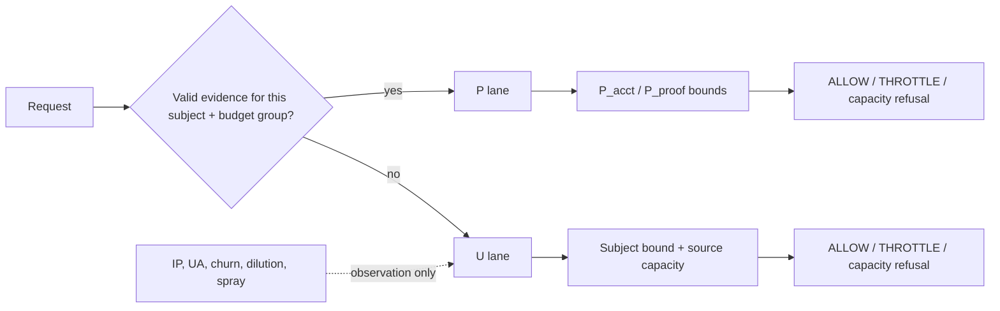

# Client Identity and Penalty Attribution — Architecture Proposal (#97)

> **Status:** ARCHITECTURE PROPOSAL for discussion. **NOT APPROVED. NO PRODUCTION CHANGE.** Not an ADR, not a GO, not a
> prototype or study authorization. It changes no `src/`, test, contract, preset, threshold, standard or decision.
> [DEC-019](../../docs/decisions/DEC-019_INTERIM_SECURITY_FIRST_CORRELATION_POSTURE.md) stays ACTIVE and unchanged.
> **Workstream:** [#97](https://github.com/Maatify/php-rate-limiter/issues/97); dependencies
> [#100](https://github.com/Maatify/php-rate-limiter/issues/100), [#106](https://github.com/Maatify/php-rate-limiter/issues/106),
> [#120](https://github.com/Maatify/php-rate-limiter/issues/120); ledger [#110](https://github.com/Maatify/php-rate-limiter/issues/110).
> **Baseline:** `main@597fda0a2c728232cdf7f3d697ab46f2abeedede`. Every number below is quoted from a merged study at that baseline.
> **Builds on:** [`ARCHITECTURE_PROPOSAL.md`](ARCHITECTURE_PROPOSAL.md) (`P§n`), [`SECURITY_FEASIBILITY.md`](SECURITY_FEASIBILITY.md)
> (`F§n`), [`G1_VERIFICATION.md`](G1_VERIFICATION.md), [`G1_FINAL_DISPOSITION.md`](G1_FINAL_DISPOSITION.md) and
> [`G2_PROOF_ACQUISITION_FEASIBILITY.md`](G2_PROOF_ACQUISITION_FEASIBILITY.md). It does not repeat their contracts; it adds the
> identity layer, the attribution rule, trust-from-success binding, and the budgets the Owner has to state.
> **Review history:** the text went through four review passes before it was committed (§16).
> **Post-G3 notes (2026-10-18):** the G3 study ([`G3_ADMISSION_BUDGETS.md`](G3_ADMISSION_BUDGETS.md)) ran after this proposal was
> written. Where its results change a statement here, a dated note is added next to that statement; the original text is kept.
> **Post-G4 note (2026-10-18):** the integrated G4 study ([`G4_INTEGRATED_ASSEMBLY.md`](G4_INTEGRATED_ASSEMBLY.md)) measured the
> whole assembly with binding; its notes are added the same way.
> **Post-G4 v2 note (2026-10-18):** G4 v2 ([`G4_V2_INTEGRATED_REASSEMBLY.md`](G4_V2_INTEGRATED_REASSEMBLY.md)) re-measured G4 with
> the instance id delivered to the pipeline (F131-01) and measured three new components; its notes are added the same way.
> **Arabic companion:** [`IDENTITY_ATTRIBUTION_PROPOSAL_AR.md`](IDENTITY_ATTRIBUTION_PROPOSAL_AR.md) (Owner-approved 2026-10-18,
> `DOCUMENTATION_LIFECYCLE_STANDARD_AR.md` §2.1). This English text is the reference and prevails on any conflict. Any PR that
> changes one of the two files changes the other in the same PR, with the same scope limits.
> **Authority:** the Owner decides every material policy, public contract, ADR, study, merge and release.

| Label | Meaning |
| --- | --- |
| `MEASURED` | Number from a merged study, quoted with its stream and study |
| `CONTRACT` | Canonical document or ACTIVE decision at the baseline |
| `DERIVED` | Reasoning or arithmetic from the above; nothing was executed for it |
| `PROPOSED` | Element of this design; not approved, not built |
| `ASSUMPTION` | Illustrative input that is not measured |
| `UNPROVEN` | A claim the design needs and that has no evidence yet |

Short paths as in `P§`: `DM` = `docs/DECISION_MATRIX.md`, `POL` = `docs/POLICIES.md`, `DFP` = `docs/DEVICE_FINGERPRINT.md`,
`KS` = `docs/KEY_STRATEGY.md`. Study numbers refer to the merged PRs: #108 `k1-credential-spray-nat`, #111 `nat-remediation-110`,
#113 `trusted-multi-session-s0`, #115 `guarded-network-headroom-110`, #116 `outcome-aware-atomic-admission-110`,
#118 `host-managed-client-identity-110`, #119 `account-scoped-known-device-relief-110`, #123 `nat-architecture-proposals-110`,
#125 `ua-client-identity-97`, #126 G1 (this folder), #127 G2 (this folder).

**The idea in one sentence.** The library does not punish anyone for *resembling* someone else. Protection comes from bounds on
the **target** that rotation of IP, UA or client id cannot multiply; a persisted penalty lands only on the **relationship** of one
actor with one target, or on the **door** of the target the failure came through; it never lands on a shared scope, and failures of
strangers never reach the proven door. Trust is **earned by success**, never by the absence of errors.

---

## 1. The problem

Three of the five canonical keys carry a **persisted penalty** on a scope that can contain many people (`CONTRACT` `KS` §3).

| Key | Material | What it does today | Measured harm |
| --- | --- | --- | --- |
| `K1` | IP / IPv6 `/64` | spray `HARD_BLOCK` on the IP | four colleagues behind one NAT: 47/61 denied (Nu4, #108). The D2 office reaches 117/121, but K1 and K2 overlap there and each alone is sufficient (#108 §1) |
| `K2` | IP + browser major | churn and LOW dilution `HARD_BLOCK` for everyone on that IP + UA | every user of one browser major across IPs: 596/600 (D1, #125); NAT churn: 118/120 (ABA_B, #116 on S0) |
| `K3` LOW | IP + UA-only fingerprint | effectively K2 | same as K2 |
| `K4` | account | score and blocks on the whole account, including trusted sessions | three unknown-device failures (+3 each, L2 at 8) publish a 60 s block that the owner meets (`P§4.4`) |
| `K5` | account + fingerprint | known-device bound (DEC-021) | with LOW confidence the "device" is account + UA major; a browser update creates a new K5 |

The protection K2 gives is not real against a competent attacker (`MEASURED`, #125 F97-01): LOW dilution stopped the X2 attacker
that keeps one UA (6/121), and the same attacker rotating the browser major reached 121/121, while the same rule denied 596/600
legitimate users.

## 2. Why the studies did not converge

The identity rounds asked "which identity replaces the UA?" and none produced an acceptable answer: HMCI (#118) was "not
acceptable as specified, direction INCONCLUSIVE", CIR (#125) was NO-GO. The defect is not the key **material** but its **role**: a
penalty is written on a shared scope, and any key that contains an IP still contains many people.

`MEASURED` (#125, CIR): when every client sent its own id, the #97 cohort denials disappeared (D1 596 → 0), but two browsers
behind one router went from 0/134 to 127/134 denied. Distinct ids on one IP + UA count as churn, so K2 hard-blocks everyone. The
harm moved; it was not removed.

The second reason: each study tested one **part** — identity without changing attribution (CIR), admission without identity
(G1), proof without solving device history (#127). The parts depend on each other, so each part alone is NO-GO.

## 3. Owner positions (stated 2026-10-17)

| Position | Effect on the design |
| --- | --- |
| The UA is not protection; any attacker changes it | The reference attacker is the **best response**. This is an explicit change of acceptance criteria that the ADR must state: naive-attacker cells (X2 and X7 with a constant UA) are recorded and published as observations; best-response cells stay gates, and any regression there (e.g. BRD) remains a gate. **Best response is computed over free identifiers only:** UA, cookie, client id, fingerprint. IPs, credentials and valid sessions cost something outside the library. "Free" means the attacker can mint an unbounded number without paying anything outside the library; the definition does not depend on which bounds this design places, so it is not circular. Attacker-owned accounts cost whatever the Host's registration controls make them cost, which the library cannot know, so they are a declared count N in the threat model, neither free nor expensive (the Y6b lesson of #116 is covered by the rule that success never earns credit on a shared scope, §6). Single-IP spray (SP1n, SP3, SP6) is therefore **not** a naive cell and stays a gate; its gate is the **written budget** of §6, not S0, because "≤ S0" is unreachable (§13) |
| The account owner must not be locked out because someone attacks the owner's well-known email | "The account" and "the strangers' door to the account" must be separated. The promise holds fully only for an owner with a bound device or session; an owner without proof falls under §11 |
| Proof acquisition (passkey, link) is **optional**, also in the Maatify usage mode | The design must work without it and state the residual honestly |
| Protection is not only Login; entry points will grow | The engine is generic; official presets are compositions on top of it |
| The library has two modes: free for consumers, and the Maatify usage mode | Everything new is optional in the free mode and may be preconfigured in the Maatify mode |

## 4. The generic model (`PROPOSED`)

Instead of K1–K5 tied to presets, every protected entry point is described by the same five concepts.

| Concept | Meaning | Examples |
| --- | --- | --- |
| `Actor` | who sends the request, and what identity is available | client instance, source (IP) |
| `Subject` | the target or resource under attack | account, coupon, phone number, API key |
| `Operation` | the protected operation | login, redeem, password reset |
| `Budget Group` | operations that test the same secret share one budget, so renaming an operation does not mint a second budget; this is the verifier class of `P§11.2` LT-5 | login + re-authentication + password change |
| `Evidence` (optional) | the proof accepted for this operation, if the Host has one | session, device binding, passkey |

In a coupon redemption the user is the Actor and the coupon is the Subject. Not every operation needs a verifier or a proof, so
proof capabilities are enabled only by the policies that need them. Not every future entry point will be configuration only;
some may need a new capability.

**The Subject is optional.** Some entry points have no Subject, or the Subject is being created: registration, webhooks, public
reads. They are protected by source capacity and a global ceiling only.

## 5. Identity layer (`PROPOSED`)

* `clientInstanceId` — a separate, optional field. A browser receives it as a first-party cookie on the first visit, before
  login; an app sends a device id. It survives network changes and browser updates.
* User-Agent — observation only. Not an identity and never a reason for a penalty.
* IP / IPv6 `/64` — identifies the source for source capacity. Not a person.

Rules for `clientInstanceId`:

1. **Separate from `clientFingerprint`.** Its presence never raises confidence. That was the cause of the #125 regression: any
   non-empty `clientFingerprint` lifts confidence to MEDIUM and selects the weaker dilution path (F97-02). When the id did not lift
   confidence, the BRD best response stayed at 22/100 as on S0 instead of 37/100 (`MEASURED`, CIRLI — a **post-hoc** probe, a
   direction and not a pre-registered result).
2. **K5 material.** With an id, K5 = account + id without the UA, so a browser update is not a new device. Without an id, the
   derivation is exactly today's. Measured cost (G-S1b, #125): a constant id with a rotating UA is now one device, so the
   device-rotation signals that UA rotation produced for free disappear. In the checkOnly-only flow: BRU 3 → 100/100, X1 3 → 61/61,
   BRD 7 → 37/100 — compared with the **same strategy** on S0. The best response for BRU and X1 is the same on S0 (100/100 and 61/61,
   nothing is recorded), and the only best-response difference was BRD, caused by the confidence lift (rule 1), not by removing
   the UA. These cells are observations under §3; the reservation of §9 is what bounds that flow.
   > **Post-G4 v2 note (2026-10-18).** Not measured yet. G4 and G4 v2 carried the instance id in `sessionDeviceId` (untrusted) and
   > kept the UA in the K5 material, a declared deviation; this rule, and the promise that a browser update is not a new device,
   > are therefore not implemented in any study (`G4_V2_INTEGRATED_REASSEMBLY.md` §9).
3. **A new id mints no budget** — not for the account, the source or the operation. Otherwise an attacker clears the cookie and
   starts over.
4. **Absence is declared absence.** A client without an id is an anonymous individual and is never grouped with every user of the
   same browser in any penalty. The only exception is K5 inside one account, which keeps today's derivation (rule 2).
5. **An IP change alone is not abuse.** The same id on several networks is normal for a phone or a laptop.
6. **Identity is not trust.** The id says "this is the client seen before"; it proves neither one person nor a right to attempts.

## 6. Attribution rules (`PROPOSED`)

**Rule.** A persisted penalty is written only on a relationship (Actor × Subject), or on the door of the Subject the failure came
through: `K4U` for failures of strangers, `K4P` for failures through the proven door (the owner's, or another proof holder's for
that account). A shared scope gets one of two roles only: observation, or a temporary capacity bound without escalation.

| Scope | How many people | Allowed | Forbidden |
| --- | --- | --- | --- |
| Shared: IP, IP + UA, passive fingerprint, churn / dilution / spray sets | many | observation; a per-window capacity bound that neither escalates nor persists | any persisted block |
| Actor (client instance) | one, if honest | short throttle; continuity | being the only basis of a hard block: the attacker discards the id, and a stolen id can be used to get the victim blocked |
| Subject (account) per Budget Group | one target, many requesters | an **identity-independent bound** (`U_acct`, option U-2 of `P§11.3` D4), load-bearing per G1; account penalties split by door: `K4U` and `K4P` (M-A, `P§7.2`) | strangers' failures reaching `K4P` or the proven door's budget |
| Actor × Subject (`K5`) | one device on one account | known-device bound (DEC-021); continuity | replacing the Subject bound: a rotating id gets a fresh K5 each time |

Today's keys in the new model:

| Today | Becomes |
| --- | --- |
| `K1` | per-window source capacity (`U_src`), never persisted; API: a window counter only. Spray detection stays and is emitted as an observation event, so the Host can block at the WAF / infrastructure layer, which has context the library lacks (datacenter or mobile network) |
| `K2` | observation only; no enforcement in Login, OTP or API |
| `K3` | LOW: observation, like K2. MEDIUM/HIGH: an optional sub-limit under the source for an identified client only — a per-window capacity bound, never persisted, because K3 contains the IP and is a shared scope; it can never raise the parent |
| `K4` | `K4U` (today's K4 key) for the strangers' door, `K4P` (new key) for the proven door, with `U_acct` above them |
| `K5` | Actor × Subject; material in §5 |

K2 is removed as a penalty key and no other key takes its place. Its function (bounding fingerprint rotation at one source) is
replaced by source capacity, counted per attempt whatever the fingerprint. K2 penalties are **not** moved to K1.

### 6.1 Declared cost: the naive cross-IP attacker

In X2 the attacker uses a new IP and a new victim account per attempt (`CONTRACT`, #125 `VALIDATION_PLAN.md`). Neither source
capacity nor the Subject bound applies, because each IP and each account sees one attempt. Only the global ceiling bounds it — the
same as P4. Today LOW dilution stops the constant-UA variant (6/121); the best response reaches 121/121. The model loses the
naive 6/121, accepted under the best-response position. The best-response reach was measured for the strangers' door in G1 and is
121/121 at every parameter set, exactly as S0 (§13). Reach with binding and id is **not measured**.

### 6.2 Per-account guessing budget (replaces "K4U escalation or not")

In G1, `K4U` kept today's K4 score and escalating blocks on the strangers' door, so an owner without proof can stay refused until
the block expires, **after the attack has stopped**. BRU stayed at 3 at every parameter set for two reasons: escalation was active,
and the Host recorded outcomes. For a checkOnly-only Host, escalation protects nothing; the `U_acct` reservation (§9) bounds that
flow.

**A daily cap is not a solution.** A cap such as "20 failures in 24 hours" (`CONTRACT`, `POL` login budget) on the strangers' door is
itself a lock that outlives the attack: the attacker burns the twenty in minutes and the owner without proof is locked for the
rest of the day. Escalation capped at one window is the same, only shorter. No option gives both "the lock ends with the attack" and
"a small number of attacker guesses per day" to an owner without proof (`F§2.9`).

**The decision is one number, T** — the longest an owner may wait after an attack stops. If the per-account bound is a token
bucket that refills one attempt every T, the owner gets a first attempt within T of the attack's end, and the attacker gets at most
86,400 / T refills per day, plus the initial burst C, so the daily ceiling is `C + ⌊86,400 / T⌋` (`DERIVED`). The table uses the
study burst C = 4.

| T (longest wait after the attack) | Refills per day (86,400 / T) | Ceiling per day with C = 4 |
| --- | --- | --- |
| zero (opens when the attack stops) | unbounded | unbounded |
| 10 minutes | 144 | 148 |
| 30 minutes | 48 | 52 |
| 60 minutes | 24 | 28 |
| S0 today, Host records outcomes | ~20 (not a refill rate), but escalation can keep the lock much longer after the attack | |
| G1 without escalation: fixed window, 16 per 10 minutes | ~2,300, with the same 10-minute wait | |

> **Post-G3 note (2026-10-18).** G3 measured the bucket on BRU24 (one victim, source and UA rotating every 15 s for 24 h): 147 /
> **51** / 27 attacker attempts reached the verifier for T = 10 / 30 / 60 minutes, against ceilings 148 / **52** / 28
> (`G3_ADMISSION_BUDGETS.md` §4.4). For the Owner's study value T = 30 minutes the three numbers are: **48 refills per day, a
> ceiling of 52, and 51 measured.**

The last row is why the shape matters: a fixed window with a large capacity gives the same recovery time as a bucket that refills
every 10 minutes, with 16 times the attacker throughput. Recovery time is set by the refill rate, not by the capacity. The cost to a
normal user: a typo after the attack means another wait of T. All of this concerns the strangers' door only; an owner with a
session or a bound device (§7) is unaffected.

**Recommendation:** state the decision as a per-account guessing budget, in the same form as the spray budget, implemented as a
token bucket and not a fixed window. The study measures T = 10, 30 and 60 minutes. **Owner decision (2026-10-17): T = 30 minutes
is the study value** (48 refills per day; ceiling 52 with C = 4). It is a value for the study only, not an accepted production value
or an accepted number of guesses. The final number is decided after the study.

### 6.3 Spray budget: the value of `U_src`

`U_src` is a tunable parameter, not part of the architecture. G1 measured two values only (12 and 40 per 600 s, with
`U_acct` = 16), so the table holds three measured points, not a curve (`MEASURED`, `G1_VERIFICATION.md` §6 and
`g1/verify/expected/summary_verify.md` §5). Spray reach equals `U_src` × windows. Rows are per stream, because the streams have
different sizes and a pooled ratio would weight them by accident.

| Stream | S0 | `U_src` = 12 | `U_src` = 40 |
| --- | --- | --- | --- |
| *Legitimate requests denied* | | | |
| L1: two colleagues behind one NAT | 0/134 | **50/134** | 0/134 |
| D2: office, fresh fingerprint per login | 117/121 | 72/121 | 27/121 |
| ABA_B | 118/120 | 96/120 | 56/120 |
| N12 / Nu4 (of 61) | 56 / 47 | 12 / 12 | 0 / 0 |
| MIX, legitimate part | 117/121 | 82/121 | 59/121 |
| *Attacker attempts that reached the verifier* | | | |
| SP6: one IP, one hour | 20 | 72 | **240** |
| SP3 / SP1n | 7 / 4 | 24 / 12 | **80 / 40** |
| MIX: attacker behind the same NAT | 0 | 10 | **55** |

Over one day from one IP: S0 ≈ 480 guesses, `U_src` = 40 ≈ 5,760, i.e. **12×** (`DERIVED`). If 0.5 % of accounts had a weak password,
that would be about 29 accounts per day from one IP (`ASSUMPTION`, illustrative only).

**Why 40 as the study value** (not a final ADR number until the result of the failure cap of §13 is known):

1. It is the only measured value with no legitimate stream worse than S0 — the goal of this proposal: an innocent user is not
   harmed for resembling someone.
2. The spray regression exists at both values; 12 makes it about three times smaller, not zero.
3. The attacker can buy the difference back: source bounds multiply by the number of IPs (#115), so three or four more IPs suffice.
   Two colleagues behind one NAT cannot do anything.
4. Botnet spray already passes S0 (SP4b 432/432, #108); this bound only stops a single-IP attacker.

> **Post-G3 note (2026-10-18).** Reason 1 is out of date. G3 measured `U_src` = 24 as well, and it also leaves no benign stream
> worse than S0 (L1 0; D2 39, ABA_B 72, MIX 63 legitimate denials, against S40's 27, 56 and 59), with lower single-IP spray reach
> (SP6 144 per hour against 240) (`G3_ADMISSION_BUDGETS.md` §4.2). The spray budget now has three measured points (12, 24, 40).
> Adopting any `U_src` replaces K1's spray protection and is a **separate Owner security decision**; accepting this proposal or
> the G3 study does not accept that trade.

**Cost at 40:** up to 240 attempts per hour per IP on distinct accounts (~5,760 per day); a co-located attacker (MIX) reaches 55
instead of 0. **Caveats:** not measured on CGNAT; `U_acct` = 16 per fixed window is not usable without escalation (~2,300 per account
per day) and is replaced by the bucket of §6.2; if binding (§7) proves that bound devices leave `U_src` without hurting L1, the
Maatify mode may later lower the value to 12.

## 7. Trust from success (`PROPOSED`, hypothesis until K5 separation is decided)

The rule for any trust score: **the absence of a bad record is free; the presence of a good record is expensive.** A new device has
no errors because it was just created, not because it is good. Therefore:

* a new instance starts **neutral**: the strangers' door, under the account bound. Neutral means unknown, not clean;
* a negative score on an instance is used for a short throttle only, never as a security bound;
* trust is **earned by a successful login**, which an attacker reaches only with the password.

**Device binding.** After a successful login, the Host issues a signed token that binds (account, instance). A bound device enters
the proven door for that account next time. Precisely: **the source of trust is still the Host**, because the token is issued when
the Host says the login succeeded. What the library gains over today's `isDevicePreviouslyVerifiedForAccount` boolean is that it
can verify the token's integrity, that it names this account (and operation, where required), that the presented
`clientInstanceId` matches the bound one, its expiry, and its revocation epoch.

What it **cannot** verify: possession of the original device. On the web the `clientInstanceId` is a cookie value and the token
is a bearer credential; whoever copies both can present them and is accepted as the bound device. The signature and the binding
limit the damage to one account and one operation class, within the proven door's bounds, until the token expires or the epoch is
revoked; they do not prevent transfer or replay between holders. A possession mechanism is out of scope for this proposal.

| Binding condition | Why |
| --- | --- |
| For one account, not general trust | A binding to account A gives nothing on account B; otherwise an attacker logs into an own account and uses that trust against others (#120) |
| Same instance | The successful login must have happened with the same `clientInstanceId` that is bound, and the token is accepted only with that id. This stops reuse of a token with a different id; it does not stop a holder who copied both (see "Stolen cookie") |
| Mints no budget | The proven door has one budget per account, shared by all bound devices, plus a daily cap on new devices (`P_acct`, `N_P`, `P§7.3`, measured in #127) |
| Revocable | On password change or "log out everywhere", via a per-account epoch: one integer per account, carried by the token, compared on use. **Not** the generational namespaces of `KS` §10.1, which mean "the previous generation is still read during rotation"; revocation means "everything before X is void", and merging them would break one of the two. The counter belongs under the account auxiliary keys of `KS` §4.6, which is LOCKED and needs an amendment |
| "No prior taint" | Measured as the **number of distinct accounts** the instance failed on in the window before the success, not the number of failures. Failures on the same account never count (typos). A hygiene condition, not a security guarantee: an attacker can log in from a clean instance |
| Assurance per operation | A binding made after login is not automatically enough for an operation that requires stronger verification |
| Stolen cookie | The id and the token are bearer values: a thief who copies both is accepted as the bound device. The thief gets the proven door of one account, within P bounds, until expiry or epoch revocation, but also **consumes the shared `P_acct`**, so the owner on the bound device can be refused inside P (`P§7.2` item 3 for the shared allowance, item 4 for P penalties from another proof holder; #127 residual 5). A negative score on (account, instance) lands on the victim's own device; the epoch fixes it only after detection. **Open proposal:** a negative score on a bound device is a throttle only. That changes DEC-021, which persists K5 blocks for known devices as the known-device guessing bound, so it needs measurement (§13) |

### Trust Score path (added 2026-10-18)

*A description of how the idea developed. It was first written in the Arabic companion; this is its English counterpart.*

The idea was raised in the discussion with the Owner on 2026-10-17 and is not recorded in the repository under the name "Trust
Score"; this proposal is the only place that describes it. It had two parts:

1. **"A new device stays clean until its first error, and counting starts from there": rejected** (§12). A new device has no errors
   because it was just created, not because it is good. An attacker can create a new device every time, so every new id gives the
   attacker a free error and the penalty lands on honest clients only. Instead, a new device is **neutral** under the account bound,
   and a negative score is used for a short throttle only.
2. **"After a successful login the device is recognised as the customer's, if it carries no earlier taint": adopted**, and it became
   the device binding of this section, with its conditions: bound to one account, from the same instance, mints no budget,
   revocable. "Taint" was defined as the number of distinct accounts the device failed on before the success.

**Status when this was written (after G3 v2, before G4):** the binding was **neither built nor measured**. What G3 v2 measured was a
temporary stand-in, routing the devices the Host marks as known, which trusts the Host exactly as DEC-021 does (a lying Host:
5,760 / 5,760). The next step for the idea was to design the binding: a signed token the library itself verifies (condition P1),
with its own per-account bound for known devices. The Post-G4 and Post-G4 v2 notes below record what happened next.

Effect: most users sign in from the same devices, so the accepted risk narrows from "any owner without proof" to "an owner on a new
device or with cleared cookies", without forcing a passkey or a link on any consumer.

> **Post-G4 note (2026-10-18).** G4 built this binding as study code and measured it in the full assembly
> ([`G4_INTEGRATED_ASSEMBLY.md`](G4_INTEGRATED_ASSEMBLY.md)): NO-GO as registered (A1, C4, E, P). In the fixtures whose input was
> delivered as planned, the binding held the claims of this section that G4 tested (owner under harassment 0 denials, NAT and
> CGNAT bound clients 0 refusals, 0 cross-account use, stolen token bounded and revoked), and an owner who falls back to the
> strangers' door during a continuing attack is starved by the bucket (§4.3 there). **Review F131-01:** the stream and BRU24-based
> fixtures did not deliver the instance id to the pipeline, so the stream results (including the `P_proof` refusals of heavy
> bound users, §4.2 there) and the BRU24-HV count are not evidenced as planned (§6.4 there).

> **Post-G4 v2 note (2026-10-18).** G4 v2 re-measured every G4 arm with the planned input: no gate, best-response number or
> BRU24 / BRU24-HV / REC number changed (5 of 684 stream rows differ, none a best response), so the G4 results above now stand as
> planned, including the `P_proof` refusals and BRU24-HV 51. It then measured `FULL2` = the G4 assembly plus three components:
> a P-lane budget that refunds successful logins, sliding token renewal on every verified success (30 days, absolute 90), and a new
> token issued at the password change to the device that made it. **`FULL2` is EXPERIMENTALLY SUPPORTED — LIMITED SCOPE for Hosts
> that record outcomes:** heavy bound users are no longer refused (L1 72 → 0), the owner is back on P at once after the password
> change while the thief keeps failing (G4: never), E2 is identical with and without the population, and each new component and K5
> separation is shown necessary. checkOnly-only Hosts still fail (gate P: L1 72, D2 61). Remaining owner residual: a new device, or
> a token past its absolute lifetime, during a continuing attack (`G4_V2_INTEGRATED_REASSEMBLY.md` §2, §5).

## 8. Optional evidence

| What the Host has | The request enters | Under attack |
| --- | --- | --- |
| nothing | strangers' door (U) | capacity refusal during the attack, then a wait of up to T (§6.2) |
| device binding or a trusted session for this account | proven door (P) | strangers' failures do not reach it; P has its own bounds and is not an exemption |
| registered passkey (case A, #127) | an exit from U | owner admitted 12/12 while the account was under attack (`MEASURED`) |
| link on a registered channel (case B, #127) | an exit, with conditions | 12/12 with high-entropy links, no invalidation of earlier links, operation binding, and validity ≥ the issuance window (`MEASURED`) |

A and B were measured in isolation; the overall #127 verdict was NO-GO because of E2 (device history, §13), not because of the
proof mechanism. A proof must be typed and bound to Subject and Budget Group, and the library itself must refuse it for another
account or operation (P1, `UNPROVEN`).

## 9. Request path

Shared signals feed observation and never block a shared scope. In the design measured in G1 they raised the strangers'-door risk
of the targeted account (`K4U`), which is a lever for the attacker (§11); under §6.2 they stay observation only and do not change
`K4U`. The bound before the verifier works through an **atomic reservation inside `checkOnly`** (T0, `P§6.5`). That is a behavioural
change of `checkOnly` for the policies that enable it (GA-5) and requires store integrity (G1 P2).

## 10. What it solves

* **#97 collective denials removed.** G1: D1 596 → 0, D1API 595 → 0, L3 104 → 0 (`MEASURED`). Attacker reach on the strangers'
  door was measured in G1 (§13); its main change is the spray budget (§6.3). Reach with binding and id is not measured.
* **Root of the NAT harm in #100 and #106:** no hard block on a shared IP. A capacity refusal remains, sized by `U_src` (§6.3).
* **Owner with a binding or session:** a strangers' attack on the owner's email does not lock the owner (GA-4). Only another proof
  holder for the same account can affect it (§7).
* **checkOnly-only Hosts** get a bound before the verifier, which does not exist today (D24K1 `pre` 1440/1440), given the reservation
  of §9.
* **Browser updates** no longer create a new device while the id is stable, at the cost stated in §5.
* **Any new entry point** is described by the same model.

## 11. Accepted risk

The proposal changes **which** risks the library carries; the data show security / availability trade-offs, not a guarantee that
overall risk does not grow. Risk grows for two attack types, and both are set by values the Owner chooses (`U_src` and T, §6);
risk falls for others. Whether the total is lower depends on how the Owner weighs innocent users denied against attacker reach.

| Attack | S0 today | Proposal |
| --- | --- | --- |
| Single-IP spray on many accounts | ~20 per hour | up to 240 per hour at `U_src` = 40 |
| Multi-IP spray (botnet) | passes (SP4b 432/432, X2 121/121) | unchanged |
| One account, rotating IPs, checkOnly-only Host | no bound (1440/1440) | bounded by the account bucket |
| Same attack, Host records outcomes | bounded by K4 escalation (BRU 3/100) | `C + ⌊86,400 / T⌋` per day (§6.2): at T = 30 minutes, 48 refills and a ceiling of 52 against ~20 on S0. Post-G3: 51 measured on BRU24, and G1 escalation 33 on the same fixture (`G3_ADMISSION_BUDGETS.md` §4.4) |
| Stolen session tried on other accounts | 200/200 (SP5) | the proof is bound to one account; other accounts are strangers |
| Lockout of an owner with a session or bound device | 14/15 (HAR) | 0/15 (HARp) |
| Attacker with sessions for many accounts | 2/200 (TMSd) | grows linearly with the accounts held, on the attacker's own accounts |

The single-IP spray protection S0 offers is paid by innocents, because it comes from the same K1 rule that blocks four colleagues in
an office. The proposal makes that price a written decision instead of a hidden one. The ADR must state the spray number and must not
present the proposal as "safer than S0 in every respect".

Item 1 below cannot be avoided without proof (`F§2.9`); the rest are chosen costs or scope limits.

1. An owner **on a new device without any proof** is effectively locked for the duration of a sustained attack, and may wait up to T
   after it ends. "The lock ends with the attack" exactly means T = 0, with no bound on guessing; any daily cap is a lock that
   outlives the attack (§6.2). Without a proof path #127 measured 11/12 refused.
2. **Either single-IP spray passes more than on S0, or the NAT is refused more than zero.** K1 is the only control on SP1n, SP3 and
   SP6 today (#108). G1 with `U_acct` = 16: at `U_src` = 12, L1 is refused 50/134 (78/134 at `U_acct` = 4); at 40, L1 is 0 but SP6
   goes 20 → 240, SP3 7 → 80, SP1n 4 → 40, MIX 0 → 55. No measured value beats S0 on both axes (`G1_VERIFICATION.md` §6).
3. An innocent neighbour behind the same NAT as an attacker shares the source **capacity**, not the penalty. On CGNAT or an IPv6
   `/64` with thousands of users, a per-window capacity refusal is the #108 harm at a smaller scale, not zero.
4. The naive cross-IP attacker (X2 with a constant UA) is no longer stopped (§6.1).
5. A client with a constant id and a rotating UA is one device (§5).
6. If the G1 design is kept, shared signals raise `K4U` for the targeted account (§9) and help the attacker lock the strangers'
   door faster. Under §6.2 this item disappears.
7. A stolen binding can consume the owner's proven-door budget until the theft is detected (§7).
8. A distributed attacker across many accounts is bounded by the global ceiling only, and any global ceiling is itself a lever to
   close the lane for everyone.
9. Record-only (`out`) Hosts get no bound before the verifier, whatever the design.
10. During a DEC-015 outage there are no lanes, so no owner protection.

## 12. Rejected ideas

| Idea | Reason |
| --- | --- |
| Put the id in place of the UA inside K2 | K2 becomes K3, churn protection disappears, and the harm moves to the NAT (CIR: L1 0 → 127/134) |
| Put the id inside `clientFingerprint` | lifts confidence to MEDIUM and selects the weaker path: a constant id across IPs, X2 6 → 121/121 (F97-02) |
| Remove the UA everywhere (null fingerprint) | the null fingerprint takes a weaker per-account scoring path: BRU 3 → 11/100, BRD 3 → 11/100, and a known device is denied on K4 instead of the DEC-021 K5 path (NUA, #125). The X2/X7 increase is paid by this proposal too and is accepted only under §3 |
| Trust score "clean until the first error" | every new id gives the attacker a free error, and the penalty lands on honest clients only |
| Short code (OTP) as the exit | needs a per-account attempt cap that the attacker exhausts (NO-GO, #127) |
| CAPTCHA as proof | not bound to an account: a cost, not a bound |
| Move K2 penalties to K1 | recreates the collective penalty on a shared IP |
| Single-principal source exception (raised in review, then withdrawn) | the number of principals behind an IP in the past does not protect those who arrive later: an office where one employee was logging in would lock the colleagues who arrive next. The no-id datacenter attacker is an anonymous individual (§5), so there is no Actor to throttle, and the exception would bring K1 back. It is bounded by source capacity per window; blocking a single-principal IP belongs to the infrastructure layer, with the library emitting the observation as an event |
| Daily per-account cap, or escalation capped at one window, on the strangers' door | both are locks that outlive the attack (§6.2) |

## 13. Known results and open items

**Known before any new study.** The verdicts of every study in the project (#108, #111, #113, #115, #116, #118, #119, #123, #125,
#126 G1, #127) already settle parts of an assembled study. Re-running them would produce the same answer; what they need is a
decision, not a measurement.

| Question | Known result | Source |
| --- | --- | --- |
| Do #97 / #100 collective denials disappear under the attribution rule? | yes: D1 596 → 0, L3 104 → 0, L1 with ids and no churn 0/134, ABA_B 118 → 0 | G1 C10-H, #125 CIRI-CHOFF, #111 |
| X2 best-response reach | 121/121 at every `U_acct` / `U_src` value, equal to S0's best response | `G1_VERIFICATION.md` §6 |
| X7 victim guesses | 40/40 in every design | #125 (post-hoc metric) |
| NAT versus single-IP spray | no `U_src` value beats S0 on both axes; measured on L1, D2, ABA_B against SP1n, SP3, SP6 and MIX (§6.3). Expected from the result that a co-located attacker and an unproven office are indistinguishable at the source | `G1_VERIFICATION.md` §6, #108, `P§2` |
| Owner without proof under attack | refused 14/15 at every value; with proof 0/15 | G1 HAR / HARp; #127 (11/12) |
| Attacker holding proofs for many accounts | reach grows linearly: accounts × `P_acct` (20 accounts = 1,200 per hour); arithmetic, not an experiment | #127; #119 (TMS 7 → 61/61) |
| Success earning credit on a shared scope | NO-GO: own accounts wash the credit (Y6b 2 → 36; pool 13 → 22) | #116 E4, #118 B5, #123 axis 4 |
| Admission without an atomic reservation | the leak equals the concurrency of the burst | #111 |
| A fixed bound per scope | multiplies by the scopes the attacker holds; `U_src` does not bound a multi-IP attacker, only `U_glob` does | #115 |
| Rollback to S0 after new state | S0 state is not preserved; the gate must be "no exception, loss documented", not "parity with S0" | #115 G4h, `P§11.2` LT-6 |
| Binding bootstrap | the 87 of 100 browsers that could not log in under #118 were blocked by MAIN's collective penalties, which disappear under the attribution rule; the tighter `U_src`, the more the problem returns | #118 H02, G1 §6 |
| The proven door does not consume `U_src` | the sign is known: the attacker gets more capacity, bounded by `U_src` | #118 B5 |

**Actually open.**

| Item | State |
| --- | --- |
| **Decision: single-IP spray budget** | The main obstacle; its result is known (above). No study will find a `U_src` that beats S0 on both axes. The Owner chooses a point and writes an explicit budget, such as "maximum reach from one IP per hour", instead of a "≤ S0" gate — the OWNER_DECISION_REQUIRED outcome of #115. Recommendation: `U_src` = 40 as the study value; the final ADR number after the failure-cap result (§6.3) |
| **Failure cap inside source capacity** | The only candidate that may bring the spray number near S0 without bringing back NAT harm. Spray almost always fails; an office mostly succeeds (≈ 8 % typos). Count the **distinct accounts the same IP failed on**, inside `U_src` = 40 as the outer ceiling; success earns no credit, to avoid #116's washing. Partial evidence: OQCE in #111 reached SP6 14 and SP3 7, and lowered D2 117 → 53 and Nu4 47 → 0. That family was NO-GO for its own reasons — a leak before outcomes arrive that grows with concurrency (bounded here by the outer ceiling) and a MIXN regression in record-only mode. In checkOnly-only mode there are no outcomes, so only the outer ceiling applies. A direction to measure, not a ready solution |
| Midpoint for `U_src` | G1 tried 12 and 40 only. A value such as 24 gives SP6 ≈ 144 per hour by arithmetic; L1 there is not measured. Added to the small study at near-zero cost |
| CGNAT curve | The only new part of the NAT question: N = 50, 500 and 5,000 behind one source. G1 measured small offices only |
| Source-capacity method | A population model, not a single stream: N users behind one source with Poisson arrivals per window, an attacker at rate r, and the share of legitimate requests refused as a function of `U_src`. Sweep N = 50, 500, 5,000 for CGNAT; a `/64` is usually one home or site, so its population is small. Add a mobile client whose IP changes during the session. The acceptance threshold is registered as a number before the run, with the same deterministic generator |
| **P4: distributed spray reach** | P4 in G1 is six streams. Four (SP6, SP3, SP1n, MIX) are single-IP and belong to the spray-budget decision. The other two are spread over many IPs and `U_src` does not address them: POI 80 → 180 at every value (8 IPs, under the cap on each) and ABA_A 3 → 24 or 80. Their only bound is `U_glob`, which is itself a lever to close the lane. This is the genuinely open part of P4; it needs a bound design, not a parameter pick |
| **E2 / K-6: device history** | The #127 NO-GO traced to its end: the population raises `K4U`, `K4U` refuses the owner's strangers'-door attempts before the verifier, their outcomes are not recorded, and the device's K5 and watcher history differ when it returns to P. The cause is one K5 family per device regardless of proof state (K-6). **The result is known:** if the proven door's K5 is written by P outcomes only — K5 separated by the binding — E2 passes by construction; if not, it fails again even without `K4U` escalation, because a `U_acct` refusal has the same effect. So this is a decision, not an experiment. The separation is the "proof-keyed K5" that `P§4.5` rejected for its cost (K5 material change, a two-derivation read during migration, P history lost on rollback). It is safe against history laundering, because laundering needs a successful login, i.e. the password. **Recommendation: separate.** The marginal cost is now small: this proposal already pays the first two costs (K5 material changes when the id enters, §5 rule 2; the one-time restart under Migration), and the third is of the same class as "K4P is lost on rollback", which `P§11.2` LT-6 already accepts. The rejection in #126 concerned K5 with its old material. Two conditions: the DEC-021 allowance is tied to the P family only — a DEC-021 change that must be written, because historically known devices on the strangers' door lose the allowance and their failures go straight to `K4U` — and E2 is re-run as a regression check, not as a gate |
| P1: library-enforced proof binding | A new typed input; the library itself refuses a proof presented for another account or operation |
| **Per-account guessing budget** | Replaces "K4U escalation or not" (§6.2). The strangers'-door bound is a token bucket refilling one attempt every T. The study measures T = 10, 30 and 60 minutes on BRU, BRD, HAR, L1 and D2, with G1's escalation as a control. The daily cap and the window-capped escalation are withdrawn as options, because both are locks that outlive the attack. **Owner: T = 30 minutes is the study value** |
| Negative score on a bound device = throttle only | Protects the victim's device from a stolen binding, but changes DEC-021 (K5 persistence for known devices). Measure the known-device guessing bound without K5 blocks, with the allowance and overflow on `K4P` only |
| Reservation inside `checkOnly` (T0) | A behavioural change of `checkOnly`; requires store integrity: no write before the decision, previous generation read-only (G1 P2) |
| Taint definition before binding | The measure is fixed in §7 (distinct accounts). Measure its effect on normal users and set the threshold |
| Migration | Ship dormant and opt-in, then default by Owner decision; a one-time K5 restart for devices that start sending an id |
| LOCKED contracts | Amendments to `KS` §3.2 (K2 becomes observation), `KS` §2 (a source-capacity class), a successor to DEC-019, `DM` §5.3 (LOW → K2 HARD), `POL` §1 (owner-safety clause naming proven owners, D4), `KS` §4.6 (epoch counter), and DEC-021 with `DFP` §4.2 and §5.1, because K5 material changes when the id enters |
| Values | No production value exists; every value here is a test value |

## 14. Proposed next steps

1. **ADR part 1 (ready to fix now as a principle):** the attribution rule; the best-response reference attacker over free
   identifiers; and the explicit change of acceptance criteria — naive-attacker cells become observations, best-response cells
   stay gates, and the single-IP spray gate is a written budget, not S0.
2. **ADR part 2 (hypothesis):** the identity layer, trust from success, binding, K5 separation and the per-account guessing budget.
   It stays PROPOSED until the K5 separation decision is taken and the T values are measured.
3. **Decisions before any study, because their results are known (§13):** `U_src` = 40 as the study value (§6.3); K5 separation
   by binding (recommended); and a rollback gate of "loss documented".
4. **A small pre-registered study of the actually open items only:** first the failure cap inside source capacity, because it is the
   only candidate that can lower the spray budget without bringing back NAT harm; then the `U_src` midpoint (24), the CGNAT curve,
   the effect of the taint threshold on normal users, and the T values of the per-account guessing budget (10, 30, 60 minutes). It
   uses the values chosen in step 3 and re-runs the cells with known results as regression checks only. Without it there is no
   adoption in default presets and no runtime change.
5. **Implementation-stage evidence:** store integrity with the reservation (P2), Redis Cluster and failover, DEC-015 integration,
   and proof binding enforced inside the library (P1).
6. Then choose the values and plan the rollout.

## 15. Owner decisions requested

| # | Decision | State |
| --- | --- | --- |
| 1 | Write ADR part 1 (§14), including the best-response definition over free identifiers | pending |
| 2 | Single-IP spray budget: adopt `U_src` = 40 as the study value, and defer the final ADR number until the failure-cap result (§6.3) | pending. Post-G3 (2026-10-18): `U_src` = 24 is a measured alternative, and the failure cap was NO-GO as registered (`G3_ADMISSION_BUDGETS.md` §2, §4.1–§4.2); any `U_src` is a separate Owner security decision |
| 3 | K5 separation by binding (recommended), with the allowance tied to the P family and E2 as a regression check (§13) | pending; approved for the G4 study only (2026-10-18). Post-G4: removes the carry-over of the owner's own U failures into P (post-hoc), but the registered E2 gate failed for an unrelated reason and the component was "not shown necessary" (`G4_INTEGRATED_ASSEMBLY.md` §4.4). Post-G4 v2: shown necessary by a registered gate (the owner's own U failures on the same instance stay out of later P decisions; without separation 12 owner rows differ, `G4_V2_INTEGRATED_REASSEMBLY.md` §5.4) |
| 4 | Per-account guessing budget: T, the longest an owner without proof waits after an attack stops, which sets the guesses per day (86,400 / T) | **approved by the Owner on 2026-10-17: T = 30 minutes as the study value only** (48 refills per day, ceiling 52 with C = 4; post-G3: 51 measured); not a production value. The final value follows the study |

## 16. Review history

The proposal was written and reviewed outside the repository before this commit; the review threads are not reproduced here.

| Pass | Main corrections |
| --- | --- |
| 1 | Over-claims removed ("solves #97 completely", "unaffected at all"); `CHALLENGE` is not a fourth decision that defeats `F§2.9` — only new information does; the identity layer and the attribution rule must be designed together |
| 2 | Wrong citation fixed (`P§7.2` items 3–4, not a non-existent feasibility section); G-S1b numbers stated; K3 MEDIUM/HIGH made a non-persisted sub-limit; single-principal source exception withdrawn; epoch counter separated from `KS` §10.1 |
| 3 | L1 at `U_src` = 12 stated with its `U_acct`; "best-response reach not measured" corrected to "measured on the strangers' door in G1"; pooled NAT ratios replaced by per-stream rows; `U_src` = 40 kept as a study value; midpoint 24 added; K5 separation recommended with the marginal-cost argument |
| 4 | A daily cap on the strangers' door is a lock that outlives the attack, so the K4U decision became a per-account guessing budget T implemented as a token bucket; BRU = 3 attributed to escalation **and** recorded outcomes |
