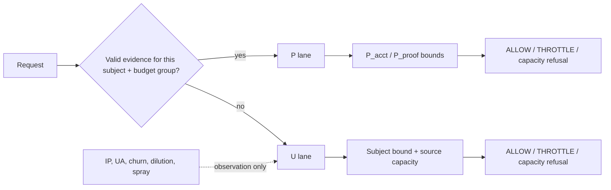

# هوية العميل وإسناد العقوبة

> **اللغة والمرجع:** دي النسخة العربية المرافقة للمقترح (`*_AR.md`، `DOCUMENTATION_LIFECYCLE_STANDARD_AR.md` §2.1، بموافقة المالك في 2026-10-18).
>
> **المرجع:** [`IDENTITY_ATTRIBUTION_PROPOSAL.md`](IDENTITY_ATTRIBUTION_PROPOSAL.md) بالإنجليزي. لو فيه أي تعارض بين النسختين، **النص الإنجليزي هو اللي يُعتمد**.
>
> **قاعدة التحديث:** أي PR يغيّر واحد من الملفين لازم يغيّر التاني في نفس الـ PR، وبنفس قيود النطاق. ومطابقة النسختين جزء من المراجعة.
>
> **صفحة العرض:** الصفحة اللي بتتعرض على المالك بتتولّد من الملف ده كما هو، ومش بتتعدّل لوحدها.

maatify/php-rate-limiter · Issue #97 ومعها #100 و #106 · مقترح معماري للنقاش

بديل لدور K2 الحالي، ونموذج عام لحماية أي مدخل في المكتبة، بحيث المستخدم البريء ما يتحجبش بسبب حد شبهه، وصاحب الحساب اللي داخل من جهاز مربوط أو session ما يتقفلش بسبب حد بيهاجم إيميله.

**الحالة:** مقترح للمراجعة · مش قرار ولا ADR · بدون تغيير في الكود · DEC-019 لسه ACTIVE · النسخة 17: أول نسخة في الريبو، بعد G4 v2 ومراجعة PR #132 · 17 أكتوبر 2026

ملحوظات بعد G3 (2026-10-18): دراسة G3 اتعملت بعد ما المقترح ده اتكتب، واتدمجت مع المقترح في PR #129، وبعدها اتعملت G3 v2 واتدمجت في PR #130 (2026-10-18). في أي مكان نتايجهم غيّرت فيه كلام هنا، اتضافت ملحوظة بتاريخها جنب الكلام، والنص الأصلي فضل زي ما هو.

ملحوظات بعد G4 (2026-10-18): دراسة G4 قاست التصميم **كله مركّب** لأول مرة، ومعاه الـ binding مبني ككود دراسة (PR #131، اتدمج في main كـ `ac97c12`). ملحوظاتها متعلّمة "بعد G4" بنفس الطريقة.

**قيد F131-01 على G4 (مراجعة PR #131):** في fixtures الـ STREAMS والـ BRU24 (BRU24 وBRU24-HV وصفوف المهاجم في REC)، الـ instance id ما وصلش للـ pipeline بسبب خطأ في الـ harness، فأرقامهم في أرشيف G4 **مش مُثبتة زي ما اتخطط**، سواء نجحت أو فشلت. التفاصيل زي النسخة الإنجليزية بالظبط:

- **الـ Host violation:** المدعوم إن علامة "known" من الـ Host لوحدها ما بتدخّلش باب P، وده من قاعدة الحدود نفسها. أما عدد 51 في BRU24-HV فمن fixture متأثر.
- **`P_proof`:** الآلية مرصودة (نجاح الجهاز المربوط بيتحسب على ميزانية التوكن)، لكن أعداد الرفض من STREAMS مش متأكدة.
- **الـ bucket:** أرقام BRU24 وREC (B1 وB2) متأثرة. أما تجويع صاحب الحساب على باب الغُرب أثناء الهجوم فمن STEAL وE2، والاتنين سليمين.
- **اختبار الضرورة:** ضرورة الربط أدلتها سليمة (HAR-B وBOOT-X وCGN-B). حد الفشل: صفوف الـ spray متأثرة، ومقارنة CROSS (24 بدل 4) سليمة. الـ bucket ومنع التصعيد: المقارنات مبنية على fixtures متأثرة.
- **سليم:** HAR وCROSS وSTEAL وBOOT وCLEAR وE2، وCGN-B (نموذج).

**ملحوظات بعد G4 v2 (2026-10-18):** G4 v2 صلّحت المدخلات، وضافت assertion بيوقف الدراسة لو الـ instance id ما وصلش، وdetector بيتأكد إن الـ assertion شغال. بعدها قاست كل أذرع G4 تاني: **ولا بوابة ولا رقم best response ولا رقم في BRU24 أو BRU24-HV أو REC اتغيّر**. اختلفت 5 صفوف بس من 684، ومفيش واحد منهم best response. يعني أرقام G4 اللي فوق بقت مُثبتة بالمدخلات المخططة. وبعدها قاست التركيبة الجديدة `FULL2`، وطلعت **مدعومة بنطاق محدود للـ Hosts اللي بتسجل النتايج بس (pre+out)، وبوابة P للـ Hosts اللي بتستخدم `checkOnly` بس فشلت**. الدراسة في PR #132، ووقت كتابة النسخة دي كان لسه Draft ومستني مراجعة الـ Lead وقرار الدمج من المالك. ملحوظاتها متعلّمة "بعد G4 v2".

**انحراف معلن في G4 وG4 v2:** الـ instance id كان بيتبعت في `sessionDeviceId` كقيمة مش موثوقة، والـ UA فضل جوه مادة K5. يعني القاعدة 2 في §5 (K5 = الحساب + الـ id من غير UA، وتحديث المتصفح ما يعملش جهاز جديد) **لسه ما اتنفذتش ولا اتقاست** في أي دراسة.

> الفكرة في جملة: المكتبة ما تعاقبش حد علشان **شبه** حد تاني. الحماية تيجي من **حدود على الهدف** ما تتأثرش بتغيير الـ IP أو الـ UA أو الـ id. والعقوبة المحفوظة تقع بس على **علاقة** فاعل معيّن بهدف معيّن، أو على **باب الهدف** اللي الفشل جه منه. عمرها ما توصل لـ scope مشترك، وفشل الغُرب عمره ما يوصل للباب المُثبت. والثقة **تتكسب بالنجاح**، مش بغياب الأخطاء.

## 01 المشكلة

المكتبة فيها خمس مفاتيح تقييم ثابتة. المشكلة إن تلاتة منهم بيشيلوا **عقوبة محفوظة** (persisted block) على scope ممكن يكون فيه ناس كتير:

| المفتاح | مكوّن من | بيعمل إيه النهارده | الضرر المقاس |
| --- | --- | --- | --- |
| `K1` | IP / IPv6 /64 | spray `HARD_BLOCK` على الـ IP | ٤ زملاء ورا NAT واحد: 47/61 (Nu4). وفي مكتب D2 الحجب وصل 117/121، بس ده K1 وK2 مع بعض، وكل واحد فيهم لوحده كفاية يحجب (#108) |
| `K2` | IP + browser major | churn و LOW dilution بيعملوا `HARD_BLOCK` لكل اللي على نفس IP + UA | كل مستخدمي نفس إصدار Chrome عبر IPs مختلفة: 596/600 (#97). churn على NAT: 118/120 (#100) |
| `K3` LOW | IP + بصمة فيها UA بس | عملياً هو K2 | نفس ضرر K2 |
| `K4` | الحساب | score وblocks على الحساب كله، بتوصل حتى للـ session الموثوقة | ٣ محاولات فاشلة من جهاز غير معروف (+3 لكل واحدة، L2 عند 8) بتعمل block 60s صاحب الحساب بيقابله |
| `K5` | الحساب + البصمة | حد للجهاز المعروف (DEC-021) | مع LOW، "الجهاز" = الحساب + UA major. وتحديث المتصفح بيعمل جهاز جديد |

> **والحماية اللي K2 بيقدمها وهمية قدام مهاجم فاهم**
>
> في سيناريو X2، الـ LOW dilution مسك المهاجم اللي بيبعت UA واحد ثابت (6/121). لكن مهاجم بيغيّر الـ browser major مع كل طلب عدّى 121/121. القاعدة نفسها حجبت 596/600 مستخدم شرعي (#125، F97-01).

## 02 ليه الدراسات ما وصلتش لنتيجة

جولات الهوية كانت بتسأل "إيه الهوية اللي تحل محل الـ UA؟"، وما فيش ولا جولة طلّعت حل مقبول: HMCI في #118 طلعت "مش مقبول بصيغته، والاتجاه INCONCLUSIVE"، وCIR في #125 طلعت NO-GO. والسبب إن العيب مش في **مادة المفتاح**، العيب في **دوره**: إن فيه عقوبة بتتكتب على scope مشترك. أي مفتاح فيه IP هيفضل جواه ناس كتير.

> **الدليل: الضرر اتنقل ومااتحلش (#125، CIR)**
>
> لما كل عميل بعت id خاص بيه: #97 اختفى (D1 من 596/600 لـ 0)، لكن اتنين browsers ورا راوتر واحد اتحجبوا من 0/134 لـ 127/134. السبب إن الـ ids المختلفة على نفس IP + UA بتتعد كـ churn، فـ K2 بيعمل HARD_BLOCK على الكل.

السبب التاني إن كل دراسة اختبرت **جزء** لوحده: هوية من غير تغيير قواعد العقوبة (CIR)، أو admission من غير هوية (G1)، أو إثبات من غير حل تاريخ الجهاز (#127). والأجزاء دي معتمدة على بعض، فكل جزء لوحده بيطلع NO-GO.

## 03 قرارات Owner محسومة

| الموقف | أثره على التصميم |
| --- | --- |
| الـ UA مش حماية، أي مهاجم بيغيّره | المهاجم المرجعي هو اللي بيلعب أحسن لعبة (best response). وده **تغيير صريح في معايير القبول** ومحتاج يتكتب في الـ ADR: خلايا المهاجم الساذج (X2 وX7 بـ UA ثابت) بتتسجل وتتنشر كـ observation، والـ gate بيبقى reach أحسن لعبة. وأي regression في خلايا أحسن لعبة (زي BRD) يفضل gate. **وأحسن لعبة بتتحسب على المعرّفات اللي ببلاش بس:** UA، وكوكي، وid، وبصمة. أما الـ IPs والـ credentials والـ sessions الصالحة فليها تمن برّه المكتبة. يعني "ببلاش" معناها إن المهاجم يقدر يعمل منها عدد مالوش آخر من غير ما يدفع حاجة برّه المكتبة، والتعريف ده ما بيعتمدش على الحدود اللي إحنا حاطّينها، علشان ما يبقاش دايري. وحسابات المهاجم الخاصة تمنها بيتحدد من ضوابط التسجيل عند الـ Host، والمكتبة ما تعرفهاش، فبتتعامل كعدد N معلن في الـ threat model، مش كحاجة ببلاش ولا كحاجة غالية (درس Y6b في #116 اتغطّى بقاعدة إن النجاح ما يدّيش رصيد على scope مشترك). فالـ spray من IP واحد (SP1n وSP3 وSP6) **مش خلية ساذجة**، ويفضل gate. والـ gate بتاعه هو **الميزانية المكتوبة** (§6)، مش S0، لإن "≤ S0" مستحيل (§13) |
| صاحب الحساب ما يتقفلش بسبب هجوم على إيميله المعروف | لازم نفصل بين "الحساب" و"باب الغُرب للحساب". والوعد ده يتحقق كامل بس لصاحب الحساب اللي معاه جهاز مربوط أو session. اللي من غير إثبات يدخل في حدود §11 |
| الإثبات (passkey أو لينك) **اختياري** حتى في استخدامات Maatify | التصميم لازم يشتغل من غيره، ونكتب بصراحة اللي بيفضل من المخاطر |
| الحماية مش للـ login بس، وفيه مداخل كتير هتزيد | المحرك generic، والـ presets تركيبات فوقه |
| المكتبة ليها وضعين: حر للمستهلك، ومخصص لاستخداماتنا | كل حاجة جديدة اختيارية في الوضع الحر، وممكن تبقى إعدادات جاهزة في الوضع المخصص |

## 04 النموذج العام

بدل K1 لحد K5 ثابتين ومربوطين بـ presets، كل مدخل محمي يتوصف بنفس الخمس مفاهيم:

| المفهوم | معناه | أمثلة |
| --- | --- | --- |
| `Actor` | مين بيبعت الطلب، وإيه الهوية المتاحة عنه | client instance، source (IP) |
| `Subject` | الهدف أو المورد اللي بيتهاجم | حساب، كوبون، رقم تليفون، API key |
| `Operation` | العملية المحمية | login، redeem، password reset |
| `Budget Group` | العمليات اللي بتختبر نفس السر بتتعد في ميزانية واحدة، علشان المهاجم ما ياخدش ميزانيتين لمجرد إن الاسم اختلف. وده نفس اللي #126 سمّاه verifier class (LT-5) | login + re-auth + change-password |
| `Evidence` *(اختياري)* | الإثبات المقبول للعملية دي لو الـ Host معاه | session، device binding، passkey |

مثال الكوبون بيوضح الفصل: المستخدم هو الـ Actor، والكوبون هو الـ Subject. ومش كل عملية محتاجة verifier أو إثبات، فقدرات الإثبات بتتفعّل بس للسياسات اللي محتاجاها. وما نوعدش إن كل مدخل مستقبلي هيبقى إعدادات بس، لإن بعضها ممكن يحتاج capability جديدة.

**الـ Subject اختياري.** فيه مداخل ملهاش Subject، أو الـ Subject فيها هو اللي بيتخلق: التسجيل الجديد، والـ webhooks، والقراءة العامة. المداخل دي بتتحمي بسعة الـ source وسقف global بس.

## 05 طبقة الهوية

- `clientInstanceId` — **هوية الاستمرارية**: field منفصل واختياري. المتصفح ياخده كـ cookie من أول زيارة قبل الـ login، والتطبيق يبعت device-id. بيفضل ثابت لو الشبكة اتغيرت أو المتصفح اتحدّث.

- `User-Agent` — **observation بس**: معلومة للرصد والتحليل. مش هوية، ومش سبب لأي عقوبة.

- `IP / IPv6 /64` — **تحديد الـ source**: بيستخدم لحدود السعة على مستوى المصدر. مش هوية لشخص.

**قواعد الـ `clientInstanceId`:**

1. **منفصل عن `clientFingerprint`.** وجوده ما يرفعش الـ confidence. ده كان سبب الـ regression في #125: أي `clientFingerprint` كان بيرفع لـ MEDIUM ويدخل مسار أضعف (F97-02). ولما الـ id ما رفعش الـ confidence، أحسن لعبة في BRD فضلت 22/100 زي S0 بدل 37/100. الرقم ده جاي من probe اتضاف بعد التجربة (CIRLI، post-hoc)، فهو اتجاه، مش نتيجة pre-registered.
2. **مادة K5.** لو الـ id موجود، K5 = الحساب + الـ id من غير UA، علشان تحديث المتصفح ما يعملش جهاز جديد. *(بعد G4 v2: القاعدة دي لسه ما اتقاستش. G4 وG4 v2 خلّوا الـ UA جوه مادة K5 كانحراف معلن.)* ولو غايب، نفس اشتقاق النهارده بالظبط. ده ليه تكلفة مقاسة: عميل بـ id ثابت وUA بيتغيّر بقى بيتشاف جهاز واحد، فإشارات تدوير الأجهزة اللي كانت جاية ببلاش من تدوير الـ UA اختفت (G-S1b في #125). وفي وضع checkOnly-only الأرقام كبيرة: BRU من 3 لـ 100/100، وX1 من 3 لـ 61/61، وBRD من 7 لـ 37/100. لكن ده مقارنة بنفس الاستراتيجية على S0. أحسن لعبة في BRU وX1 هي نفسها على S0 (100/100 و61/61، لإن مفيش حاجة بتتسجل)، والفرق الوحيد في أحسن لعبة كان في BRD، وسببه رفع الـ confidence (القاعدة 1) مش شيل الـ UA. علشان كده الخلايا دي observation تحت قرار §3، والـ reservation اللي في §9 هي اللي بتحد الوضع ده.
3. **الـ id الجديد ما يجيبش ميزانية جديدة.** لا للحساب ولا للمصدر ولا للعملية. وإلا المهاجم هيمسح الكوكي ويبدأ من الأول.
4. **غيابه غياب معلن.** العميل اللي من غير id يتعامل كمجهول لوحده، ومش بيتحط في جروب مع كل مستخدمي نفس المتصفح في أي عقوبة. الاستثناء الوحيد هو K5 جوه حساب واحد، اللي بيفضل على اشتقاق النهارده (القاعدة 2).
5. **تغيير الـ IP لوحده مش إساءة.** نفس الـ id على شبكات مختلفة سلوك طبيعي لموبايل أو لاب توب.
6. **الهوية مش ثقة.** الـ id بيعرّف "ده نفس العميل اللي جه قبل كده"، بس ما بيثبتش إنه شخص واحد ولا إن ليه حق في محاولات.

## 06 قواعد الإسناد

القاعدة: العقوبة المحفوظة تتكتب بس على علاقة (Actor × Subject)، أو على باب الـ Subject اللي الفشل جه منه: `K4U` لفشل الغُرب، و`K4P` لفشل الباب المُثبت (من صاحب الحساب، أو من حد تاني معاه إثبات للحساب). أي scope مشترك ياخد دور واحد من اتنين: يا observation، يا حد سعة مؤقت من غير escalation.

| الـ Scope | فيه كام حد؟ | المسموح | الممنوع |
| --- | --- | --- | --- |
| مشترك: IP، IP+UA، بصمة passive، مجموعات churn وdilution وspray | كتير | observation، وحد سعة لكل window مش بيتصعّد ومش بيتحفظ | أي block محفوظ |
| Actor (client instance) | واحد، لو أمين | throttle قصير، واستمرارية | يكون السبب الوحيد لـ hard block. المهاجم بيرمي الـ id، والـ id المسروق ممكن يتستخدم علشان الضحية نفسها تتقفل |
| Subject (الحساب) لكل Budget Group | هدف واحد بس الطلبات جاية من أطراف كتير | **حد مستقل عن أي هوية** لكل window (`U_acct`، option U-2 في D4)، وده الحد اللي الحماية معتمدة عليه (G1: load-bearing). وعقوبات الحساب مقسومة على البابين: `K4U` لباب الغُرب و`K4P` للباب المُثبت (M-A في #126) | إن فشل الغُرب يوصل لـ `K4P` أو لميزانية الباب المُثبت |
| Actor × Subject (`K5`) | جهاز واحد على حساب واحد | حد الجهاز المعروف (DEC-021)، واستمرارية | يبقى بديل لحد الـ Subject. المهاجم اللي بيغيّر الـ id بياخد K5 جديد كل مرة |

**المفاتيح الحالية في النموذج الجديد:**

| النهارده | بيتحول لـ |
| --- | --- |
| `K1` | سعة الـ source لكل window (`U_src`)، من غير block محفوظ. وفي الـ API: window counter بس. وكشف الـ spray بيفضل موجود، والمكتبة بتطلّعه كحدث observation علشان الـ Host يقدر يحجب على مستوى الـ WAF أو البنية التحتية، اللي عندها سياق المكتبة ما تعرفوش (الـ IP ده datacenter ولا شبكة موبايل) |
| `K2` | observation بس. مفيش enforcement في Login وOTP وAPI |
| `K3` | LOW: observation زي K2. MEDIUM/HIGH: sub-limit اختياري تحت الـ source لعميل معروف بس، وهو **حد سعة لكل window من غير block محفوظ** لإن K3 فيه IP، فهو scope مشترك. وما يقدرش يرفع سعة الـ parent |
| `K4` | `K4U` (هو K4 الحالي بنفس المفتاح) لباب الغُرب، و`K4P` مفتاح جديد للباب المُثبت. وفوقهم `U_acct` |
| `K5` | Actor × Subject، والمادة بتاعته في §5 |

K2 بيتشال كمفتاح عقوبة، ومش بيتحط مكانه مفتاح تاني. الوظيفة اللي كان بيعملها (يحد تدوير البصمات من نفس المصدر) بيستبدلها حد سعة على الـ source، بيتعد بعدد المحاولات أياً كانت البصمة. وعقوبات K2 **ما تتنقلش** لـ K1 أوتوماتيك.

> **التكلفة المعلنة: المهاجم الساذج عبر الـ IPs**
>
> في X2 المهاجم بيستخدم IP جديد وحساب ضحية جديد في كل محاولة. يعني لا سعة الـ source ولا حد الـ Subject بيمسكوه، لإن كل IP وكل حساب بياخد محاولة واحدة بس. اللي بيحدّه في النموذج ده هو السقف global بس، وده هو نفس P4.
>
> النهارده الـ LOW dilution بيمسك نسخة X2 اللي بـ UA ثابت (6/121)، وأحسن لعبة بتعدّي 121/121. فالنموذج بيخسر الـ 6/121 بتاعة المهاجم الساذج، وده مقبول تحت قرار الـ best response. أما reach أحسن لعبة فاتقاس على باب الغُرب في G1، وطلع 121/121 مع كل القيم، يعني زي S0 بالظبط (§13). اللي لسه **ما اتقاسش** هو reach أحسن لعبة مع الـ binding والـ id. *بعد G4 v2: اتقاس بالـ binding والـ id واصلين للـ pipeline، وX2 لسه 121/121 زي S0. بس الـ UA لسه جوه مادة K5 (انحراف معلن).*

> **قرار مفتوح: ميزانية التخمين على الحساب الواحد**
>
> في G1، `K4U` فضل شغال على باب الغُرب بنفس score الـ K4 الحالي وblocks اللي بتتصعّد. فصاحب حساب من غير إثبات ممكن يفضل مرفوض لحد ما الـ block يخلص، **حتى بعد ما الهجوم يقف**. وBRU فضل 3 في كل القيم لسببين: التصعيد كان شغال، والـ Host كان بيسجل النتايج. أما لو الـ Host بيستخدم `checkOnly` بس، فالتصعيد ما بيحميش أصلاً، واللي بيحد الوضع ده هو الـ reservation على `U_acct` (§9).
>
> **السقف اليومي مش حل.** سقف زي "20 فشل في 24 ساعة" على باب الغُرب هو نفسه قفل بيعيش بعد الهجوم: المهاجم بيحرق العشرين في دقايق، وصاحب الحساب اللي من غير إثبات بيفضل مقفول لباقي اليوم. وتصعيد سقفه window واحدة نفس الكلام بس لمدة أقصر. يعني مفيش اختيار بيحقق "القفل ينتهي مع الهجوم" بالظبط وفي نفس الوقت بيدّي المهاجم عدد صغير في اليوم. والاتنين مع بعض مستحيلين لصاحب حساب من غير إثبات (§2.9).
>
> **فالقرار الحقيقي هو رقم واحد:** T، يعني أقصى وقت صاحب الحساب ممكن يستناه بعد ما الهجوم يقف. ولو الحد على الحساب بيتملى بمعدل ثابت (token bucket)، بمحاولة واحدة كل T، يبقى صاحب الحساب بياخد أول محاولة خلال T من نهاية الهجوم، والمهاجم بياخد 86,400 ÷ T ملي في اليوم، زائد السعة الأولية C. يعني السقف اليومي هو `C + ⌊86,400 ÷ T⌋`. الجدول بيستخدم C = 4، وهي قيمة الدراسة.
>
> | T: أقصى انتظار بعد الهجوم | ملي في اليوم (86,400 ÷ T) | السقف في اليوم مع C = 4 |
> | --- | --- | --- |
> | صفر (يفتح أول ما الهجوم يقف) | مالوش حد | مالوش حد |
> | 10 دقايق | 144 | 148 |
> | 30 دقيقة | 48 | 52 |
> | ساعة | 24 | 28 |
> | S0 النهارده، والـ Host بيسجل النتايج | ~20 (مش معدل ملي)، بس القفل ممكن يعيش أطول بكتير بعد الهجوم بسبب التصعيد |  |
> | اللي اتقاس في G1 من غير تصعيد: window ثابتة، 16 لكل 10 دقايق | ~2,300، بنفس انتظار الـ 10 دقايق |  |
>
> الصف الأخير بيوضح ليه الشكل مهم: window ثابتة بسعة كبيرة بتدّي نفس وقت الرجوع زي token bucket بيتملى كل 10 دقايق، بس بتدّي المهاجم 16 ضعف. لإن وقت الرجوع بيتحدد من سرعة الملي، مش من حجم السعة. والتكلفة على المستخدم العادي: لو غلط في الباسورد بعد الهجوم، هيستنى T تانية. وده كله في باب الغُرب بس. اللي معاه session أو جهاز مربوط (§7) مش بيتأثر.
>
> **التوصية:** نحوّل القرار من "تصعيد ولا لأ" لـ "ميزانية تخمين على الحساب الواحد" بنفس شكل ميزانية الـ spray، وإن الحد يبقى token bucket مش window ثابتة. والدراسة تقيس T = 10 و30 و60 دقيقة. **قرار الـ Owner (2026-10-17): T = 30 دقيقة قيمة للدراسة بس** (48 ملي في اليوم، وسقف 52 مع C = 4)، ومش قيمة إنتاجية ولا عدد تخمينات متقبّل. الرقم النهائي بيتحدد بعد الدراسة.
>
> **ملحوظة بعد G3 (2026-10-18):** G3 قاست الـ bucket على BRU24، وده حساب ضحية واحد والمهاجم بيغيّر الـ source والـ UA كل 15 ثانية لمدة 24 ساعة. محاولات المهاجم اللي وصلت للـ verifier كانت 147 و**51** و27 لـ T = 10 و30 و60 دقيقة، قصاد سقف 148 و**52** و28 (`G3_ADMISSION_BUDGETS.md` §4.4). يعني عند T = 30 الأرقام التلاتة هي: **48 ملي في اليوم، وسقف 52، و51 مقاس.**
>
> **ملحوظة بعد G3 v2 (2026-10-18):** G3 فشلت على stream اسمه UAC، وده صاحب حساب على جهازه المعروف وهو بيغلط في الباسورد كذا مرة، والـ bucket عدّ غلطاته. في v2 الأجهزة اللي الـ Host معلّمها كمعروفة للحساب بقت ما بتتحسبش على الـ bucket، ومعاها refund على النجاح. والنتيجة **SUPPORTED — LIMITED SCOPE** لـ T = 10 و30 و60. UAC رجع 6 زي S40، وكل الـ streams الشرعية عند S40 أو أقل، والحد اتحقق تاني (51 من 52 عند T = 30). بس فيه شرطين:
>
> - **الـ Host لازم يكون صادق.** لما الـ Host علّم المهاجم كجهاز معروف، كل محاولاته وصلت للـ verifier: 5760/5760. يعني توجيه الأجهزة المعروفة لازم يبقى ليه حد خاص بيه على مستوى الحساب، وده ما اتقاسش.
> - **الـ Host اللي بيستخدم `checkOnly` بس** ما عندوش نتايج، فمفيش refund. فـ L1 بيترفض 122/134، وD2 61.
>
> (`G3_V2_NET_CAP_KNOWN_ROUTING.md` §4.2–§4.3)

### ميزانية الـ spray: قيمة `U_src`

`U_src` مفتاح بيتظبط، مش جزء ثابت في المعمارية. وG1 قاس قيمتين بس (12 و40 لكل 600 ثانية، مع `U_acct` = 16)، فاللي تحت ٣ نقط مقاسة، مش منحنى متصل. الـ spray بيساوي `U_src` × عدد الـ windows. الأرقام لكل stream لوحده، لإن الـ streams مختلفة في الحجم، والنسبة المجمّعة كانت هتدّي وزن لكل stream حسب حجمه بالصدفة.

| Stream | S0 | `U_src` = 12 | **`U_src` = 40** |
| --- | --- | --- | --- |
| **طلبات شرعية مرفوضة** |  |  |  |
| L1: زميلين ورا NAT واحد | 0/134 | 50/134 | 0/134 |
| D2: مكتب، بصمة جديدة مع كل login | 117/121 | 72/121 | 27/121 |
| ABA_B | 118/120 | 96/120 | 56/120 |
| N12 / Nu4 | 56 / 47 من 61 | 12 / 12 | 0 / 0 |
| MIX: الجزء الشرعي | 117/121 | 82/121 | 59/121 |
| **محاولات المهاجم اللي وصلت للـ verifier** |  |  |  |
| SP6: IP واحد، ساعة | 20 | 72 | 240 |
| SP3 / SP1n | 7 / 4 | 24 / 12 | 80 / 40 |
| MIX: المهاجم في نفس الـ NAT | 0 | 10 | 55 |

**نفس الكلام على مدى يوم، من IP واحد:** S0 حوالي 480 تخمين، و`U_src` = 40 حوالي 5,760، يعني **12 ضعف**. ولو افترضنا للتوضيح بس إن 0.5% من الحسابات كلمة سرها ضعيفة، ده حوالي 29 حساب في اليوم من IP واحد. والرقم ده افتراض، مش قياس، بس ده الشكل اللي القرار لازم يتاخد عليه.

**ليه 40 كقيمة للدراسة** (مش رقم نهائي في الـ ADR لحد ما نتيجة الحد على الفشل تطلع، §13):

1. دي القيمة الوحيدة المقاسة اللي مفيهاش stream شرعي أسوأ من S0، وده هو هدف المقترح من الأول: البريء ما يتأذيش بسبب حد شبهه.
2. الـ regression في الـ spray موجود في القيمتين. 12 بيصغّره حوالي ٣ مرات بس، مش بيلغيه.
3. المهاجم يقدر يعوّض الفرق ده: الحد على مستوى الـ source بيتضرب في عدد الـ IPs (#115)، فيكفيه ٣ أو ٤ IPs زيادة. أما زميلين ورا NAT واحد فمفيش في إيدهم حاجة يعملوها.
4. spray الـ botnet بيعدّي على S0 أصلاً (SP4b 432/432). فالحد ده بيمسك مهاجم معاه IP واحد بس.

> **ملحوظة بعد G3 (2026-10-18)**
>
> السبب الأول بقى قديم. G3 قاست `U_src` = 24 كمان، وهي كمان ما بتخلّيش أي stream شرعي أسوأ من S0. L1 بقى 0، والرفض الشرعي في D2 وABA_B وMIX بقى 39 و72 و63، قصاد 27 و56 و59 مع S40. وفي المقابل الـ spray من IP واحد أقل: SP6 144 في الساعة بدل 240 (`G3_ADMISSION_BUDGETS.md` §4.2). يعني ميزانية الـ spray بقى ليها 3 نقط مقاسة: 12 و24 و40.
>
> اعتماد أي قيمة لـ `U_src` بيشيل حماية K1 من الـ spray، فهو **قرار أمني منفصل عند الـ Owner**. وقبول المقترح ده أو دراسة G3 ما بيعنيش قبول المقايضة دي.

> **ملحوظة بعد G3 v2 (2026-10-18): حد الفشل الصافي**
>
> في G3، حد الفشل كان بيعد كل حساب فشل عليه الـ IP، فظلم المكاتب اللي فيها أخطاء كتابة (D2). في v2 بقى **صافي**: لو الدخول نجح بعد كده على نفس الحساب من نفس الـ IP، الحساب بيتشال من مجموعة الفشل. والمهاجم ما يقدرش يشيل حساب ضحية بالطريقة دي، لإن ده محتاج الباسورد.
>
> **`FCN4-24`** (حد صافي 4، فوقه `U_src` = 24) طلع **SUPPORTED — LIMITED SCOPE**، للـ Hosts اللي بتسجل النتايج بس:
>
> - **الـ spray من IP واحد قرّب من S0:** SP6 24 (S0 = 20)، وSP3 8 (7)، وSP1n 4 (4)، وABA_A 8 (3). وPOI نزل من 180 لـ 96.
> - **الـ streams الشرعية:** كلها عند S0 أو أقل، وزي S24 بالظبط في كل حاجة ما عدا MIX (66 قصاد 63)، وده المكتب اللي فيه مهاجم معاه على نفس الـ IP.
> - **مش أحسن من S0 في كل حاجة:** SP6 وSP3 وABA_A لسه أعلى بكام محاولة. يعني ده لسه ميزانية مكتوبة، مش تعادل مع S0.
> - **الـ Hosts اللي بتستخدم `checkOnly` بس:** الحد ده ما بيشتغلش عندهم، لإنه محتاج نتيجة كل محاولة، فبياخدوا السقف الخارجي بس (SP6 = 144).
> - **`FCN4-40` فشل:** D2 = 29 قصاد 27.
>
> **تنبيه مهم:** حد الفشل الصافي اتقاس على build فيه تصعيد K4 شغال، والـ bucket اتقاس على build تاني بـ `U_src` = 40. **التركيبة الكاملة (24 + حد الفشل الصافي + الـ bucket) عمرها ما اتقاست مع بعض.** (`G3_V2_NET_CAP_KNOWN_ROUTING.md` §4.1)

> **ملحوظة بعد G4 (2026-10-18): التركيبة الكاملة اتقاست**
>
> **قيد F131-01:** أرقام الصندوق ده جاية من STREAMS وBRU24، والاتنين كانوا متأثرين بـ F131-01 في أرشيف G4، ما عدا رقم الـ CGNAT (نموذج). **بعد G4 v2:** اتقاسوا تاني بالمدخلات الصح وطلعوا نفس الأرقام بالظبط.
>
> G4 قاست `U_src` = 24 + حد الفشل الصافي + الـ bucket (T = 30 دقيقة) + الـ binding + فصل K5 مع بعض. وفي الـ harness ده، الأجزاء **فضلت شغالة وهي مركّبة**:
>
> - **الـ spray من IP واحد:** SP6 24، وSP3 8، وSP1n 4، وABA_A 8. نفس أرقام `FCN4-24`، وكلها تحت S12.
> - **الحد على الحساب الواحد:** 51 من 52 على BRU24، وصاحب الحساب بيدخل خلال دقيقة من نهاية الهجوم.
> - **المكتب D2** نزل لـ 24 (S24 = 39)، و**MIX** لـ 54 (S0 = 117).
> - **اختبار الضرورة:** شيل حد الفشل رجّع SP6 لـ 144. وشيل الـ bucket خلّى المهاجم ياخد 2,304 محاولة بدل 51. ورجوع التصعيد خلّى صاحب الحساب يستنى 31 دقيقة بعد الهجوم بدل دقيقة. يعني التلاتة **لازمين**.
> - **24 ولا 40:** الـ 40 بتنزّل D2 من 24 لـ 2، وMIX من 54 لـ 42، ورفض أول يوم في الـ CGNAT للنص تقريباً. وفي المقابل بتعدّي spray أكتر للـ Hosts اللي بتستخدم `checkOnly` بس: SP6 240 بدل 144. القرار لسه عند الـ Owner.
>
> (`G4_INTEGRATED_ASSEMBLY.md` §3، §4.5–§4.6)

**التمن مع 40:** لحد 240 محاولة في الساعة لكل IP، على حسابات مختلفة، يعني حوالي 5,760 في اليوم. ومهاجم في نفس الـ NAT (MIX) بيعدّي 55 بدل 0.

**تحفظات:** القيمة دي ما اتقاستش على CGNAT. وقيمة `U_acct` = 16 لكل window ما تنفعش لو التصعيد اتوقف، لإنها بتدّي حوالي 2,300 تخمين على الحساب الواحد في اليوم. مكانها ميزانية التخمين على الحساب اللي فوق (token bucket بـ T). ولو الـ binding (§7) أثبت إن الأجهزة المربوطة بتطلع من `U_src` من غير ما تظلم L1، ممكن ننزل لـ 12 في وضع Maatify بعدين.

## 07 الثقة من النجاح

فيه قاعدة بتحكم أي trust score: **إن مفيش سجل وحش ده ببلاش، وإن فيه سجل كويس ده تمنه غالي.** الجهاز الجديد ما عندوش غلطات لإنه لسه مولود، مش لإنه كويس. علشان كده:

- الـ instance الجديد يبدأ **محايد**: باب الغُرب، تحت حد الحساب. محايد معناه "مش عارفينه"، مش "نضيف".
- الـ score السلبي على الـ instance يستخدم في throttle قصير بس، مش كحد أمني.
- الثقة **تتكسب بـ login ناجح**، لإن ده دليل غالي: المهاجم مش هيوصله غير لو معاه الباسورد.

**Device binding (فرضية لحد ما E2/K-6 يتقاسوا):** بعد login ناجح، الـ Host بيصدر token موقّع بيربط (الحساب، الـ instance). والجهاز المربوط بيدخل باب P لنفس الحساب في المرات الجاية.

وبدقة: **مصدر الثقة لسه الـ Host**، لإن التوكن بيتصدر علشان الـ Host قال "الـ login نجح". اللي المكتبة بتكسبه مقارنة بالـ boolean بتاع النهارده (`isDevicePreviouslyVerifiedForAccount`) هو إنها تقدر تتحقق من سلامة التوكن، ومن إنه باسم الحساب ده (وباسم العملية لو مطلوب)، ومن إن الـ `clientInstanceId` اللي جاي مطابق للي اتربط، ومن تاريخ انتهاء التوكن، ومن الـ epoch بتاع الإلغاء.

اللي **ما تقدرش** تتحقق منه: إن اللي ماسك التوكن هو الجهاز الأصلي. على الويب، الـ `clientInstanceId` قيمة cookie، والتوكن bearer credential، يعني اللي يمسكه بيستخدمه. فاللي ينسخ الاتنين يقدر يقدّمهم، والمكتبة هتقبله كإنه الجهاز المربوط. التوقيع والربط بيحددوا الضرر في حساب واحد ونوع عمليات واحد، وجوه حدود الباب المُثبت، لحد ما التوكن ينتهي أو الـ epoch يتلغي. لكن ما بيمنعوش النقل أو إعادة الاستخدام بين اللي ماسكينه. وآلية تثبت إن الجهاز الأصلي هو اللي معاه التوكن خارج نطاق المقترح ده.

| شرط على الـ binding | ليه |
| --- | --- |
| لحساب معيّن، مش ثقة عامة | الربط بحساب A ما يدّيش أي ميزة على حساب B. وإلا المهاجم يسجّل في حسابه هو ويستخدم الثقة دي ضد غيره (#120) |
| نفس الـ instance | الـ login الناجح لازم يكون حصل بنفس الـ `clientInstanceId` اللي هيتربط، والتوكن مش بيتقبل غير مع الـ id ده. ده بيمنع استخدام التوكن مع id تاني، بس ما بيمنعش حد نسخ الاتنين (شوف "سرقة الكوكي") |
| ما يخلقش ميزانية | ميزانية باب P واحدة للحساب ومشتركة بين كل الأجهزة المربوطة، ومعاها حد لعدد الأجهزة الجديدة في اليوم (`P_acct` و`N_P` في #126 §7.3، واتقاسوا في #127) |
| بيتلغي | لما الباسورد يتغيّر أو المستخدم يعمل logout من كل الأجهزة، بعدّاد epoch على مستوى الحساب. وده **آلية منفصلة وصغيرة**: عدّاد integer واحد لكل حساب، التوكن بيشيل قيمته، والتحقق مجرد مقارنة. ما نستخدمش namespaces KS §10.1 الجيلية، لإن معناها "الجيل القديم لسه بيتقرا أثناء الـ rotation"، والإلغاء معناه "كل اللي قبل X باطل"، ولو دمجناهم هنكسر واحد منهم. والعدّاد مكانه تحت مفاتيح الحساب المساعدة في KS §4.6، ودي LOCKED فمحتاجة تعديل |
| "من غير شوائب قديمة" | المقياس هو **عدد الحسابات المختلفة** اللي نفس الـ instance فشل عليها في النافذة اللي قبل النجاح، مش عدد مرات الفشل. والفشل على نفس الحساب ما يتعدش أبداً، مهما كان عدده (typos). وده شرط نظافة، مش ضمان أمني، لإن المهاجم ممكن يعمل الـ login الناجح من instance نضيف |
| assurance لكل عملية | الـ binding اللي اتعمل بعد login مش كافي أوتوماتيك لعملية محتاجة تحقق أقوى |
| سرقة الكوكي | الـ id والتوكن قيم bearer: اللي ينسخ الاتنين بيتقبل كإنه الجهاز المربوط. السارق بياخد باب P لحساب واحد بس، وجوه حدود P، لحد ما التوكن ينتهي أو الـ epoch يتلغي. بس كمان **بيستهلك `P_acct` المشترك**، فصاحب الحساب على جهازه المربوط ممكن يترفض جوه P (`ARCHITECTURE_PROPOSAL.md` §7.2 البند 3 للـ allowance المشترك والبند 4 لعقوبات P من حامل إثبات تاني، و#127 residual 5). وأي score سلبي على (الحساب، الـ instance) هيقع على جهاز الضحية نفسه. والـ epoch بيحل المشكلة بعد ما السرقة تتكشف بس. **مقترح مفتوح:** الـ score السلبي على جهاز مربوط يبقى throttle بس. ده بيغيّر DEC-021، اللي النهارده بيحفظ blocks على K5 للجهاز المعروف وبيعتبرها الحد على تخمين الجهاز المعروف. فمحتاج قياس قبل ما يتعتمد (§13) |

> **مسار فكرة الـ Trust Score (اتضاف 2026-10-18)**
>
> *القسم ده توصيف لمسار الفكرة. أصله اتكتب بالعربي، ومقابله الإنجليزي في المرجع §7 ("Trust Score path").*
>
> الفكرة دي اتقالت في النقاش مع الـ Owner يوم 2026-10-17، ومش مسجلة في الريبو باسم "Trust Score". المقترح ده هو المكان الوحيد اللي بيوصفها. كانت جزئين:
>
> 1. **"الجهاز الجديد يفضل نضيف لحد أول غلطة، والعد يبدأ بعدها":** **اترفضت** (§12)، لإن الجهاز الجديد ما عندوش غلطات لإنه لسه مولود، مش لإنه كويس. والمهاجم يقدر يعمل جهاز جديد كل مرة، فكل id جديد بيدّيله غلطة ببلاش، والعقوبة بتقع على العميل الأمين بس. وبدلها: الجهاز الجديد **محايد** تحت حد الحساب، والـ score السلبي بيستخدم في throttle قصير بس.
> 2. **"بعد login ناجح الجهاز يتعرف إنه بتاع العميل، لو مفيش عليه شوائب قديمة":** **اتاخدت**، وبقت الـ device binding اللي في القسم ده. بشروطها: الربط لحساب واحد، ومن نفس الـ instance، وما بيخلقش ميزانية، وبيتلغي. و"الشوائب" اتعرّفت كعدد الحسابات المختلفة اللي الجهاز فشل عليها قبل النجاح.
>
> **حالتها وقت كتابة القسم ده (بعد G3 v2، وقبل G4):** الـ binding **ما اتبناش ولا اتقاس.** اللي اتقاس في G3 v2 هو بديل مؤقت عنه، وهو توجيه الأجهزة اللي الـ Host معلّمها كمعروفة. وده بيثق في الـ Host زي DEC-021 بالظبط (لو الـ Host كدب: 5760/5760). والخطوة الجاية علشان الفكرة تتحقق فعلاً هي تصميم الـ binding: توكن موقّع المكتبة نفسها تتحقق منه (شرط P1)، ومعاه حد خاص على مستوى الحساب للأجهزة المعروفة.

> **ملحوظة بعد G4 (2026-10-18): الـ binding اتبنى واتقاس**
>
> G4 بنت الـ binding ككود دراسة بالشروط اللي فوق: توكن HMAC فيه الحساب والـ instance وتاريخ الانتهاء والـ epoch، وبيتصدر بعد login ناجح على باب الغُرب لو الـ instance ما فشلش على 3 حسابات تانية أو أكتر في نفس النافذة. والمكتبة بتدخّل الطلب باب P بس لو التوكن سليم وباسم نفس الحساب ونفس الـ instance.
>
> **في الـ fixtures السليمة**، الـ binding اتصرف زي ما القسم ده بيقول في: حماية صاحب الحساب (HAR-B)، والـ NAT (BOOT-X)، والـ CGNAT (CGN-B، نموذج)، ومنع استخدام توكن حساب على حساب تاني (CROSS)، والتوكن المسروق (STEAL).
>
> **الـ Host violation:** المدعوم بقاعدة الحدود نفسها إن علامة "known" من الـ Host لوحدها عمرها ما بتدخّل P، والـ F131-01 ما بيأثرش على اختيار الباب. أما عدد المحاولات اللي وصلت للـ verifier في BRU24-HV (51) فجاي من fixture متأثر، فـ**مش مُثبت كما خُطّط في G4**.
>
> **`P_proof`:** الآلية مرصودة (نجاح الجهاز المربوط بيتحسب على ميزانية التوكن)، لكن أعداد الرفض في الـ streams مش متأكدة للمدخل المخطط في G4.
>
> الصفوف المتعلّمة بـ ⚠️ تحت من fixtures متأثرة. **بعد G4 v2:** اتقاست تاني بالمدخل الصح وطلعت نفس الأرقام.
>
> | الحالة | مع الـ binding | من غيره |
> | --- | --- | --- |
> | صاحب الحساب على جهازه المربوط، و30 IP بيجرّبوا على إيميله (HAR) | 0 رفض | 14 |
> | الـ Host بيعلّم المهاجم كجهاز معروف (كدب). العلامة لوحدها ما بتدخّلش P (من قاعدة الحدود). العدد ⚠️ F131-01، واتأكد في G4 v2 | 51 محاولة (الحد 52) | 5,760 في G3 v2 |
> | توكن حساب المهاجم بيتجرّب على 200 ضحية | 0 على باب P | لو التحقق ما بيشوفش الحساب: 6 |
> | 40 متصفح في مكتب ومعاهم مهاجم على نفس الـ IP | 0 رفض للمربوطين | 28 |
> | CGNAT فيه 5,000 مستخدم، اليوم التالت (نموذج) | 0.01% رفض | 42% |
> | CGNAT ومعاه spray يوم كامل | 0 رفض للمربوطين | حوالي 100% |
> | توكن مسروق | 9 محاولات على P في 12 ساعة، و0 بعد تغيير الباسورد | — |
> | Hosts بتستخدم `checkOnly` بس (L1) ⚠️ F131-01، واتأكد في G4 v2 | 72 | 122 |
>
> **بس الحكم المسجّل NO-GO** (البوابات A1 وC4 وE وP). ده حكم الـ harness المؤرشف، مش قياس نظيف للتركيبة الكاملة، لإن A1 وP كانوا من fixtures متأثرة بـ F131-01. **بعد G4 v2:** نفس الحكم ونفس البوابات بالمدخل الصح. والسبب حاجتين حوالين الـ binding، مش فيه:
>
> 1. **ميزانية الباب المُثبت بتعد النجاح.** حدود `P_proof` (6 في الـ window و30 في اليوم) اتعملت في G1 لإثبات ممكن يقع في إيد مهاجم. مع الـ binding، التوكن بقى وسيلة الدخول اليومية، فالمستخدم اللي بيدخل كتير بيخلّص الحد بنجاحاته: L1 72، وABA_B 94، وY6b 10، وكلهم `cap:pproof`. ⚠️ الأرقام دي من STREAMS (F131-01): الآلية كانت مرصودة والأعداد مش متأكدة، وG4 v2 أكدت نفس الأعداد بالمدخلات الصح. **الاتجاه:** حدود P تعد الفشل بس، أو ترجّع الرصيد مع النجاح.
> 2. **صاحب الحساب اللي يرجع لباب الغُرب والهجوم لسه شغال ما بيدخلش** (سيناريو سليم من F131-01). لو التوكن انتهى، أو الباسورد اتغيّر، أو الكوكيز اتمسحت، بيرجع لباب الغُرب. والمهاجم بياخد الـ bucket كل ما يتملى. في سيناريو التوكن المسروق، بعد تغيير الباسورد اترفضت 719 محاولة لصاحب الحساب على مدى 12 ساعة. **الاتجاه:** تغيير الباسورد أو الاسترداد يصدر التوكن الجديد على طول، لإنه حدث مُثبت، وعمر التوكن يبقى أطول ويتجدد مع الاستخدام.
>
> والاتجاهين دول **ما اتقاسوش**، ومحتاجين دراسة v2 بخطة جديدة مسجّلة قبل التشغيل. (`G4_INTEGRATED_ASSEMBLY.md` §4.1–§4.3)

> **ملحوظة بعد G4 v2 (2026-10-18): الحلّين اتقاسوا**
>
> G4 v2 (خطة مسجّلة قبل أي كود) قاست `FULL2`، وده تركيبة G4 نفسها ومعاها تلات حاجات جديدة:
>
> - ميزانية باب P بترجّع الرصيد مع كل نجاح، والفشل بيتحسب زي ما هو.
> - التوكن بيتجدد مع كل نجاح على باب P: 30 يوم من آخر نجاح، وبحد أقصى 90 يوم من أول ربط.
> - تغيير الباسورد أو الاسترداد بيصدر توكن جديد على طول للجهاز اللي عمل التغيير.
>
> **الحكم المسجّل: SUPPORTED — LIMITED SCOPE للـ Hosts اللي بتسجل النتايج بس (pre+out). وبوابة P للـ Hosts اللي بتستخدم `checkOnly` بس: FAIL.** كل البوابات الـ 13 للـ pre+out نجحت، وكل الـ detectors الـ 6 اشتغلت. والنطاق: streams اصطناعية، وتوكنات ونموذج Host من كود الدراسة، وتغيير الباسورد كحدث من الـ Host، والـ UA لسه جوه مادة K5. ده مش موافقة معمارية ولا ADR.
>
> | البوابة | G4 (اتأكدت بالمدخلات الصح) | `FULL2` |
> | --- | --- | --- |
> | المستخدمين كتير الدخول على جهاز مربوط (A1) | L1 72، ABA_B 94، Y6b 10 | 0 و0 و0 |
> | صاحب الحساب بعد تغيير الباسورد والحرامي لسه شغال (C4) | ما دخلش أبداً (719 رفض) | دخل على طول على P (0 ثانية) |
> | الحرامي بعد تغيير الباسورد | 0 على P | 0 على P، و27 على U (السقف 28) |
> | E2: صاحب الحساب مع وجود الهجوم ومن غيره | مختلف | متطابق |
> | فشل صاحب الحساب نفسه على U بنفس الجهاز ما يوصلش لقراراته على P (K5) | ما كانش بوابة | نجحت؛ ومن غير الفصل اختلفت 12 قرار |
> | Hosts بتستخدم `checkOnly` بس (بوابة P) | L1 72، D2 61 | نفس الأرقام: **FAIL** |
>
> **الضرورة (pre+out):** كل مكوّن من التلاتة، وفصل K5 كمان، اتثبتت ضرورته بالقاعدة المسجّلة.
>
> **ملاحظة لاحقة (post-hoc، مش بوابة):** علشان صاحب الحساب بقى بيفضل على P، غلطاته هو نفسه (3 محاولات فاشلة ورا بعض) بقت عقوبات على P، فاترفض 12 مرة من 38 في E2، بنفس الشكل مع الهجوم ومن غيره. ده مرتبط بالبند المفتوح "الـ score السلبي على جهاز مربوط يبقى throttle بس".
>
> **اللي لسه مش محلول:**
>
> - جهاز جديد جنب مهاجم على نفس الـ IP.
> - توكن وصل لحده الأقصى (90 يوم) والهجوم شغال.
> - الـ Hosts اللي بتستخدم `checkOnly` بس: الرصيد ما يرجعش من غير نتيجة. والبديل اللي بيعد الفشل بس ما بيحطش أي حد لباب P من غير نتايج.
>
> (`G4_V2_INTEGRATED_REASSEMBLY.md` §2–§5)

> **أثره**
>
> أغلب المستخدمين بيدخلوا من نفس أجهزتهم. فالمخاطرة المقبولة بتضيق من "أي صاحب حساب من غير إثبات" لـ "صاحب حساب على جهاز جديد أو مسح الكوكيز". ومن غير ما نفرض passkey ولا لينك على أي مستهلك.

## 08 الإثبات الاختياري

| اللي الـ Host معاه | الطلب يدخل | تحت الهجوم |
| --- | --- | --- |
| ولا حاجة | باب U (الغُرب) | رفض **سعة** طول الهجوم، وبعده انتظار لحد T (§6) |
| Device binding أو session موثوقة لنفس الحساب | باب P | فشل الغُرب ما يوصلوش. بس P ليه حدوده، ومش إعفاء من المحاسبة |
| Passkey مسجّل (حالة A في #127) | طريق خروج من باب U | صاحب الحساب دخل 12/12 والحساب تحت هجوم |
| لينك على قناة مسجّلة (حالة B في #127) | طريق خروج، بشروط | 12/12، بشرط: entropy عالية، الإصدار الجديد ما يلغيش القديم، مربوط بالعملية، وصلاحيته ≥ نافذة الإصدار |

أرقام A وB اتقاست في عزلة. الحكم الكلي لـ #127 كان NO-GO بسبب E2 (تاريخ الجهاز، §13)، مش بسبب آلية الإثبات نفسها.

والإثبات لازم يكون typed ومربوط بالـ Subject والـ Budget Group، والمكتبة نفسها ترفضه لو اتقدّم على حساب أو عملية تانية (شرط P1، لسه UNPROVEN).

## 09 مسار الطلب

الإشارات المشتركة بتغذي الـ observation، وما بتعملش block على scope مشترك. في التصميم اللي اتقاس في G1 كانت بترفع مخاطرة باب الغُرب للحساب المستهدف (`K4U`)، وده أداة في إيد المهاجم (§11). تحت التوصية اللي في §6، بتفضل observation بس ومش بتغيّر `K4U`.

الحد اللي قبل الـ verifier بيشتغل بـ **reservation ذرّية جوه `checkOnly`** (T0 في #126). ده تغيير في سلوك `checkOnly` للسياسات اللي هتفعّله (GA-5)، ومحتاج سلامة في الـ store (P2 في G1).

## 10 اللي بيحله

- **الحجب الجماعي في #97 بيتشال بالكامل:** G1 قاس إن شيل العقوبات الجماعية بيودّي D1 من 596 لـ 0، وD1API من 595 لـ 0، وL3 من 104 لـ 0. وreach المهاجم على باب الغُرب اتقاس في G1 (§13)، وأهم تغيير فيه ميزانية الـ spray (§6). اللي لسه **ما اتقاسش** هو الـ reach مع الـ binding والـ id. *بعد G4 v2: اتقاس (X2 121/121 زي S0)، والـ UA لسه جوه مادة K5.*
- **أصل ضرر الـ NAT في #100 و#106:** مفيش hard block على IP مشترك. اللي بيفضل هو رفض سعة، وحجمه بيتحدد من قيمة `U_src` (§6).
- **صاحب الحساب اللي معاه binding أو session:** هجوم الغُرب على إيميله ما يقفلش عليه (GA-4). اللي يقدر يأثر عليه بس هو حد تاني معاه إثبات للحساب ده (§7).
- **Hosts بتستخدم `checkOnly` بس:** بياخدوا حد قبل الـ verifier، وده مش موجود النهارده (D24K1 `pre` 1440/1440). بشرط الـ reservation اللي في §9.
- **تحديث المتصفح:** ما يعملش جهاز جديد طول ما الـ id ثابت، بالتكلفة اللي في §5.
- **أي مدخل جديد:** بيتوصف بنفس النموذج.

## 11 اللي بنقبله بصراحة

**المقترح بيغيّر نوع المخاطر اللي المكتبة شايلاها.** الأرقام بتوري مقايضات بين الأمان والإتاحة، مش ضمان إن الخطر الكلي ما بيزيدش. فيه نوعين من الهجوم الخطر بيزيد فيهم، والاتنين بيتحددوا بقيم الـ Owner هو اللي بيختارها: ميزانية الـ spray (`U_src`) وميزانية التخمين على الحساب الواحد (T)، والاتنين في §6. وفيه أنواع تانية الخطر بيقل فيها. أما هل الإجمالي أقل ولا لأ، فده بيعتمد على الوزن اللي الـ Owner بيديه للمستخدمين الأبرياء اللي بيترفضوا قصاد الـ reach بتاع المهاجم.

| نوع الهجوم | S0 النهارده | المقترح |
| --- | --- | --- |
| spray من IP واحد على حسابات كتير | ~20 في الساعة | لحد 240 في الساعة مع `U_src` = 40 |
| spray من IPs كتير (botnet) | بيعدّي (SP4b 432/432، X2 121/121) | زي ما هو |
| هجوم على حساب واحد بـ IPs بتتغيّر، والـ Host بيستخدم `checkOnly` بس | مفيش حد (1440/1440) | محدود بـ `U_acct` |
| نفس الهجوم، والـ Host بيسجل النتايج | محدود بتصعيد K4 (BRU 3/100) | `C + ⌊86,400 ÷ T⌋` في اليوم (§6): عند T = 30 دقيقة، 48 ملي وسقف 52، قصاد حوالي 20 على S0. بعد G3: 51 مقاس على BRU24، وتصعيد G1 طلّع 33 على نفس السيناريو (`G3_ADMISSION_BUDGETS.md` §4.4) |
| session مسروقة بتتجرّب على حسابات تانية | 200/200 (SP5) | الإثبات مربوط بحساب واحد، فالحسابات التانية بتتعامل كغُرب |
| قفل صاحب حساب معاه session أو جهاز مربوط | مقفول 14/15 | 0/15 |
| مهاجم معاه sessions لحسابات كتير | 2/200 | بيزيد خطّي مع عدد الحسابات، بس على حساباته هو |

والأمان اللي S0 بيقدمه في السطر الأول تمنه بيدفعه الأبرياء، لإنه جاي من نفس قاعدة K1 اللي بتحجب ٤ زملاء في مكتب. المقترح بيخلّي التمن ده قرار مكتوب بدل ما يفضل مستخبي. فالـ ADR لازم يكتب رقم الـ spray بوضوح، وما يقدّمش المقترح على إنه "أأمن من S0 في كل حاجة".

> **البند الأول مستحيل رياضياً نتجنّبه من غير إثبات (`investigations/k2-identity-admission-97/SECURITY_FEASIBILITY.md` §2.9). الباقي تكاليف اخترناها، أو حدود في النطاق**
>
> 1. صاحب حساب **على جهاز جديد ومن غير أي إثبات**: لو الهجوم مستمر، الرفض معناه عملياً إنه **مقفول طول مدة الهجوم**، وبعد ما الهجوم يقف ممكن يستنى لحد T. "القفل ينتهي مع الهجوم" بالظبط معناه إن T = صفر، وساعتها التخمين على الحساب مالوش حد. وأي سقف يومي هو قفل بيعيش بعد الهجوم (§6). ومن غير طريق إثبات، #127 قاست إنه بيترفض 11/12.
> 2. **الـ spray من IP واحد هيعدّي أكتر من S0، أو الـ NAT هيترفض أكتر من صفر. لازم واحدة من الاتنين.** النهارده K1 هو الحاجة الوحيدة اللي بتمسك SP1n وSP3 وSP6 (#108). وG1 قاس المنحنى مع `U_acct` = 16: مع `U_src` = 12، L1 بيترفض 50/134 (ويوصل 78/134 لو `U_acct` = 4). ومع `U_src` = 40، L1 بيوصل 0، بس SP6 بيروح من 20 لـ 240، وSP3 من 7 لـ 80، وSP1n من 4 لـ 40، وMIX من 0 لـ 55. وولا قيمة اتجرّبت كانت أحسن من S0 على المحورين (G1_VERIFICATION §6).
> 3. جار بريء في نفس الـ NAT مع مهاجم بيشاركه **سعة** الـ source، لكن مش عقوبته. وعلى CGNAT أو IPv6 /64 فيها آلاف المستخدمين، رفض السعة لكل window هو نفس ضرر #108 بس على نطاق أصغر، مش صفر.
> 4. المهاجم الساذج عبر الـ IPs (X2 بـ UA ثابت) ما بقاش بيتمسك (§6).
> 5. عميل بـ id ثابت وUA بيتغيّر بقى بيتشاف جهاز واحد (§5).
> 6. لو فضلنا على تصميم G1، الإشارات المشتركة (spray من scope مشترك) بترفع مخاطرة `K4U` للحساب المستهدف (§9). وده أداة في إيد المهاجم: يقفل باب الغُرب على صاحب الحساب أسرع. وتحت التوصية اللي في §6 البند ده بيختفي.
> 7. الـ binding المسروق يقدر يستهلك ميزانية باب P لصاحب الحساب لحد ما السرقة تتكشف (§7).
> 8. مهاجم موزّع على حسابات كتير بيتحد بسقف global بس. وأي سقف global هو نفسه أداة إن المهاجم يقفل الـ lane على الكل.
> 9. في الوضع record-only (`out`) مفيش حد قبل الـ verifier، أياً كان التصميم.
> 10. وقت الـ outage (DEC-015) مفيش أبواب، فمفيش حماية لصاحب الحساب في الفترة دي.

## 12 أفكار اترفضت وليه

| الفكرة | السبب |
| --- | --- |
| نحط id مكان الـ UA جوه K2 | K2 هيبقى هو K3، وحماية الـ churn هتختفي، والضرر هيروح على الـ NAT (CIR: L1 0 → 127/134) |
| نحط الـ id جوه `clientFingerprint` | بيرفع الـ confidence لـ MEDIUM ويدخل مسار أضعف: id ثابت عبر IPs X2 6 → 121/121 (F97-02) |
| نشيل الـ UA من كل حاجة (بصمة null) | البصمة null بتشغّل مسار scoring أضعف لكل حساب: BRU من 3 لـ 11/100، وBRD من 3 لـ 11/100. والجهاز المعروف بيترفض على K4 بدل مسار K5 بتاع DEC-021 (NUA في #125). أما زيادة X2/X7 فالمقترح ده بيدفعها هو كمان، ومقبولة بس تحت قرار الـ best response (§3) |
| Trust score "نضيف لحد أول غلطة" | كل id جديد بيدّي المهاجم غلطة مجانية، والعقوبة بتقع على العميل الأمين بس |
| كود قصير (OTP) كطريق خروج | محتاج حد محاولات لكل حساب، والمهاجم بيستنفده (NO-GO في #127) |
| CAPTCHA كإثبات | مش مربوط بحساب، فهو تكلفة مش حد |
| ننقل عقوبات K2 لـ K1 | بيعيد نفس العقوبة الجماعية على IP مشترك |
| استثناء المصدر اللي فيه principal واحد (اتقدّم في المراجعة الأولى واتسحب في التانية) | عدد الـ principals ورا IP في الماضي ما بيحميش اللي هييجوا عليه بعدين: مكتب كان فيه موظف واحد بيسجل دخول ساعتها هيتقفل على زمايله لما يوصلوا. والمهاجم من datacenter اللي ما بيبعتش id بيتعامل كمجهول لوحده (§5)، فمفيش Actor نعمل عليه throttle، والاستثناء كان هيرجّعنا لـ K1. هو محدود بسعة الـ source لكل window. وحجب الـ IP اللي وراه principal واحد مكانه طبقة البنية التحتية: المكتبة تطلّع الـ observation كحدث، والـ Host يقرر |

## 13 مفتوح ومحتاج دراسة

> **قبل أي دراسة جديدة: فيه نتايج معروفة مسبقاً من الدراسات اللي فاتت**
>
> راجعنا أحكام كل الدراسات اللي في المشروع: #108، و#111، و#113، و#115، و#116، و#118، و#119، ومقارنة الـ NAT في #123، و#125، و#126 (G1)، و#127. وطلع إن فيه أجزاء من الدراسة المجمّعة نتيجتها محسومة قبل ما تتعمل. لو اتعملت تاني هتطلّع نفس النتيجة. واللي محتاجينه فيها قرار، مش قياس.

| السؤال | النتيجة المعروفة | المصدر |
| --- | --- | --- |
| هل الحجب الجماعي لـ #97 و#100 بيختفي تحت قاعدة الإسناد؟ | أيوه. D1 من 596 لـ 0، وL3 من 104 لـ 0، وL1 بـ ids من غير churn 0/134، وABA_B من 118 لـ 0 | G1 C10-H، و#125 CIRI-CHOFF، و#111 |
| reach أحسن لعبة في X2 | 121/121 في كل قيم `U_acct` و`U_src`، وده نفس أحسن لعبة على S0 | G1_VERIFICATION §6 |
| تخمينات الضحية في X7 | 40/40 في كل التصميمات | #125 (metric post-hoc) |
| منحنى NAT قدام spray من IP واحد | مفيش قيمة لـ `U_src` أحسن من S0 على المحورين. اتقاس على L1 وD2 وABA_B قدام SP1n وSP3 وSP6 وMIX (الأرقام في §6). وده متوقع من البرهان إن مهاجم في نفس الـ source ومكتب من غير إثبات ما ينفعش يتفرّقوا | G1_VERIFICATION §6، و#108، و`ARCHITECTURE_PROPOSAL.md` §2 |
| صاحب حساب من غير إثبات تحت هجوم | بيترفض 14/15 مع كل قيمة. وبالإثبات 0/15 | G1 HAR وHARp، و#127 (11/12) |
| مهاجم معاه إثبات لحسابات كتير | reach بيزيد خطّي: عدد الحسابات × `P_acct` (20 حساب = 1200 في الساعة). وده حساب رياضي مش تجربة | #127، و#119 (TMS من 7 لـ 61/61) |
| النجاح يدّي رصيد على scope مشترك | NO-GO. حسابات المهاجم الخاصة بتغسل الرصيد: Y6b من 2 لـ 36، والـ pool من 13 لـ 22 | #116 E4، و#118 B5، ومقارنة #123 المحور 4 |
| Admission من غير reservation ذرّية | التسريب بيساوي عدد الطلبات المتزامنة في الـ burst | #111 |
| حد ثابت على كل scope | بيتضرب في عدد الـ scopes اللي المهاجم ماسكها، فـ `U_src` ما بيحدّش مهاجم عنده IPs كتير، وده دور `U_glob` بس | #115 |
| Rollback لـ S0 بعد state جديد | state الـ S0 ما بيتحفظش. يعني الـ gate يبقى "مفيش exception، والخسارة مكتوبة"، مش "parity مع S0" | #115 G4h، و#126 LT-6 |
| Bootstrap للـ binding | الـ 87 من 100 متصفح اللي ما قدروش يسجلوا دخول في #118 كانوا بسبب الحجب الجماعي على MAIN، وده بيختفي تحت قاعدة الإسناد. بس كل ما `U_src` يضيق، المشكلة بترجع بنفس النسبة | #118 H02، وG1 §6 |
| الباب المُثبت ما بيستهلكش من `U_src` | اتجاه الأثر معروف: المهاجم بياخد سعة أكتر، ومحدود بـ `U_src` | #118 B5 |

**المفتوح فعلاً:**

| البند | الوضع |
| --- | --- |
| **قرار: ميزانية الـ spray من IP واحد** | ده العائق الأساسي، ونتيجته معروفة (الجدول اللي فوق). مفيش دراسة هتلاقي قيمة لـ `U_src` أحسن من S0 على المحورين. المطلوب إن الـ Owner يختار نقطة على المنحنى ويكتب ميزانية صريحة، زي "أقصى reach من IP واحد في الساعة"، بدل gate "≤ S0". وده نفس الحكم OWNER_DECISION_REQUIRED اللي طلع في #115. التوصية: `U_src` = 40 كقيمة للدراسة، والرقم النهائي يتكتب في الـ ADR بعد نتيجة الحد على الفشل (§6) |
| **حد على الفشل جوه حد السعة** | *بعد G3 وG3 v2 (2026-10-18): الحد الإجمالي طلع NO-GO في G3. والحد الصافي `FCN4-24` طلع SUPPORTED — LIMITED SCOPE في v2، للـ Hosts اللي بتسجل النتايج بس (§6).* المرشح الوحيد اللي ممكن يقرّب رقم الـ spray من S0 من غير ما يرجّع ظلم الـ NAT. الـ spray كله تقريباً بيفشل، والمكتب أغلب محاولاته بتنجح (typos حوالي 8%). فبنعد **الحسابات المختلفة اللي فشل عليها نفس الـ IP** جوه `U_src` = 40 كسقف خارجي. والنجاح ما يدّيش أي رصيد، علشان ما نكررش غسيل الرصيد (#116).  **الأدلة جزئية:** OQCE في #111 وصّل SP6 لـ 14 وSP3 لـ 7، ونزّل D2 من 117 لـ 53 وNu4 من 47 لـ 0. بس العائلة دي طلعت NO-GO لأسبابها: تسريب قبل ما النتيجة توصل وبيزيد مع الطلبات المتزامنة، والسقف الخارجي هنا بيحدّه، ومعاه regression في MIXN في وضع record-only. وفي وضع `checkOnly` بس مفيش نتايج، فالحد ده ما بيشتغلش والسقف الخارجي لوحده هو اللي بيحكم. يعني ده اتجاه محتاج قياس، مش حل جاهز |
| منحنى CGNAT | *بعد G4 (2026-10-18): نموذج CGN-B بالـ binding: مع 5,000 مستخدم ودخول واحد في اليوم، الرفض في اليوم التالت 0.01% (من غير binding 42%)، و0 رفض للمربوطين حتى مع spray يوم كامل. اللي فاضل هو اليوم الأول قبل ما الأجهزة تتربط (19% مع 24، و5% مع 40). نموذج، فمش متأثر بـ F131-01، ونفس الأرقام في G4 v2.* الجزء الجديد الوحيد في سؤال الـ NAT: N = 50 و500 و5000 ورا source واحد. G1 قاس مكاتب صغيرة بس |
| طريقة قياس سعة الـ source | نموذج population، مش stream واحد. N مستخدم ورا source واحد بوصول Poisson لكل window، ومهاجم بمعدل r، والمقياس نسبة الطلبات الشرعية المرفوضة كدالة في `U_src`. sweep على N = 50 و500 و5000 للـ CGNAT. والـ /64 غالباً بيت أو موقع واحد، فالـ population فيه صغيرة. ونضيف حالة الموبايل اللي الـ IP بتاعه بيتغيّر أثناء الجلسة. عتبة القبول تتسجل كرقم قبل التشغيل، ونفس المولّد deterministic |
| **P4: reach الـ spray الموزّع** | P4 في G1 هو ست streams. أربعة منهم (SP6 وSP3 وSP1n وMIX) من IP واحد، ودول قرار ميزانية الـ spray اللي فوق. والاتنين الباقيين موزّعين على IPs كتير، و`U_src` ما بيحلّهمش: POI من 80 لـ 180 في كل القيم (8 IPs، أقل من الحد في كل واحد)، وABA_A من 3 لـ 24 أو 80. الحد الوحيد عليهم `U_glob`، وهو نفسه أداة إن المهاجم يقفل الـ lane على الكل. ده الجزء المفتوح فعلاً من P4، وحله تصميم حدود مش اختيار أرقام |
| **E2 / K-6: تاريخ الجهاز** | سبب NO-GO في #127 اتتبع لحد آخره: الـ population بتعلّي `K4U`، فـ `K4U` بيرفض محاولات صاحب الحساب في باب U قبل الـ verifier، فنتايجها ما بتتسجلش، فتاريخ K5 والـ watcher بتوع جهازه بيختلفوا لما يرجع P. يعني السبب إن K5 عيلة واحدة للجهاز مهما كانت حالة الإثبات (K-6).  **النتيجة محسومة:** لو K5 بتاع الباب المُثبت بيتكتب من نتايج P بس، يعني K5 مفصول بالـ binding، E2 هيعدّي بحكم التصميم. ولو مش مفصول، هيفشل تاني حتى مع توقيف تصعيد `K4U`، لإن رفض `U_acct` بيعمل نفس الأثر. يعني ده قرار مش تجربة: الفصل هو نفسه "proof-keyed K5" اللي #126 §4.5 رفضه بسبب تكلفته (مادة K5 بتتغير، وقراءة باشتقاقين أثناء الـ migration، وتاريخ P بيضيع لو رجعنا rollback). المطلوب إننا نقبل التكلفة دي أو نقبل E2 كـ residual مكتوب. والفصل ده آمن ضد غسيل التاريخ، لإن الغسيل محتاج login ناجح، يعني الباسورد.  **التوصية: الفصل.** التكلفة الإضافية بقت صغيرة، لإن المقترح بيدفع أول تكلفتين أصلاً: مادة K5 بتتغير لما الـ id يدخل (§5 القاعدة 2)، والـ restart لمرة واحدة مكتوب في Migration. والتكلفة التالتة من نفس نوع "K4P بيضيع عند الـ rollback" اللي #126 LT-6 قبله. ورفض #126 كان لـ K5 بمادته القديمة. ومع الفصل شرطين: الـ allowance بتاع DEC-021 يبقى مربوط بعيلة P بس، وده تغيير في DEC-021 لازم يتكتب، لإن الأجهزة المعروفة تاريخياً في باب U هتفقد الـ allowance وفشلها هيروح على `K4U` على طول. والشرط التاني إن E2 يتعاد كـ regression check، مش كـ gate.  *بعد G4 (2026-10-18): الفصل اتبنى واتقاس. صاحب الحساب على باب P ما اتأثرش بالـ population خالص طول ما التوكن صالح. بس E2 فشل لسبب تاني: لما التوكن انتهى، صاحب الحساب رجع لباب الغُرب واتحرم من الـ bucket. وقياس لاحق (post-hoc) بيّن إن من غير الفصل، فشل صاحب الحساب نفسه على باب الغُرب بيوصل لقراراته على P (`pen:K5`)، والفصل بيمنع ده. لكن بالقاعدة المسجّلة الفصل "ما اتثبتتش ضرورته" (`G4_INTEGRATED_ASSEMBLY.md` §4.4)*  *بعد G4 v2 (2026-10-18): بوابة مسجّلة على الحالة دي بالظبط (K5U). مع الفصل، قرارات صاحب الحساب على P بعد فشله على U بنفس الجهاز متطابقة. ومن غيره اختلف 12 قرار (`pen:K5` و`soft`). يعني الفصل **اتثبتت ضرورته** (`G4_V2_INTEGRATED_REASSEMBLY.md` §5.4)* |
| شرط P1: ربط الإثبات بالمكتبة | typed input جديد، والمكتبة نفسها ترفض الإثبات لو اتقدّم على حساب أو عملية تانية |
| **ميزانية التخمين على الحساب الواحد** | *بعد G3 v2 (2026-10-18): الـ bucket مع refund وتوجيه الأجهزة المعروفة طلع SUPPORTED — LIMITED SCOPE لـ T = 10 و30 و60، بشرط إن الـ Host صادق. ولسه محتاج حد للأجهزة المعروفة على مستوى الحساب، وإجابة للـ Hosts اللي بتستخدم `checkOnly` بس (§6).* ده بدل سؤال "تصعيد `K4U` ولا لأ" (§6). الحد على باب الغُرب يبقى token bucket بيتملى بمحاولة كل T، والدراسة تقيس T = 10 و30 و60 دقيقة على BRU وBRD وHAR وL1 وD2. وتصعيد G1 يتقاس جنبهم كـ control. والسقف اليومي والتصعيد اللي سقفه window اتشالوا كاختيارات، لإن الاتنين قفل بيعيش بعد الهجوم |
| نقطة وسط لـ `U_src` | G1 جرّب 12 و40 بس. قيمة زي 24 بتدّي SP6 حوالي 144 في الساعة بالحساب، وL1 فيها ما اتقاسش. تتضاف للدراسة الصغيرة، وتكلفتها تقريباً صفر |
| Score سلبي على جهاز مربوط = throttle بس | بيحمي جهاز الضحية من binding مسروق، بس بيغيّر DEC-021 (persistence على K5 للجهاز المعروف). محتاج نقيس الحد على تخمين الجهاز المعروف من غير blocks K5، ومع الـ allowance والـ overflow على `K4P` بس |
| Reservation جوه `checkOnly` (T0) | تغيير في سلوك `checkOnly`، ومحتاج سلامة في الـ store: مفيش write قبل القرار، والجيل القديم read-only (P2 في G1) |
| **جديد بعد G4: ميزانية الباب المُثبت للأجهزة المربوطة** | حدود `P_proof` بتعد نجاح الجهاز المربوط، فالمستخدم اللي بيدخل كتير بيترفض (L1 72، رقم من STREAMS كان متأثر بـ F131-01 في G4، واتأكد في G4 v2). المقترح: الحدود تعد الفشل الصافي، أو ترجّع الرصيد مع النجاح. *بعد G4 v2: إرجاع الرصيد مع النجاح اتقاس. L1 بقى 0 وABA_B 0 وY6b 0، وحد الحرامي فضل زي ما هو. لكن ده للـ Hosts اللي بتسجل النتايج بس، وبوابة P (checkOnly) لسه FAIL* |
| **جديد بعد G4: رجوع صاحب الحساب لباب P أثناء هجوم** | اللي فقد التوكن (انتهى، أو غيّر الباسورد، أو مسح الكوكيز) والهجوم لسه شغال ما بيدخلش من باب الغُرب. المقترح: تغيير الباسورد أو الاسترداد يصدر التوكن على طول، وعمر التوكن يبقى أطول ويتجدد مع الاستخدام. *بعد G4 v2: الاتنين اتقاسوا، للـ Hosts اللي بتسجل النتايج (pre+out). صاحب الحساب رجع P على طول بعد تغيير الباسورد، وE2 بقى متطابق. ولسه مفتوح: جهاز جديد، أو توكن وصل للحد الأقصى، أثناء الهجوم، والـ Hosts اللي بتستخدم `checkOnly` بس (بوابة P فشلت)* |
| تعريف "الشوائب" قبل الـ binding | المقياس اتحدد في §7 (عدد الحسابات المختلفة). محتاج نقيس أثره على المستخدم العادي ونحدد العتبة |
| Migration | يتشحن dormant ومفعّل بالاختيار (opt-in)، بعد كده يبقى default بقرار Owner. وفيه restart لمرة واحدة لـ K5 للأجهزة اللي هتبدأ تبعت id |
| عقود LOCKED | لازم تعديل لـ KS §3.2 (K2 يبقى observation)، وKS §2 (يضيف فئة "حد سعة على الـ source")، ونسخة جديدة تحل محل DEC-019. وكمان DM §5.3 (LOW → K2 HARD)، وPOL §1 (بند owner-safety يتعدّل علشان يسمّي أصحاب الحسابات المُثبتين، D4)، وKS §4.6 (عدّاد الـ epoch)، وDEC-021 و DFP §4.2 و §5.1، لإن مادة K5 بتتغير لما الـ id يدخل |
| القيم الفعلية | مفيش ولا قيمة إنتاجية لحد دلوقتي. كل القيم الحالية قيم اختبار |

## 14 الخطوة الجاية المقترحة

1. **ADR جزء أول (جاهز يتثبت دلوقتي كمبدأ):** قاعدة الإسناد، والمهاجم المرجعي هو best response على المعرّفات اللي ببلاش، ومعه تغيير معايير القبول بشكل صريح: خلايا المهاجم الساذج بتبقى observation، وخلايا أحسن لعبة بتفضل gates، والـ gate بتاع الـ spray من IP واحد هو ميزانية مكتوبة، مش S0.
2. **ADR جزء تاني (فرضية):** طبقة الهوية، والثقة من النجاح، والـ binding، وفصل K5، وميزانية التخمين على الحساب الواحد. تفضل PROPOSED لحد ما قرار فصل K5 يتاخد، وقيم T تتقاس.
3. **قرارات قبل أي دراسة، لإن نتيجتها معروفة (§13):** `U_src` = 40 كقيمة للدراسة (§6)، وفصل K5 بالـ binding (التوصية)، وإن الـ gate بتاع الـ rollback يبقى "الخسارة مكتوبة".
4. **دراسة pre-registered صغيرة للمفتوح فعلاً بس:** أولها الحد على الفشل جوه حد السعة، لإنه الحاجة الوحيدة اللي ممكن تقلل ميزانية الـ spray من غير ما ترجّع ظلم الـ NAT. وبعده نقطة وسط لـ `U_src` (24)، ومنحنى CGNAT، وأثر عتبة الشوائب على المستخدم العادي، وقيم T لميزانية التخمين على الحساب الواحد (10 و30 و60 دقيقة). وتتقاس بالقيم اللي اتختارت في الخطوة اللي قبلها، وتعيد تشغيل الخلايا اللي نتيجتها معروفة كـ regression check بس. ومن غير ده، مفيش تبنّي في الـ presets الافتراضية ولا runtime.
5. **أدلة مرحلة التنفيذ:** سلامة الـ store مع الـ reservation (P2)، وRedis Cluster والـ failover، والتكامل مع DEC-015، وفرض ربط الإثبات جوه المكتبة (P1).
6. **بعد G4 (2026-10-18): دراسة G4 v2 بخطة جديدة مسجّلة** تختبر الحلّين بس: حدود P اللي بتعد الفشل للأجهزة المربوطة، وإصدار التوكن مع تغيير الباسورد أو الاسترداد. وتعيد البوابات اللي نجحت في G4 كـ regression check. *اتعملت (2026-10-18): `FULL2` طلع SUPPORTED — LIMITED SCOPE للـ Hosts اللي بتسجل النتايج، وبوابة P (checkOnly) FAIL.*
7. بعد كده نختار القيم، ونحدد خطة الـ rollout.

## 15 المطلوب دلوقتي

المراجعة الأولى جاوبت على أسئلة النسخة 1، وإجاباتها اندمجت في §4 و§7 و§11 و§13. والنسخة 3 ظبطت التناسق الداخلي وضافت الحاجات اللي كانت ناقصة: مادة K5، وتقسيم K4 على البابين، والـ reservation، وقرار تصعيد `K4U`. والمراجعة التانية جاوبت على أسئلة النسخة 3، وإجاباتها اندمجت في §6 و§7 و§12 و§13. والمراجعة التالتة صلّحت رقمين متعارضين، وضافت نقطة وسط لـ `U_src`، وحجة إن تكلفة فصل K5 بقت صغيرة، واندمجت في §3 و§6 و§13. والمراجعة الرابعة بيّنت إن السقف اليومي قفل بيعيش بعد الهجوم، فقرار `K4U` بقى ميزانية تخمين على الحساب الواحد (§6).

مفيش أسئلة مفتوحة للمراجع دلوقتي. اللي فاضل قرارات Owner، وأغلبها اتعرف إنه قرار مش قياس بعد ما راجعنا الدراسات اللي فاتت (§13):

1. يتكتب الجزء الأول من الـ ADR (§14)، ومعاه تعريف أحسن لعبة على المعرّفات اللي ببلاش بس؟
2. ميزانية الـ spray من IP واحد: نعتمد `U_src` = 40 كقيمة للدراسة، ونأجّل الرقم النهائي في الـ ADR لحد ما نتيجة الحد على الفشل تطلع (§6)؟ *بعد G3 (2026-10-18): `U_src` = 24 بقت بديل مقاس، والحد على الفشل طلع NO-GO حسب القواعد المسجلة (`G3_ADMISSION_BUDGETS.md` §2، §4.1–§4.2). وأي قيمة لـ `U_src` قرار أمني منفصل عند الـ Owner. وبعد G3 v2: `U_src` = 24 مع حد الفشل الصافي (`FCN4-24`) طلع SUPPORTED — LIMITED SCOPE، للـ Hosts اللي بتسجل النتايج بس (§6).*
3. فصل K5 بالـ binding (التوصية)، بشرط الـ allowance لعيلة P بس وE2 كـ regression check (§13)؟ *الـ Owner وافق عليه للدراسة بس (2026-10-18). بعد G4: بيمنع فشل صاحب الحساب على باب الغُرب من إنه يأثر على قراراته في باب P (قياس لاحق)، بس بالقاعدة المسجّلة ما اتثبتتش ضرورته (§13). وبعد G4 v2: اتثبتت ضرورته ببوابة مسجّلة في التركيبة `FULL2` (pre+out؛ وبوابة P للـ checkOnly فشلت) (§13).*
4. ميزانية التخمين على الحساب الواحد: أقصى وقت صاحب حساب من غير إثبات يستناه بعد ما الهجوم يقف (T)، واللي بيحدد عدد التخمينات في اليوم (86,400 ÷ T). **الـ Owner وافق في 2026-10-17: T = 30 دقيقة كقيمة للدراسة بس** (48 ملي في اليوم، وسقف 52 مع C = 4، وبعد G3 اتقاس 51، وفي v2 مع توجيه الأجهزة المعروفة اتقاس 51 برضه)، ومش قيمة إنتاجية. القيمة النهائية بتتحدد بعد الدراسة. *بعد G4: الحد طلع 51 من 52 في التركيبة الكاملة، بس BRU24 كان متأثر بـ F131-01. بس T بتحمي صاحب الحساب **بعد** ما الهجوم يقف بس. أثناء الهجوم، اللي ما معهوش توكن صالح ما بيدخلش (§7). وبعد G4 v2: الحد اتحقق بالمدخل الصح (51 من 52)، وصاحب الحساب المربوط ليه طريقين يرجع بيهم لـ P من غير الـ bucket، للـ Hosts اللي بتسجل النتايج بس (§7).*

---

المراجع داخل الريبو:

`investigations/ua-client-identity-97/REPORT.md` (#125)، `investigations/k2-identity-admission-97/ARCHITECTURE_PROPOSAL.md` (§6.5 T0، §7.2 M-A والبنود 3–4، §11 D4) و`G1_FINAL_DISPOSITION.md` (#126)، `G2_PROOF_ACQUISITION_FEASIBILITY.md` (#127)، `G3_ADMISSION_BUDGETS.md` (#129)، `G3_V2_NET_CAP_KNOWN_ROUTING.md` (#130)، `G4_INTEGRATED_ASSEMBLY.md` (#131)، `G4_V2_INTEGRATED_REASSEMBLY.md` (G4 v2)، `investigations/k2-identity-admission-97/SECURITY_FEASIBILITY.md` (§2.9)، `investigations/ua-client-identity-97/VALIDATION_PLAN.md` (تعريف X2 وX7)، `investigations/k2-identity-admission-97/G1_VERIFICATION.md` (§6)، `investigations/k1-credential-spray-nat/` (#108)، `nat-remediation-110/` (#111)، `trusted-multi-session-s0/` (#113)، `guarded-network-headroom-110/` (#115)، `outcome-aware-atomic-admission-110/` (#116)، `host-managed-client-identity-110/` (#118)، `account-scoped-known-device-relief-110/` (#119)، `nat-architecture-proposals-110/COMPARISON.md` (#123)، `docs/KEY_STRATEGY.md`، `docs/decisions/DEC-019_INTERIM_SECURITY_FIRST_CORRELATION_POSTURE.md`.

كل الأرقام من streams اصطناعية deterministic في الدراسات المدموجة، ومش إحصائيات إنتاج.
