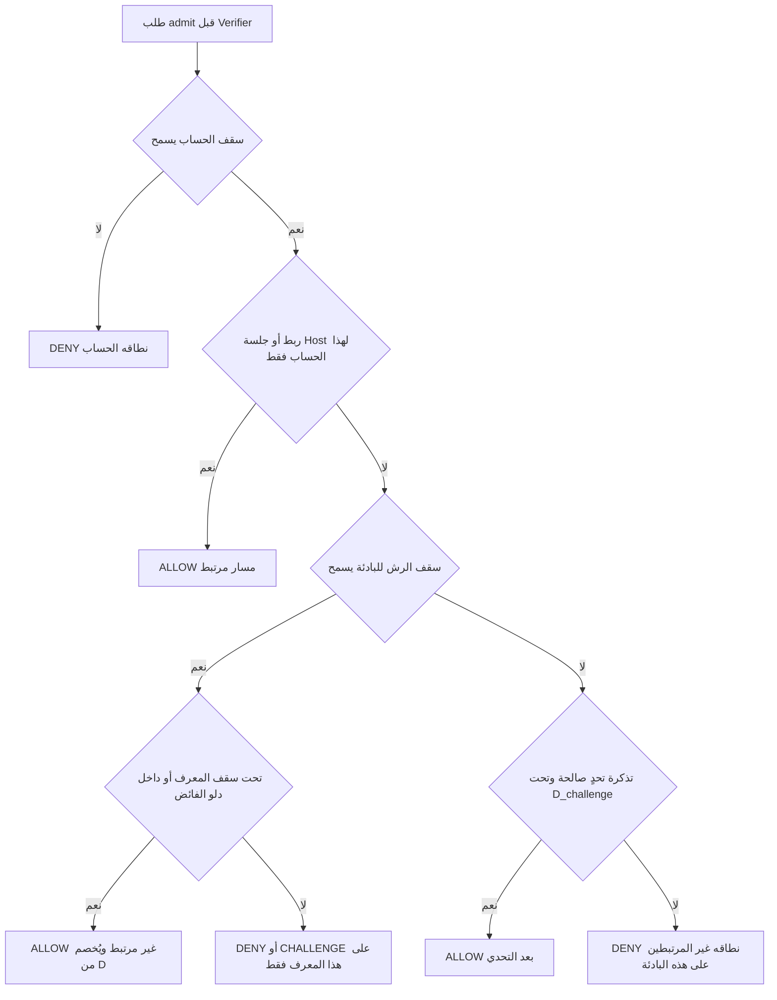

## 1. Root Cause Analysis

المشكلة ليست عتبة منخفضة، ولا طبقة واحدة «قاسية». الطبقات الخمس الحالية تخلط أربعة قرارات يجب أن تبقى منفصلة: من هو الفاعل، ما مقدار الثقة في هذا التعريف، أي عدّاد يُستهلك، وعلى من تقع العقوبة.

الأسباب الجذرية، لا الأعراض:

1. **المعرّف غير الموثوق يُعامل كأصل حصة (Sybil).** أي مفتاح يستطيع المهاجم إنشاءه بلا تكلفة — Cookie، Client Instance ID، User-Agent، Fingerprint، Browser Major — لا يجوز أن يفتح ميزانية جديدة. التجربة E (2/200 مع Browser Major واحد، و36/200 مع عشرين) هي هذا الخطأ مباشرة: مفتاح المراقبة `IP + Browser Major` جعل تدوير إشارة رخيصة يُقسّم الحارس العابر للحسابات.

2. **عنوان الشبكة يُعامل كفاعل واحد، ثم كمجال عقوبة.** الـIP تحت NAT أو CGNAT ليس شخصًا. رصد «خمسة حسابات من هذا العنوان» قد يكون صحيحًا كإشارة ضغط، وحظر كل من يشاركه العنوان قرار مختلف وغير مبرَّر. هذا هو الفرق بين نطاق المراقبة ونطاق العقوبة. حجب `IP + Browser Major` بسبب تعاقب جهاز A ثم B ثم A هو توسيع للعقوبة على أدلة لا تميّز جهازين حقيقيين عن جهاز يدوّر بصمته.

3. **إعفاء «الجهاز المعروف» بلا قيد الحساب.** تجربة C أظهرت أن الجلسة الموثوقة تخص العلاقة `(instance, account)` لا الشخص ولا الجهاز ككائن آمن. مهاجم يملك 12 حسابًا يملك 12 علاقة مشروعة. إعفاء هذه العلاقات من الحارس العابر للحسابات يلغي الحارس. النجاح على حساب يملكه المهاجم ليس دليلًا على أن محاولاته ضد حسابات أخرى بريئة، وإعادة ضبط تاريخ الخطر عند النجاح يمنحه أداة تنظيف.

4. **الحصة المشتركة لا تُصغَّر عندما يُعفى منها من لا يجب أن يستهلكها.** تجربة D رفعت وصول المهاجم من 13 إلى 21 (و23 في Bootstrap) لأن إعفاء المعروفين ترك الميزانية الكبيرة كما هي لمن تبقى، ومن تبقى يشمل المهاجم غير المعروف. الإعفاء من الاستهلاك بلا تخفيض السقف يفتح سعة هجومية.

5. **قرار ما قبل الـVerifier لا يمكن أن يعتمد على نتيجة لاحقة.** في النمط Pre-check فقط، وعلى دفعة متزامنة، أي منطق «ننتظر الفشل ثم نتعلم» لا يمنع الوصول إلى التحقق. فحص العدّاد ثم زيادته في عمليتين منفصلتين ليست حدًا؛ هي سباق.

الأعراض التي تختفي إن عولجت الجذور، ولا تستحق عتباتها الخاصة: Fingerprint Churn كحجب جماعي، معاملة بصمة LOW كجهاز واحد عبر الشبكات، وقاعدة «خمسة موضوعات خلال عشر دقائق» كحجب للشبكة كلها. هذه القواعد تحاول استنتاج وحدة الفاعل من إشارات لا تحمل هذه المعلومة.

السبب الذي لا يُحل بخوارزمية أذكى على نفس الإشارات: قبل المصادقة، دفعة مستخدمين غير مرتبطين خلف NAT واحد، بنفس عائلة المتصفح، منتجة لنفس توزيع الطلبات، لا يمكن تمييزها عن مهاجم واحد يصطنع هذا التوزيع. أي دالة من هذه الإشارات وحدها إما تدخل الفوج وإما تدخل الرش بالحجم نفسه.

## 2. Feasibility Boundaries

ما يمكن ضمانه بالمعلومات المتاحة فعلًا عند طلب تسجيل الدخول (الحساب المستهدف معروف قبل التحقق من كلمة المرور، والشبكة معروفة، ومعرّف نسخة المتصفح اختياري وغير موثوق):

| الضمان | الشرط |
|---|---|
| سقف محاولات لكل حساب قبل الوصول إلى Verifier، لا يتأثر بتدوير IP أو UA أو Cookie | Pre-check ذرّي |
| سقف واحد لمجموع محاولات «غير المرتبطة بهذا الحساب» لكل بادئة شبكة، لا يتضاعف بتدوير المعرّفات | Pre-check ذرّي، والمفتاح هو البادئة لا البصمة |
| مستخدم مرتبط سابقًا بهذا الحساب لا يُحجب لأن غير المرتبطين استنفدوا ميزانية الرش | الربط موجود: Outcome سابق أو تأكيد جلسة من الـHost |
| نجاح المهاجم على حساباته لا يمسح عدّاد الرش ولا يفتح محاولات على الضحايا | الربط مقصور على الحساب نفسه |
| تحت Redis السليم، التزامن لا يتجاوز السقف | سكربت Lua واحد يتحقق ويزيد |

ما لا يمكن ضمانه، وهذا حد استحالة لا نقص تنفيذ:

- **لا يمكن** إدخال كل مستخدم جديد بلا Cookie ولا ربط، في مكتب من 100 شخص أو خلف CGNAT، وفي الوقت نفسه إبقاء ميزانية الرش أصغر من حجم هذا الفوج. الإشارتان متطابقتان. أقل معلومة موثوقة تكسر التعارض، بالترتيب من الأرخص إلى الأقوى:
  1. **ربط `(instance, account)` ناتج عن نجاح حقيقي أو عن جلسة أثبتها الـHost لهذا الحساب فقط.** يحلّ العائدين. لا يحلّ الفوج غير المرتبط.
  2. **إثبات تفاعلي يستهلك تكلفة** (تحدٍّ يرجعه الـHost: CAPTCHA أو PoW أو خطوة ثانية)، يُستبدل بتذكرة أحادية الاستعمال مخزّنة عند الخادم. يحلّ الإنسان غير المرتبط بتكلفة UX، ولا يُمنح بمجرد صنع Cookie.
  3. **قرار منتج صريح:** «نقبل أن يصل إلى التحقق حتى D محاولة غير مرتبطة يوميًا من هذه البادئة». هذا ليس حلًا خوارزميًا؛ هو قبول ميزانية هجوم.
- **لا يمكن** إيقاف botnet يوزّع محاولة واحدة لكل IP. حارس الشبكة يحدّ التركيز لا التوزيع. ما يبقى ضد التوزيع هو سقف الحساب، ورفض كلمات المرور المخترقة عند إنشائها، وMFA. OWASP يعامل حجب الـIP كطبقة غير كافية وحدها لنفس السبب.
- **لا يمكن** منع مالك حساب من استهلاك ميزانية هذا الحساب. هي ميزانيته، مشروعة كانت أم خبيثة.
- **لا يمكن** وعد أي شيء قبل Verifier إذا كان الـHost لا يسأل المكتبة إلا بعد التحقق.

بصمة أفضل، أو Machine Learning على نفس الثلاثية `(IP, UA, fingerprint منخفض الثقة)`، لا تضيف بتًا موثوقًا جديدًا. المهاجم الذي يقلّد الفوج يمرّ بالنموذج الذي يمرّر الفوج.

## 3. Alternative Designs

### التصميم A — السقف على الحساب فقط

كل محاولة تُخصم من الحساب المستهدف ولا يوجد حجب شبكي. العدالة خلف NAT كاملة، بما في ذلك اليوم الأول والمستخدم الذي فقد الـCookie. الرش بمحاولة لكل حساب يصل كله إلى Verifier؛ هذا بالضبط ما رفع التجربة المعزولة من 4/200 إلى 200/200. قفل الحساب بعد إخفاقات قليلة يفتح أيضًا حجبًا انتقاميًا: خمسة إخفاقات موزعة تقفل الضحية. يُرفض كتصميم وحيد. يُحتفظ به كطبقة عمق داخل أي تصميم آخر، لأن تدوير الشبكة يجب ألا يُسقط حماية الحساب.

### التصميم B — سقف IP مرتفع بما يكفي لأكبر موقع

مفتاح واحد `IP`، وسقف بحجم ذروة المكتب (مئات المحاولات). العائدون يمرون. المهاجم من هذا العنوان يحصل على ميزانية المكتب كلها، دائمًا، حتى لو كان كل الموظفون مرتبطين ولا يحتاجون هذه السعة. مستخدم أو سكربت واحد يستطيع استنزافها فيُحجب الباقي. تدوير UA لا يضاعف الحصة إن كان المفتاح IP فقط، وهذا تحسّن عن الوضع الحالي، لكنه يترك نطاق العقوبة مساويًا للشبكة. تجربة D تحذر من ترك هذه السعة كبيرة. يُرفض كتصميم أساسي. يبقى مفيدًا فقط كسقف طوارئ أعلى من ميزانية الرش، لا كآلية عدالة.

### التصميم C — مساران وميزانية رش غير قابلة للمضاعفة

تفصيله في القسم التالي. مختصرًا: محاولة الحساب المرتبط لا تمس ميزانية الشبكة، ومحاولات غير المرتبطين تشترك في ميزانية واحدة صغيرة لا تنمو بصنع المعرّفات، والعقوبة عند نفادها تصيب غير المرتبطين فقط. هذا يعالج تجارب A–E في مواضع فشلها الفعلية لا برفع عتبة.

### التصميم D — كل محاولة غير مرتبطة فوق حد مجاني ضئيل تتطلب تحديًا

يكسر الاستحالة بشراء إشارة جديدة، ويعطي المستخدم الجديد مسارًا لا يملكه المهاجم الآلي مجانًا. كتصميم وحيد يعاقب كل دخول أول بتفاعل، ويفشل إن تجاهل الـHost التحدي وعامله كسماح، ويضعف أمام مزارع CAPTCHA إن رُفع السقف بعده بلا حد. الاعتماد على Cookie وحدها بعد «نجاح التحدي» يعيد المضاعفة؛ التذكرة يجب أن تكون أحادية ومحسوبة على الخادم. يُرفض كبديل عن C، ويُعتمد كالمخرج الوحيد للفوج غير المرتبط عندما تكون ميزانية الرش أضيق من عددهم. مكتبة PHP عامة لا يجوز أن تفرض مزود CAPTCHA؛ القرار الراجع للـHost هو `CHALLENGE`، لا `ALLOW`.

لا أوصي بتصميم قائم على بصمة الجهاز، ولا على إعفاء كل جهاز معروف، ولا على ردّ الحجز عند النجاح. التجارب رفضت هذه الصيغ، والسبب البنيوي (مضاعفة الحصة أو توسيع الإعفاء خارج الحساب) يبقى في أي إعادة تسمية لها.

## 4. Recommended Architecture

التوصية هي التصميم C مع مخرج التحدي من D، لا كطبقة خامسة شبيهة بـK1–K5. اسم العمل: **مساران، ميزانية غير قابلة للمضاعفة، عقوبة بأضيق نطاق**.

### مبدأ التشغيل

كل محاولة تصديق تُصنَّف قبل أي حجب:

- **مسار مرتبط** إذا وُجد ربط سابق `(client_instance, account)` ناتج عن نجاح، أو أكّد الـHost جلسة تحقق منها لهذا الحساب نفسه. هذا المسار يستهلك ميزانية الحساب فقط.
- **مسار غير مرتبط** في كل حالة أخرى: مستخدم جديد، Cookie مفقودة، حساب آخر من جهاز مرتبط بحساب مختلف، معرّف مصنوع للتو، أو غياب المعرّف. هذا المسار يستهلك ميزانية الحساب وميزانية الرش الخاصة ببادئة الشبكة.

الربط لا يعني «هذا الجهاز آمن». يعني فقط: محاولة إعادة دخول هذا الحساب من هذه النسخة ليست رشًا عابرًا للحسابات. محاولة الحساب B من نسخة مرتبطة بـA تبقى غير مرتبطة وتُخصم من ميزانية الرش. بهذا تسقط تجربة C: اثنتا عشرة جلسة موثوقة تسمح باستخدام الاثني عشر حسابًا داخل سقوفها، ولا تُنتج اثنتي عشرة حصة ضد الضحايا.

معرّف النسخة الذي يصنعه الـHost (Cookie HttpOnly، أو Installation ID) أداة فصل وعدّ وتاريخ، وليس امتيازًا. وجوده لا يمنح حصة. تدويره لا يصفّر عدّادًا. حدّ الامتياز: لا يصبح المعرّف أصلًا مستقلًا للحصة إلا داخل العلاقة المثبتة مع حساب محدد، وحتى هناك السقف هو سقف ذلك الحساب لا سقف جديد على الشبكة.

### مفاتيح الاستهلاك

ثلاثة عدّادات فقط، كلها ذرّية:

1. **الحساب**، عبر النوافذ. يحدّ العمق (تخمين كلمة مرور واحدة) ويبقى ساريًا عند تغيير IP. الإخفاق، إن وُجد Outcome، يشدّد التراجع الزمني على هذا الحساب وحده. لا قفلًا طويلًا يسهّل حبسه انتقاميًا؛ `DENY` مؤقت مع `retry_after`. النجاح لا يصفرّ عدّاد الرش الشبكي. النجاح لا يزيد ميزانية الحساب فوق سقفها.
2. **الرش غير المرتبط لكل بادئة**، بنافذتين على الأقل: دلو قصير (Burst + معدل) وسقف يومي `D`. المفتاح `IPv4 /32` و`IPv6 /64` قابل للتهيئة. ليس `Browser Major`. ليس البصمة. كلمة المرور وOTP وواجهات الاستعلام الحسّاسة غير المصادق عليها تسحب من الميزانية اليومية نفسها حتى لا يضاعف المهاجم بتبديل نوع الطلب. لكل نوع سقف حسابي مستقل أضيق (OTP أضيق من كلمة المرور).
3. **الثقيل داخل البادئة**، بسقف فرعي ثابت لكل Instance، مع دلو فائض واحد. من يكرر الطلب من معرّف واحد يُعاقَب وحده حتى لا يبتلع `D`. من يصنع ألف معرّف لا يحصل على ألف سقف فرعي: بعد عدد محدود من المفاتيح المميزة في النافذة (مثلاً بضع عشرات) يسقط الباقي في دلو الفائض الواحد. هذا يحدّ الذاكرة ويمنع Sybil من تحويل العزل إلى مضاعفة. مجموع ما يصل إلى Verifier من المسار غير المرتبط يبقى `≤ D` يوميًا لكل بادئة، مهما دارت المعرّفات.

`D` لا يُشتق من عدد الـCookies الظاهرة. إن لزم تكييفه مع حجم الشبكة، ففقط من عدد الروابط المثبتة تاريخيًا على هذه البادئة، وبسقف صلب `D_max` يقرّه المنتج. مهاجم باثني عشر حسابًا لا يحرّك هذا التقدير تحريكًا ذا شأن، بعكس رفع السقف لأن «ظهر كثير من البصمات».

مسار التحدي، إن فعّله الـHost: تذكرة أحادية في Redis، تُستهلك عند السماح، ومحدودة بسقف يومي `D_challenge` أعلى من `D` ولكن غير لانهائي وغير قابل للضرب بعدد التذاكر المصدرة. التحدي يشتري مقعدًا داخل السقف الأعلى، لا يفتح عائلة سقوف.

### متى يُحجب من

المستخدم المرتبط لا يدخل صندوق الرش. نفاد `D` لا يقطعه. هذا هو الإصلاح الذي يوقف استخدام المهاجم كأداة لتعطيل زملائه: قدرته على الإغراق تعطّل غير المرتبطين على البادئة نفسها فقط، وهم الأقلية (جدد، Cookies ممسوحة، وهو نفسه)، لا المكتب كله.

بصمة LOW لا تُنشئ هوية ولا حجبًا عابرًا للشبكات. تشابه User-Agent المتوقع ليس دليل وحدة جهاز. رصد Churn يُحذف كسبب حجب جماعي؛ المعرّف المدوَّر يبقى أصلًا غير موثوق فيبقى داخل `D`. لا حاجة لإثبات أن A وB جهاز واحد.

### ما يُضمن قبل المصادقة حسب نمط الـHost

| النمط | قبل Verifier | ما لا يحدث |
|---|---|---|
| Pre-check فقط | سقوف الحساب والرش والثقل، ذرّيًا. لا تعلم، ولا تخرج روابط جديدة | لا عدّاد إخفاق. العائدون لا يُعفون إلا إذا أكّد الـHost الجلسة |
| Pre-check + Outcome | الضمان السابق، زائد تراجع زمني حسب الإخفاق، وإنشاء ربط عند النجاح فقط | النجاح لا يردّ حصة الرش ولا يمسحها |
| Outcome فقط | لا ضمان قبل Verifier. الدفعة الحالية وصلت كلها | المكتبة ترفض أن تسمّي هذا حماية دخول |

الحجز المسبق مع التعويض عند النجاح مرفوض: نجاح حسابات يملكها المهاجم يعيد له سعة الرش، وربط الحجز بالمحاولة الخاطئة تحت التزامن يفتح ثغرة محاسبية. المحاولة غير المرتبطة تُخصم عند `admit` وتبقى مخصومة إن نجحت. مكافأتها الوحيدة هي ربط لاحق لهذا الحساب.

### الذرّية والتخزين والأعطال

تحت Redis، القبول يتم في سكربت Lua واحد: قراءة عدّادات الحساب والبادئة (ومفتاح المعرّف إن كان ضمن السقف العددي) ثم زيادتها معًا أو رفضها معًا. `INCR` ثم فحص منفصل، أو `GET` ثم `SET`، كلاهما مرفوض لأن التزامن يكسر السقف. العدّادات تحمل TTL النافذة فقط. لا سجل دائم لكل محاولة.

الروابط تُنشأ عند النجاح فقط، كتجزئات HMAC لا كقيم خام: `HMAC(secret, instance)` مع `HMAC(secret, account)` وبادئة الشبكة. TTL طويل محدود (أسابيع، لا سنوات)، وسقف عدد الروابط لكل حساب حتى لا تتحول المكتبة إلى نظام إدارة أجهزة. لا تُخزَّن بصمة دائمة لزائر لم ينجح. مفاتيح المعرّفات داخل النافذة محدودة بعدد أقصى؛ ما زاد عنه دلو واحد.

تدوير سر الاشتقاق لا يجوز أن يبدأ عدّادات من الصفر. أثناء التداخل يُقرأ المفتاح القديم والجديد ويُحتسب المجموع، أو يبقى اسم مفتاح العدّاد مستقرًا ويُدار السر للقراءة فقط. النشر المختلط الذي يغيّر هوية المفتاح يمنح المهاجم ميزانية ثانية؛ اختبار التراجع يجب أن يثبت أن مجموع النسختين لا يتجاوز `D`.

انقطاع Redis يُسقط الضمان الموزّع. السلوك المحدد: لا فتح كامل ولا إغلاق كامل. ذاكرة موجبة قصيرة للروابط التي رُئيت للتو، وسقف محلّي في كل Worker يساوي `ceil(D / N)` حيث `N` هو الحد الأقصى المعلن لعدد الـWorkers لا العدد المتصل الآن. الضمان يضعف إلى «لكل عملية» ويُوثَّق هكذا. غياب المعرّف أو البصمة لا يفتح مسارًا خاصًا؛ الطلب يدخل دلو الفائض غير المرتبط.

IPv4 لا يُجمع إلى `/24` لأن ذلك يوسّع الانفجار. IPv6 لا يُحسب `/128` لأن تدوير عنوان الخصوصية داخل `/64` يضاعف `D`. طول البادئة قرار صريح، الافتراضي المقترح `/32` و`/64`.

## 5. Threat-Model Walkthrough

الأرقام هنا مفاتيح قرار لا توصية صامتة. للتوضيح فقط: سقف حساب 10 محاولات/يوم و5/15 دقيقة، `D = 40` محاولة غير مرتبطة/يوم للبادئة، Burst قصير 5، تحدٍّ اختياري حتى `D_challenge = 200` بتذاكر أحادية. من لا يقبل هذه الأرقام يغيّر المفتاح ولا يغيّر الشكل.

1. **مكتب 100 خلف NAT، Browser Major واحد، روابط موجودة من أيام سابقة.** كل واحد يحاول حسابه من نسخته المرتبطة. المسار مرتبط. لا يُخصم من `D`. يصل المائة إلى Verifier. تشابه UA لا يُنتج Churn ولا حجب `IP+Browser`. المتضرر الجانبي: لا أحد. إن كان اليوم الأول بلا أي Cookie، فهم فوج غير مرتبط: يصل `min(100, D)` فقط، والباقي `CHALLENGE` أو انتظار حتى الغد. هذا ليس فشل تصنيف؛ هو حد القسم 2، ويُعالَج بتحدٍّ أو برفع `D` مع قبول أن المهاجم في ذلك اليوم يحصل على القيمة الجديدة.

2. **مستخدمان شرعيان، نفس IP ونفس UA، A ثم B ثم A.** إن كانا مرتبطين بحسابيهما: كلاهما `ALLOW`، ولا تفسير للتتابع كتدوير. إن كانا غير مرتبطين ومعرّفاهما مختلفان: كل منهما يُخصم من `D` تحت سقف الثقيل، فيمران ما دام المجموع تحت `D`. لا حجب مشترك لعائلة المتصفح.

3. **مستخدم جديد بلا Cookie.** غير مرتبط. يمر إن بقي من `D` وسقف حسابه، ويُطلب من الـHost أن يزرع معرّف النسخة في الاستجابة حتى تثبت المحاولة التالية على نفس المفتاح غير الموثوق (هذا يمنع تكراره من أن يبدو كألف جهاز، ولا يمنحه حصة إضافية). بعد النجاح يُنشأ الربط إن وُجد Outcome. إن كان `D` مستنفدًا من رش حقيقي: هذا المستخدم يتلقى `CHALLENGE` أو `DENY`. لا طريقة لتمييزه عن المحاولة رقم 41 للمهاجم بدون التحدي.

4. **معروف، كلمتان خاطئتان ثم نجاح.** مسار مرتبط. الإخفاقان على حسابه فقط، ثم النجاح. زملاؤه لا يُلمسون. عدّاد رش البادئة لا ينقص ولا يُصفَّر. إن كان فقد الـCookie فهو كالمستخدم الجديد لهذه المحاولة، ويستهلك 3 من `D`، والنجاح ينشئ ربطًا ولا يسترد الثلاثة.

5. **رش 200 حساب، بلا أي حساب صحيح، مع تدوير Cookie وUA.** كلها غير مرتبطة. يصل إلى Verifier على الأكثر `D` (توضيحيًا 40) لا 200، وواحدة لكل حساب داخل سقف الحساب. البقية `DENY` قبل التحقق. تدوير الهوية لا يرفع المجموع. لا يُحجب حساب ضحية حجبًا طويلًا بسبب محاولة واحدة؛ الحجب الجماعي للموظفين المرتبطين لا يحدث.

6. **12 حسابًا و12 جلسة صحيحة، ثم استهداف الآخرين.** الدخول إلى الحسابات الاثني عشر: مسار مرتبط، داخل سقف كل حساب. أي حساب ثالث: مسار غير مرتبط، ضمن `D` الجماعية لا `12 × حصة`. مع `D = 40` يصل 40 لا 200، وبلا إعفاء التجربة C الذي أوصل 61/61 أو 200/200. نجاحاته لا تنظّف العدّاد. المتضرر الجانبي: غير المرتبطين على نفس البادئة بعد نفاد `D`، لا حاملو الجلسات الشرعية الآخرون.

7. **تغيير UA وBrowser ID كل محاولة.** لا مفتاح اسمه Browser Major. كل المعرّفات الجديدة دلو واحد حتى `D`. التجربة E (36/200 عبر 20 بصمة) لا تتكرر لأن التقسيم لم يعد يخلق حراسًا مستقلين.

8. **مهاجم وسط المكتب يحاول تعطيل الجميع.** الموظفون المرتبطون خارج الميزانية التي يملؤها. إغراقه يستهلك `D` ثم يُرفض هو، ومن لم يرتبط بعد على هذا العنوان. لا يستطيع حجب المئة عبر طلبات كثيرة ولا عبر بصمات كثيرة. هذا أقصى ما تسمح به الاستحالة: بقايا الضرر على غير المثبتين، لا على السكان.

9. **100 محاولة متزامنة.** سكربت واحد. عدد من يصل إلى Verifier يساوي المتبقي من السقف المعني، لا 100 فوقه. الطلبات الزائدة `DENY` حتى لو وصلت في اللحظة نفسها وقبل أي Outcome.

10. **الـHost لا يبلّغ النتائج.** سقوف Pre-check تبقى إن كان ينادي `admit` قبل التحقق. لا روابط جديدة من المكتبة. مكتب عائد بلا تأكيد جلسات من الـHost يُعامَل كغير مرتبط إلى الأبد، فيصطدم بـ`D`. إن كان لا ينادي `admit` أصلًا: الدفعة الحالية بلا ضمان، والمكتبة لا توفّر حماية دخول بل إحصاءً بعد وقوع التحقق.

مهاجم منخفض المعدل (النوع G) لا يتجاوز `D` في اليوم مهما أبطأ؛ النافذة القصيرة وحدها كانت ستمنحه `D` كل عشر دقائق، لذلك السقف اليومي جزء من التعريف لا تحسين. مهاجم متعدد العناوين يحصل على `D` لكل بادئة، ويصطدم بسقف الحساب عبر العناوين. ذلك هو الرش الموزّع، وهو خارج قدرة أي مفتاح IP، ويُعلَن كذلك.

## 6. Security vs Availability Trade-offs

المكاسب بالنسبة إلى السلوك الذي وُصف في التجارب:

- المكتب المرتبط يخرج من حجب 56/61 أو 117/121 إلى حجب صفري سببُه الشبكة. حجب الحساب الفردي بالإخفاقات يبقى، وهو مستحق.
- الرش من عنوان واحد يبقى محدودًا بـ`D` يوميًا بعد أن كان تعطيل الحارس الشبكي يمرّر 200/200، وبعد أن كان إعفاء المعروف يمرّر 61/61.
- تدوير Browser Major أو Fingerprint أو Cookie لا يضاعف `D`.
- استنزاف مشترك لم يعد أداة لقطع السكان المرتبطين.
- بصمة LOW لم تعد هوية عابرة للشبكات، فيختفي نمط حجب 596/600 الناتج عن دمج خاطئ.

الخسائر التي تحتاج اعتمادًا صريحًا، ولا أفترض قبولها:

- **`D` هو عدد تخمينات الرش التي يقبل المنتج أن تصل إلى Verifier من بادئة واحدة في يوم.** عند `D = 40` يصل 40 من 200 لا 4 من 200 كما في أحد أرقام النظام الحالي. هذا ارتفاع مقصود عن أشد أوضاع الحارس الشبكي، لأنه كان يشتري الرقم 4 بحجب الأبرياء. إن كان المطلوب إبقاء المهاجم عند 4، فسيبقى فوج غير المرتبط الأكبر من 4 محرومًا بلا تحدٍّ. لا يوجد ثالث على هذه الإشارات.
- **اليوم الأول، ومسح Cookies جماعيًا، والكشك الذي يمسح التخزين، وCGNAT بلا تحدٍّ:** المتاح من غير المرتبطين هو `D` ثم توقف. CGNAT لآلاف المشتركين لا يجوز رفع `D` إلى حجمهم؛ `D_max` يبقى سقف الرش. الفائض البشري يمر عبر تحدٍّ أو ينتظر.
- **غير المرتبط بجانب مهاجم نشط على نفس NAT** يتضرر حتى يمر التحدي أو تمتلئ النافذة التالية. لا ضمان توفر مطلق له.
- **Pre-check بلا جلسات يؤكدها الـHost وبلا Outcomes** لا يكتسب عدالة العائدين. السقف الآمن يبقى، والراحة لا تأتي.
- التحدي يكلّف UX ويتكامل مع إمكانية الوصول. تجاهله ومعاملة `CHALLENGE` كـ`ALLOW` يسقط الفرق بين `D` و`D_challenge`.
- أثناء انقطاع Redis يصير الضمان محليًا لكل Worker. أسوأ من السقف الموزّع بمقدار `N` عملية إن ضُبط `N` خطأ؛ لذلك `N` معلن ومحافظ لا «عدد تقديري».

ما لم يُمس: حماية الحساب عبر الشبكات، ومنع القفل الانتقامي الطويل، ومنع النجاح المزيّف من غسل تاريخ الرش.

## 7. Host Integration Contract

الحد الأدنى حتى تكون الضمانات حقيقية:

1. **`admit` قبل استدعاء Verifier** لكل محاولة كلمة مرور أو OTP أو عملية حسّاسة غير مثبتة. بلا هذا النداء لا يوجد ضمان. النمط Outcome فقط يُوثَّق كغير كافٍ.
2. **معرّف الحساب المستهدف بعد التطبيع**، ممرَّرًا كقيمة جاهزة للتجزئة. المكتبة لا تدير دليل الحسابات.
3. **نوع العملية:** تقديم سر، مقابل استمرار جلسة. استمرار الجلسة ليس محاولة رش.
4. **تأكيد الربط، بأحد الطريقين:** إبلاغ `SUCCESS/FAILURE` بعد المحاولة، أو تصريح صريح `session_for(account)` لا يرسله الـHost إلا بعد أن يكون هو قد أثبت الجلسة. التصريح الثقة فيه ثقة الـHost، وهو أصلاً نظام المصادقة. التصريح لحساب A لا يغطي B.
5. **معرّف نسخة يزرعه الـHost** (Cookie عشوائية HttpOnly، أو Installation ID). مطلوب للعدالة داخل البادئة ولإبقاء المستخدم المعروف خارج `D`. غيابه لا يكسر سقف `D`؛ يكسر العزل بين شخصين غير مرتبطين فيملأ أحدهما الدلو. المعرّف ليس سرًا عالي الثقة، وتوقيعه يمنع العبث بالصيغة لا يمنع زراعته عبر زيارة الموقع.

عقد الاختيارات، لا الإلزام:

- قرار `CHALLENGE` يعني: لا يصل الطلب إلى Verifier حتى يعود الـHost بتذكرة. `CHALLENGE` ليس `ALLOW`. إن كان التطبيق لا يملك واجهة تحدٍّ، يعامل القرار كـ`DENY` ويعيش داخل `D` فقط.
- لا قاعدة بيانات إضافية، ولا مزود بصمة، ولا إدارة أجهزة في التطبيق. Redis مشترك كما هو مفترض اليوم.
- مفاتيح يقررها المنتج قبل التشغيل ولا تخبئها المكتبة كـ«قيم آمنة»: `D`، `D_max`، `D_challenge`، سقوف الحساب لكل نوع عملية، طول بادئة IPv6، `N` الخاص بوضع العطل، مدة الربط.

أثر التوافق: مستهلك حالي لا يرسل Outcomes ويطلب فقط سماح/منع يبقى يعمل، بسقوف محاولة لا سقوف إخفاق، وبلا مسار مرتبط ما لم يرسل تصريح الجلسة. هذا أصرح من نظام يعاقب المكتب لأنه خمّن أن خمس جلسات رش. إضافة النداء بعد النتيجة اختيارية للتقوية لا شرطًا لمنع المضاعفة.

## 8. Validation Strategy

لا عتبة قبول أمنية مخترعة. البوابة هي محافظات يجب أن تُكسر الاختبارات إن انكسرت، ثم قرار بشري على قيمة `D`.

فرضيات تُثبت قبل أي كود إنتاج:

- مجموع ما يرجعه `admit=ALLOW` للمسار غير المرتبط على بادئة واحدة خلال نافذة اليوم `≤ D`، مع تدوير Cookie وUA وFingerprint وBrowser Major، ومع 100 طلب متوازٍ، ومع Workers عدة.
- مسار مرتبط لا يُرفض بسبب استنفاد `D`. سيناريو المكتب المرتبط من التجربة A وC يُعاد كما هو، لا ممزوجًا مع سيناريو LOW.
- نجاح على 12 حسابًا مملوكة ثم 200 هدف غريب: ما يصل للغرباء `≤ D`، وما يصل للحسابات المملوكة داخل سقف كل حساب فقط. إعادة التجربة C وE بهذا الفصل.
- رد النجاح لا ينقص عدّاد البادئة. إعادة التجربة الذهنية D: إعفاء المرتبطين يترافق مع بقاء `D` صغيرًا، فيُقاس وصول المهاجم مقابل `D` لا مقابل السقف القديم الكبير.
- غياب Outcome مع وجود `admit`: السقف يبقى. غياب `admit`: الاختبار يثبت أن الدفعة كاملة وصلت، ويُسجَّل ذلك كحد للنمط لا كنجاح.
- تدوير سر المفتاح ونشر نسختين معًا: المجموع ما زال `≤ D`.
- Redis متوقف: لا Worker يتجاوز دلوه المحلي، والمجموع `≤ N × حصة العملية`، والرابط المخزّن مؤقتًا لا يُعفي حسابًا غير حسابه.
- ضغط ذاكرة: مئة ألف Instance ID على بادئة واحدة لا تنشئ مئة ألف مفتاح؛ العدّادية المتتبَّعة محدودة والباقي دلو واحد، والسقف ما زال `D`.
- IPv6: تدوير `/128` داخل `/64` لا يضاعف `D`.

مقاييس تُجمع لكل سيناريو على حدة، بلا دمج:

- `reached_verifier / attempts` للمهاجم، مفصولًا: حساب واحد، عبر حسابات، عنوان واحد، عناوين كثيرة.
- `denied_legitimate / legitimate` مفصولًا: مرتبط، جديد، Cookie مفقودة، LOW، مكتب متزامن، CGNAT.
- `collateral`: عدد المرتبطين الذين رُفضوا أثناء رش غير مرتبط على عنوانهم. الهدف الصفري.
- `sybil_gain`: فرق ما وصل إلى Verifier بين هوية واحدة وألف هوية مدوَّرة. الهدف صفر فوق `D`.

أرفض هذا التصميم بنفسي إذا أظهر الاختبار أيًا مما يلي: تضاعفًا فعليًا فوق `D` بتدوير معرّف غير موثوق؛ رفض مستخدم مرتبط لأن غير المرتبطين ملأوا الميزانية؛ غسل عدّاد الرش بنجاح على حساب مملوك؛ تجاوز السقف تحت التزامن؛ أو حاجة صامتة لرفع `D` إلى حجم أكبر مكتب حتى يمرّ العائدون المرتبطون. الحالة الأخيرة تعني أن الربط لم يُعزل عن ميزانية الرش، أي أن التصميم لم يُنفَّذ.

مقارنة عادلة مع النظام الحالي: إعادة A ثم B ثم C ثم E كبطاريات منفصلة على نفس توليد الطلبات، مع الإفصاح عن `D` المستخدم. رقم واحد مدمج من هذه البطاريات لا يُقبل كدليل.

## 9. Outstanding Questions

هذه قرارات منتج لا فجوات بحث:

1. ما قيمة `D` اليومية لكل بادئة، وما `D_max`، التي تقبلون أن تصل إلى Verifier من مهاجم بلا حسابات؟ كل رقم أقل من حجم أكبر فوج غير مرتبط تتوقعونه في يوم بارد سيحتاج تحديًا أو رفضًا.
2. هل واجهة الـHost ستنفّذ `CHALLENGE`، أم تُعامله كـ`DENY`؟ هذا يحدد مصير اليوم الأول والكشك وCGNAT والمستخدم الذي فقد Cookie أثناء رش جارٍ.
3. هل المستهلكون الحاليون يستطيعون تصريح «جلسة مثبتة لهذا الحساب»، أم الإبلاغ بالنجاح، أم لا هذا ولا ذاك؟ الحالة الثالثة تُبقي العائدين داخل `D`.
4. طول بادئة IPv6، والحد `N` لعدد Workers أثناء عطل Redis.
5. هل كلمة المرور وOTP تشتركان في `D` واحدة؟ توصيتي نعم على مستوى البادئة، مع سقوف حساب أضيق لكل نوع. إن فُصلتا، فالمهاجم يحصل على مجموعها، ويجب اعتماد هذا المجموع صراحة.
6. سياسة القفل الانتقامي: تراجع زمني قصير لا تجميد حساب لساعات بعد إخفاقات قليلة من عناوين مختلفة.

لا ينقص التصميم إشارة بصمة، ولا نموذج تعلم، ولا خدمة سمعة IP إلزامية. تصنيف العناوين (استضافة مقابل سكني) تحسين اختياري لاحق يشدّد `D` على الاستضافة؛ غيابه لا يغيّر المعمارية.

## 10. Final Verdict

أوصي ببناء هذا التصميم، لا بإعادة ضبط K1–K5.

الشرط الذي يُحسم قبل الكتابة، وهو شرط واحد: اعتماد الميزانية المتبقية `D` كقرار أمني ظاهر، مع تحديد هل التحدي جزء من العقد أم أن غير المرتبطين يعيشون داخل `D` فقط. بلا هذا الاعتماد ستنزلق التنفيذات إلى رفع السقف «حتى يمر المكتب»، فيعود فشل التجربة A من باب تجربة D.

لا شرط جوهري آخر. المشكلة غير قابلة للحل الكامل على `(IP, User-Agent, Fingerprint)` مهما تغيّرت العتبات، وقابلة للحل العملي في اللحظة التي تُفصل فيها عقوبة السكان المرتبطين عن ميزانية الرش، وتُمنع المعرّفات الرخيصة من صناعة حصص، ويُطلب من الـHost إما إثبات جلسة لهذا الحساب وإما تحدٍّ تفاعلي عند نفاد الميزانية الصغيرة. ذلك تغيير في فلسفة التحديد: الشبكة لم تعد فاعلًا يُعاقَب، والمعرّف الذي يستطيع المهاجم زرعه لم يعد زبونًا يُمنح، والحساب هو الوحدة الوحيدة التي تُشترى محاولاتها بمعرفة هدفها لا بانتحال جارها.
