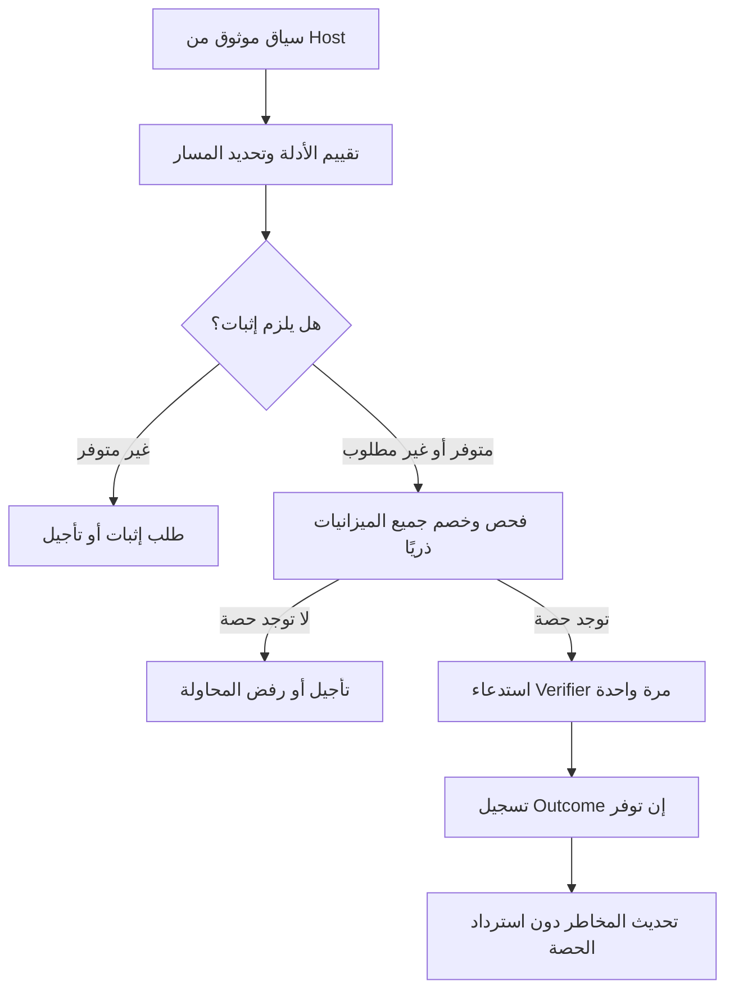

**حكمي المعماري: المشكلة قابلة للتحسين بدرجة كبيرة، لكنها لا تقبل ضمانًا مطلقًا يجمع كل الأهداف بالمعلومات الحالية.** لا تستطيع المكتبة ضمان وصول كل مستخدم جديد خلف NAT، وفي الوقت نفسه فرض سقف منخفض على مهاجم يستطيع تقديم الإشارات نفسها، دون دليل إضافي أو تفاعل إضافي أو مقايضة معلنة.

أفضل تصميم أقترحه هو **بوابة قبول قبل التحقق، بميزانيات مشتركة لا تُسترد عند النجاح، مع فصل هوية العميل عن استحقاقه للحصة، وإثبات محدد للحساب والعملية عند الحاجة**. هذا التصميم يغلق مسارات التدوير والإعفاء غير المحدود، لكنه لا يخفي التعارض المتبقي عند نفاد الموارد المشتركة.

الدراسة التالية مبنية على وصفك والنتائج التي أوردتها، وعلى المصادر الأصلية المشار إليها. لم أراجع المستودع، ولم أُجرِ قياسات جديدة، ولم أكتب تنفيذًا.

## 1. Root Cause Analysis: أين تكمن المشكلة الحقيقية؟

### 1.1 الخلط بين التشابه، والهوية، والاستحقاق

هذه ثلاثة أسئلة مختلفة:

1. هل تتشابه الطلبات؟
2. هل صدرت عن الكيان نفسه؟
3. هل يستحق هذا الكيان محاولة إضافية؟

النظام الموصوف ينتقل أحيانًا من إجابة السؤال الأول إلى الثالث مباشرة.

مثلًا:

- تشابه `IP + Browser Major` لا يثبت وحدة الجهاز.
- اختلاف Fingerprint لا يثبت أن جهازًا واحدًا يدوّر هويته.
- صلاحية Session تثبت واقعة مصادقة أو امتلاك جلسة ضمن شروطها، ولا تثبت حسن النية.
- وجود Cookie صادرة من الخادم يثبت أن الخادم أصدرها، ولا يثبت أن حاملها لا يمتلك ألف Cookie أخرى.

**المشكلة الأساسية هي إسناد معنى أمني أقوى مما تسمح به الإشارة.**

وتؤكد إرشادات OWASP أن معلومات Fingerprint المقدمة من العميل قابلة للتزييف، وأن الدفاعات الفردية تحتاج إلى طبقات أخرى تعوض تجاوزها. [OWASP: Credential Stuffing Prevention](https://cheatsheetseries.owasp.org/cheatsheets/Credential_Stuffing_Prevention_Cheat_Sheet.html)

### 1.2 نطاق المراقبة ليس بالضرورة نطاق الحجب

يمكن أن يكون تجميع النشاط على مستوى الشبكة مفيدًا لاكتشاف:

- زيادة مفاجئة في المحاولات.
- ارتفاع تنوع الحسابات المستهدفة.
- استهلاك متزامن كبير.
- تغير سلوك المجموعة بمرور الوقت.

لكن هذه الملاحظات لا تحدد تلقائيًا أي مستخدم داخل الشبكة هو المسؤول.

لذلك يجب فصل:

> «هذه المجموعة تحتاج إلى احتياط إضافي» عن «كل فرد فيها يستحق الحجب».

الحجب المشترك ليس مجرد نتيجة لكشف الهجوم؛ إنه **قرار توزيع ضرر** يحتاج إلى تبرير مستقل.

### 1.3 نمط A ثم B ثم A لا يثبت Churn

وفق الوصف، هناك انتقال غير مشروع من تعاقب طلبات مختلفة إلى افتراض وجود مصدر مادي واحد.

لكي يصبح تغير البصمة دليلًا على تدوير هوية كيان واحد، نحتاج إلى رابط مستقل بذلك الكيان. أما الاشتراك في IP وUA فلا يوفر هذا الرابط.

وينطبق الأمر نفسه على بصمة LOW مشتقة من UA عبر شبكات مختلفة: هي **فئة تشابه واسعة**، وليست هوية جهاز عالميًا.

### 1.4 الحصة المشتركة تخلق موردًا يستطيع الخصم استنزافه

إذا كانت كل طلبات المكتب تستهلك رصيدًا واحدًا، يستطيع مهاجم داخله استهلاك هذا الرصيد.

إضافة عدادات فردية تساعد عندما تستطيع المكتبة تثبيت هوية المستهلك. لكنها لا تمنع مهاجمًا من استهلاك الرصيد عبر هويات كثيرة قابلة للإنشاء.

ينشأ التعارض:

- الحصة المشتركة تحدّ التجميع الهجومي، لكنها تسمح بالضرر الجانبي.
- الحصص المستقلة تقلل الضرر الجانبي، لكنها قد تضاعف ميزانية المهاجم.

هذا تعارض أساسي، وليس خلل Threshold فقط.

### 1.5 تقسيم المفاتيح قد يتحول إلى تقسيم للميزانية الأمنية

إذا كان Browser Major جزءًا من المفتاح الذي يمنح الحصة، فإن تغييره قد يمنح المهاجم ميزانية أخرى.

يمكن استخدام UA للتفسير أو رصد الشذوذ، لكن **المعلومة التي يتحكم فيها الخصم لا ينبغي أن تقسّم السقف الإجمالي الوحيد الذي يحمي من هجومه**.

السبب نفسه ينطبق على Cookie وFingerprint وSession ID عندما تؤدي إعادة إنشائها إلى رصيد جديد.

### 1.6 المعرفة اللاحقة لا تعوض غياب الحجز السابق

هناك موردان مختلفان:

- **ميزانية الوصول إلى Verifier:** يجب استهلاكها قبل التحقق.
- **تاريخ نتائج المصادقة:** يتكون بعد التحقق، ويؤثر في القرارات اللاحقة.

عد الفشل فقط يترك نافذة تسمح بمرور دفعة متزامنة قبل تسجيل نتائجها. وفي نمط Outcome فقط، تكون المحاولات المبلّغ عنها قد وصلت بالفعل إلى Verifier.

**الأسباب الأساسية:** محدودية التمييز، وقابلية إنشاء الهويات، وغياب ميزانية قبول ملزمة قبل التحقق.

**الأعراض الناتجة:** الحجب الجماعي، وإعادة الحجب من تاريخ قديم، وتضاعف الحصص عند التدوير، وتحول الجلسة المعروفة إلى إعفاء.

---

## 2. Feasibility Boundaries: ما الذي يمكن ضمانه؟

### 2.1 برهان عدم التمييز

لنقارن عالمين خلال الفترة نفسها:

- **العالم الشرعي:** مئة مستخدم خلف NAT، لكل منهم معرف متصفح مختلف، يستهدفون حسابات مختلفة.
- **العالم الهجومي:** مهاجم واحد ينشئ مئة معرف، ويرسل الطلبات نفسها إلى الحسابات نفسها، بالتوقيت والإشارات المتاحة نفسيهما.

نفترض عدم وجود إثبات مستقل يميز العالمين، وعدم توفر Outcomes قبل اتخاذ القرارات.

من منظور المكتبة، المدخلات متطابقة. لذلك تكون القرارات متطابقة أيضًا، أو لها التوزيع الاحتمالي نفسه إن استخدمت المكتبة العشوائية.

إذا سمحت الخوارزمية لكل طلب شرعي باحتمال لا يقل عن \(1-\varepsilon\)، فإنها تسمح في العالم الهجومي، في المتوسط، بما لا يقل عن:

\[
100(1-\varepsilon)
\]

محاولة.

وبالتالي لا يمكن في الوقت نفسه ضمان سقف هجومي أصغر بكثير لهذا التدفق المتطابق.

هذا استدلال خاص بالمشكلة المعروضة. وهو يتسق مع مشكلة Sybil العامة: إثبات امتلاك معرفات متعددة لا يثبت أنها تخص كيانات مستقلة. [Douceur: The Sybil Attack](https://www.microsoft.com/en-us/research/publication/the-sybil-attack/)

### 2.2 التاريخ الطبيعي يساعد، لكنه لا يثبت حسن النية المستقبلية

التاريخ السابق قد يغير تقدير المخاطر، لكنه لا يحل المشكلة مطلقًا:

- قد يبني المهاجم تاريخًا طبيعيًا.
- قد يمتلك حسابات وجلسات صحيحة.
- قد يسيطر على جهاز كان شرعيًا.
- قد يبدأ الهجوم بعد فترة طويلة من السلوك الطبيعي.

لذلك يمكن للتاريخ أن يؤثر في الاحتكاك أو ترتيب الوصول، لكن تحويله إلى رصيد غير محدود يعيد المشكلة.

### 2.3 لا يمكن ضمان الوصول عند استنزاف مورد مشترك محدود

إذا كانت الشبكة تملك \(B\) فرص تحقق، واستُهلكت كلها، فإن الطلب الشرعي التالي يحتاج إلى واحد من ثلاثة أشياء:

1. الانتظار.
2. حصة محفوظة لم يستطع المستنزف استهلاكها.
3. مسار آخر له مورد أو إثبات مختلف.

إنشاء رصيد إضافي تلقائيًا ليس استنتاجًا أمنيًا؛ إنه زيادة في الميزانية.

والحصة المحفوظة نفسها تحتاج إلى معيار استحقاق لا يستطيع المهاجم اصطناعه بلا حدود.

### 2.4 ما أقل معلومة إضافية مفيدة؟

تختلف الإجابة باختلاف الضمان المطلوب:

| الضمان المطلوب | المعلومة الإضافية المفيدة | ما لا تثبته |
|---|---|---|
| فصل سجلات متصفحين متشابهين | Client Instance ID | استقلال الشخصين أو استحقاق حصة جديدة |
| منع استخدام ثقة حساب A لمهاجمة B | إثبات صالح للحساب **B** وللعملية الحالية | حسن نية مالك B |
| حفظ فرصة لصاحب الحساب أمام مهاجم لا يملكه | إثبات مستقل لسيطرة صاحب الطلب على الحساب المستهدف | استحقاق حصة إجمالية أكبر |
| تقييد مهاجم يمتلك حسابات كثيرة كفاعل واحد | ربط موثوق بحصة أصلية محدودة لا يملك إنشاءها | توفر هذا الربط في تطبيق عام |
| إبطاء مهاجم مجهول | تكلفة قابلة للتحقق لكل محاولة | أن المهاجم عاجز عن دفع التكلفة |

**إثبات السيطرة على الحساب يحل مشكلة التفويض بين الحسابات. إثبات محدودية الاستحقاقات يحل مشكلة تكاثر الحصص. وهما ليسا الشيء نفسه.**

يمكن أن تكون الحصة الأصلية مستمدة من قائمة موظفين يصدرها Host بإجراءات مضبوطة، مثلًا. لكن لا يجوز افتراض وجود مثل هذه القائمة في مكتبة عامة.

---

## 3. Alternative Designs: البدائل المختلفة

### البديل الأول: ميزانية مشتركة صارمة دون امتيازات هوية

**الفكرة:** كل محاولة تستهلك من سقوف مشتركة قبل التحقق، مع حدود إضافية للحساب والعميل.

- **الإشارات:** الشبكة من Host موثوق، والحساب المستهدف، ومعرف العميل اختياريًا.
- **الهوية:** الحساب نطاق حماية؛ العميل سجل استمرارية؛ الشبكة نطاق تجميع.
- **الاستهلاك:** كل محاولة مسموحة تُخصم، سواء نجحت أم فشلت.
- **التجميع:** سقف عبر الحسابات لا يتغير بتغيير UA أو Cookie.
- **الحجب:** على الطلب الذي لا يجد رصيدًا، لا على أساس اتهام كل أفراد الشبكة.
- **المستخدم الجديد:** يحصل على فرصة من الحصة العامة المتاحة.
- **التدوير:** لا يوسع السقف المشترك.
- **Outcomes:** تحسن الاستجابة، ولا يلزم وجودها لإثبات سقف القبول.
- **التكلفة:** تخزين وتكامل بسيطان نسبيًا.

**ميزته:** ضمان واضح وقابل للإثبات.

**عيبه الحاسم:** يستطيع المهاجم استنزاف الحصة العامة، فيتضرر مستخدمون جدد وشرعيون. يحسن الصدق الأمني، لكنه لا يحل عدالة NAT وحده.

### البديل الثاني: تحكم سلوكي يعتمد على النتائج

**الفكرة:** تقدير المخاطر من نتائج المحاولات وعلاقات الحسابات والعملاء والشبكات، مع تصعيد موجه.

- **الإشارات:** Outcomes موثوقة، تاريخ زمني، وعلاقات الحساب بالعميل.
- **الهوية:** علاقات احتمالية بين مصادر النشاط، وليست هوية مادية مثبتة.
- **الاستهلاك:** الفشل أو الأنماط غير الطبيعية يزيدان دين المخاطر.
- **التجميع:** عبر الحسابات والمصادر المرتبطة بالأدلة.
- **الحجب:** على العلاقة أو المصدر الذي تدعمه الأدلة.
- **المستخدم الجديد:** يحصل على فترة تعلم أو ميزانية أولية.
- **التدوير:** يُقاوم بالربط السلوكي، مع احتمالات خطأ وتفويت.
- **ما قبل التحقق:** يحتاج إلى ميزانية مستقلة؛ التعلم وحده لا يضمن سقفًا.
- **التكلفة:** أعقد في الضبط والتفسير، ويتطلب تكامل Outcomes.

**ميزته:** قد يوجه الاحتكاك بصورة أفضل من الحجب الشبكي.

**عيبه الحاسم:** ضعيف في البداية، ومع Pre-check فقط، والهجمات البطيئة، والمهاجم الذي يملك نجاحات صحيحة. لا أوصي به كسلطة القبول الوحيدة.

### البديل الثالث: قبول مقابل تكلفة لكل محاولة

**الفكرة:** عند الاشتباه، يلزم تحدٍّ أو عمل قابل للتحقق ومربوط بالمحاولة، بدل منح حصة لكل هوية.

- **الإشارات:** حل تحدٍّ حديث، مرتبط بالهدف والعملية وNonce.
- **الهوية:** لا يلزم الادعاء بأن كل حل صادر عن شخص مستقل.
- **الاستهلاك:** تكلفة لكل محاولة، مع سقف خادمي مشترك.
- **التجميع:** عدد الحلول وكلفتها، لا عدد Cookies.
- **الحجب:** قبل Verifier لمن لا يقدم الحل أو لا يجد رصيدًا.
- **المستخدم الجديد:** يستطيع المشاركة دون تاريخ سابق.
- **التدوير:** لا يزيل تكلفة المحاولة.
- **Outcomes:** اختيارية لضمان التكلفة والحد الخادمي.
- **التكلفة:** احتكاك، وإتاحة أقل لبعض المستخدمين، وحماية لازمة لخدمة التحدي نفسها.

**ميزته:** يعالج المستخدم المجهول دون الادعاء بامتلاك هوية موثوقة.

**عيبه الحاسم:** الحماية اقتصادية واحتمالية؛ يمكن شراء حلول أو استخدام موارد أكثر. وتوضح OWASP أن CAPTCHA قابلة للتجاوز، فلا تُعد إثباتًا قطعيًا للاستقلال أو الشرعية. [OWASP: CAPTCHA](https://cheatsheetseries.owasp.org/cheatsheets/Credential_Stuffing_Prevention_Cheat_Sheet.html#captcha)

### البديل الرابع: قبول محدود مع إثبات محدد الهدف وحصص محفوظة

**الفكرة:** الاحتفاظ بسقف إجمالي ملزم، وتقسيمه مسبقًا بين حركة غير مثبتة وحركة تقدم إثباتًا مناسبًا للحساب والعملية، مع عدم استرداد الحصة عند النجاح.

- **الإشارات:** سياق الطلب الأساسي، وإثبات اختياري يتحقق منه Host.
- **الهوية:** Client ID للاستمرارية؛ الحساب للحماية؛ الإثبات لتحديد أهلية المسار.
- **الاستهلاك:** كل وصول إلى Verifier يستهلك من السقف الإجمالي ومن حدود مساره.
- **التجميع:** عبر جميع الحسابات والجلسات والمتصفحات داخل النطاق المشترك.
- **الحجب:** تأجيل أو طلب إثبات أو رفض للمحاولة الحالية.
- **المستخدم الجديد:** يستخدم المسار العام، ويمكنه تقديم إثبات مستقل إذا كان متاحًا.
- **التدوير:** لا ينشئ رصيدًا إجماليًا.
- **Outcomes:** تضيف معرفة، ولا تعيد الحصة.
- **التكلفة:** أعقد من البديل الأول، لكنه يبقى قابلًا للتنفيذ دون نظام Fraud خارجي.

**ميزته:** يوفر ضمانًا سابقًا للتحقق، ويمنع مهاجمًا بلا إثبات من استهلاك الحصة المحفوظة لأصحاب الإثبات.

**حدّه:** مهاجم يملك إثباتات صحيحة يستهلك من المسار المحفوظ أيضًا؛ والمستخدم الجديد بلا إثبات يبقى معرضًا لاستنزاف المسار العام.

**هذا هو البديل الذي أوصي به، ضمن هذه الحدود المعلنة.**

---

## 4. Recommended Architecture: التصميم الموصى به

### 4.1 فصل المسؤوليات إلى ثلاثة أجزاء

1. **تفسير الأدلة:** ماذا نعرف، وما مصدر الثقة؟
2. **توزيع القبول:** هل توجد حصة لهذه المحاولة في جميع النطاقات اللازمة؟
3. **تسجيل النتائج:** ماذا تعلمنا بعد حدوث التحقق؟

لا يصنع جزء تقييم المخاطر رصيدًا جديدًا، ولا يحول النجاح إلى محو لاستهلاك سابق.

### 4.2 نموذج الهوية

أوصي بالفصل الآتي:

| العنصر | دوره | الحد الأمني |
|---|---|---|
| Network ID | تجميع الاستهلاك والمخاطر | لا يساوي مستخدمًا |
| Browser Major / Fingerprint | معلومات وصفية واحتمالية | لا يمنح حصة مستقلة |
| Client Instance ID | استمرارية سجل العميل وحدوده المحلية | لا يثبت استقلاله عن العملاء الآخرين |
| Account ID | حماية الهدف عبر الأجهزة والشبكات | امتلاك حساب لا يخول حسابًا آخر |
| إثبات مرتبط بالهدف | أهلية مسار محدد | لا يثبت حسن النية ولا يمنح إعفاءً |
| أصل استحقاق موثوق، إن توفر | تجميع حصص حسابات تابعة لمالك واحد | لا يُفترض توفره افتراضيًا |

يمكن للـHost إصدار Cookie عشوائية مستقرة وآمنة الاستخدام، لكن حتى Cookie موقعة لا تمنع طلب إصدارات كثيرة.

**القاعدة: يجوز للمعرف الجديد إنشاء سجل، ولا يجوز له إنشاء ميزانية أمنية إجمالية جديدة.**

### 4.3 الميزانيات الملزمة قبل التحقق

لكل سياسة، مثل Login أو OTP، توجد ميزانيات تشمل:

- سقفًا للخدمة أو Tenant.
- سقفًا للشبكة، عبر جميع Browser Majors.
- سقفًا للحساب، عبر جميع الشبكات.
- سقوفًا إضافية للعميل والعلاقة بينه وبين الحساب.
- سقفًا للاستحقاق الأصلي إذا قدم Host مثل هذا الربط الموثوق.

كل السماحات المطلوبة تُفحص وتُخصم معًا. لا يصل الطلب إلى Verifier إذا فشل أي شرط ملزم.

ولتحديد الضمان بدقة، يمكن تمثيل كل سقف بغلاف قبول:

\[
N_s([t,t+T]) \le b_s+r_sT
\]

حيث:

- \(N_s\): عدد عمليات القبول في النطاق \(s\).
- \(b_s\): السماح بالدفعة.
- \(r_s\): معدل التجدد.

هذه صياغة للضمان، وليست اعتمادًا لقيم معينة. ويمكن تحقيقها بخوارزمية مناسبة ذات حالة محدودة.

**اختيار Token Bucket أو غيره ليس حل NAT؛ وظيفته تنفيذ الغلاف المتفق عليه بدقة.**

### 4.4 الحصة المحفوظة جزء من الإجمالي

داخل الميزانية المشتركة يمكن تخصيص:

- \(B_U\): للمحاولات غير المثبتة.
- \(B_P\): للمحاولات ذات الإثبات المناسب.

مع:

\[
B_U+B_P=B_N
\]

في المثال المبسط لفترة بلا تجدد.

وفي وجود معدلات، يلزم ضبط الدفعات ومعدلات التجدد بالمنطق نفسه، مع بقاء السقف الأب ملزمًا.

النتائج:

- مهاجم بلا إثبات لا يستطيع استهلاك \(B_P\).
- مهاجم يملك حسابات صحيحة قد يستهلك من المسارين.
- إجمالي الجميع يظل داخل \(B_N\).
- تخصيص \(B_P\) يقلل الرصيد المتاح للمستخدم الجديد الذي لا يستطيع تقديم إثبات.

أبدأ بتقسيم لا يسمح باقتراض الحصة المحفوظة. الاقتراض قد يحسن الاستغلال، لكنه يحتاج إلى تحليل إضافي لأنه قد يزيل فرصة الوصول وقت الحاجة.

**التقسيم لا يخلق موارد، ولا يضمن العدالة وحده.**

### 4.5 ما الإثبات المقبول؟

الإثبات يجب أن يحدد، على الأقل:

- الحساب أو المورد المستهدف.
- العملية المسموح بها.
- حداثة الإثبات وصلاحيته.
- مستواه أو نوعه.
- مرجعًا يمنع إعادة استعماله خارج شروطه.

أمثلة ممكنة، وفق سياسة Host:

- إثبات مفتاح مسجل للحساب المستهدف.
- جلسة يتحقق Host من صلاحيتها ومن أنها تخول العملية الحالية.
- إثبات سيطرة على قناة مسجلة، إذا اختار Host اعتبارها كافية لهذا الغرض.

WebAuthn مثال على إثبات مرتبط ببيانات اعتماد للحساب، مع تحقق من التحدي وOrigin والتوقيع؛ لكنه يتطلب تسجيلًا سابقًا، ولا يثبت أن الحسابات المختلفة تعود إلى أشخاص مستقلين. [W3C: Verifying an Authentication Assertion](https://www.w3.org/TR/webauthn-2/#sctn-verifying-assertion)

ويجب تجنب الدوران المنطقي:

> لا يمكن استخدام نجاح التحقق من كلمة المرور باعتباره الدليل الذي سمح بالوصول إلى تحقق كلمة المرور نفسه.

كذلك لا يجوز استخدام OTP الجاري حمايته بوصفه إثباتًا مستقلًا سابقًا له.

إذا كان الإثبات يكفي لإتمام المصادقة وفق سياسة Host، فقد يختار Host مسار مصادقة بديلًا. لكن يجب قياس كلفته ومحاولاته أيضًا؛ لا يُعرض اختفاء استدعاءات Password Verifier وحده بوصفه اختفاءً للنشاط الهجومي.

### 4.6 كيف نعامل المخاطر؟

أوصي بثلاث قواعد:

**أولًا:** تنوع الحسابات خلف NAT يرفع الحاجة إلى الاحتياط، لكنه لا يثبت إدانة كل المستخدمين.

**ثانيًا:** تغير UA أو Fingerprint لا يمنح رصيدًا، ولا يثبت بمفرده تدوير جهاز واحد.

**ثالثًا:** المخاطر قد تؤدي إلى طلب إثبات أو تأجيل أو تشديد موجّه، لكن لا تعطي نجاحات حسابات المهاجم رصيدًا يعوض هجومه على حسابات أخرى.

كل الحركة، بما فيها المعروفة والناجحة، تُحتسب في الميزانيات الإجمالية. ويمكن تصنيفها داخل سجل المراقبة، مع عدم حذفها من الإجمالي.

وأفصل بين:

- أدلة ناتجة عن محاولات مصادقة فعلية.
- ضغط طلبات مرفوضة.
- تاريخ العقوبة.

لا ينبغي لطلب فحص مرفوض وحده أن يجدد عقوبة جماعية باستعمال الدليل القديم نفسه إلى ما لا نهاية. استمرار الحماية يتبع قواعد معلنة للتجدد والاضمحلال، لا إعادة تدوير الواقعة نفسها.

### 4.7 النجاح لا يعيد حصة الوصول إلى Verifier

كل محاولة مسموحة تظل مستهلكة، حتى إن:

- نجحت.
- فشلت.
- تعطل Worker بعدها.
- لم يُرسل Outcome.
- لم يكتمل استدعاء Verifier.

هذا محافظ وقد يهدر بعض الحصة، لكنه يمنع غسل الميزانية بنجاحات حسابات المهاجم.

ويجب فصل ذلك عن عداد الأخطاء المتتالية الخاص بوسيلة مصادقة. يمكن أن تكون له قواعد تصفير محلية عند نجاح الوسيلة نفسها، دون تصفير ميزانية الاستهلاك أو تاريخ الهجوم عبر حسابات أخرى. توصية NIST بتجاهل الإخفاقات السابقة بعد النجاح تتعلق بالمصادقات المستخدمة بنجاح؛ ولا تستلزم إعادة رصيد العمل المشترك. [NIST SP 800-63B، قسم Rate Limiting](https://pages.nist.gov/800-63-4/sp800-63b.html#rate-limiting-throttling)

### 4.8 التنفيذ الذري تحت Redis

العملية المنطقية الواحدة يجب أن:

1. تتحقق من نسخة العقد والسياسة.
2. تقرأ جميع الميزانيات اللازمة.
3. تفحص صلاحية الإثبات وعدم استهلاكه.
4. تقرر القبول.
5. تخصم جميع الأرصدة وتثبت المحاولة واستهلاك الإثبات.
6. تعيد السماح بعد اكتمال ذلك.

لا يكفي `GET` ثم قرار داخل PHP ثم `INCR`.

تتيح Redis تنفيذ Script ذريًا بالنسبة للعمليات الأخرى على الخادم. لكن يجب التحقق من المدخلات والأنواع قبل الكتابات؛ ولا يُعامل فشل التنفيذ بوصفه نجاحًا أو افتراضًا بأن كل شيء أُلغي. [Redis: Scripting with Lua](https://redis.io/docs/latest/develop/programmability/eval-intro/)

**المشكلة المهمة في Cluster:** مفاتيح الشبكة والحساب والإجمالي قد تقع في Slots مختلفة. لا تصبح العملية متعددة النطاقات ذرية لمجرد كتابتها في Lua.

أوصي للنسخة الأولى بوضع حالة القبول التابعة لوحدة سياسة محددة على Redis واحد، أو في Hash Slot مشترك لكل Tenant مناسب الحجم. المقايضة هي نقطة ازدحام وحدّ للتوسع داخل Tenant كبير. [Redis Cluster Specification](https://redis.io/docs/latest/operate/oss_and_stack/reference/cluster-spec/)

التوزيع بين عدة Slots يتطلب بروتوكولًا مختلفًا. ولا ينبغي ادعاء الذرية نفسها دون تصميمه وإثباته.

### 4.9 الربط الفعلي باستدعاء Verifier

سماح المكتبة لا يمنع Host من استخدامه مرتين ما لم يمنع العقد ذلك.

لذلك أفضل واجهة عالية المستوى تجعل المكتبة تحيط باستدعاء Verifier، بحيث:

- تنشئ مرجع محاولة من جهة الخادم.
- تخصم مباشرة قبل الاستدعاء.
- تسمح باستدعاء واحد.
- تسجل النتيجة إن توفرت.

عند فقد رد Redis، لا يصل Worker إلى Verifier اعتمادًا على تخمين أن الحجز نجح. وإعادة الاستعلام عن محاولة قديمة لا تمنح حق إعادة تشغيلها.

إذا احتاج Host إلى إعادة استدعاء Verifier بعد حالة غير محسومة، تُحتسب محاولة جديدة. لا نفترض ضمان تنفيذ «مرة واحدة بالضبط» بين Redis وعملية خارجية.

كما يجب تحديد المسافة الزمنية بين الخصم وبدء التحقق. إذا كان أقصى التأخير \(\delta\)، فإن حد بدايات Verifier خلال فترة \(T\) يتبع، بصورة محافظة، غلاف القبول خلال \(T+\delta\).

أما حد التحقق المتزامن الحقيقي، فيحتاج أيضًا إلى إنهاء فعلي أو مهلة تنفيذ ملزمة؛ انتهاء Lease وحده لا يثبت أن Verifier السابق توقف.

### 4.10 التخزين المحدود

أوصي بـ:

- حالة ذات حجم ثابت لكل ميزانية.
- مراجع محاولات وإثباتات بعمر محدود.
- ملخصات مخاطر محدودة الحجم.
- سقف لعدد الكيانات النشطة وحجم المدخلات.
- عدم إنشاء سجل جديد لكل طلب مرفوض.
- سقف عام لإنشاء الحالة، حتى لا يصبح تدوير الحسابات وIPs هجوم ذاكرة.

عند بلوغ سقف التخزين، لا نحذف دينًا حيًا ثم نعامل الهوية التالية كأنها جديدة. نستخدم مسار Overflow محافظًا أو نرفض تخصيص حالة إضافية.

ويجب منع Eviction من تحويل فقد مفتاح حي إلى رصيد جديد. HMAC يساعد على تقليل كشف المعرفات، لكنه ليس إخفاء هوية مطلقًا، ولا يبرر الاحتفاظ غير المحدود. لا حاجة إلى تخزين كلمات المرور أو بصماتها.

---

## 5. Threat-Model Walkthrough: السيناريوهات العملية

الأعداد الدقيقة تعتمد على الميزانيات والسياسات التي لم تُعتمد بعد. سأحدد ما يمر وحدوده، دون اختراع نتائج تجريبية.

### 1. مكتب به 100 مستخدم خلف NAT وBrowser Major واحد

1. لا يُدمج المستخدمون في جهاز واحد بسبب UA.
2. كل محاولة تُفحص مقابل سقف الحساب والشبكة والخدمة والمسار.
3. ظهور حسابات كثيرة قد يطلب احتياطًا إضافيًا، لكنه لا يثبت هجومًا.

**إلى Verifier:** تصل المحاولات التي تجد رصيدًا وتستوفي متطلبات المسار. إذا كانت الحصة المتاحة وشروط الإثبات تسمح بالمئة، تصل المئة.

**ما يتوقف:** الطلبات التي ينفد مسارها أو تحتاج إثباتًا غير متوفر.

**الضرر الجانبي:** قد يتأخر أبرياء، خصوصًا الجدد. لا أضمن صفر حجب لمئة مستخدم مع الإبقاء على سقف مشترك أصغر من الطلب الشرعي المطلوب.

### 2. مستخدمان بنفس IP وUA، بالنمط A ثم B ثم A

1. لا يُفسر التعاقب بوصفه تدوير جهاز واحد.
2. إن توفرت معرفات عملاء، تُستخدم لفصل السجلات.
3. عند غيابها، يبقى التشابه غموضًا لا إثبات إساءة.

**إلى Verifier:** يمكن أن تصل المحاولات الثلاث إذا سمحت الميزانيات.

**ما يتوقف:** تجاوز فعلي لميزانية أو شرط مستقل، لا النمط A–B–A وحده.

**الضرر الجانبي:** يظل ممكنًا بسبب استهلاك الرصيد المشترك، لا بسبب تصنيفهما جهازًا واحدًا.

### 3. مستخدم جديد دون Cookie

1. يصدر له معرف للاستمرارية.
2. لا يحصل المعرف على ميزانية إجمالية جديدة.
3. يبدأ من المسار العام.
4. عند الضغط، يمكنه تقديم إثبات مستقل إن كان Host يوفره.

**إلى Verifier:** محاولة يجد لها المسار رصيدًا.

**ما يتوقف:** المحاولة عند نفاد المسار أو تعذر الإثبات المطلوب.

**الضرر الجانبي:** لا يمكن ضمان وصوله أمام مهاجم ينتج الإشارات نفسها. التحدي البشري قد يساعد عمليًا، لكنه لا يزيل هذا الحد.

### 4. مستخدم معروف يخطئ مرتين ثم ينجح

1. كل محاولة تُخصم قبل التحقق.
2. النتائج تحدث سجل العلاقة والحساب.
3. النجاح الثالث لا يعيد رصيد المحاولتين.

**إلى Verifier:** المحاولات الثلاث إذا توفر رصيد لثلاث محاولات.

**ما يتوقف:** قد تتوقف الثالثة إن نفد الرصيد؛ المكتبة لا تعرف أنها صحيحة قبل التحقق.

**الضرر الجانبي:** تأخير المستخدم نفسه محتمل. يمكن توفير إثبات بديل وفق سياسة Host، دون محو الاستهلاك السابق.

### 5. مهاجم يجرب 200 حساب دون حساب صحيح

1. الحسابات المختلفة لا تمنحه سقوفًا شبكية مستقلة.
2. تنوع الأهداف يراكم إشارة مخاطرة.
3. الإثبات الخاص بالحساب المستهدف غير متاح له وفق فرض السيناريو.

**إلى Verifier:** بحد أقصى ما تسمح به ميزانية المسار العام والسقوف الأعلى، وقد يكون أقل بسبب طلب الإثبات.

**ما يتوقف:** بقية المحاولات قبل التحقق.

**الضرر الجانبي:** يمكنه استنزاف المسار العام لمستخدمين جدد من الشبكة نفسها.

### 6. مهاجم يمتلك 12 حسابًا و12 جلسة صحيحة

1. الإثبات الخاص بحساب A لا يفيد في حساب B.
2. إثباتاته الصحيحة لحساباته قد تؤهله للمسار المحفوظ.
3. جميع محاولاته، بما فيها الناجحة، تُخصم من الإجمالي.

خلال فترة محددة:

\[
A_{\text{total}}
\le
\min\left(B_G,\ B_N,\ \sum_{i=1}^{12}B_{A_i}\right)
\]

مع إضافة حدود المسارات عند حساب التوزيع داخلها.

**إلى Verifier:** المحاولات التي تدخل هذا الحد الإجمالي، عبر الحسابات الاثني عشر مجتمعة.

**ما يتوقف:** كل محاولة تتجاوز السقوف، مهما كانت الجلسة صحيحة.

**الضرر الجانبي:** يستطيع استهلاك جزء من الحصة المحفوظة أو كلها إذا كانت حدوده تسمح بذلك.

ولا أستنتج أن التصميم سيحافظ تلقائيًا على نتيجة `7/61` المذكورة. قد تسمح سياسة مرشحة بعدد أكبر داخل سقفها؛ وهذه مقايضة يجب كشفها ورفض اعتمادها تلقائيًا.

### 7. مهاجم يغير UA وBrowser ID في كل محاولة

1. تنشأ سجلات مختلفة عند الحاجة، ضمن سقف إنشاء الحالة.
2. السقف الشبكي لا يحتوي Browser Major بوصفه فاصل ميزانية.
3. السقف الإجمالي لا يتغير بتغيير العميل.

**إلى Verifier:** لا يزيد سقفه الصلب بسبب هذا التدوير.

**ما يتوقف:** ما يتجاوز الميزانية أو قدرة إنشاء الحالة.

**الضرر الجانبي:** قد يستنزف المسار العام، لكنه لا يحصل على مجموع حصص مستقلة بعدد المتصفحات المصطنعة.

### 8. مهاجم داخل مكتب شرعي

1. إن كان بلا إثباتات للموظفين، لا يستطيع استهلاك حصتهم المحفوظة.
2. يستطيع الضغط على المسار العام.
3. إن امتلك إثباتات صحيحة لحسابات كثيرة، يستهلك من المسار المحفوظ ضمن السقف نفسه.

**إلى Verifier:** محاولاته المحدودة بميزانياته والسقوف المشتركة، ومحاولات الأبرياء التي تجد رصيدًا.

**ما يتوقف:** التجاوزات وعدم استيفاء الإثبات.

**الضرر الجانبي:** لا يزال الجدد بلا إثبات معرضين للتأخير. منع هذا الضرر بالكامل يحتاج إلى استحقاق مستقل أو موارد محفوظة يستطيعون إثبات أهليتهم لها.

### 9. دفعة من 100 محاولة متزامنة

إذا كان الرصيد المتبقي للدفعة \(B\)، ولا يوجد تجدد مؤثر خلالها:

\[
N_{\text{admitted}} \le \min(100,B)
\]

وقد تقل النتيجة بسبب سقوف الحساب أو المسار.

**إلى Verifier:** المحاولات المقبولة ذريًا فقط، مع استدعاء واحد لكل قبول.

**ما يتوقف:** البقية قبل التحقق.

**الضرر الجانبي:** ترتيب التنفيذ قد يحرم أبرياء. العشوائية أو الطابور قد يحسنان الفرص، لكن العدالة على أساس Client IDs قابلة للإنشاء ليست عدالة مقاومة لـSybil.

### 10. Host لا يرسل Outcomes

1. تُخصم الميزانية قبل التحقق.
2. لا يُسترد شيء لغياب النتيجة.
3. تُسجل النتيجة المفقودة بوصفها `UNKNOWN`، لا فشل مصادقة مؤكدًا.

**إلى Verifier:** نفس الحدود الصلبة السابقة للتحقق.

**ما يتوقف:** تجاوز الميزانيات ومتطلبات الإثبات غير المستوفاة.

**الضرر الجانبي:** يصبح القرار أكثر تحفظًا وأقل قدرة على التفريق السلوكي. حماية القبول تبقى، بينما يفقد النظام التعلم من النجاح والفشل.

**الهجوم البطيء:** يستطيع الاستمرار ضمن معدل التجدد. هذا حد لمعدل الهجوم، وليس وعدًا بمنعه نهائيًا.

**تغيير IP:** لا يمحو سقف الحساب. أما الهجوم متعدد الحسابات والشبكات، فلا يمكن تجميعه كفاعل واحد دون رابط موثوق؛ يبقى محدودًا بسقف الخدمة، مع ما يحمله ذلك من ضرر جانبي محتمل.

---

## 6. Security vs Availability Trade-offs: المكاسب والخسائر

| القرار | المكسب الأمني | كلفة الإتاحة |
|---|---|---|
| احتساب كل السماحات دون استرداد | يمنع غسل الحصة بالنجاح | الحركة الشرعية الناجحة تستهلك الرصيد |
| سقف مشترك عبر Browser Majors | يمنع تقسيم الميزانية عبر UA | يبقى موردًا مشتركًا داخل NAT |
| حصة محفوظة لإثبات الهدف | يمنع غير المالك من استنزافها | يقلل المتاح لمن لا يستطيع الإثبات |
| عدم منح Cookie جديدة رصيدًا | يمنع تكاثر الحصص | لا يقدم مخرجًا تلقائيًا للمستخدم الجديد |
| رفض القبول غير المحسوم | يحافظ على الضمان عند الأعطال | يؤخر تسجيل الدخول وقت تعطل المخزن |
| إزالة الاستدلال القطعي من LOW وA–B–A | يقلل التصنيف الخاطئ | يلزم تعويض الحماية بميزانية أو إثبات فعلي |

هناك فرق مهم بين:

- الحفاظ على سقف إجمالي معرّف.
- والحفاظ على عدد المحاولات الذي سمح به النظام التاريخي في سيناريو بعينه.

الأول لا يثبت الثاني. فقد يسمح تصميم جديد بعشرين محاولة داخل سقف معلن، بينما كان النظام القديم يسمح بأربع في الاختبار نفسه.

لذلك يجب إظهار:

\[
\Delta A=A_{\text{candidate}}-A_{\text{baseline}}
\]

لكل سيناريو مستقل.

من معطياتك، توجد زيادات مثل `+196` و`+54` و`+8` و`+34` في تجارب مختلفة. هذه أدلة على مخاطر بدائل محددة، ولا يجوز جمعها أو استخراج معدل مقايضة واحد منها.

**لا أفترض قبول أي زيادة موجبة في وصول المهاجم.** إذا ظهرت، تُعرض بعدد المحاولات، والفترة، ونوع المهاجم، والأثر على المستخدمين، لاتخاذ قرار صريح.

والتغيير الفلسفي الضروري هو أن يكون القرار قادرًا على التعبير عن:

- توجد حصة لهذه المحاولة.
- يلزم إثبات.
- يلزم الانتظار.
- المخزن غير متاح.

أما رد كل الحالات إلى «عنوان IP سيئ» فيخلط الاستحقاق بالاشتباه وبنقص الموارد.

---

## 7. Host Integration Contract: عقد التكامل

### 7.1 المدخلات الأساسية

يوفر Host:

- Namespace وسياسة يحددهما الخادم.
- العملية المطلوبة.
- معرف الهدف بعد تطبيع متسق.
- عنوان العميل من سلسلة Proxy موثوقة.
- Client Instance ID اختياريًا.
- إثباتًا اختياريًا يتحقق منه Host.

يجب معالجة أسماء الحسابات البديلة بحيث لا يحصل الحساب نفسه على حصص منفصلة بسبب اختلاف الاسم المستخدم. كما يجب ألا تكشف ردود المكتبة وجود الحساب من عدمه.

لا يُقبل علم `trusted=true` من بيانات العميل. الأفضل سياق موثوق ينشئه Host بعد التحقق، مع تحديد الهدف والعملية والصلاحية.

### 7.2 الضمان حسب نمط التكامل

| النمط | الضمان الممكن |
|---|---|
| Pre-check فقط، لكنه فحص دون خصم | لا يضمن سقفًا تحت التزامن |
| Pre-check فقط مع قبول وخصم ذري | يضمن سقف القبول، دون تعلم النتائج |
| Pre-check + Outcome | يضيف تعلمًا وتوجيهًا أدق للمخاطر |
| Outcome فقط | يرصد ما حدث؛ لا يمنع وصول المحاولات المبلّغ عنها إلى Verifier |

التغيير الضروري في العقد هو تحويل «الفحص» إلى **قبول يستهلك الحصة**.

يمكن إبقاء عملية Inspect للعرض والتشخيص، لكن يجب تسميتها وتوثيقها بحيث لا تُستخدم بوصفها تصريح تحقق.

### 7.3 عقد Outcome

يرتبط Outcome بمرجع محاولة محفوظ يتضمن سياقها الأصلي:

- Tenant.
- السياسة.
- الهدف.
- مصدر الطلب.
- نسخة العقد.

ويُطبق بصورة Idempotent. لا يستطيع Host ربط نجاح محاولة بحساب آخر لتخفيف مخاطره، ولا يستطيع تكرار النتيجة لصناعة امتياز.

### 7.4 Redis outages وfailover

السلوك المحافظ للعمليات الحساسة:

- تعذر القبول أو غموضه ⇒ لا يبدأ تحقق جديد.
- لا يوجد انتقال تلقائي إلى عداد محلي مستقل لكل Worker.
- لا تتحول نتيجة التخزين المفقودة إلى سماح.

لكن الذرية أثناء التشغيل الطبيعي ليست ضمان بقاء الحالة بعد failover. توضح Redis أن النسخ المتماثل الافتراضي غير متزامن، وأن `WAIT` لا يحولها إلى مخزن قوي الاتساق يمنع فقد الكتابات المؤكدة في جميع حالات التبديل. [Redis: Replication](https://redis.io/docs/latest/operate/oss_and_stack/management/replication/)

لذلك يجب اختيار أحد عقدين:

1. **ضمان صارم:** إيقاف القبول عند فقد ضمان الحالة، مع استعادة محافظة ومنع الكاتب القديم من الاستمرار، أو استخدام مخزن يحقق متطلبات الاتساق اللازمة.
2. **استمرار أثناء failover:** الإقرار بإمكان فقد دين سابق وإعادة منح حصة، وقياس الحد الناتج إن أمكن.

لا أوصي بادعاء العقد الأول فوق Redis HA اعتيادي دون آلية استعادة ومنع كتاب قدامى مثبتة.

### 7.5 النشر المختلط والتراجع

- تتحقق عملية القبول من نسخة العقد والسياسة المشتركة.
- الإصدار غير المتوافق يرفض الخدمة، ولا ينشئ Namespace فارغة.
- لا يكفي أن يكتب إصداران في مخزنين منفصلين.
- التراجع إلى إصدار لا يفهم العقد الجديد ليس آمنًا تلقائيًا.

المسار الأبسط هو توافق مسبق على عقد موحد، أو انتقال منسق مع توقف قصير عند الحاجة. Shadow Mode مفيد للمقارنة، لكنه لا يمنح حماية.

### 7.6 تدوير الأسرار والجلسات

- تغيير Session ID لا يغير أصل الحساب أو رصيده.
- مفاتيح توقيع الإثباتات منفصلة عن مفاتيح اشتقاق حالة الاستهلاك.
- تغيير مفتاح HMAC لا يسمح بالانتقال إلى حالة فارغة.
- يلزم استمرار فحص الحالة القديمة أو ترحيل محافظ لها خلال كامل مدة تأثيرها.
- `key_id` ليس فاصلًا لحصة أمنية.

ويجب اختبار التدوير مع عدة Workers وإصدارات، لا مع عملية منفردة فقط.

### 7.7 IPv4 وIPv6

- تطبيع تمثيلات العناوين، بما فيها IPv4-mapped IPv6.
- تجميع Prefix وفق بيئة النشر، دون اعتبار `/64` هوية شخص ثابتة.
- احتفاظ الحساب بحمايته عند تغيير العنوان.
- الإقرار بأن تدوير Prefixes يضعف التجميع الشبكي.
- عدم الثقة في `X-Forwarded-For` خارج سلسلة الوكلاء المعتمدة.

### 7.8 Login وOTP والبيانات المفقودة

- لكل سياسة حدود تناسب خطرها وكلفة التحقق منها.
- OTP يحتاج إلى سقف للحساب والعملية، لا للكود الحالي فقط.
- إعادة إصدار الكود لا تصفر جميع ميزانيات التخمين.
- تحديات البريد أو الرسائل تحتاج إلى حماية للإصدار والإرسال والتحقق.
- غياب Fingerprint أو Cookie لا يُعد إساءة.
- غياب الإثبات يحدد المسار المتاح، ولا يصنع إثباتًا افتراضيًا.
- غياب Outcomes لا يعطل خصم القبول.

يمكن تقديم هذا كله بواجهة بسيطة تحيط بعملية التحقق، وAdapter اختياري للأدلة الموجودة أصلًا لدى Host. أما الإثبات غير الموجود، فلا تستطيع المكتبة اختراعه بدلًا عنه.

---

## 8. Validation Strategy: خطة الإثبات قبل الإنتاج

### 8.1 تعريف ثوابت يمكن إبطالها

يجب إثبات الآتي لكل سياسة:

1. لا يبدأ Verifier دون قبول سابق.
2. كل بدء يستهلك من جميع السقوف المطلوبة.
3. النجاح لا يعيد ميزانية القبول.
4. تدوير المدخلات غير الموثوقة لا يزيد السقف الإجمالي.
5. إثبات A لا يخول محاولة محمية على B.
6. تغيير IP لا يصفر حماية الحساب.
7. غياب Outcome لا يحرر الحصة.
8. إعادة الطلب أو النتيجة لا تمنح تنفيذًا إضافيًا.
9. فقد الحالة أو الذاكرة لا يُفسر بوصفه رصيدًا جديدًا.
10. مجموع حسابات المهاجم يخضع للحد المعلن، لا كل حساب منفردًا فقط.

هذه الثوابت لا تختار مقدار الحماية المطلوب؛ إنها تثبت أن النظام ينفذ ما يعلنه.

### 8.2 نموذج مرجعي صغير

قبل كود الإنتاج، نحتاج إلى مواصفة للحالات تشمل:

- محاولة مقبولة.
- محاولة مرفوضة.
- إثبات مطلوب أو مستهلك.
- نتيجة ناجحة أو فاشلة أو مجهولة.
- إعادة إرسال.
- فقد رد المخزن.
- تعطل Worker.
- تغيير سياسة أو مفتاح أو إصدار.

تُحدد نقطة سريان القرار، وما إذا كان أثر كل انتقال يظل قائمًا عند الانقطاع.

### 8.3 اختبارات هجومية تكيفية

تشمل المصفوفة:

- مهاجم بلا حسابات، ثم مهاجم يمتلك 1 و2 و5 و12 و50 حسابًا.
- كل نجاح مصحوب بمحاولات على حسابات أخرى.
- Cookies ومعرفات عملاء صحيحة الإصدار بأعداد كبيرة.
- تدوير UA وFingerprint وSession وIP.
- IP واحد ومتعدد IPs.
- دفعات متزامنة ونتائج متأخرة ومفقودة.
- هجوم بطيء عبر حدود النوافذ.
- مهاجم يستنزف المسار العام قبل وصول الموظفين.
- مهاجم يملك إثباتات صحيحة ويستنزف المسار المحفوظ.
- إعادة تشغيل رموز الإثبات عبر الحسابات والسياسات والنسخ.

يجب أن يبحث المهاجم عن أفضل استراتيجية ضد التصميم، لا أن يُختبر فقط بالنمط الذي بُني التصميم لمواجهته.

### 8.4 اختبارات مستخدمين شرعيين

تشمل:

- مكاتب بأحجام مختلفة واندفاع دخول صباحي.
- مستخدمين جدد ومعروفين مختلطين.
- أخطاء كتابة ونجاحات متقاربة.
- فقد Cookie.
- متصفحات LOW متشابهة.
- مستخدمين لا يستطيعون اجتياز نوع معين من التحديات.
- NAT يحتوي مهاجمًا فعليًا.

والمقياس هو إتمام الوصول المشروع وزمنه، وليس انخفاض عدد ردود الحجب وحده.

### 8.5 المقاييس

| الجانب | المقاييس |
|---|---|
| وصول المهاجم | بدايات Verifier الفعلية، عبر جميع حساباته وجلساته |
| الضرر الأمني | نجاحات غير مصرح بها، بجانب عدد المحاولات |
| التضخيم | تغير المحاولات مع عدد الهويات وBrowser Majors وIPs |
| الإتاحة | نسبة إتمام الدخول، وزمنه، والتأجيل والتحديات |
| العدالة | الضرر الواقع على الأبرياء بسبب وجود المهاجم |
| التزامن | أقصى تجاوز للغلاف المعلن |
| التشغيل | أثر فقد الرد، والتبديل، والتدوير، وفقد الحالة |
| الكلفة | الذاكرة، وزمن القرار، وكلفة التحديات والخدمات التابعة |

ويُعرض نشاط حسابات المهاجم الصحيحة أيضًا. لا نحذفه من الإجمالي لأنه نجح.

### 8.6 مقارنة سليمة مع النظام الحالي

لكل تجربة من A إلى E تقرير مستقل يحتفظ بـ:

- سيناريو الإدخال والتوقيت.
- نمط التكامل.
- ملف السياسة.
- حالة البداية.
- توزيع الشرعي والمهاجم.
- عدد مرات دخول Verifier فعليًا.
- النتائج المفقودة أو المتأخرة.

ثم:

1. نقارن على تدفقات ثابتة متطابقة.
2. نقارن ضد مهاجم يتكيف مع كل تصميم.
3. نجري اختبارات تعزل كل تغيير.
4. نعيد اختبار النظام كاملًا بعد تركيب التغييرات.

ولا تُرسل Outcomes لمحاولات منعها تصميم معين، ولا يُعاد استخدام سجل النتائج بطريقة تمنح أحد التصميمين معرفة لم تكن متاحة له.

### 8.7 إثبات Atomicity والأعطال

يجب قياس الأحداث عند مدخل Verifier، لا عدادات المكتبة فقط.

ويُحقن الانقطاع:

- قبل الخصم.
- أثناء العملية.
- بعد الخصم وقبل وصول الرد.
- بعد السماح وقبل بدء التحقق.
- أثناء التحقق.
- قبل Outcome وبعده.
- خلال failover وتدوير المفتاح والنشر المختلط.

كما تُختبر:

- امتلاء الذاكرة.
- فقد مفتاح حي.
- زمن غير متوقع.
- خطأ داخل Script.
- محاولتان تستخدمان الإثبات نفسه.
- حساب واحد من شبكات مختلفة.
- شبكة واحدة تستهدف حسابات كثيرة.

كل سجل يجب أن يكون قابلًا للتفسير بوصفه تسلسلًا صحيحًا يحترم السقوف، أو يُعلن صراحة أن حالة العطل خارج الضمان.

### 8.8 متى أرفض التصميم؟

أرفضه أو أرفض الادعاء المرتبط به إذا ظهر أن:

- Client ID جديد يرفع الميزانية الإجمالية.
- نجاح على حساب يزيل دين هجوم على حساب آخر.
- 12 جلسة تمنح إعفاءات تتجاوز الحد المشترك.
- السماح الواحد يُستخدم لأكثر من استدعاء.
- غياب Outcome يعيد الحصة.
- failover أو تدوير المفتاح يفتح رصيدًا فارغًا دون احتساب ذلك.
- تقليل الحجب الظاهر مجرد تحويله إلى تحدٍّ لا يستطيع المستخدم إكماله.
- الذرية تتحقق للشبكة دون الحساب أو العكس.
- التخزين المحدود يُنفذ بحذف ديون حية.
- الحماية الفعلية للمستخدم الجديد لا تتحسن إلا بزيادة غير معتمدة في وصول المهاجم.

وتُعرض النتائج كمنحنيات مقايضة بين وصول المهاجم وإتمام دخول الأبرياء والاحتكاك والكلفة. لا توجد نقطة قبول أمنية رقمية أعتمدها نيابةً عنكم.

---

## 9. Outstanding Questions: القرارات غير المحسومة

1. **ما الشيء المطلوب تحديده بدقة؟** عدد جميع استدعاءات التحقق، أم التخمينات على حسابات لا يسيطر عليها المهاجم، أم الاثنان؟ يلزم قياسهما معًا إذا كانا مطلوبين.

2. **ما الإثبات المتاح قبل Verifier؟** جلسة للحساب المستهدف؟ مفتاح مسجل؟ قناة مستقلة؟ أم لا يوجد شيء؟

3. **ما ضمان المستخدم الجديد تحت هجوم مستمر؟** هل يُقبل انتظار أو تحدٍّ، أم يُطلب وصول فوري مضمون؟ الثاني يتعارض مع سقف منخفض عند تطابق الأدلة.

4. **هل توجد استحقاقات يضبط Host إصدارها؟** مثل أعضاء مؤسسة أو تراخيص أو أجهزة مُدارة، أم أن كل الحسابات قابلة للإنشاء الحر؟

5. **ما كلفة الاحتكاك المقبولة؟** تأخير تسجيل دخول حساس يختلف عن تأخير API عامة.

6. **ما عقد الأعطال المطلوب؟** التوقف المحافظ، أم الاستمرار مع حد أضعف؟ وما الذي يمكن ضمانه فعليًا في البنية التشغيلية؟

7. **ما أكبر Tenant ومعدل القبول المتوقع؟** لتقييم ملاءمة نطاق Redis ذري واحد.

8. **هل يمكن اعتماد عقد قبول يخصم قبل التحقق؟** المستهلك الذي يطلب فحصًا دون استهلاك لا يحصل على الضمان نفسه.

9. **من يعتمد المقايضات بعد القياس؟** بما فيها أي زيادة موجبة في وصول المهاجم أو تراجع في إتاحة المستخدم الجديد.

هذه ليست تفاصيل تنفيذ مؤجلة؛ بعضها يحدد إمكان تحقيق المنتج الموعود أصلًا.

---

## 10. Final Verdict: التوصية النهائية

**أوصي بالتصميم الرابع بوصفه أفضل أساس معماري، ولا أوصي بوصفه حلًا مكتملًا لكل ضمانات NAT المطلوبة قبل حسم شروطه.**

قيمته أنه:

- يثبت الاستهلاك قبل التحقق، حتى دون Outcomes.
- يمنع النجاح من غسل الميزانية.
- يمنع Cookie وUA والجلسات الجديدة من توليد حصص إجمالية.
- يمنع ثقة حساب من الانتقال إلى حساب آخر.
- يتيح حماية حصة محفوظة ممن لا يملك الإثبات المطلوب.
- يجعل حدود الضرر المتبقي قابلة للقياس.

لكنه لا يستطيع ضمان وصول مستخدم مجهول تحت استنزاف مستمر، ولا تمييز مهاجم يملك حسابات صحيحة عن أصحاب الحسابات الشرعيين اعتمادًا على صلاحية الحسابات وحدها.

**الشرط الجوهري قبل بناء علاج إنتاجي هو تحديد ما الذي سيمنح استحقاق الوصول وقت الازدحام: إثبات مستقل، أو استحقاق محدود الإصدار، أو انتظار وتفاعل إضافي، أو مقايضة أمنية مقاسة ومعتمدة.**

من دون ذلك، سنستمر في نقل المشكلة بين المفاتيح: إما حصة يستطيع المهاجم استنزافها، أو حصص يستطيع مضاعفتها. الخوارزمية الصحيحة تستطيع ضبط هذا التعارض وإظهاره؛ ولا تستطيع استخراج فرق أمني من معلومات لا تحتويه.
