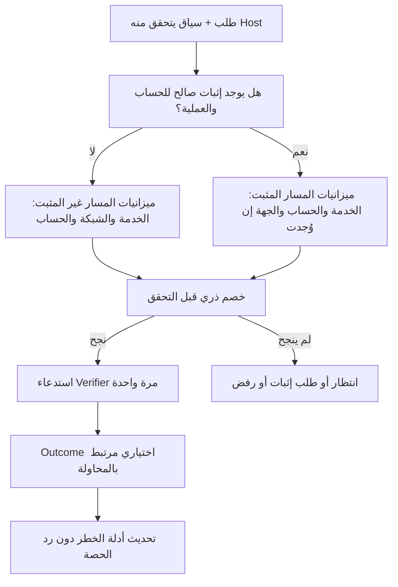

**الحكم الأساسي: لا يمكن تحقيق جميع الضمانات المطلوبة بالمعلومات الحالية وحدها.** يمكن بناء حماية أفضل كثيرًا من النموذج الموصوف، لكن لا توجد خوارزمية تستطيع تمييز مستخدم جديد عن مهاجم ينتج الإشارات نفسها، أو تمييز موظفين مستقلين عن مهاجم يمتلك حسابات وجلسات صحيحة مماثلة، دون دليل إضافي.

أوصي بمعمارية تجمع **محاسبة إلزامية قبل التحقق، وإثباتًا محدود الصلاحية للحساب والعملية، وفصلًا محسوبًا للحصص**. لكن اعتمادها يتوقف على حسم مطلب جوهري: هل يجب أن يبقى إجمالي محاولات المهاجم ثابتًا حتى عندما يملك عشرات الحسابات الصحيحة؟ إن كان الجواب نعم، فإثبات ملكية الحساب وحده لا يكفي؛ نحتاج أيضًا إلى مصدر موثوق يربط حساباته بجهة استهلاك واحدة، أو إلى قبول قيد مشترك له ضرر جانبي معلوم.

الأرقام الواردة في السؤال أتعامل معها بوصفها نتائج التجارب الموصوفة فقط. لم أفحص المستودع، ولم أشغّل تجارب جديدة، ولا أقدّم أرقامًا متوقعة باعتبارها قياسات.

---

**1. Root Cause Analysis — أين تكمن المشكلة الحقيقية؟**

المشكلة ليست اختيار Token Bucket بدل Sliding Window. المشكلة هي الخلط بين ثلاث وظائف مختلفة:

- **التعرّف:** ما الطلبات التي نستطيع ربطها ببعضها؟
- **الاستحقاق:** ما الدليل الذي يبرر منح هذه الجهة حصة مستقلة؟
- **الإنفاذ:** ما النطاق الذي يجوز تقييده عند استهلاك الحصة أو ظهور الخطر؟

عنوان IP قد يصلح لتجميع نشاط للمراقبة، لكنه لا يثبت أن مصدر هذا النشاط شخص واحد. وCookie قد تفصل مسارين من الطلبات، لكنها لا تثبت أن صاحبيهما مستقلان أو يستحقان حصتين.

| المشكلة | السبب الجذري | النتيجة |
|---|---|---|
| اعتبار IP أو IP + Browser Major هوية مستهلك | مساواة مجموعة شبكية بجهة فاعلة واحدة | أخطاء شخص أو هجومه يؤثران على الآخرين |
| تفسير A ثم B ثم A باعتباره تدويرًا | استنتاج وحدة الفاعل دون دليل يربط الجهازين | التعدد الطبيعي يتحول إلى تهمة |
| ربط بصمة LOW عبر شبكات مختلفة | إشارة قليلة التمييز تُستخدم كمعرّف قوي | دمج مستخدمين غير مرتبطين |
| تحويل تعدد الحسابات المستهدفة إلى حجب الشبكة | نطاق المراقبة تحوّل تلقائيًا إلى نطاق عقوبة | مكتب طبيعي يُعامل كمهاجم واحد |
| حصة مستقلة لكل Cookie أو UA | منح الاستحقاق بناءً على قيمة يتحكم فيها العميل | إنشاء هويات يصبح إنشاءً للحصص |
| إعفاء الجهاز المعروف | الخلط بين صحة الارتباط وسلامة السلوك | المهاجم صاحب الحسابات الصحيحة يحصل على امتياز |
| الاعتماد على الفشل اللاحق | غياب محاسبة إلزامية قبل العمل المكلف | التزامن أو غياب Outcomes يسمح بتجاوز الحماية |
| إعادة الحجب من التاريخ القديم | غياب تعريف واضح لاستهلاك الدليل وانتهاء أثره | الطلب الشرعي التالي يعيد تشغيل العقوبة |

الأسباب الأساسية هي **نقص المعلومات المميِّزة، وعدم وجود أساس مقاوم لإنشاء الهويات لمنح الحصص، وغياب حد إلزامي قبل التحقق**. أما إعادة الحجب من سجل قديم، وتقسيم الحارس بواسطة Browser Major، فهما عيوب تصميم قابلة للإصلاح، لكن إصلاحهما لا يزيل التعارض الأساسي.

كذلك، إذا كان القرار النهائي يعني: «ارفض الطلب إذا رفضته أي طبقة»، فإن أوسع طبقة حجب تستطيع إلغاء كل العدالة التي تحققها الطبقات الأخرى. لذلك يجب أن يكون عقد كل طبقة واضحًا: هل تنتج **إشارة خطر**، أم تستهلك **ميزانية**، أم تمنع **مسارًا محددًا**؟ لا ينبغي أن تنتج جميعها حظرًا عامًا قابلًا للجمع دون تمييز.

---

**2. Feasibility Boundaries — ما الذي يمكن وما الذي لا يمكن ضمانه؟**

**برهان عدم التمييز**

لنأخذ تسلسلًا من الطلبات قبل التحقق، يتضمن كل ما تستطيع المكتبة رؤيته: الشبكة، والتوقيت، والحساب المستهدف، وUA، وCookies، والبصمات، والإثباتات المتاحة.

هناك عالمان محتملان:

- في الأول، الطلبات تخص 100 مستخدم شرعي.
- في الثاني، يصنع مهاجم تسلسلًا مطابقًا في جميع المعلومات المرئية للمكتبة.

إذا كانت المدخلات والتاريخ المرئي متطابقين، فالخوارزمية الحتمية تعطي القرارات نفسها. والخوارزمية العشوائية تعطي توزيع احتمالات القرارات نفسه.

بالتالي، إذا ضمن النظام السماح بـ100 محاولة في العالم الأول، فلا يستطيع ضمان السماح بأربع فقط في العالم الثاني **ما دام لا يملك معلومة تفرق بينهما**.

وفي صيغة أبسط: إذا كان السقف الأمني هو \(b\) محاولات ضمن 100 محاولة لا يمكن تمييز أصحابها، فلا يمكن في الوقت نفسه ضمان مرورها جميعًا؛ لا بد من تأخير أو منع ما لا يقل عن \(100-b\) منها في أحد العالمين.

إضافة الوقت، أو عمر Cookie، أو ترتيب الطلبات لا ترفع هذا التعارض إذا استطاع المهاجم محاكاتها. وتوزيع الحصص بالتساوي على معرفات قابلة للإنشاء لا يحل المشكلة: المهاجم الذي ينشئ معرفات أكثر يحصل على حصة أكبر من التوزيع. هذا يتصل بمشكلة هويات Sybil، مع اختلاف تفاصيل التطبيق هنا عن نموذج البحث الأصلي. [بحث The Sybil Attack](https://www.microsoft.com/en-us/research/publication/the-sybil-attack/).

**هناك معلومتان إضافيتان مختلفتان، وليستا بديلتين لبعضهما**

| المعلومة | ما الذي تسمح بضمانه؟ | ما الذي لا تثبته؟ |
|---|---|---|
| إثبات صلاحية للحساب المستهدف والعملية المطلوبة | جلسة حساب A لا تمنح امتيازًا لمحاولة حساب B | أن صاحب A غير مهاجم، أو أنه لا يملك حسابات أخرى |
| هوية محاسبية موثوقة تجمع حسابات الجهة نفسها | وضع سقف واحد عبر الحسابات التابعة لتلك الجهة | أن الجهة لن تحصل على هويات محاسبية أخرى، إلا إذا كان الإصدار نفسه مضبوطًا |

المعلومة الأولى قد يوفرها الـHost من جلسة حالية، أو مفتاح جهاز سبق ربطه بالحساب، أو تحقق مستقل من قناة مرتبطة بالحساب. لكن **سجل «هذا الجهاز استُخدم سابقًا» وحده ليس إثبات حيازة حاليًا**.

المعلومة الثانية قد تتوافر داخل مؤسسة لديها هويات موظفين مُدارة، أو منصة تعرف جهة التعاقد التي تتبعها عدة حسابات. لا يجوز افتراض وجودها في مكتبة عامة، ولا اختراعها من IP أو Fingerprint.

**بالنسبة للمستخدم الجديد**

يجب التمييز بين:

- **متصفح جديد لحساب موجود:** قد يستطيع تقديم إثبات مستقل عبر وسيلة مرتبطة بالحساب.
- **زائر مجهول تمامًا، بلا حساب أو وسيلة سابقة أو استحقاق موثوق:** لا توجد معلومة تميّزه عن هوية جديدة صنعها المهاجم.

في الحالة الثانية، الخيارات المتاحة هي حصة مشتركة، أو انتظار، أو تكلفة إضافية، أو تفاعل إضافي. لا يوجد ضمان مطلق للسماح بالأبرياء وحدهم.

CAPTCHA أو Proof of Work قد يرفعان تكلفة الهجوم، لكنهما لا يثبتان استقلال الأشخاص، ولا يعطيان حدًا ثابتًا لمحاولات مهاجم ذي موارد غير محدودة. وتصف OWASP الـCAPTCHA باعتباره دفاعًا إضافيًا يمكن تجاوزه آليًا أو بخدمات حل خارجية. [OWASP Authentication Cheat Sheet](https://cheatsheetseries.owasp.org/cheatsheets/Authentication_Cheat_Sheet.html#captcha).

**حد آخر: الموارد المشتركة**

حتى مع هويات مثالية، لا يمكن ضمان خدمة غير محدودة على موارد محدودة. حماية حصة مستخدم من الاستنزاف المنطقي لا تعني ضمان وصوله أثناء تشبع الشبكة أو قاعدة البيانات أو Verifier.

لذلك سأفصل بين:

- عدم استهلاك المهاجم **الحصة الخاصة بالمستخدم**.
- استمرار وجود **قدرة تشغيلية كافية** لخدمته.

---

**3. Alternative Designs — أربعة بدائل مختلفة**

**البديل الأول: محاسبة مسبقة هرمية بالإشارات الحالية**

كل محاولة تستهلك قبل التحقق من حدود مشتركة ثابتة: الخدمة، والشبكة، والحساب المستهدف، وربما حدود فرعية للعميل. لا يمنح Device ID حصة مستقلة تتجاوز الآباء.

- **الثقة:** الـHost يحدد الشبكة والحساب المستهدف؛ معرف العميل ضعيف.
- **الهوية:** حساب مستهدف أو نطاق استهلاك، دون ادعاء معرفة الشخص.
- **التجميع بين الحسابات:** حارس الشبكة والخدمة.
- **الحجب:** عند نفاد أي ميزانية لازمة للمسار.
- **المستخدم الجديد:** يدخل الحصة المشتركة نفسها.
- **التدوير:** تغيير UA أو Cookie لا يغيّر الآباء.
- **قبل التحقق:** حد عددي حقيقي إذا كان الخصم ذريًا.
- **Outcomes:** تضيف عقوبات أو تقييمًا، لكنها ليست أساس الحد.
- **التكلفة:** أبسط البدائل، وتخزينه قابل للضبط.

هذا بديل جيد لتصحيح ضمانات التزامن والتدوير، لكنه **لا يحل عدالة NAT للمستخدم غير القادر على التمييز عن المهاجم**. تغيير اسم الحصة المشتركة إلى «حارس هرمي» لا يغير هذه الحقيقة.

**البديل الثاني: قبول مبني على إثبات محدود للحساب والعملية**

يوجد مسار محدود للمحاولات التي لا تحمل إثباتًا، ومسار آخر محدود لمن يثبت صلاحية محددة للحساب المستهدف. كل المسارات تحاسب قبل التحقق.

- **الثقة:** إثبات يتحقق منه الـHost، مرتبط بالحساب والعملية.
- **الهوية:** الحساب المستهدف هو حد الاستحقاق؛ الأجهزة والجلسات فروع داخله.
- **التجميع:** حارس مشترك للمحاولات غير المثبتة، وحدود للحسابات المثبتة، وسقوف للخدمة.
- **الحجب:** تقييد المسار المستنزف، مع إمكانية طلب إثبات مستقل.
- **المستخدم الجديد:** يستطيع استخدام المسار العادي أو تقديم إثبات جديد لحساب موجود.
- **التدوير:** لا تنشأ حصة حساب جديدة بتغيير الجهاز أو الجلسة.
- **قبل التحقق:** الحدود كاملة؛ Outcomes ليست شرطًا للمحاسبة.
- **التكلفة:** عقد إثبات إضافي، ومساران محاسبيان، وتفاعل محتمل مع المستخدم.

ميزته حماية المستخدم المثبت من استنزاف الشبكة. عيبه أن المهاجم صاحب حسابات صحيحة يستطيع استهلاك حصص تلك الحسابات. **هذه زيادة يجب حسابها، لا تسميتها حركة موثوقة ثم تجاهلها.**

**البديل الثالث: استحقاقات مرتبطة بجهة محاسبية موثوقة**

يقدم الـHost معرّف جهة موثوقًا يجمع كل حساباتها، ثم تُوزع ميزانيتها على الحسابات والجلسات.

- **الثقة:** نظام إصدار هويات أو استحقاقات مستقل عن المدخلات الحرة للمهاجم.
- **الهوية:** الجهة المحاسبية، لا المتصفح ولا الحساب وحده.
- **الاستهلاك:** كل حسابات الجهة تخصم من ميزانية أصل واحدة.
- **التجميع:** مباشر عبر الحسابات دون اعتماد على IP.
- **الحجب:** يقع على الجهة أو العملية المستنزفة.
- **المستخدم الجديد:** يحتاج إلى الحصول على استحقاق من جهة الإصدار؛ وإلا يعود لمسار مجهول محدود.
- **التدوير:** لا يفيد ما دام لا ينتج جهة محاسبية جديدة.
- **قبل التحقق:** يمكن ضمان السقف دون Outcomes.
- **التكلفة:** تكامل أكبر، وسياسة إصدار وإلغاء واستعادة هوية.

هذا أقوى بديل لمهاجم يمتلك 12 حسابًا **إذا ثبت أنها تتبع الجهة نفسها**. لكنه ليس حلًا عامًا يمكن لمكتبة PHP استنتاجه تلقائيًا.

**البديل الرابع: تذاكر قبول مقابل تكلفة أو تحدٍّ**

كل محاولة تحصل على تذكرة مرتبطة بالهدف والعملية، بعد حل تحدٍّ أو دفع تكلفة قابلة للتحقق.

- **الثقة:** الدليل يثبت إنجاز العمل المطلوب، لا حسن النية.
- **الهوية:** لا تحتاج إلى شخص ثابت؛ المحاسبة على التذكرة والتكلفة.
- **التجميع:** ميزانيات إصدار واستهلاك عامة، وربما ميزانيات شبكة وحساب.
- **المستخدم الجديد:** يستطيع تحصيل التذكرة دون تاريخ سابق.
- **التدوير:** لا يلغي الحاجة إلى تكلفة لكل تذكرة.
- **قبل التحقق:** التحقق من التذكرة واستهلاكها يتمان قبله.
- **Outcomes:** غير لازمة للحد الأساسي.
- **التكلفة:** احتكاك للمستخدم، واستهلاك موارد، وتحديات وصول للأجهزة الضعيفة.

إذا بقيت التذاكر تحت الحصة الشبكية نفسها، لا تختفي مشكلة الاستنزاف. وإذا تجاوزتها، يصبح لدينا مسار إضافي يجب إدخاله في حد الهجوم. لا يجوز وصفه بأنه «تعويض أمني» دون قياس قدرة المهاجم على تحصيل تذاكره.

**اختياري هو البديل الثاني، مع دعم الثالث عندما يمتلك الـHost مصدره بالفعل.** فهو يوفر أقوى فصل عملي بين أصحاب الحسابات داخل NAT دون فرض بنية إدارة هويات مؤسسية على كل مستهلك. لكنه توصية مشروطة، وليست إثباتًا أنه يحقق كل الشروط الأصلية دون مقايضة.

---

**4. Recommended Architecture — المعمارية المقترحة**

الفكرة المحورية: **هوية العميل تساعد على ربط الطلبات؛ أما حق الوصول إلى حصة محمية فيحتاج إلى إثبات محدد، وتظل الحصة نفسها محدودة.**

**أ. إعادة تعريف دور الطبقات الحالية**

| العنصر الحالي | الدور المقترح |
|---|---|
| K1: الشبكة | تجميع الخطر وتقييد المسار غير المثبت؛ لا إثبات وحدة الفاعل |
| K2: IP + Browser Major | تحليل اختياري؛ لا يكون أصلًا يمنح حصة جديدة أو حظرًا مستقلًا للجميع |
| K3: IP + Fingerprint | إشارة ضعيفة وربما حد فرعي؛ ليست هوية أمنية |
| K4: الحساب | حدود ثابتة عبر الشبكات، مع فصل حصص المحاولات المثبتة وغير المثبتة |
| K5: الحساب + الجهاز | تاريخ علاقة وحدود فرعية تحت الحساب؛ تغيير الجهاز لا يعيد ميزانية الحساب |
| Client Instance ID | ربط سياق العميل وتاريخه؛ لا يمنح استحقاقًا بمجرد وجوده |

لا أنقل القرار القديم نفسه إلى مفتاح جديد. مثلًا: لا يصبح «IP + Cookie» حصة مستقلة لمجرد أن Cookie موقعة. توقيعها يثبت أن الخادم أصدرها، وليس أن الخادم أصدر واحدة فقط لكل شخص.

**ب. ما الإثبات المقبول؟**

الإثبات يعني تقريبًا:

> تحقق الـHost من أن مقدم هذا الطلب يمتلك صلاحية بالمستوى المطلوب لإجراء العملية O على الحساب A، ضمن مدة محددة.

يلزم أن يرتبط بـ:

- نطاق التطبيق أو المستأجر.
- الحساب المستهدف بعد توحيد هويته.
- العملية أو عائلة العمليات المسموح بها.
- مستوى الإثبات ومصدره.
- الصلاحية الزمنية والإلغاء.
- سياق الاستخدام أو الحامل، بحسب نموذج الـHost.

يمكن أن يكون التحقق داخليًا في التطبيق؛ لا يلزم أن تصدر المكتبة JWT أو تبني نظام جلسات جديدًا.

أمثلة ممكنة: جلسة حالية يقر الـHost بصلاحيتها لهذه العملية، أو إثبات حيازة مفتاح مرتبط بالحساب، أو تحقق مستقل من قناة حساب. يتيح WebAuthn مثلًا إثباتًا تشفيريًا مرتبطًا بتحدٍّ، لكن صلاحية استخدامه لهذا القرار تظل مسؤولية الـHost. [مواصفة WebAuthn](https://www.w3.org/TR/webauthn-2/).

هناك أربعة قيود حاسمة:

1. إثبات الحساب A لا يصلح للحساب B.
2. إثبات تسجيل الدخول لا يمنح تلقائيًا صلاحية تغيير وسيلة الاسترداد.
3. تجديد الإثبات أو الجلسة لا يجدد الميزانية.
4. الإثبات يثبت صلاحية أو حيازة، وليس براءة صاحبه. الحسابات والجلسات المسروقة تدخل ضمن الحسابات التي يستطيع المهاجم تقديم إثبات لها.

كما أن الحصول على الإثبات نفسه له تكلفة وحدود. نقل التخمين من Password Verifier إلى OTP Verifier دون حمايته ليس علاجًا.

**ج. مساران محاسبيان ثابتان**

أسمي المسار بلا إثبات **U**، والمسار ذي الإثبات المقبول **P**.

| المسار | الحدود اللازمة |
|---|---|
| U | حد مشترك للخدمة، وحد للشبكة، وحد للحساب المستهدف، وحدود فرعية اختيارية للعميل |
| P | حد مشترك مخصص لهذا المسار، وحد للحساب والعملية، وحد للجهة المحاسبية إن توفرت |
| الاثنان | سقف موارد التشغيل، وضبط تكلفة العملية، ومحاسبة قبل التحقق |

كل الأجهزة والجلسات التي تستخدم P للحساب نفسه تشترك في ميزانية الحساب نفسها.

تُحجز حصة P للحساب بحيث لا يستطيع مهاجم بلا إثبات استهلاكها بإرسال محاولات U ضد ذلك الحساب. لو استخدمنا عداد حساب واحدًا يستطيع U استنزافه بالكامل، لأعدنا مشكلة تعطيل الضحية على مستوى الحساب.

لذلك يكون الحد الكلي المعلن للحساب هو مجموع الحدود المخصصة للمسارين، أو تقسيمًا محددًا مسبقًا من حد كلي. **لا توجد حصة محمية سرية خارج الحساب الأمني.**

ولا تنتقل الحصة غير المستخدمة من P إلى U تلقائيًا، ولا يؤدي نجاح مستخدم إلى زيادة U.

**لكن الفصل لا يلغي نتيجة التجربة D.** إذا كانت الحركة الشرعية تستهلك سابقًا الحصة المشتركة، ثم توقفت عن استهلاكها، فقد يجد المهاجم مساحة أكبر داخل U حتى لو لم يتغير سقف U. يجب قياس ذلك مقابل المرجع، لا الاكتفاء بالقول إن السقف ثابت.

**د. حدود الهجوم بصورة صريحة**

ليكن \(U_n(T)\) الحد الأقصى للمحاولات غير المثبتة من شبكة \(n\) خلال فترة طولها \(T\)، و\(U_\Sigma(T)\) حد هذا المسار على الخدمة.

يمكن تمثيل حد محاسبي قابل للتنفيذ بالشكل:

\[
Q(T)=\lfloor B+rT \rfloor
\]

حيث \(B\) سماح الدفعة و\(r\) معدل التجدد. ويمكن فرض أكثر من حد زمني معًا؛ حينها يؤخذ الأشد.

لمهاجم يستخدم مجموعة شبكات \(N\):

\[
A_U(T)\le
\min\left(
U_\Sigma(T),
\sum_{n\in N}U_n(T)
\right)
\]

وتضيف حدود الحسابات المستهدفة قيودًا أخرى.

إذا كان يستطيع تقديم إثباتات لمجموعة حسابات \(M\):

\[
A_P(T)\le
\min\left(
P_\Sigma(T),
\sum_{a\in M}P_a(T)
\right)
\]

ومن ثم:

\[
A_{\text{attacker,total}}(T)\le A_U(T)+A_P(T)
\]

**هذا الإجمالي يشمل محاولاته على حساباته، بما فيها النجاحات.** لا أستبعدها لتحسين النتيجة.

إذا تساوت حصص الحسابات المثبتة عند \(p(T)\)، فالمساهمة المحتملة للمسار P تكون:

| عدد حسابات المهاجم | حد مساهمة P |
|---:|---:|
| 0 | 0 |
| 1 | \(\min(P_\Sigma,p)\) |
| 2 | \(\min(P_\Sigma,2p)\) |
| 5 | \(\min(P_\Sigma,5p)\) |
| 12 | \(\min(P_\Sigma,12p)\) |
| 50 | \(\min(P_\Sigma,50p)\) |

إذا ربطت جهة محاسبية موثوقة هذه الحسابات كلها، يُضاف حد تلك الجهة، فيمنع زيادة الحصة بمجرد زيادة حساباتها. دون هذه المعلومة، لا يمكن للمكتبة اختراع هذا التجميع بأمان.

أما المحاولات ضد حسابات **لا يملك المهاجم إثباتًا لها**، فتبقى داخل U. تلك فائدة حقيقية، لكنها ليست مساوية لضمان ثبات الإجمالي عبر جميع حساباته.

**هـ. فصل أدلة الخطر عن رصيد المحاولات**

كل الحركة تدخل الرصد، بما فيها P. لكن الرصد لا يمنح رصيدًا ولا يرد رصيدًا.

- نجاح الحساب A لا يمحو إخفاقات الحساب B.
- لا يوجد رد لحصة المحاولة عند النجاح.
- لا يوجد رد عند فقد Outcome.
- إنشاء جلسة جديدة أو تغيير مفتاح الجهاز لا ينشئ حصة حساب جديدة.
- التاريخ الهادئ قد يقلل الاحتكاك داخل حدود مقررة؛ لا يرفع سقف الهجوم تلقائيًا.

تعدد الحسابات، وتغير البصمات، والفشل، والتزامن إشارات مفيدة، لكن أثرها يجب أن يتناسب مع قوة نسبتها إلى فاعل محدد.

مثلًا: تعدد الحسابات من IP واحد قد يطلب إثباتًا في U أو يشدد ميزانيته. لا يثبت أن كل صاحب إثبات مستقل داخل الشبكة يجب حجبه.

وعند انتهاء عقوبة، لا يكفي وصول طلب جديد لإعادة تفعيلها من الشاهد نفسه بلا حد. يجب تحديد نافذة الدليل، ومدة أثره، وشروط التصعيد الجديدة. الطلبات المرفوضة لا تمدد العقوبة بلا نهاية لمجرد أنها وصلت.

**و. المحاسبة قبل التحقق**

العملية الأمنية ليست «اقرأ العداد ثم اسمح». هي:

1. التحقق من السياق والإثبات.
2. تحديد جميع الميزانيات اللازمة.
3. فحصها وخصم تكلفة المحاولة ذريًا.
4. تسجيل أن هذه المحاولة استهلكت حق استدعاء واحد.
5. السماح للـHost باستدعاء Verifier مرة واحدة.

الخصم نهائي بالنسبة إلى ميزانية المعدل. إذا تعطل العامل قبل استدعاء Verifier، قد تضيع محاولة مسموحة، لكن لا تُنشأ محاولة إضافية.

عند ضياع الرد من Redis، لا يُفترض النجاح. وفي إعادة المحاولة بالمعرّف نفسه، يجب ألا يحصل عامل آخر على تصريح ثانٍ لاستدعاء Verifier. المحاولة الجديدة تستهلك خصمًا جديدًا.

هذا يفضّل السلامة العددية على استرجاع كل فرصة ضائعة. لا توجد معاملة ذرية عامة تجمع Redis واستدعاء Password Verifier داخل عملية أخرى، ولذلك يلزم عقد واضح مع الـHost بشأن التنفيذ مرة واحدة وعدم إعادة تشغيل التحقق من إيصال قديم.

ومن الأفضل أن توفر المكتبة غلافًا ينفذ التحقق داخل مسارها المضبوط، مع إبقاء واجهة منفصلة لمن يحتاجها.

**ز. التزامن وRedis**

لنسخة أولى قابلة للإثبات، أوصي بوضع مفاتيح الميزانيات المتداخلة داخل **نطاق ذري واحد**: Redis واحد، أو Hash Slot واحد لكل نطاق أمني مستقل.

لا يكفي تجميع مفاتيح الحساب حسب الحساب ومفاتيح الشبكة حسب IP ثم الادعاء بأن Lua جمعتها ذريًا عبر Cluster. توضح وثائق Redis كيفية استخدام Hash Tags لتجميع مفاتيح العمليات متعددة المفاتيح في slot واحد. [Redis Cluster specification](https://redis.io/docs/latest/operate/oss_and_stack/reference/cluster-spec/#hash-tags).

تضمن Lua عدم تداخل تنفيذ السكربت مع عمليات أخرى أثناء تنفيذه. لكن هذا لا يبرر افتراض Rollback عام عند أي خطأ؛ يجب فحص المدخلات والأنواع، وعدم إرجاع السماح بعد فشل أو تنفيذ جزئي. [Redis scripting](https://redis.io/docs/latest/develop/programmability/eval-intro/).

هذه البنية لها تكلفة: النطاق الأمني الكبير يصبح نقطة ضغط. التوسع لاحقًا ممكن بتقسيم ميزانيات مسبق يحفظ مجموعها، لكنه بروتوكول إضافي يحتاج إثباتًا. التقسيم العشوائي للعدادات ليس حلًا مكافئًا.

كذلك يوجد فرق بين:

- عدد تصاريح الوصول التي صدرت.
- عدد استدعاءات Verifier الجارية فعليًا.

انتهاء TTL لحجز التزامن لا يثبت أن العامل توقف عن تنفيذ التحقق. لضمان حد صارم للأعمال الجارية، يحتاج الـHost إلى مهلة تنفيذ قابلة للإنفاذ أو آلية إيقاف مناسبة.

ويجب منع تخزين التصاريح ثم استخدامها في دفعة متأخرة. توضع المحاسبة عند بوابة التنفيذ، مع صلاحية قصيرة. وإذا كان هناك تأخير مسموح \(\delta\) بين الخصم والتنفيذ، فيدخل هذا التأخير في برهان حدود النوافذ الزمنية، بدل مساواة وقت الخصم بوقت التنفيذ دون إثبات.

**ح. التخزين المحدود**

لا تكفي TTL وحدها؛ يستطيع مهاجم إنشاء عدد هائل من المفاتيح قبل انتهاء أي منها.

أقترح:

- سجلات دقيقة للحصص الأمنية، مع سقف لعدد الحالات النشطة.
- إنشاء حالة جديدة عند قبول عمل محدود بالميزانيات العامة، لا لكل قيمة عشوائية مرفوضة.
- هياكل محدودة الحجم لإحصاءات الخطر؛ لا تعتمد الحدود الصارمة على تقديرات احتمالية.
- إيصالات قصيرة العمر بعدد محدود بالمعدل المسموح وفترة الاحتفاظ.
- عدم حذف دين ميزانية قبل انتهاء أثره الأمني.
- عدم السماح لإخلاء الذاكرة بأن يحول حالة مستنزفة إلى عميل جديد كامل الحصة.
- عند امتلاء السعة: قرار معلوم يطلب إثباتًا أو يؤجل؛ لا إنشاء غير محدود ولا Reset صامت.

لا تُخزن كلمات المرور أو OTP أو مشتقات يمكن استخدامها لاختبارها. تُستخدم معرفات معتمة للحسابات والشبكات، وتكون سجلات التشخيص محدودة المدة. الترميز باستخدام HMAC يقلل كشف البيانات في المفاتيح، لكنه لا يجعل البيانات غير شخصية تلقائيًا.

**ط. الأعطال والنشر والتدوير**

| الحالة | السلوك المقترح |
|---|---|
| Redis غير متاح | لا سماح جديد في النمط ذي الضمان الصارم؛ إرجاع عدم توفر الحماية |
| نتيجة عملية Redis مجهولة | عدم استدعاء Verifier حتى حسم الإذن؛ لا افتراض ALLOW |
| Fallback محلي لكل Worker | غير مقبول باعتباره الضمان نفسه؛ قد يضاعف الحصة بعدد Workers |
| Failover يفقد خصومات سابقة | سقوط افتراض الحد الصارم؛ يلزم بروتوكول استعادة يحافظ على الدين أو توقف مضبوط |
| إصدارات مختلفة | بروتوكول حالة متوافق ومصدر سياسة موحد؛ لا ميزانيات مستقلة لكل إصدار |
| Rollback | مسموح فقط إلى إصدار يفهم الحالة الحالية، أو بعد انتقال مضبوط |
| غياب Cookie أو Fingerprint | استخدام U؛ لا استنتاج اتهام من الغياب |
| IPv4 وIPv6 | توحيد التمثيل، ومصدر IP موثوق، وسياسة شبكة معلنة؛ لا مساواة prefix بشخص |
| اختلاف Login وOTP | حدود منفصلة حسب العملية، مع آباء مشتركة حيث يوجد مسار تجاوز بينهما |

`WAIT` لا يحول Redis ذي النسخ غير المتزامن إلى مخزن قوي الاتساق؛ قد تُفقد كتابات أُقرّ بها أثناء Failover. لذلك لا أنسب إلى Lua ضمانًا ضد فقد الحالة بعد الأعطال. [Redis replication](https://redis.io/docs/latest/operate/oss_and_stack/management/replication/).

إذا كان المطلوب حدًا صارمًا عبر كل أعطال التخزين أيضًا، فهناك شرط تشغيلي إضافي: تخزين يحفظ الخصومات وفق نموذج أعطال معلن، أو إيقاف القبول حتى استعادة حالة آمنة مع منع الكتّاب القدامى. لا يكفي تبديل رقم epoch وبدء العدادات من الصفر.

وفي IPv6، قد تتغير العناوين المؤقتة بصورة طبيعية؛ أما فرض `/64` باعتباره مستخدمًا ثابتًا فليس استنتاجًا مشروعًا. يبقى الحساب محميًا عبر العناوين، بينما يعامل نطاق الشبكة كتجميع قابل للخطأ. [RFC 8981](https://www.rfc-editor.org/rfc/rfc8981.html).

أما تدوير الأسرار:

- تدوير مفتاح توقيع الإثبات لا يعيد الميزانيات.
- تدوير سر اشتقاق أسماء مفاتيح العدادات يحتاج ربطًا أو نقلًا محافظًا للحالة.
- لا يكفي أخذ `max(old, new)` إذا سمح النظام بخصومات مستقلة في النسختين.
- يجب منع الكاتب القديم من مواصلة إصدار حصص على حالة قديمة.
- تبقى حماية إعادة الاستخدام مستقلة عن إصدار مفتاح التوقيع.

---

**5. Threat-Model Walkthrough — السيناريوهات العشرة**

الأعداد التالية حدود مشروطة بالميزانيات، وليست نتائج تجارب. والمقصود بالحجب يشمل منع الوصول الحالي إلى Verifier أثناء انتظار أو تحدٍّ؛ لا أعدّ التحدي نجاح وصول.

| السيناريو | ما الذي يصل إلى Verifier؟ | ما الذي يُمنع، والضرر الجانبي؟ |
|---|---|---|
| **1. مكتب من 100 مستخدم بنفس Browser Major** | أصحاب الإثباتات يمرون من P ضمن حصص حساباتهم وسعة P. من دون إثبات يستخدمون U | إذا كان الجميع جددًا بلا دليل إضافي، يمر ما تسمح به U فقط. الباقون يحتاجون انتظارًا أو إثباتًا. مرور 100 ليس مضمونًا بمجرد كونهم أبرياء |
| **2. مستخدمان بنفس IP وUA: A ثم B ثم A** | ثلاث محاولات عادية تُحاسب حسب مساراتها إن توفرت الحصص | لا عقوبة Churn من هذا النمط وحده. قد يقع تقييد لميزانية مستهلكة، لكن ليس لأن A عاد بعد B |
| **3. مستخدم جديد دون Cookie** | يستطيع المحاولة ضمن U. إذا حصل على إثبات مستقل لحسابه، ينتقل إلى P | Cookie الجديدة لا تمنحه رصيدًا إضافيًا. عند نفاد U وعدم وجود وسيلة إثبات، يبقى احتمال التأخير أو المنع |
| **4. مستخدم معروف يخطئ مرتين ثم ينجح** | تصل المحاولات الثلاث إذا كانت الميزانية والسياسة تسمحان بها | المحاولات الثلاث مدفوعة؛ النجاح لا يرد أول محاولتين. إذا كانت الميزانية تسمح باثنتين فقط فلا يصح وعده بأن الثالثة ستصل |
| **5. مهاجم يجرب 200 حساب دون حساب صحيح** | من شبكة واحدة: على الأكثر \(\min(200,U_n,U_\Sigma)\)، مع حدود الحسابات وأي تشديد إضافي | الباقي لا يصل. تغيير اسم الهدف لا ينشئ حصة شبكة جديدة. المستخدمون غير المثبتين في الشبكة قد يتأثرون |
| **6. مهاجم يملك 12 حسابًا و12 جلسة صحيحة** | ضد حسابات أخرى: U. ضد حساباته التي تقبل السياسة إثباتها: U زائد ما يصل إلى \(\min(P_\Sigma,\sum_{1}^{12}P_a)\) | لا تنظيف للعدادات بالنجاح ولا حصة لكل جلسة. لكن امتلاكه 12 حسابًا قد يزيد الإجمالي، ويجب تسجيل هذه الزيادة كاملة |
| **7. تغيير UA وBrowser ID في كل محاولة** | لا يتغير حد U للشبكة والخدمة. وفي P لا يتغير حد الحساب | قد يتخلص من حد فرعي ضعيف، لكنه لا يتخلص من الآباء. تغيير IP يوسع نطاق الشبكات المتاحة؛ يبقى حد الحساب والخدمة |
| **8. مهاجم داخل مكتب شرعي** | يستهلك U أو حصص حساباته المثبتة. لا يستطيع استهلاك P لحساب زميل لا يملك إثباته | يستطيع دفع زملائه غير المثبتين إلى التحدي. وقد يضغط الموارد العامة. الفصل يحمي الحصة الخاصة، ولا يضمن الإتاحة المطلقة |
| **9. دفعة من 100 محاولة متزامنة** | إذا كانت كلها تحت حارس U واحد وله \(q\) وحدات متاحة، يصدر على الأكثر \(\min(100,q)\) تصريحًا قبل أي Outcome | الباقي لا يصل. وجود مسارات P يضيف حصصها المحسوبة، ولا يجوز تجاهلها في الإجمالي |
| **10. Host لا يبلغ بالنتائج** | تعمل الحدود السابقة إذا كانت عملية Pre-check تخصم ذريًا قبل التحقق | لا يوجد تعلم من الفشل أو النجاح. إذا كان Pre-check مجرد قراءة، فلا يوجد هذا الضمان. وفي Outcome-only يمكن أن تصل الدفعة كلها قبل أي تأثير |

**مثال مشتق من مطلب الإتاحة، وليس Threshold مقترحة**

إذا أردنا ضمان وصول «خطأين ثم نجاح» لكل صاحب حساب مثبت داخل الفترة نفسها، فنحن نحتاج إتاحة ثلاث محاولات لذلك الحساب، ما لم نفرض شرطًا إضافيًا يميز تلك المحاولات.

مهاجم يملك 12 حسابًا مماثلًا يستطيع عندئذ طلب:

\[
12 \times 3 = 36
\]

محاولة عبر P، إذا كانت السعة المشتركة تسمح بها، بخلاف U.

هذا ليس توقعًا لنتيجة اختبار الـ61 طلبًا؛ توقيته وحالته الابتدائية غير متاحين. لكنه يوضح أن وعد الإتاحة نفسه يحمل تكلفة أمنية قابلة للاشتقاق.

وبالنسبة للمهاجم منخفض المعدل: حد \(B+rT\) يسمح بنمو المحاولات مع الزمن. لا يثبت حدًا ثابتًا مدى الحياة. إذا كانت الميزانية اليومية أو الممتدة مهمة، يجب تمثيلها واختبارها صراحةً.

---

**6. Security vs Availability Trade-offs — المكاسب والخسائر**

المكاسب القابلة للدفاع عنها هي:

- تغيير UA وCookie لا يفتح حصصًا غير محدودة.
- النجاح لا يعيد ملء ميزانية مشتركة.
- التزامن لا ينتظر تسجيل الفشل حتى يبدأ الحماية.
- إثبات حساب لا يمنح امتيازًا ضد حساب آخر.
- مهاجم بلا إثبات للضحية لا يستطيع استنزاف حصتها المحمية.
- بصمة LOW لا تُعامل باعتبارها هوية مادية مشتركة عبر الشبكات.

لكن توجد خسائر أو حدود لا ينبغي إخفاؤها:

| الاختيار | المكسب | الثمن |
|---|---|---|
| فصل P عن الحصة الشبكية | حماية أصحاب الإثباتات من استنزاف NAT | حصة إضافية ممكنة للمهاجم صاحب الحسابات |
| إبقاء U ثابتة مع إخراج المعروفين منها | بساطة وتحديد سقف معلوم | قد تزيد الحصة المتاحة فعليًا للمهاجم مقارنة بالمرجع |
| عدم رد الخصم | منع استغلال النجاح والتعطل | ضياع بعض الفرص عند أخطاء التشغيل |
| طلب إثبات إضافي | تمييز أقوى للمستخدم الجديد لحساب موجود | تأخير واحتكاك واحتمال فشل الاسترداد |
| التوقف عند فقد التخزين | الحفاظ على الادعاء الأمني | انخفاض إتاحة المصادقة |
| ربط عدة حسابات بجهة واحدة | ضبط إجمالي المهاجم عبرها | معلومات وتكامل لا تتوافر لكل Host |

المقارنة الصحيحة لكل سيناريو \(s\) هي:

\[
\Delta A_s=A_{\text{new},s}-A_{\text{baseline},s}
\]

مع تثبيت الحمل والتوقيت والحالة الابتدائية، واحتساب كل المسارات. وكذلك نعرض تحسن إكمال المستخدمين الشرعيين، وزمنهم، وعدد التحديات التي واجهوها.

**لا أفترض أن أي \(\Delta A_s>0\) مقبول.** حتى لو انخفض معدل الحجب الجانبي بقوة، تبقى الزيادة الأمنية محتاجة اعتمادًا صريحًا. وإذا كان مطلوبًا منع كل زيادة مع الحفاظ على إتاحة جميع أصحاب الحسابات المستقلة ظاهريًا، يعود شرط الهوية المحاسبية الموثوقة أو حد الاستحالة.

---

**7. Host Integration Contract — الحد الأدنى من التكامل**

أقترح مستويين معلنين، دون تحويل غياب معلومة إلى افتراض ثقة.

**العقد الأساسي**

يوفر الـHost:

- سياق سياسة وتطبيق ثابتًا.
- الحساب المستهدف بهوية موحدة؛ فلا تتحول أسماء الدخول البديلة إلى حصص مختلفة.
- مصدر الشبكة بعد معالجة صحيحة للـTrusted Proxies.
- نوع العملية وتكلفتها المحددة من الخادم.
- معرّف محاولة غير قابل لاستخدامه لتشغيل Verifier مرارًا.
- التزامًا بألا يجري التحقق إلا بعد قبول محاسبي، وبمرة واحدة لذلك القبول.

Client Instance ID اختياري. يمكن للمكتبة توفير مساعد لإصداره، لكن غيابه أو تغييره لا يعيد الآباء ولا يمنح استحقاقًا.

**العقد الإضافي لحماية NAT**

يوفر الـHost نتيجة تحقق موثوقة من إثبات مرتبط بالحساب والعملية. تتولى المكتبة اختيار الحصة، وفحص حدودها، ومنع تحويل تجديد الإثبات إلى تجديد للرصيد.

لا يحتاج المستهلك إلى بناء Fraud Engine. لكنه يحتاج إلى معرفة ما تعنيه جلسته، وما الحساب الذي تثبت صلاحيتها له، وما العمليات التي يجوز قبولها بناءً عليها. هذه مسؤولية مصادقة لا تستطيع المكتبة استنتاجها من Cookie خام.

| نمط التكامل | الضمان |
|---|---|
| Pre-check محاسبي فقط | حد قبل Verifier، دون معرفة النتيجة |
| Pre-check محاسبي + Outcome | الحد السابق، مع تحليل نتائج وعقوبات أدق |
| Pre-check للقراءة فقط | ملاحظة حالة؛ لا حجز لحصة ولا ضمان دفعات متزامنة |
| Outcome فقط | رصد لاحق؛ لا منع مسبق للمحاولة التي حدثت |

تُربط Outcome بإيصال المحاولة، وتُقبل بطريقة تمنع التكرار أو تغيير الحساب أو تبديل نتيجة سابقة بصمت. Outcome المفقودة تبقى مجهولة؛ لا تُفسر نجاحًا، ولا تعيد الحصة.

ولا ينبغي اختزال القرار الجديد في Boolean فقط. يلزم تمييز: سماح، انتظار، إثبات مطلوب، رفض، وعدم توفر الحماية. تبقى التفاصيل التي تكشف وجود حساب أو حالته داخل التشخيص الآمن، مع رد خارجي مناسب لا يكشفها.

في OTP، يحتاج الـHost أيضًا إلى تعريف الحساب والمعاملة أو التحدي والعامل المستهدف. إعادة إصدار OTP لا تعيد سقف الحساب، ونجاح خطوة سابقة لا يبرر إعفاء عامل آخر.

---

**8. Validation Strategy — كيف نثبت التصميم قبل كود الإنتاج؟**

أبدأ بعقد قابل للدحض ونموذج حالات صغير، ثم تجارب محاكاة وتكامل. لا أبدأ بتغيير Thresholds في المكتبة الحالية.

**أ. خصائص يجب إثباتها**

1. كل استدعاء Verifier يقابله خصم صالح واحد على الأقل من جميع الميزانيات اللازمة.
2. لا يمكن استخدام قبول واحد لاستدعاءين.
3. تغيير معرف ضعيف لا يزيد سقف أي ميزانية أب.
4. تجديد الجلسة أو الإثبات لا يجدد ميزانية الحساب.
5. نجاح حساب لا ينقص استهلاكًا سابقًا لشبكة أو حساب آخر.
6. إثبات A لا يفتح P للحساب B أو لعملية خارج صلاحيته.
7. طلبات المهاجم التي لا تحمل إثبات الضحية لا تخصم من P الخاص بها.
8. مجموع الحصص التي يمنحها أي توزيع أو انتقال حالة لا يتجاوز الحد المعلن.
9. إعادة التشغيل والنشر وتدوير الأسرار لا تنشئ ميزانية نظيفة مع استمرار الميزانية السابقة.
10. الادعاء بشأن الأعطال يطابق نموذج التخزين الفعلي.

الخاصية السابعة تخص العزل المحاسبي. لا أخلطها بادعاء أن الموارد العامة لن تتشبع.

**ب. مصفوفة مهاجمين، لا سيناريو واحد**

تشمل على الأقل:

- 0 و1 و2 و5 و12 و50 حسابًا صحيحًا.
- حسابات يملكها المهاجم، وحسابات لا يملكها، ومزيجًا منهما.
- جلسة واحدة وعدة جلسات للحساب نفسه.
- Browser Major واحد و20 Browser Majors وتغييرًا مستمرًا.
- Cookie ثابتة، مفقودة، ومتجددة لكل محاولة.
- شبكة واحدة، وشبكات متعددة، وعناوين IPv6 متغيرة.
- هجومًا سريعًا، وبطيئًا، ومتزامنًا، وممتدًا عبر تجدد الحصص.
- نجاحات متعمدة بين الإخفاقات.
- مهاجمًا يختار توقيته لاستنزاف حصة المستخدمين الجدد.

ويجب أن يتكيف المهاجم مع السياسة الجديدة. إعادة تشغيل أثر هجوم قديم لا تكفي لإثبات أن التصميم يقاوم أفضل استراتيجية جديدة.

**ج. إعادة التجارب الأصلية دون خلطها**

تُعاد A وB وC وD وE كل واحدة على حدة، مع تثبيت:

- التوقيت وترتيب الوصول.
- الحالة الابتدائية والتاريخ السابق.
- عدد المستخدمين والحسابات والأجهزة.
- وضع إرسال Outcomes وتأخرها.
- ميزانيات البداية ومدة التجربة.
- إصدار المرجع وإعداداته.

ثم نضيف اختبارات ممتدة تكشف الاستنزاف البطيء وتجدد الحصص وBootstrap اليومي.

لا يُحذف طلب شرعي من المقام لأنه تحول إلى تحدٍّ، ولا يُحسب الطلب المؤجل كأنه اكتمل. وتُفصل إعادة المحاولة عن إكمال المهمة الأصلية.

**د. المقاييس المطلوبة**

| المجال | المقاييس |
|---|---|
| التعرض الأمني | عدد استدعاءات Verifier الفعلية للمهاجم، إجمالًا ولكل حساب، مفصولة إلى U وP |
| مقاومة الحسابات المتعددة | منحنى المحاولات مقابل عدد الحسابات والجلسات والشبكات |
| الإتاحة | نسبة إكمال المستخدم الشرعي للمهمة ضمن زمن معلوم |
| الضرر الجانبي | الحجب، والتحديات، والانتظار، والتخلي، خصوصًا للمستخدم الجديد وLOW |
| العدالة | أثر وجود المهاجم على كل فئة، وأسوأ مستخدم، لا المتوسط فقط |
| الموارد | تكلفة Password/OTP والتحقق من الإثباتات وإصدارها، وحجم الحالة |
| التزامن | أعلى عدد وصل قبل أول Outcome، وعدد التنفيذات لكل إيصال |
| التشغيل | سلوك التعطل والاستعادة والتدوير، وأي زيادة في الحصة |

يُسجل إجمالي محاولات المهاجم كما طلبتم، مع تفصيل يفسر أين ذهبت. لا نغيّر تعريف النجاح الأمني إلى «لم يهاجم إلا حساباته» ونحذفها من القياس.

**هـ. اختبارات الأعطال الحاسمة**

- Timeout قبل الخصم وبعده.
- توقف العامل بعد الخصم وقبل التحقق، وبعد التحقق وقبل Outcome.
- إعادة إرسال الإيصال إلى عامل آخر.
- Outcomes مكررة أو متأخرة أو متناقضة.
- خطأ نوع مفتاح أو نفاد الذاكرة أثناء العملية.
- فقد كتابة مُقرّ بها أثناء Failover.
- عودة نسخة بيانات أقدم.
- تشغيل Workers بإصدارات مختلفة.
- Rollback أثناء وجود محاولات نشطة.
- تدوير سر اشتقاق المفاتيح مع استمرار كتابة الإصدار القديم.
- إعادة استخدام إثبات بعد تغيير مفتاح توقيعه.
- انتهاء TTL قبل انتهاء دين الميزانية.
- قفزات الساعة وانحرافها، خصوصًا عند حساب التجدد.
- امتلاء حدود التخزين مع تدفق معرفات وحسابات عشوائية.

**و. متى أرفض التصميم الذي أوصي به؟**

أرفضه أو أرفض ادعاءه الأمني إذا:

- ظهرت حصص جديدة من تغيير هوية ضعيفة أو جلسة.
- انتقل امتياز الحساب إلى حساب آخر.
- تجاوز التزامن الحد المعلن.
- أدى فقد الحالة أو التدوير إلى إعادة تعبئة غير محسوبة.
- أعاد الفصل بين المسارات زيادة من نوع 13 إلى 21 أو 23، ولم تُعتمد هذه الزيادة.
- لم يوفر الـHost مسار إثبات قابلًا للاستخدام للمستخدم الجديد، بينما المنتج يعد بحمايته من حجب NAT.
- كانت زيادة \(m\times p\) للمهاجم صاحب الحسابات غير مقبولة، ولا يوجد أصل محاسبي موثوق يجمعها.
- انخفض الحجب الظاهري فقط لأن المستخدمين أصبحوا عالقين في تحديات لا يستطيعون إكمالها.

هذه ليست عتبات قبول مختلقة؛ إنها شروط صدق الادعاءات ومواطن القرار التي تحتاج بيانات واعتمادًا.

---

**9. Outstanding Questions — ما الذي يجب حسمه؟**

1. هل المطلوب سقف ثابت لإجمالي المهاجم حتى مع امتلاكه عددًا متزايدًا من الحسابات الصحيحة؟
2. هل توجد لدى أي Host هوية محاسبية تجمع حسابات الجهة نفسها بصورة موثوقة؟
3. ما مستوى الإثبات المقبول لكل من Login وOTP والعمليات الحساسة؟ وهل الجلسة الحالية كافية لكل منها؟
4. ما وسيلة المستخدم الذي فقد Cookie للوصول إلى إثبات مستقل؟ وماذا عن مستخدم بلا وسيلة سابقة أصلًا؟
5. هل التحدي والانتظار مقبولان، وما معيار إكمال المهمة الذي سنقيس به أثرهما؟
6. ما حدود الهجوم المرجعية المطلوب الحفاظ عليها، وفي أي نوافذ زمنية وحالات ابتدائية؟
7. هل المطلوب ضمان صارم عبر Failover وفقد البيانات، أم ضمان أثناء وجود مخزن حالة سليم مع توقف عند الشك؟
8. ما حجم النطاق الأمني ومعدل الطلبات الذي يجب أن يتحمله نطاق Redis الذري الواحد؟

هذه القرارات تحدد قابلية قبول المعمارية. لا يمكن تعويض غيابها باختيار أرقام تبدو معقولة.

---

**10. Final Verdict — هل أوصي بالبناء؟**

**أوصي بإعداد عقد رسمي ونموذج إثبات للبديل الثاني، ولا أوصي باعتباره حتى الآن إصلاحًا جاهزًا يحقق جميع المتطلبات أو بديلًا إنتاجيًا معتمدًا.**

Client Instance Identifier مفيد لفصل سياقات المتصفحات، ورصد تاريخها، وفرض حدود فرعية عليها. **حده الأمني هو أنه لا يمنح حصة إضافية لمجرد وجوده أو استقراره أو توقيع الخادم له.**

التغيير الضروري في فلسفة المكتبة هو فصل **التشابه بين الطلبات** عن **حق الحصول على حصة مستقلة**، وفصل **الإشارة المشبوهة** عن **صلاحية معاقبة مجموعة كاملة**، مع محاسبة لا تنتظر نتائج المصادقة.

إذا أردنا حماية المستخدم الجديد داخل NAT، نحتاج عند استنزاف الحصة المشتركة إلى دليل يستطيع هذا المستخدم تحصيله ولا يستطيع المهاجم تقديمه نيابةً عنه. وإذا أردنا أيضًا سقفًا ثابتًا للمهاجم عبر حساباته الصحيحة الكثيرة، نحتاج معلومة أقوى تجمع استهلاك تلك الحسابات، أو اعتماد مقايضة محددة.

**دون أحد هذين الشرطين، لا أوصي بوعد «حماية قوية بلا حجب جماعي وبلا زيادة لمحاولات المهاجم». هذا الوعد غير قابل للإثبات بالمعلومات المتاحة.**
