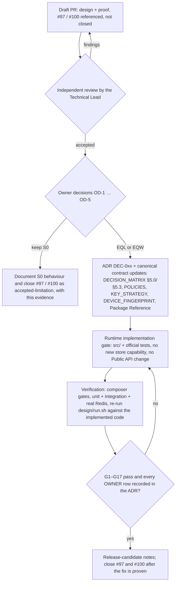

# Evidence-Qualified Correlation Enforcement (EQ) — Design & Proof for #97 / #100

**Status: DESIGN & PROOF — Draft. Nothing here is production code, an approved policy, an ADR or a canonical contract. No variant is adopted, and none is a unified ready fix** (see §1: EQL leaves #100 unfixed for access-scored policies and weakens check-only-only integrations; both are stated, measured and left to the Owner).
No change to `src/`, `tests/`, `docs/`, `DECISION_MATRIX.md`, ADRs, Composer files, CI, version or changelog. Everything lives under
`investigations/workstream-b-anti-evasion/design/`. Every number below is generated by [`run.sh`](run.sh) into
[`expected/summary.md`](expected/summary.md) (tables) and [`expected/gates.jsonl`](expected/gates.jsonl) (machine-readable gates).

Baseline: `Maatify/php-rate-limiter` `main` @ `107b795d9454a89ea5f5752d6a7ccf7053a6e7e0` (`EvaluationPipeline` sha-256 `4b259d33…f4fc`, unchanged since the
#103/#104 baseline `56f601c`).

## 0. ملخص تنفيذي (Arabic summary)

* **السؤال:** كيف نمنع الـ Correlation من معاقبة مستخدمين أبرياء مع الحفاظ على أقوى حماية ممكنة، دون كسر الـ Public API أو Redis أو تعقيد التكامل؟
* **السبب الجذري (مثبت بالتشغيل):** كاشفات §5.3 تعدّ *كل* طلب (ناجحًا أو فاشلًا، وعند `checkOnly` أيضًا) دليلًا؛ وتنتهي العقوبة (60 ث) قبل
  انتهاء الدليل (600 ث) فيتجدد الحجب من التاريخ وحده؛ وإشارة LOW (الـ UA فقط) نطاقها السكان كلهم.
* **التصميم قيد التقييم (EQL، غير معتمد):** الاكتشاف كما هو (نفس المجموعات المحدودة والـ WATCH والتدوير) ← **التأهيل** بدليل مسجَّل طازج (فشل/نشاط مُسجَّل من السياسة نفسها،
  علامة WATCH ثابتة 60 ث) ← **نطاق الإنفاذ** الأضيق المبرَّر (إشارة LOW عبر الـ IPs استشارية فقط) ← **التعافي** بلا إعادة حجب من التاريخ وحده.
* **النتيجة:** تحسّن حاسم في الـ false positives والتعافي (L1/L2/L3/D1: من 127/104/104/596 إلى **0** ردٌّ بسبب الـ correlation؛ تعافٍ في 61 ث بدل 601 ث)،
  توافق كامل مع الـ Public API وعقود Redis، دليل تزامن على Redis حقيقي. **الثمن المقاس:** (أ) تسرّب محدود ≤ 1 تحقق/60 ث لكل K2 تحت هجوم مستمر، (ب) فقدان
  حماية الـ correlation للهجمات الموزعة عبر IPs بإشارة LOW فقط (X2/X7/X2L/Y2c/X8) — وهي **حالة غير قابلة للفصل** عن مستخدمين شرعيين (A06) ⇒
  **`OWNER DECISION REQUIRED`**. لا يُنفَّذ شيء قبل اعتماد المالك والـ ADR.
* **ليس حلًّا موحدًا جاهزًا (F105-01):** EQL لا يعالج #100 في `API_OVERUSE` (كل نداء يُحسب دليلًا) ويُضعف حماية مضيفي `checkOnly` فقط (**NO-GO مقيَّد** لهذا التكامل: لا إشارة نتيجة ⇒ لا دليل). قُدِّم بديل محدود **EQV** (دليل مبني على حجم النقاط عند L1−1) يعالج الأول بثمن مقاس (فقدان حماية الـ churn منخفض الحجم في سياسات API). نافذة الدليل **ثابتة 60 ث من أول كتابة** وليست «آخر 60 ث» (F105-02).

## 1. Verdict

| Variant | Verdict | One line |
|---|---|---|
| **EQL** (base design under evaluation) | **CONDITIONAL — OWNER DECISION REQUIRED — NOT A UNIFIED READY FIX** | Passes the compatibility, fairness (Login/OTP), recovery, concurrency, rotation, bounds, failure and DEC-003 gates. Measured limits: #100 is **not** fixed for API_OVERUSE (G13), check-only-only integrations lose correlation protection (G17: scoped NO-GO), LOW cross-IP protection is removed and renewal leaks ≤ 1 verification / 60 s / K2 (G6). All need the Owner (§8). |
| EQV (bounded alternative for the API_OVERUSE shortfall) | **CONDITIONAL — OWNER DECISION REQUIRED — NOT A UNIFIED READY FIX** | EQL + a volume-qualified evidence rule for access-scored policies. Fixes #100 on API_OVERUSE (L1 113→1, D2 115→1, X4 78→1 legit denials by correlation) at a measured price: low-volume fingerprint churn on API policies is no longer stopped by correlation (X1/api 2→61 = the no-correlation control; Y7/api 3→120; D5/api 3→119). §4.1. |
| EQW (alternative) | NO-GO as a #97 fix | Keeps S0's LOW protection but does **not** fix #97 at population scale (D1: 538 of 600 legitimate requests still denied). Useful only as the Owner's fallback if LOW protection must be preserved. |
| EQN (ablation) | NO-GO | Detection and enforcement only on scored commands: loses the N-1 WATCH boundary, the IPv6 macro scope (Y9b 3→12) and makes check-only hosts blind. Kept only to show why the marker design is needed. |

The proof does **not** claim that attack and legitimate traffic can be separated: pairs with byte-identical inputs exist (A06, §6) and are treated
identically by every variant. EQ chooses *which side of that irreducible ambiguity pays*, and makes the cost explicit.

## 2. Root causes (all measured on the unpatched runtime, S0)

1. **Every request is evidence.** The churn/dilution sets are written at every command (pre-check and outcome, success or failure). Two stable colleagues behind one
   NAT (L1) satisfy the N-1 WATCH rule on their own: 127 of 134 legitimate requests denied, **zero failures involved**.
2. **Evidence outlives punishment.** The block lasts 60 s; the set lives 600 s. After expiry the stale set re-issues the block on the next request (B5: one 3-fingerprint burst
   denies a lone legitimate client until t=600; 10 block cycles for one burst) — #100's "renewable blocking".
3. **LOW confidence has population scope.** Without a client fingerprint the "fingerprint" is the hash of the normalized UA (`chrome/126`): every user of that browser
   major is one member of one scope. Any site with ≥ 6 users per 10 minutes trips it (D1: 596 of 600 legitimate logins denied; every denial attributed to correlation).
4. **Part of the collateral is not correlation at all.** K1 credential-spray (§5.1) blocks a NAT with more than five distinct accounts per 10 minutes (D2: 108 of 121 legitimate
   requests denied by independent protections, unchanged by every variant — the no-correlation control equals S0). The design must not claim to fix it.

## 3. The design (EQ → base variant EQL)

Four stages. Stage 1 is S0 untouched; stages 2–4 are the whole delta.

| Stage | Rule | Mechanism (existing capabilities only) |
|---|---|---|
| **1 Detection** | Unchanged: churn (600 s, cap 3, N-1 WATCH 1800 s), fingerprint dilution (600 s, cap 6), IPv6 macro scopes, Current/Previous bridges, ephemeral overflow. Still observed at every command. | `addDistinctBounded` / `…AcrossRotation`, `incrementWatchFlag` — exactly as S0. |
| **2 Qualification** | A trigger is *enforced* only if the same detection scope holds **fresh scored evidence**: a command that the policy itself scores (a reported failure, or any outcome of a policy with access scoring) wrote the scope's marker, and that marker is still alive. The marker has a **fixed 60 s lifetime counted from its first write** (never refreshed, §3.2) — it is *not* a sliding "last 60 s". A success never creates evidence; a request denied by an active block never creates evidence (the pipeline returns before correlation); `checkOnly` never creates evidence. | One `incrementWatchFlag(marker, 60)` per scope on a scored command; one `getWatchFlag` (current, and previous generation during rotation) only when a trigger fires. |
| **3 Enforcement scope** | Same enforcement keys as S0 (K2 for churn/macro, K3 for MEDIUM/HIGH dilution after the existing two-window confirmation). **LOW-confidence UA-only cross-IP dilution is advisory**: no state is written and nothing is enforced. Rationale: its scope is the whole UA population; narrowing it to the evidence-bearing request still punishes every typo (`narrow` option, `expected/summary.md` §4b: D1 51 of 600 legitimate requests denied, attacker reach equal to the no-correlation control in every stream) — so it was removed, not narrowed. | A single early `return null` before the dilution observation for LOW confidence. |
| **4 Recovery** | Block expiry no longer re-arms from history. The evidence window (60 s, fixed, never refreshed) equals the correlation block duration (`PenaltyLadder` L2 = 60 s) and ends with it; a re-block needs a **new** scored command. | Fixed-TTL WATCH marker (`CorrelationStoreInterface`: "must not refresh that TTL"). |

### 3.1 Why a marker and not the existing `added` / `accepted` / `count` / `expiresAt`

* `BoundedDistinctResultDTO{count, accepted}` (base `BoundedCorrelationStoreInterface`, required of **every** store): `accepted` is true for a new member *and* for a known member, false only for a new
  member rejected at the cap. It cannot say "this request added a member".
* `BoundedDistinctSnapshotDTO{count, accepted, added, members, expiresAt}` (additive `BoundedCorrelationSnapshotStoreInterface`): `added` is the only atomic "fresh distinct arrival" signal. Using it in the
  churn/dilution path would make the snapshot capability **mandatory for every policy** (today only the distributed-account rule requires it) — a new storage requirement, forbidden here. This is also why
  PR #104's RL latch (a "new distinct arrival" rule) had to approximate `added` with a read-then-increment pair and stayed `UNPROVEN` under concurrency.
* PR #104's PW/P2 failed concurrency exactly where they derived evidence from a read-then-increment tally (8 concurrent failures of one fingerprint inflated it to ≥ 3). EQ never compares a counter: the
  marker is an **existence** test (`> 0`), written by an atomic increment whose value is not used for any decision. The only counters EQ reads are S0's own bounded sets, unchanged.
* `expiresAt` (snapshot only) is not needed: the marker's fixed TTL *is* the window.

Proven on real Redis (D05, 8 concurrent workers × 12 rounds each): the cap holds (R3), 8 concurrent failures of **one** fingerprint never produce a block (R4), and the marker counts exactly the 8 writers in every
round (R5, no lost update). Duplicate handling, cap and TTL behaviour are S0's and are unchanged; Current/Previous rotation is proven in D03 (R1–R4) including marker continuity (R2) and no-evidence-across-rotation (R3).
A custom store that exposes only the baseline non-distributed capabilities (`BoundedCorrelationRotationStoreInterface` + `CorrelationRotationStoreInterface`, **no snapshot**) runs EQ unchanged (D03 C1).

### 3.2 Evidence-window semantics (F105-02): fixed from the first write, proved at 0 / 59 / 60 / 61 / 119 s

`CorrelationStoreInterface::incrementWatchFlag` fixes the TTL at the first mutation and forbids refreshing it. The marker is therefore a **fixed 60 s window opened by the first scored command in the scope**, not "a failure within the last 60 s". Proved on the controlled clock by `D02.B10/B11` (record-only flow, every command evaluated alone):

| Probe | S0 | EQW / EQL / EQV |
|---|---|---|
| B10: trigger reached by a *succeeding* member at +0 / +59 / +60 / +61 / +119 s after the first failing write | enforced at every offset (history alone, up to the 600 s set expiry) | enforced +0, +59; **not** enforced +60, +61, +119 |
| B11: a duplicate failure at +59 s, then the trigger at +59 vs +60 s | enforced / enforced | enforced at +59, **not** at +60 — the failure at +59 did **not** extend the window |

Impact. **Protection:** a trigger enforced *at a scored command* persists a 60 s K2/K3 block from that moment, so protection after a trigger does not depend on the window; the fixed window matters only for a trigger reached by a *non-failing* arrival while no block is active, and then only within 60 s of the **first** failure in the scope. A failure at +59 s therefore qualifies arrivals for 1 s only; the next failure (+60 s) opens a new window — which is exactly the measured renewal rate (≤ 1 verification per 60 s per K2, B8). **Recovery:** because the block is always issued at or after the marker's first write, the marker never outlives the block (it ends at or before block end), so history alone cannot re-block after expiry (B1/B5/B6, live R6). No Store contract change is involved; the earlier wording "fresh evidence within the last 60 s" was inaccurate and is corrected throughout.

## 4. A — Contract delta (Current → Proposed)

Minimum normative change: **§5.0, §5.3 and the §5.2/§5.4 cross-references**. §5.1 (spray), §5.2 (distributed account), §5.4 (new-device flood), §6, §7, §8 are untouched.

| Item | Current (S0, `DECISION_MATRIX.md`) | Proposed (EQL) | Public API / Redis impact |
|---|---|---|---|
| Correlation triggering | Bounded distinct observation at **every** command (§5.0, §5.3) | Unchanged | none |
| Evidence qualification | none: a trigger enforces | Trigger enforces only with fresh scored evidence in the detection scope (60 s fixed marker). Scored command = reported failure, or any outcome of a policy with `access > 0` | no signature change; uses `incrementWatchFlag`/`getWatchFlag` of the base `CorrelationStoreInterface` |
| Confidence handling | LOW → K2 hard block; MEDIUM/HIGH → K3 after a second window (§5.3) | LOW (UA-only) cross-IP dilution → advisory, no state, no enforcement. MEDIUM/HIGH unchanged except for qualification | none |
| Enforcement scope | LOW dilution: the whole UA population (set at cap ⇒ every request of that UA) | K2 churn / macro, K3 dilution as before; no population-wide scope | none |
| Decision semantics | HARD_BLOCK L2 / 60 s | HARD_BLOCK L2 / 60 s — **no** Soft/Advisory decision is added to the public result; "advisory" means "no candidate" | none |
| Recovery | Re-issued from the stale set until it expires (≤ 600 s) | Re-issued only by a new scored command; recovery = block expiry + 1 s (61 s vs 601 s) | none |
| WATCH (N-1) | Second observation of count N-1 within 1800 s ⇒ trigger | Unchanged (G9: all boundaries equal S0) | none |
| Rotation | Previous read-only; bridge; coordinated pairs | Marker read across generations (current, then previous); written current-only | none |
| Official / custom policies | Rules apply to every policy | Login/OTP: failures are evidence. API_OVERUSE and any policy with `access > 0`: every call is scored, so the rule cannot discriminate (see §8, OD-4) | none; custom policies need no change (`api_custom` shape proven) |
| Storage / migration | — | One new key family `…:eq:fresh:{churn\|macro\|dilution}:v1:…`, TTL 60 s, written only by scored commands. **No migration, no flush**: S0 state is read as before; stale markers do not exist | no new interface; old persisted state valid; TTL ≤ 60 s |
| Expected trade-offs | — | Fairness ↑ (Login/OTP), recovery ↑, ≤ 1 verification / 60 s / K2 leak under sustained attack, LOW cross-IP protection removed, API_OVERUSE #100 unfixed (EQL) or churn protection lost below overuse volume (EQV), check-only-only blind | — |

### 4.1 API_OVERUSE and check-only-only (F105-01): limited comparison

**API_OVERUSE (access-scored).** Every call is scored activity, so under EQL the evidence rule is always satisfied and #100 is unchanged there (L1/api 113 → 113 legit denials by correlation; D2/api 115 → 115). EQV changes only the evidence definition for policies with `access > 0`: a call is evidence only when the K2 or K3 volume score after the call reaches the near-threshold level (`L1 − 1`) — the same N-1 notion §5.0 already uses for WATCH; no new constant. Result (`expected/summary.md` §4c, G13): legit denials by correlation L1/api 113 → 1, D2/api 115 → 1, X4/api 78 → 1 (api_custom likewise → 1). Price: below that volume, fingerprint churn on an API policy is no longer stopped by correlation — X1/api 2 → 61 (= no-correlation control 61), Y7/api 3 → 120 (control 123), D5/api 3 → 119 (control 120); Login/OTP rows are identical to EQL. Whether an API policy should ever hard-block on fingerprint churn below its own overuse threshold is a policy decision (OD-4); EQV is evidence for that choice, not a recommendation.

**Check-only-only integrations — scoped NO-GO.** A host that only calls `checkOnly` reports no outcome, so no outcome-based evidence can exist. The only way to restore S0's protection for it is to treat `checkOnly` itself as evidence, which *is* S0 (the original false positives, L1 127/134). No Public-API/Redis-compatible signal distinguishes such a host (a per-policy "has any outcome ever been reported" key would be an unbounded-lifetime hot key and a heuristic, rejected). Measured loss in the check-only flow (G17): X2 6→121, Y9a 2→31, Y9b 3→12, Y1 8→16. Stated as **NO-GO for this integration within the constraints**; the documented lifecycle (`checkOnly` then `recordFailure`/`recordSuccess`) is the input of the evidence model.

## 5. B — What ran (reproducible)

`bash investigations/workstream-b-anti-evasion/design/run.sh` — builds the isolated candidate tree from `git archive` of the baseline + [`patches/eq-candidates.patch`](patches/eq-candidates.patch) (one file, only private members
added; hash-pinned; refusals proven by self-tests), runs, for each of **S0 / EQN / EQW / EQL / EQV**: the matrix (36 streams: the published L1–L4/X1–X8 and PR #104 Y-series **unchanged**, plus D1–D7 added by this design; Login with
account in three Host flows — `pre+out`, record-only `out`, check-only `pre` — and login-anon, OTP, API_OVERUSE, custom API_OVERUSE), recovery/renewal/boundaries, rotation/ephemeral/backend failure/custom store, bounded
state and per-command operation counts, public-API fingerprint, PR #104's A06 (indistinguishability) and A07 (DEC-003 behaviour) **unchanged**, and the real-Redis stage (concurrency, TTL hygiene, live recovery on the
Redis clock). `report.php` turns the evidence into 17 gates + a verdict and **fails closed** (exit 5) on missing/empty/malformed evidence. Seven mutation self-tests (remove qualification / marker, lengthen window,
drop previous-generation read, re-enable LOW enforcement, remove correlation from S0, move the DEC-003 boundary), two provenance refusals, four build-recipe refusals and ten fail-closed cases (including the deletion of A06's four assertions while its four pair rows remain, F105-03, and of the B10/B11 window rows) must be **detected** or the run fails.

Controls that prevent S0/candidate mixing: each file asserts the sha-256 of the pipeline it actually loaded (S0 = repository file, candidates = pinned patched copy outside `src/`); S0 numbers are asserted equal to PR #104's published
`expected/a01_matrix.S0.jsonl` (G16); every matrix row carries a paired *no-correlation* control run, and G3 requires that control to equal S0 in every cell (the patch changes nothing outside correlation).

## 6. C — Security regression (EQL vs S0; Login, precheck + outcome; full tables in `expected/summary.md` §3–§4)

Reach = attacker attempts reaching the protected verification / attempts. Legit = denied[of which by correlation]/attempts. *control* = reach with correlation disabled (what the independent protections alone allow).

| Stream | S0 reach | EQL reach | control | S0 legit denied | EQL legit denied | Scope | Residual |
|---|---|---|---|---|---|---|---|
| L1 NAT, 2 stable clients | – | – | – | 127[127]/134 | **0**/134 | K2 | none |
| L2 LOW population (121) | – | – | – | 104[104]/121 | **0**/121 | UA-wide→none | none |
| L3 LOW + 8 % typos | – | – | – | 104[104]/121 | **0**/121 | | none |
| D1 LOW population 600, 8 % typos | – | – | – | 596[596]/600 | **0**/600 | | none |
| D3 D1 + 8-IP botnet | 1/200 | 32/200 | 32 | 597/600 | **0**/600 | | botnet gets what independent protections allow |
| X1 churn, 1 IP | 2/61 | 2/61 | 2 | – | – | K2 | none |
| X3, Y2a, Y2b (churn, N-1, spaced) | 2 / 6 / 8 | 2 / 6 / 8 | – | – | – | K2 | none |
| X4 / X6 insider poisoning (free failures) | 0/40 | 2/40 | 2 | 79[79]/81 | **8[8]**/81 | K2 | insider pays failures |
| Y6b zero-failure re-seeding | 2/36 | 13/36 | 13 | 28[9]/30 | 19[**0**]/30 | | correlation part 9→0 |
| Y4c sustained poisoning, 1 failure/61 s | 2/30 | 7/30 | 7 | 28[5]/30 | 26[3]/30 | K2 | poisoning still works **at the cost of one failing request / 61 s** |
| Y1 (4-IP pool, fresh fp+account) | 8/121 | 16/121 | 16 | – | – | K2 | bounded renewal |
| Y7 fixed-pool cycler | 3/241 | 6/241 | 7 | – | – | K2 | bounded renewal (S0 and RL also stop it; RL loses it, EQL keeps it) |
| Y9a / Y9b IPv6 /64, /48 | 2/31, 3/12 | 6/31, 6/12 | 31, 12 | – | – | macro→K2 | bounded renewal |
| D5 churn + success padding | 3/122 | 4/122 | 5 | – | – | K2 | padding cannot cancel evidence |
| D7 persistent attacker 30 min | 4/1801 | 8/1801 | 10 | – | – | K2 | bounded (B8: 31 vs 4 verifications for a 1-IP, 1801 s, fresh-fp-per-second attacker) |
| **X2, X7 (LOW distributed, new IP each)** | **6/121** | **121/121** | 121 | – | – | UA-wide | **removed — OWNER DECISION** |
| **X2L, X8, D4 (LOW + legit sharing the UA)** | 5, 4, 0 | 121, 32, 4 | 121, 32, 4 | 29/30, 49/50, 596/600 | **0**, **0**, **0** | | **removed — OWNER DECISION** |
| Y2c (LOW N-1 hover) | 18/20 | 20/20 | 20 | – | – | | removed (same class) |

Per-flow facts: `pre+out` and record-only `out` carry the evidence; **check-only-only integrations** (a host that never reports an outcome) lose correlation enforcement (X2 6→121, Y9a 2→31, Y9b 3→12 in `pre`): they never
tell the library about failures, so they also get no K2/K4/K5 scoring; the documented lifecycle (`USAGE_GUIDE.md`: `checkOnly()` then `recordFailure()`/`recordSuccess()`) is the evidence model's input. **API_OVERUSE**: every call is scored,
so EQ ≡ S0 for NAT churn there (L1: 127[113] → 127[113] — #100 is **not** fixed for access-scored policies; only the LOW part changes: L2/L3/D1 → 0).

### 6.1 Indistinguishability (A06, re-run on every variant)

Four attacker/legitimate pairs carry byte-identical `(t, ip, UA, fingerprint, account, outcome)` streams and are treated identically by S0, EQN, EQW and EQL: cookie-clearing colleagues mistyping vs a fingerprint-rotating
insider; a password-expiry failure wave vs distributed LOW guessing (**the X2 class**); a shared account between typos vs success padding; a roaming device vs a replayed fingerprint. Host outcomes are attacker-forgeable
(X7), so a *success* can never exonerate — EQ therefore uses only failures as evidence and never uses successes to cancel it (D5). A design that separates those pairs needs a new trusted input (attested outcome / signed device
token): out of scope, not recommended here.

## 7. D — Complexity & developer experience

| Dimension | EQL vs S0 |
|---|---|
| Runtime overhead | none on the success path (identical call count: 10 per `checkOnly`+`recordSuccess`); LOW success path −2 calls (LOW dilution skipped); a failing request +2 atomic calls (churn marker, dilution marker; +1 per active IPv6 macro scope); a trigger +1 or +2 reads |
| Redis calls | same primitives, same atomic scripts; **no new capability, no new Lua**. Total correlation-store calls: success 10→10, typo 11→13, LOW success 10→8, 3-failing-fingerprint attack 23→27 |
| Memory / key cardinality | S1 (3000 failing unique anchors, 1 req/s): live entries 2100→2220 (+5.7 %): marker keys ≤ 2 × failure-rate × 60 s, each fixed 60 s; sets unchanged (cap ≤ 50, TTL ≤ 1800). Success flood: 2100→2100 (no marker). Idle 2000 s ⇒ zero entries |
| Concurrency complexity | no read-then-compare on any counter; one existence test; races between a marker write and a read at the boundary are benign (either ordering is a valid history) |
| Operational failures | marker write/read failures propagate exactly like S0's set failures (D03 F1b/F1c; never ALLOW, never a silent skip) |
| Host configuration burden | **none**: no parameter, callback or flag; the Default Builder and presets behave as before; hosts already follow `checkOnly` → outcome |
| Code size | one private helper block (~70 added lines, no removed lines) in `EvaluationPipeline` |

## 8. Owner decisions required (no policy is selected here)

| # | Decision | Evidence | Options |
|---|---|---|---|
| **OD-1** | LOW (UA-only) cross-IP dilution: **advisory (EQL)**, **wide with fresh evidence (EQW)**, or **keep S0** (the `narrow` option is dominated: §3 stage 3) | S0 protects X2/X7 (6/121) by denying the *whole UA population* (D1 596/600; D3 597/600). EQL removes both; EQW keeps ~15/121 but still denies 538/600 (D1) | EQL recommended: the protection and the collateral are one mechanism, the pair is indistinguishable (A06 I2), and the independent protections (K1 spray, K4/K5, K2 missing-fp score) are untouched (G3). EQW only if LOW protection is judged more valuable than #97 |
| **OD-2** | Accept the sustained-attack bound ≤ 1 verification / 60 s / K2 (B8: 31 vs 4 over 30 min) and the 60 s evidence window = L2 block duration | Derived, not fitted; recovery needs it | Alternative (not implemented): escalate a re-issued qualified block along `PenaltyLadder` (L3 300 s) — lowers the leak, raises poisoning cost for the legitimate NAT |
| **OD-3** | Check-only-only integrations: **scoped NO-GO** (no correlation enforcement; not compensable within the API/Redis constraints, §4.1) | `pre` flow numbers in G17 | accept + document the lifecycle requirement, or keep S0 for the whole policy |
| **OD-4** | API_OVERUSE (access-scored): keep EQL (S0's NAT-churn behaviour, #100 unfixed there), adopt the volume rule **EQV**, or keep S0 | §4.1, G13, `expected/summary.md` §4c | EQV fixes #100 on API at the measured price above; both are policy choices on thresholds already in the library |
| **OD-5** | Governance: ADR (new `DEC-0xx`, no ACTIVE decision is contradicted — see §9) + canonical updates (`DECISION_MATRIX.md` §5.0/§5.3, `DEVICE_FINGERPRINT.md`, `KEY_STRATEGY.md`, `POLICIES.md`, Package Reference) **before** any runtime implementation | Decision Governance §2/§7 | — |

## 9. ACTIVE-decision preflight

DEC-003 (cycle/pause): untouched; A07 (cycle transitions, 600 s pause, no mutation under an active block, Current/Previous history) passes on every variant — fewer re-issues ⇒ fewer cycles, never different semantics. DEC-007 (K4
re-entry): no K4 persistence is added; the distributed-account rule is not modified. DEC-008 (capability classification): no capability is added; "scored command" is derived from the policy's own `ScoreDeltasDTO`.
DEC-010 (builder/composite surface), DEC-017 (timestamp domain): untouched. DEC-015 (failure semantics): backend failures on the new path propagate (D03 F1). DEC-016 (Redis clock): the marker's window is the store's fixed TTL (Redis clock);
no caller-time arithmetic is introduced; exact-boundary claims are made only on the controlled clock and one live check (R6) on the Redis clock.

## 10. Not proven / residual risks

* Streams are synthetic and small (≤ 600 users, ≤ 40 minutes); real traffic mixes are unknown. D1/D3/D4 are the only population-scale cases.
* Redis time boundaries beyond the live 63 s check (R6) are not claimed; 8-worker × 12-round concurrency is a correctness probe, not a stress test.
* IPv6 macro scopes are exercised by Y9a/Y9b and share the marker code path; macro-scope *rotation* is covered by code symmetry and the plain-K2 rotation tests only.
* Poisoning remains possible at the cost of one failing request per 61 s (Y4c/Y4e/Y4f); K1 credential-spray collateral on a shared NAT (D2) is a separate, untouched mechanism.
* API_OVERUSE #100 symptoms are unchanged under EQL and EQV trades them for lost low-volume churn protection (OD-4); check-only-only hosts are blind — scoped NO-GO (OD-3).
* The patch contains test-only fault injectors (`EQ_MUTATE`) and an env-selected variant switch: it is an experiment, not an implementation proposal for `src/`.

## 11. Follow-up flow

